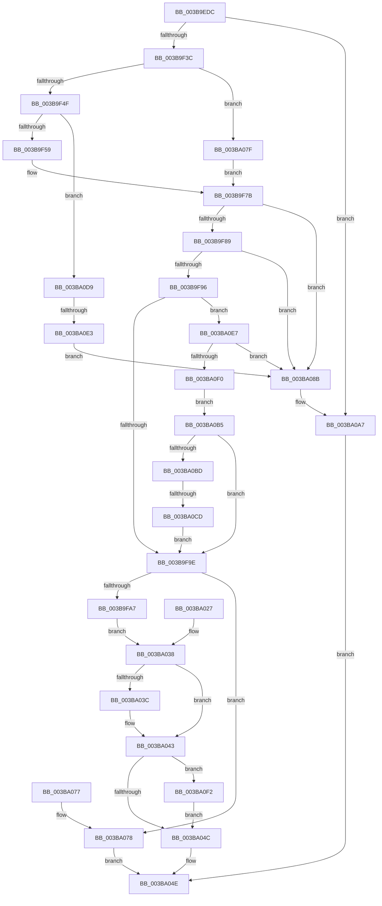

# MmQueryMemoryListInformation

- RVA: `0x003B9EDC`–`0x003BA108` (길이 `556` bytes)
- VA: `0x00000001403B9EDC`
- 실행 섹션: `.text`
- PDB 이름 있음: `예`; PDB Function 태그: `예`
- unwind 정보 RVA: `0x0008CB2C`
- 디코드: `128`개 명령, `556/556` bytes 표시
- 미해석 바이트: `0` (있으면 어셈블리에 `.byte`로 보존)

> 이 문서는 커널 이미지의 기계어와 PDB 기호를 분석해 생성했습니다. 4번과 5번은 함수 원형과 자료형을 바이너리 사용 방식에서 추정한 C 해석이며 원본 소스 복구 결과는 아닙니다.

## 1. Dependencies

- 직접 호출 지점: **6**; 고유 호출 대상: **6**
- 직접 호출자로 확인된 함수: **10**
- RIP 상대 이미지 참조: **3**

### Outgoing calls
- `0x003B9F27` → [memset](../6C/memset_function_006C6C40.md) (function, `0x006C6C40`)
- `0x003B9FAF` → [MiQueryMemoryListInformation](MiQueryMemoryListInformation_function_003BA110.md) (function, `0x003BA110`)
- `0x003BA059` → [_security_check_cookie](../6A/_security_check_cookie_function_006AC640.md) (function, `0x006AC640`)
- `0x003BA0A1` → [KeBugCheckEx](../4F/KeBugCheckEx_function_004FD660.md) (function, `0x004FD660`)
- `0x003BA0C0` → [PsReferencePartitionSafe](PsReferencePartitionSafe_function_003BA6C0.md) (function, `0x003BA6C0`)
- `0x003BA0FE` → [PsDereferencePartition](../34/PsDereferencePartition_function_00342E70.md) (function, `0x00342E70`)

### Direct callers
- [EtwpLogMemInfo](EtwpLogMemInfo_function_003B9AC0.md) at `0x003B9B32`
- [PfpMemoryListQuery](PfpMemoryListQuery_function_003B9DB8.md) at `0x003B9E17`
- [PfpPfnPrioRequest](../../page/90/PfpPfnPrioRequest_function_00902488.md) at `0x0090252D`
- [PfpVolumePrefetchMetadata](../../page/93/PfpVolumePrefetchMetadata_function_0093A158.md) at `0x0093A576`
- [PfpPrefetchPrivatePages](../../page/93/PfpPrefetchPrivatePages_function_0093A7FC.md) at `0x0093A991`
- [PfpPrefetchDirectoryStream](../../page/93/PfpPrefetchDirectoryStream_function_0093AA94.md) at `0x0093AD13`
- [PfpPrefetchFilesTrickle](../../page/93/PfpPrefetchFilesTrickle_function_0093C4E8.md) at `0x0093C65B`
- [PfpUpdateRepurposedByPrefetch](../../page/93/PfpUpdateRepurposedByPrefetch_function_0093C838.md) at `0x0093C88D`
- [PfSnCheckActionsNeeded](../../page/95/PfSnCheckActionsNeeded_function_0095F538.md) at `0x0095F6AC`
- [ExpQuerySystemInformation](../../page/A5/ExpQuerySystemInformation_function_00A57858.md) at `0x00A58E29`

### Static image references
- `0x003B9EF2` → RVA `0x00E0A740` (`.data`; read)
- `0x003B9F70` → RVA `0x00E30088` (`.data`; read)
- `0x003BA07F` → RVA `0x00E38D00` (`.data`; read)

## 2. Other-region calls and transfers

- 다른 실행 섹션으로 향하는 call: **0**
- call이 아닌 외부 분기/꼬리 이동: **2**
  - `0x003BA0C7` → [sub_006E7B00 + 0xD](../6E/Unknown_function_006E7B00.md) (`tail-transfer`)
  - `0x003BA0DD` → [sub_006E7B00](../6E/Unknown_function_006E7B00.md) (`tail-transfer`)

## 3. Assembly (complete function range)

```asm
003B9EDC  48 89 5C 24 18                  mov qword ptr [rsp + 0x18], rbx
003B9EE1  48 89 74 24 20                  mov qword ptr [rsp + 0x20], rsi
003B9EE6  57                              push rdi
003B9EE7  41 56                           push r14
003B9EE9  41 57                           push r15
003B9EEB  48 81 EC 10 01 00 00            sub rsp, 0x110
003B9EF2  48 8B 05 47 08 A5 00            mov rax, qword ptr [rip + 0xa50847]
003B9EF9  48 33 C4                        xor rax, rsp
003B9EFC  48 89 84 24 00 01 00 00         mov qword ptr [rsp + 0x100], rax
003B9F04  41 8B D8                        mov ebx, r8d
003B9F07  4C 8B FA                        mov r15, rdx
003B9F0A  48 8B F9                        mov rdi, rcx
003B9F0D  4C 8B B4 24 50 01 00 00         mov r14, qword ptr [rsp + 0x150]
003B9F15  4C 89 74 24 40                  mov qword ptr [rsp + 0x40], r14
003B9F1A  33 D2                           xor edx, edx
003B9F1C  41 B8 B0 00 00 00               mov r8d, 0xb0
003B9F22  48 8D 4C 24 50                  lea rcx, [rsp + 0x50]
003B9F27  E8 14 CD 30 00                  call 0x1406c6c40
003B9F2C  41 83 26 00                     and dword ptr [r14], 0
003B9F30  81 FB B0 00 00 00               cmp ebx, 0xb0
003B9F36  0F 82 6B 01 00 00               jb 0x1403ba0a7
003B9F3C  33 D2                           xor edx, edx
003B9F3E  40 32 F6                        xor sil, sil
003B9F41  40 88 74 24 30                  mov byte ptr [rsp + 0x30], sil
003B9F46  48 85 FF                        test rdi, rdi
003B9F49  0F 84 30 01 00 00               je 0x1403ba07f
003B9F4F  48 83 FF FF                     cmp rdi, -1
003B9F53  0F 85 80 01 00 00               jne 0x1403ba0d9
003B9F59  65 48 8B 04 25 88 01 00 00      mov rax, qword ptr gs:[0x188]
003B9F62  48 8B 88 B8 00 00 00            mov rcx, qword ptr [rax + 0xb8]
003B9F69  0F B7 89 AE 04 00 00            movzx ecx, word ptr [rcx + 0x4ae]
003B9F70  48 8B 05 11 61 A7 00            mov rax, qword ptr [rip + 0xa76111]
003B9F77  48 8B 1C C8                     mov rbx, qword ptr [rax + rcx*8]
003B9F7B  48 89 5C 24 38                  mov qword ptr [rsp + 0x38], rbx
003B9F80  48 85 DB                        test rbx, rbx
003B9F83  0F 84 02 01 00 00               je 0x1403ba08b
003B9F89  81 7B 08 40 19 36 12            cmp dword ptr [rbx + 8], 0x12361940
003B9F90  0F 85 F5 00 00 00               jne 0x1403ba08b
003B9F96  85 D2                           test edx, edx
003B9F98  0F 85 49 01 00 00               jne 0x1403ba0e7
003B9F9E  48 85 DB                        test rbx, rbx
003B9FA1  0F 84 D1 00 00 00               je 0x1403ba078
003B9FA7  48 8D 54 24 50                  lea rdx, [rsp + 0x50]
003B9FAC  48 8B CB                        mov rcx, rbx
003B9FAF  E8 5C 01 00 00                  call 0x1403ba110
003B9FB4  33 FF                           xor edi, edi
003B9FB6  48 8D 44 24 50                  lea rax, [rsp + 0x50]
003B9FBB  0F 10 00                        movups xmm0, xmmword ptr [rax]
003B9FBE  41 0F 11 07                     movups xmmword ptr [r15], xmm0
003B9FC2  0F 10 48 10                     movups xmm1, xmmword ptr [rax + 0x10]
003B9FC6  41 0F 11 4F 10                  movups xmmword ptr [r15 + 0x10], xmm1
003B9FCB  0F 10 40 20                     movups xmm0, xmmword ptr [rax + 0x20]
003B9FCF  41 0F 11 47 20                  movups xmmword ptr [r15 + 0x20], xmm0
003B9FD4  0F 10 48 30                     movups xmm1, xmmword ptr [rax + 0x30]
003B9FD8  41 0F 11 4F 30                  movups xmmword ptr [r15 + 0x30], xmm1
003B9FDD  0F 10 40 40                     movups xmm0, xmmword ptr [rax + 0x40]
003B9FE1  41 0F 11 47 40                  movups xmmword ptr [r15 + 0x40], xmm0
003B9FE6  0F 10 48 50                     movups xmm1, xmmword ptr [rax + 0x50]
003B9FEA  41 0F 11 4F 50                  movups xmmword ptr [r15 + 0x50], xmm1
003B9FEF  0F 10 40 60                     movups xmm0, xmmword ptr [rax + 0x60]
003B9FF3  41 0F 11 47 60                  movups xmmword ptr [r15 + 0x60], xmm0
003B9FF8  B9 80 00 00 00                  mov ecx, 0x80
003B9FFD  4C 03 F9                        add r15, rcx
003BA000  0F 10 40 70                     movups xmm0, xmmword ptr [rax + 0x70]
003BA004  41 0F 11 47 F0                  movups xmmword ptr [r15 - 0x10], xmm0
003BA009  0F 10 0C 08                     movups xmm1, xmmword ptr [rax + rcx]
003BA00D  41 0F 11 0F                     movups xmmword ptr [r15], xmm1
003BA011  0F 10 44 08 10                  movups xmm0, xmmword ptr [rax + rcx + 0x10]
003BA016  41 0F 11 47 10                  movups xmmword ptr [r15 + 0x10], xmm0
003BA01B  0F 10 4C 08 20                  movups xmm1, xmmword ptr [rax + rcx + 0x20]
003BA020  41 0F 11 4F 20                  movups xmmword ptr [r15 + 0x20], xmm1
003BA025  EB 11                           jmp 0x1403ba038
003BA027  8B F8                           mov edi, eax
003BA029  4C 8B 74 24 40                  mov r14, qword ptr [rsp + 0x40]
003BA02E  40 8A 74 24 30                  mov sil, byte ptr [rsp + 0x30]
003BA033  48 8B 5C 24 38                  mov rbx, qword ptr [rsp + 0x38]
003BA038  85 FF                           test edi, edi
003BA03A  78 07                           js 0x1403ba043
003BA03C  41 C7 06 B0 00 00 00            mov dword ptr [r14], 0xb0
003BA043  40 84 F6                        test sil, sil
003BA046  0F 85 A6 00 00 00               jne 0x1403ba0f2
003BA04C  8B C7                           mov eax, edi
003BA04E  48 8B 8C 24 00 01 00 00         mov rcx, qword ptr [rsp + 0x100]
003BA056  48 33 CC                        xor rcx, rsp
003BA059  E8 E2 25 2F 00                  call 0x1406ac640
003BA05E  4C 8D 9C 24 10 01 00 00         lea r11, [rsp + 0x110]
003BA066  49 8B 5B 30                     mov rbx, qword ptr [r11 + 0x30]
003BA06A  49 8B 73 38                     mov rsi, qword ptr [r11 + 0x38]
003BA06E  49 8B E3                        mov rsp, r11
003BA071  41 5F                           pop r15
003BA073  41 5E                           pop r14
003BA075  5F                              pop rdi
003BA076  C3                              ret
003BA077  CC                              int3
003BA078  B8 A0 04 00 C0                  mov eax, 0xc00004a0
003BA07D  EB CF                           jmp 0x1403ba04e
003BA07F  48 8D 1D 7A EC A7 00            lea rbx, [rip + 0xa7ec7a]
003BA086  E9 F0 FE FF FF                  jmp 0x1403b9f7b
003BA08B  48 83 64 24 20 00               and qword ptr [rsp + 0x20], 0
003BA091  4C 8B CB                        mov r9, rbx
003BA094  4C 8B C7                        mov r8, rdi
003BA097  BA 01 10 04 00                  mov edx, 0x41001
003BA09C  B9 1A 00 00 00                  mov ecx, 0x1a
003BA0A1  E8 BA 35 14 00                  call 0x1404fd660
003BA0A6  CC                              int3
003BA0A7  41 C7 06 B0 00 00 00            mov dword ptr [r14], 0xb0
003BA0AE  B8 04 00 00 C0                  mov eax, 0xc0000004
003BA0B3  EB 99                           jmp 0x1403ba04e
003BA0B5  85 D2                           test edx, edx
003BA0B7  0F 84 E1 FE FF FF               je 0x1403b9f9e
003BA0BD  48 8B CF                        mov rcx, rdi
003BA0C0  E8 FB 05 00 00                  call 0x1403ba6c0
003BA0C5  84 C0                           test al, al
003BA0C7  0F 85 40 DA 32 00               jne 0x1406e7b0d
003BA0CD  33 DB                           xor ebx, ebx
003BA0CF  48 89 5C 24 38                  mov qword ptr [rsp + 0x38], rbx
003BA0D4  E9 C5 FE FF FF                  jmp 0x1403b9f9e
003BA0D9  48 83 FF FE                     cmp rdi, -2
003BA0DD  0F 85 1D DA 32 00               jne 0x1406e7b00
003BA0E3  33 DB                           xor ebx, ebx
003BA0E5  EB A4                           jmp 0x1403ba08b
003BA0E7  48 39 BB B8 00 00 00            cmp qword ptr [rbx + 0xb8], rdi
003BA0EE  75 9B                           jne 0x1403ba08b
003BA0F0  EB C3                           jmp 0x1403ba0b5
003BA0F2  BA 4D 6D 50 6F                  mov edx, 0x6f506d4d
003BA0F7  48 8B 8B B8 00 00 00            mov rcx, qword ptr [rbx + 0xb8]
003BA0FE  E8 6D 8D F8 FF                  call 0x140342e70
003BA103  E9 44 FF FF FF                  jmp 0x1403ba04c
```

## 4. C-style interpretation (structured pseudocode)

```c
__int64 __fastcall MmQueryMemoryListInformation(__int64 a1, __int64 a2, int a3, __int64 a4, __int64 a5)
{
    __int64 result;
    __int64 v_r15;
    __int64 v_rbx;
    __int64 v_rdi;
    __int64 v_rsi;
    __int64 v_rsp;
    unsigned __int64 v_stack_m18;
    unsigned __int64 v_stack_m28;
    unsigned __int64 v_stack_mD8;
    unsigned __int64 v_stack_mE8;
    unsigned __int64 v_stack_mF0;
    unsigned __int8 v_stack_mF8;
    unsigned __int64 v_stack_p18;
    unsigned __int64 v_stack_p20;

    v_stack_p18 = v_rbx;
    v_stack_p20 = v_rsi;
    v_rsp = (v_rsp) - (272);
    result = (*(unsigned __int64 *)(v_rip + 10815559)) ^ (v_rsp);
    v_stack_m28 = result;
    v_stack_mE8 = a5;
    a2 = 0;
    result = memset(v_stack_mD8, a2, 176, a4);
    if (((unsigned int)((unsigned int)(a3))) < 176) goto loc_003BA0A7;
    a2 = 0;
    v_rsi = 0;
    v_stack_mF8 = 0;
    if (a1 == 0) goto loc_003BA07F;
    if (a1 != -1) goto loc_003BA0D9;
loc_003B9F7B:
    v_stack_mF0 = *(unsigned __int64 *)(*(unsigned __int64 *)(v_rip + 10969361) + *(unsigned __int16 *)(*(unsigned __int64 *)(*(unsigned __int64 *)(gs_base + (0 + 392)) + 184) + 1198) * 8);
    if (*(unsigned __int64 *)(*(unsigned __int64 *)(v_rip + 10969361) + *(unsigned __int16 *)(*(unsigned __int64 *)(*(unsigned __int64 *)(gs_base + (0 + 392)) + 184) + 1198) * 8) == 0) goto loc_003BA08B;
    if ((*(unsigned int *)(*(unsigned __int64 *)(*(unsigned __int64 *)(v_rip + 10969361) + *(unsigned __int16 *)(*(unsigned __int64 *)(*(unsigned __int64 *)(gs_base + (0 + 392)) + 184) + 1198) * 8) + 8)) != 0x12361940ULL) goto loc_003BA08B;
    if (0 != 0) goto loc_003BA0E7;
loc_003B9F9E:
    if (*(unsigned __int64 *)(*(unsigned __int64 *)(v_rip + 10969361) + *(unsigned __int16 *)(*(unsigned __int64 *)(*(unsigned __int64 *)(gs_base + (0 + 392)) + 184) + 1198) * 8) == 0) goto loc_003BA078;
    result = MiQueryMemoryListInformation(*(unsigned __int64 *)(*(unsigned __int64 *)(v_rip + 10969361) + *(unsigned __int16 *)(*(unsigned __int64 *)(*(unsigned __int64 *)(gs_base + (0 + 392)) + 184) + 1198) * 8), v_stack_mD8, 176, a4);
    v_rdi = 0;
    *(unsigned __int64 *)(a2) = v_xmm0;
    *(unsigned __int64 *)(a2 + 16) = v_xmm1;
    *(unsigned __int64 *)(a2 + 32) = v_xmm0;
    *(unsigned __int64 *)(a2 + 48) = v_xmm1;
    *(unsigned __int64 *)(a2 + 64) = v_xmm0;
    *(unsigned __int64 *)(a2 + 80) = v_xmm1;
    *(unsigned __int64 *)(a2 + 96) = v_xmm0;
    v_r15 = (a2) + (128);
    *(unsigned __int64 *)(v_r15 - 16) = v_xmm0;
    *(unsigned __int64 *)(v_r15) = v_xmm1;
    *(unsigned __int64 *)(v_r15 + 16) = v_xmm0;
    *(unsigned __int64 *)(v_r15 + 32) = v_xmm1;
    goto loc_003BA038;
loc_003BA038:
    if (!(sign_flag)) {
        *(unsigned int *)(a5) = 176;
    }
    if (0 != 0) goto loc_003BA0F2;
loc_003BA04C:
loc_003BA04E:
    a1 = (v_stack_m28) ^ (v_rsp);
    result = _security_check_cookie(a1, v_stack_mD8, 176, a4);
    return result;
loc_003BA078:
    goto loc_003BA04E;
loc_003BA07F:
    goto loc_003B9F7B;
loc_003BA08B:
    result = KeBugCheckEx(26, (unsigned int)(0x41001ULL), 0, v_rip + 11005050);
loc_003BA0A7:
    *(unsigned int *)(a5) = 176;
    goto loc_003BA04E;
loc_003BA0B5:
    if ((unsigned int)((unsigned int)(0x41001ULL)) == 0) goto loc_003B9F9E;
    result = PsReferencePartitionSafe(0, (unsigned int)(0x41001ULL), 0, v_rip + 11005050);
    v_rbx = 0;
    v_stack_mD8 = 0;
    goto loc_003B9F9E;
loc_003BA0D9:
    v_rbx = 0;
    goto loc_003BA08B;
loc_003BA0E7:
    if ((*(unsigned __int64 *)(v_rbx + 184)) != 0) goto loc_003BA08B;
    goto loc_003BA0B5;
loc_003BA0F2:
    result = PsDereferencePartition(*(unsigned __int64 *)(v_rbx + 184), (unsigned int)(0x6F506D4DULL), 0, v_rip + 11005050);
    goto loc_003BA04C;
}
```

## 5. (Beta) C Style

```c
int64_t MmQueryMemoryListInformation(int64_t Arg1, void *Arg2, int32_t Arg3, int64_t Arg4, void *Arg5)
{
    uint8_t *arg2 = (uint8_t *)Arg2;
    uint8_t *arg5 = (uint8_t *)Arg5;

    int64_t result;
    int64_t local_r15;
    int64_t local_rbx;
    int64_t local_rdi;
    int64_t local_rsi;
    int64_t local_rsp;
    uint64_t v_stack_m18;
    uint64_t v_stack_m28;
    uint64_t v_stack_mD8;
    uint64_t v_stack_mE8;
    uint64_t v_stack_mF0;
    uint8_t v_stack_mF8;
    uint64_t v_stack_p18;
    uint64_t v_stack_p20;

    v_stack_p18 = local_rbx;
    v_stack_p20 = local_rsi;
    local_rsp = (local_rsp) - (272);
    result = (*(uint64_t *)(v_rip + 0xA50847)) ^ (local_rsp);
    v_stack_m28 = result;
    v_stack_mE8 = Arg5;
    Arg2 = 0;
    result = memset(v_stack_mD8, Arg2, 176, Arg4);
    if (((uint32_t)((uint32_t)(Arg3))) < 176) goto loc_003BA0A7;
    Arg2 = 0;
    local_rsi = 0;
    v_stack_mF8 = 0;
    if (Arg1 == 0) goto loc_003BA07F;
    if (Arg1 != -1) goto loc_003BA0D9;
loc_003B9F7B:
    v_stack_mF0 = *(uint64_t *)(*(uint64_t *)(v_rip + 0xA76111) + *(uint16_t *)(*(uint64_t *)(*(uint64_t *)(gs_base + (0 + 0x188)) + 0xB8) + 0x4AE) * 8);
    if (*(uint64_t *)(*(uint64_t *)(v_rip + 0xA76111) + *(uint16_t *)(*(uint64_t *)(*(uint64_t *)(gs_base + (0 + 0x188)) + 0xB8) + 0x4AE) * 8) == 0) goto loc_003BA08B;
    if ((*(uint32_t *)(*(uint64_t *)(*(uint64_t *)(v_rip + 0xA76111) + *(uint16_t *)(*(uint64_t *)(*(uint64_t *)(gs_base + (0 + 0x188)) + 0xB8) + 0x4AE) * 8) + 0x8)) != 0x12361940ULL) goto loc_003BA08B;
    if (0 != 0) goto loc_003BA0E7;
loc_003B9F9E:
    if (*(uint64_t *)(*(uint64_t *)(v_rip + 0xA76111) + *(uint16_t *)(*(uint64_t *)(*(uint64_t *)(gs_base + (0 + 0x188)) + 0xB8) + 0x4AE) * 8) == 0) goto loc_003BA078;
    result = MiQueryMemoryListInformation(*(uint64_t *)(*(uint64_t *)(v_rip + 0xA76111) + *(uint16_t *)(*(uint64_t *)(*(uint64_t *)(gs_base + (0 + 0x188)) + 0xB8) + 0x4AE) * 8), v_stack_mD8, 176, Arg4);
    local_rdi = 0;
    *(uint64_t *)(arg2) = v_xmm0;
    *(uint64_t *)(arg2 + 0x10) = v_xmm1;
    *(uint64_t *)(arg2 + 0x20) = v_xmm0;
    *(uint64_t *)(arg2 + 0x30) = v_xmm1;
    *(uint64_t *)(arg2 + 0x40) = v_xmm0;
    *(uint64_t *)(arg2 + 0x50) = v_xmm1;
    *(uint64_t *)(arg2 + 0x60) = v_xmm0;
    local_r15 = (Arg2) + (128);
    *(uint64_t *)(local_r15 - 0x10) = v_xmm0;
    *(uint64_t *)(local_r15) = v_xmm1;
    *(uint64_t *)(local_r15 + 0x10) = v_xmm0;
    *(uint64_t *)(local_r15 + 0x20) = v_xmm1;
    goto loc_003BA038;
loc_003BA038:
    if (!(sign_flag)) {
        *(uint32_t *)(arg5) = 176;
    }
    if (0 != 0) goto loc_003BA0F2;
loc_003BA04C:
loc_003BA04E:
    Arg1 = (v_stack_m28) ^ (local_rsp);
    result = _security_check_cookie(Arg1, v_stack_mD8, 176, Arg4);
    return result;
loc_003BA078:
    goto loc_003BA04E;
loc_003BA07F:
    goto loc_003B9F7B;
loc_003BA08B:
    result = KeBugCheckEx(26, (uint32_t)(0x41001ULL), 0, v_rip + 11005050);
loc_003BA0A7:
    *(uint32_t *)(arg5) = 176;
    goto loc_003BA04E;
loc_003BA0B5:
    if ((uint32_t)((uint32_t)(0x41001ULL)) == 0) goto loc_003B9F9E;
    result = PsReferencePartitionSafe(0, (uint32_t)(0x41001ULL), 0, v_rip + 11005050);
    local_rbx = 0;
    v_stack_mD8 = 0;
    goto loc_003B9F9E;
loc_003BA0D9:
    local_rbx = 0;
    goto loc_003BA08B;
loc_003BA0E7:
    if ((*(uint64_t *)(local_rbx + 0xB8)) != 0) goto loc_003BA08B;
    goto loc_003BA0B5;
loc_003BA0F2:
    result = PsDereferencePartition(*(uint64_t *)(local_rbx + 0xB8), (uint32_t)(0x6F506D4DULL), 0, v_rip + 11005050);
    goto loc_003BA04C;
}
```

### 관측된 메모리 오프셋

구조체 형식이 확인되지 않은 접근은 인자 기준의 오프셋으로만 기록했습니다.

| 기준 인자 | 오프셋 표현 | 폭 (bit) | 접근 |
|---|---:|---:|---|
| `Arg2` | `- 0x10` | `128` | `R` |
| `Arg2` | `+ 0x0` | `128` | `R` |
| `Arg2` | `+ 0x10` | `128` | `R` |
| `Arg2` | `+ 0x20` | `128` | `R` |
| `Arg2` | `+ 0x30` | `128` | `R` |
| `Arg2` | `+ 0x40` | `128` | `R` |
| `Arg2` | `+ 0x50` | `128` | `R` |
| `Arg2` | `+ 0x60` | `128` | `R` |
| `Arg5` | `+ 0x0` | `32` | `R/W` |
| `Arg5` | `+ 0x0` | `32` | `W` |

## 6. Execution-region graph

[열기: 2D/3D 그래프와 함수 탐색 컨트롤 패널](../../../control-panel.html?section=text&rva=0x003B9EDC&view=graph)

- 2D 그래프는 위에서 아래로 흐르고, 3D 그래프는 빈 공간을 드래그해 회전합니다. Shift+드래그는 이동, 휠은 확대·축소, 함수 노드 선택은 대상 보고서 이동입니다.

### Static fallback


