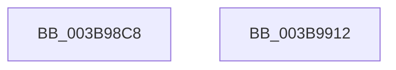

# MmQuerySystemMemoryInformation

- RVA: `0x003B98C8`–`0x003B9913` (길이 `75` bytes)
- VA: `0x00000001403B98C8`
- 실행 섹션: `.text`
- PDB 이름 있음: `예`; PDB Function 태그: `아니요`
- unwind 정보 RVA: `0x0005C788`
- 디코드: `17`개 명령, `75/75` bytes 표시
- 미해석 바이트: `0` (있으면 어셈블리에 `.byte`로 보존)

> 이 문서는 커널 이미지의 기계어와 PDB 기호를 분석해 생성했습니다. 4번과 5번은 함수 원형과 자료형을 바이너리 사용 방식에서 추정한 C 해석이며 원본 소스 복구 결과는 아닙니다.

## 1. Dependencies

- 직접 호출 지점: **0**; 고유 호출 대상: **0**
- 직접 호출자로 확인된 함수: **3**
- RIP 상대 이미지 참조: **4**

### Outgoing calls
- 직접 디코드된 call 명령이 없습니다.

### Direct callers
- [EtwpLogMemInfoTimerCallback](EtwpLogMemInfoTimerCallback_function_003B9850.md) at `0x003B9875`
- [EtwpLogMemInfoRundown](../../page/7C/EtwpLogMemInfoRundown_function_007C0144.md) at `0x007C016E`
- [PfpPrivSourceEnum](../../page/91/PfpPrivSourceEnum_function_0091BF00.md) at `0x0091C164`

### Static image references
- `0x003B98CC` → RVA `0x00E37650` (`.data`; read)
- `0x003B98D7` → RVA `0x00E2CB48` (`.data`; read)
- `0x003B98E3` → RVA `0x00E3D9C0` (`.data`; read)
- `0x003B98EF` → RVA `0x00E3D840` (`.data`; read)

## 2. Other-region calls and transfers

- 다른 실행 섹션으로 향하는 call: **0**
- 별도 외부 분기/꼬리 이동을 확인하지 못했습니다.

## 3. Assembly (complete function range)

```asm
003B98C8  48 83 EC 28                     sub rsp, 0x28
003B98CC  48 8B 05 7D DD A7 00            mov rax, qword ptr [rip + 0xa7dd7d]
003B98D3  48 89 04 24                     mov qword ptr [rsp], rax
003B98D7  48 8B 05 6A 32 A7 00            mov rax, qword ptr [rip + 0xa7326a]
003B98DE  48 89 44 24 08                  mov qword ptr [rsp + 8], rax
003B98E3  48 8B 05 D6 40 A8 00            mov rax, qword ptr [rip + 0xa840d6]
003B98EA  48 89 44 24 10                  mov qword ptr [rsp + 0x10], rax
003B98EF  48 8B 05 4A 3F A8 00            mov rax, qword ptr [rip + 0xa83f4a]
003B98F6  0F 10 04 24                     movups xmm0, xmmword ptr [rsp]
003B98FA  48 89 44 24 18                  mov qword ptr [rsp + 0x18], rax
003B98FF  33 C0                           xor eax, eax
003B9901  0F 10 4C 24 10                  movups xmm1, xmmword ptr [rsp + 0x10]
003B9906  0F 11 01                        movups xmmword ptr [rcx], xmm0
003B9909  0F 11 49 10                     movups xmmword ptr [rcx + 0x10], xmm1
003B990D  48 83 C4 28                     add rsp, 0x28
003B9911  C3                              ret
003B9912  CC                              int3
```

## 4. C-style interpretation (structured pseudocode)

```c
__int64 __fastcall MmQuerySystemMemoryInformation(__int64 a1)
{
    __int64 result;
    __int64 v_rsp;
    unsigned __int64 v_stack_m10;
    unsigned __int64 v_stack_m18;
    unsigned __int64 v_stack_m20;
    unsigned __int64 v_stack_m28;

    v_rsp = (v_rsp) - (40);
    v_stack_m28 = *(unsigned __int64 *)(v_rip + 11001213);
    v_stack_m20 = *(unsigned __int64 *)(v_rip + 10957418);
    v_stack_m18 = *(unsigned __int64 *)(v_rip + 11026646);
    v_stack_m10 = *(unsigned __int64 *)(v_rip + 11026250);
    result = 0;
    *(unsigned __int64 *)(a1) = v_xmm0;
    *(unsigned __int64 *)(a1 + 16) = v_xmm1;
    v_rsp = (v_rsp) + (40);
    return result;
}
```

## 5. (Beta) C Style

```c
int64_t MmQuerySystemMemoryInformation(void *Arg1)
{
    uint8_t *arg1 = (uint8_t *)Arg1;

    int64_t result;
    int64_t local_rsp;
    uint64_t v_stack_m10;
    uint64_t v_stack_m18;
    uint64_t v_stack_m20;
    uint64_t v_stack_m28;

    local_rsp = (local_rsp) - (40);
    v_stack_m28 = *(uint64_t *)(v_rip + 0xA7DD7D);
    v_stack_m20 = *(uint64_t *)(v_rip + 0xA7326A);
    v_stack_m18 = *(uint64_t *)(v_rip + 0xA840D6);
    v_stack_m10 = *(uint64_t *)(v_rip + 0xA83F4A);
    result = 0;
    *(uint64_t *)(arg1) = v_xmm0;
    *(uint64_t *)(arg1 + 0x10) = v_xmm1;
    local_rsp = (local_rsp) + (40);
    return result;
}
```

### 관측된 메모리 오프셋

구조체 형식이 확인되지 않은 접근은 인자 기준의 오프셋으로만 기록했습니다.

| 기준 인자 | 오프셋 표현 | 폭 (bit) | 접근 |
|---|---:|---:|---|
| `Arg1` | `+ 0x0` | `128` | `R` |
| `Arg1` | `+ 0x10` | `128` | `R` |

## 6. Execution-region graph

[열기: 2D/3D 그래프와 함수 탐색 컨트롤 패널](../../../control-panel.html?section=text&rva=0x003B98C8&view=graph)

- 2D 그래프는 위에서 아래로 흐르고, 3D 그래프는 빈 공간을 드래그해 회전합니다. Shift+드래그는 이동, 휠은 확대·축소, 함수 노드 선택은 대상 보고서 이동입니다.

### Static fallback


