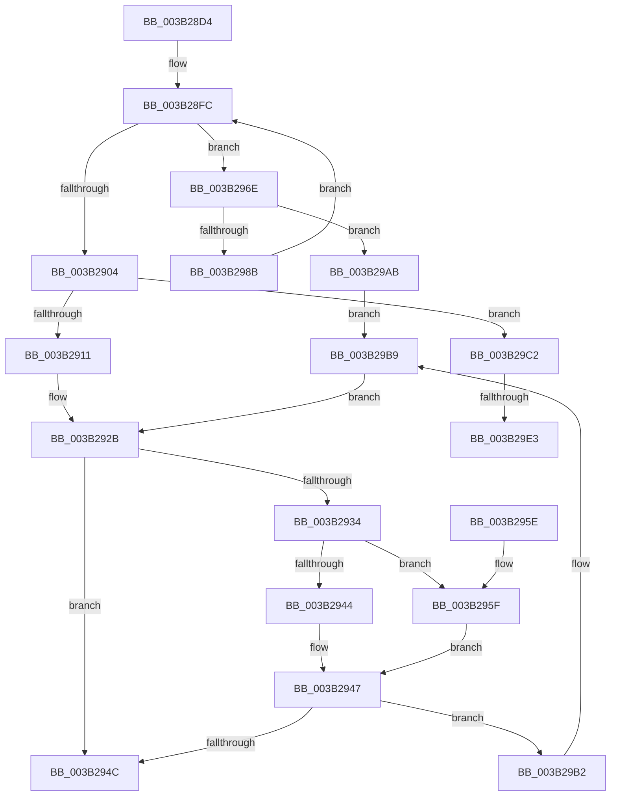

# NP_CONTEXT::NpStart

- RVA: `0x003B28D4`–`0x003B29F0` (길이 `284` bytes)
- VA: `0x00000001403B28D4`
- 실행 섹션: `.text`
- PDB 이름 있음: `예`; PDB Function 태그: `예`
- unwind 정보 RVA: `0x0008C410`
- 디코드: `80`개 명령, `284/284` bytes 표시
- 미해석 바이트: `0` (있으면 어셈블리에 `.byte`로 보존)

> 이 문서는 커널 이미지의 기계어와 PDB 기호를 분석해 생성했습니다. 4번과 5번은 함수 원형과 자료형을 바이너리 사용 방식에서 추정한 C 해석이며 원본 소스 복구 결과는 아닙니다.

## 1. Dependencies

- 직접 호출 지점: **2**; 고유 호출 대상: **2**
- 직접 호출자로 확인된 함수: **1**
- RIP 상대 이미지 참조: **0**

### Outgoing calls
- `0x003B297E` → [ExAllocatePool2](../../poolcode/B8/ExAllocatePool2_function_00B820F0.md) (function, `0x00B820F0`)
- `0x003B29B4` → [ExFreePoolWithTag](../../poolcode/B8/ExFreePoolWithTag_function_00B82870.md) (function, `0x00B82870`)

### Direct callers
- [ST_STORE&lt;SM_TRAITS&gt;::StDmStart](ST_STORE_SM_TRAITS_StDmStart_function_003B25C8.md) at `0x003B27E9`
- [ST_STORE&lt;SM_TRAITS&gt;::StDmStart](ST_STORE_SM_TRAITS_StDmStart_function_003B25C8.md) at `0x003B27FD`
- [ST_STORE&lt;SM_TRAITS&gt;::StDmStart](ST_STORE_SM_TRAITS_StDmStart_function_003B25C8.md) at `0x003B2811`

### Static image references
- 디코드된 RIP-relative 메모리 참조가 없습니다.

## 2. Other-region calls and transfers

- 다른 실행 섹션으로 향하는 call: **2**
  - `0x003B297E` → [ExAllocatePool2](../../poolcode/B8/ExAllocatePool2_function_00B820F0.md) (`.text` → `POOLCODE`)
  - `0x003B29B4` → [ExFreePoolWithTag](../../poolcode/B8/ExFreePoolWithTag_function_00B82870.md) (`.text` → `POOLCODE`)
- call이 아닌 외부 분기/꼬리 이동: **2**
  - `0x003B29DD` → [sub_006E70F4](../6E/Unknown_function_006E70F4.md) (`tail-transfer`)
  - `0x003B29EB` → [sub_006E70F4](../6E/Unknown_function_006E70F4.md) (`tail-transfer`)

## 3. Assembly (complete function range)

```asm
003B28D4  48 89 5C 24 08                  mov qword ptr [rsp + 8], rbx
003B28D9  48 89 7C 24 10                  mov qword ptr [rsp + 0x10], rdi
003B28DE  55                              push rbp
003B28DF  48 8B EC                        mov rbp, rsp
003B28E2  48 83 EC 30                     sub rsp, 0x30
003B28E6  48 83 65 F0 00                  and qword ptr [rbp - 0x10], 0
003B28EB  4C 8D 45 F0                     lea r8, [rbp - 0x10]
003B28EF  4C 89 45 F8                     mov qword ptr [rbp - 8], r8
003B28F3  45 33 C9                        xor r9d, r9d
003B28F6  48 8B FA                        mov rdi, rdx
003B28F9  48 8B D9                        mov rbx, rcx
003B28FC  8B 47 04                        mov eax, dword ptr [rdi + 4]
003B28FF  4C 3B C8                        cmp r9, rax
003B2902  72 6A                           jb 0x1403b296e
003B2904  48 8D 4B 40                     lea rcx, [rbx + 0x40]
003B2908  4D 85 C9                        test r9, r9
003B290B  0F 85 B1 00 00 00               jne 0x1403b29c2
003B2911  0F 10 07                        movups xmm0, xmmword ptr [rdi]
003B2914  0F 10 4F 10                     movups xmm1, xmmword ptr [rdi + 0x10]
003B2918  0F 11 03                        movups xmmword ptr [rbx], xmm0
003B291B  F2 0F 10 47 20                  movsd xmm0, qword ptr [rdi + 0x20]
003B2920  0F 11 4B 10                     movups xmmword ptr [rbx + 0x10], xmm1
003B2924  F2 0F 11 43 20                  movsd qword ptr [rbx + 0x20], xmm0
003B2929  33 DB                           xor ebx, ebx
003B292B  48 8D 45 F0                     lea rax, [rbp - 0x10]
003B292F  4C 3B C0                        cmp r8, rax
003B2932  74 18                           je 0x1403b294c
003B2934  48 8B 4D F0                     mov rcx, qword ptr [rbp - 0x10]
003B2938  48 8B 01                        mov rax, qword ptr [rcx]
003B293B  48 89 45 F0                     mov qword ptr [rbp - 0x10], rax
003B293F  49 3B C8                        cmp rcx, r8
003B2942  74 1B                           je 0x1403b295f
003B2944  49 FF 08                        dec qword ptr [r8]
003B2947  48 85 C9                        test rcx, rcx
003B294A  75 66                           jne 0x1403b29b2
003B294C  48 8B 7C 24 48                  mov rdi, qword ptr [rsp + 0x48]
003B2951  8B C3                           mov eax, ebx
003B2953  48 8B 5C 24 40                  mov rbx, qword ptr [rsp + 0x40]
003B2958  48 83 C4 30                     add rsp, 0x30
003B295C  5D                              pop rbp
003B295D  C3                              ret
003B295E  CC                              int3
003B295F  48 83 65 F0 00                  and qword ptr [rbp - 0x10], 0
003B2964  48 8D 45 F0                     lea rax, [rbp - 0x10]
003B2968  48 89 45 F8                     mov qword ptr [rbp - 8], rax
003B296C  EB D9                           jmp 0x1403b2947
003B296E  BA 00 10 00 00                  mov edx, 0x1000
003B2973  B9 40 00 00 00                  mov ecx, 0x40
003B2978  41 B8 73 6D 4E 70               mov r8d, 0x704e6d73
003B297E  E8 6D F7 7C 00                  call 0x140b820f0
003B2983  4C 8B C0                        mov r8, rax
003B2986  48 85 C0                        test rax, rax
003B2989  74 20                           je 0x1403b29ab
003B298B  48 8B 4D F8                     mov rcx, qword ptr [rbp - 8]
003B298F  48 8B 11                        mov rdx, qword ptr [rcx]
003B2992  48 FF C2                        inc rdx
003B2995  48 89 10                        mov qword ptr [rax], rdx
003B2998  48 8B 4D F8                     mov rcx, qword ptr [rbp - 8]
003B299C  48 89 01                        mov qword ptr [rcx], rax
003B299F  48 89 45 F8                     mov qword ptr [rbp - 8], rax
003B29A3  4C 8B 08                        mov r9, qword ptr [rax]
003B29A6  E9 51 FF FF FF                  jmp 0x1403b28fc
003B29AB  BB 9A 00 00 C0                  mov ebx, 0xc000009a
003B29B0  EB 07                           jmp 0x1403b29b9
003B29B2  33 D2                           xor edx, edx
003B29B4  E8 B7 FE 7C 00                  call 0x140b82870
003B29B9  4C 8B 45 F8                     mov r8, qword ptr [rbp - 8]
003B29BD  E9 69 FF FF FF                  jmp 0x1403b292b
003B29C2  48 8B 41 08                     mov rax, qword ptr [rcx + 8]
003B29C6  4C 03 08                        add r9, qword ptr [rax]
003B29C9  48 8B 01                        mov rax, qword ptr [rcx]
003B29CC  49 89 00                        mov qword ptr [r8], rax
003B29CF  48 8B 45 F0                     mov rax, qword ptr [rbp - 0x10]
003B29D3  48 89 01                        mov qword ptr [rcx], rax
003B29D6  48 8B 41 08                     mov rax, qword ptr [rcx + 8]
003B29DA  48 3B C1                        cmp rax, rcx
003B29DD  0F 85 11 47 33 00               jne 0x1406e70f4
003B29E3  48 8B 45 F8                     mov rax, qword ptr [rbp - 8]
003B29E7  48 89 41 08                     mov qword ptr [rcx + 8], rax
003B29EB  E9 04 47 33 00                  jmp 0x1406e70f4
```

## 4. C-style interpretation (structured pseudocode)

```c
__int64 __fastcall NP_CONTEXT__NpStart(__int64 a1, __int64 a2, __int64 a3, int a4)
{
    __int64 result;
    __int64 v_rbx;
    __int64 v_rsp;
    unsigned __int64 v_stack_m10;
    unsigned __int64 v_stack_m18;
    unsigned __int64 v_stack_p10;
    unsigned __int64 v_stack_p8;

    v_stack_p8 = v_rbx;
    v_stack_p10 = v_rdi;
    v_rsp = (v_rsp) - (48);
    v_stack_m10 = v_stack_m18;
    a4 = 0;
loc_003B28FC:
    if (0 < ((unsigned int)(*(unsigned int *)(a2 + 4)))) goto loc_003B296E;
    if (0 != 0) goto loc_003B29C2;
    *(unsigned __int64 *)(a1) = v_xmm0;
    *(unsigned __int64 *)(a1 + 16) = v_xmm1;
    *(unsigned __int64 *)(a1 + 32) = v_xmm0;
    v_rbx = 0;
loc_003B292B:
    if (v_stack_m18 == v_stack_m18) goto loc_003B294C;
    v_stack_m18 = *(unsigned __int64 *)(v_stack_m18);
    if (v_stack_m18 == v_stack_m18) goto loc_003B295F;
loc_003B2947:
    if (v_stack_m18 != 0) goto loc_003B29B2;
loc_003B294C:
    v_rsp = (v_rsp) + (48);
    return 0;
loc_003B295F:
    v_stack_m10 = v_stack_m18;
    goto loc_003B2947;
loc_003B296E:
    result = ExAllocatePool2(64, (unsigned int)(0x1000ULL), (unsigned int)(0x704E6D73ULL), a4);
    if (result == 0) goto loc_003B29AB;
    a2 = (*(unsigned __int64 *)(v_stack_m10)) + 1;
    *(unsigned __int64 *)(result) = a2;
    *(unsigned __int64 *)(v_stack_m10) = result;
    v_stack_m10 = result;
    goto loc_003B28FC;
loc_003B29AB:
    goto loc_003B29B9;
loc_003B29B2:
    a2 = 0;
    result = ExFreePoolWithTag(v_stack_m10, a2, result, *(unsigned __int64 *)(result));
loc_003B29B9:
    goto loc_003B292B;
loc_003B29C2:
    a4 = (*(unsigned __int64 *)(result)) + (*(unsigned __int64 *)(*(unsigned __int64 *)(v_stack_m10 + 8)));
    *(unsigned __int64 *)(v_stack_m10) = *(unsigned __int64 *)(v_stack_m10);
    *(unsigned __int64 *)(v_stack_m10) = v_stack_m18;
    *(unsigned __int64 *)(v_stack_m10 + 8) = v_stack_m10;
}
```

## 5. (Beta) C Style

```c
int64_t NP_CONTEXT__NpStart(void *Arg1, void *Arg2, int64_t Arg3, int32_t Arg4)
{
    uint8_t *arg1 = (uint8_t *)Arg1;
    uint8_t *arg2 = (uint8_t *)Arg2;

    int64_t result;
    int64_t local_rbx;
    int64_t local_rsp;
    uint64_t v_stack_m10;
    uint64_t v_stack_m18;
    uint64_t v_stack_p10;
    uint64_t v_stack_p8;

    v_stack_p8 = local_rbx;
    v_stack_p10 = local_rdi;
    local_rsp = (local_rsp) - (48);
    v_stack_m10 = v_stack_m18;
    Arg4 = 0;
loc_003B28FC:
    if (0 < ((uint32_t)(*(uint32_t *)(arg2 + 0x4)))) goto loc_003B296E;
    if (0 != 0) goto loc_003B29C2;
    *(uint64_t *)(arg1) = v_xmm0;
    *(uint64_t *)(arg1 + 0x10) = v_xmm1;
    *(uint64_t *)(arg1 + 0x20) = v_xmm0;
    local_rbx = 0;
loc_003B292B:
    if (v_stack_m18 == v_stack_m18) goto loc_003B294C;
    v_stack_m18 = *(uint64_t *)(v_stack_m18);
    if (v_stack_m18 == v_stack_m18) goto loc_003B295F;
loc_003B2947:
    if (v_stack_m18 != 0) goto loc_003B29B2;
loc_003B294C:
    local_rsp = (local_rsp) + (48);
    return 0;
loc_003B295F:
    v_stack_m10 = v_stack_m18;
    goto loc_003B2947;
loc_003B296E:
    result = ExAllocatePool2(64, (uint32_t)(0x1000ULL), (uint32_t)(0x704E6D73ULL), Arg4);
    if (result == 0) goto loc_003B29AB;
    Arg2 = (*(uint64_t *)(v_stack_m10)) + 1;
    *(void **)(result) = Arg2;
    *(uint64_t *)(v_stack_m10) = result;
    v_stack_m10 = result;
    goto loc_003B28FC;
loc_003B29AB:
    goto loc_003B29B9;
loc_003B29B2:
    Arg2 = 0;
    result = ExFreePoolWithTag(v_stack_m10, Arg2, result, *(uint64_t *)(result));
loc_003B29B9:
    goto loc_003B292B;
loc_003B29C2:
    Arg4 = (*(uint64_t *)(result)) + (*(uint64_t *)(*(uint64_t *)(v_stack_m10 + 0x8)));
    *(uint64_t *)(v_stack_m10) = *(uint64_t *)(v_stack_m10);
    *(uint64_t *)(v_stack_m10) = v_stack_m18;
    *(uint64_t *)(v_stack_m10 + 0x8) = v_stack_m10;
}
```

### 관측된 메모리 오프셋

구조체 형식이 확인되지 않은 접근은 인자 기준의 오프셋으로만 기록했습니다.

| 기준 인자 | 오프셋 표현 | 폭 (bit) | 접근 |
|---|---:|---:|---|
| `Arg1` | `+ 0x0` | `64` | `R` |
| `Arg1` | `+ 0x0` | `64` | `W` |
| `Arg1` | `+ 0x0` | `128` | `R` |
| `Arg1` | `+ 0x8` | `64` | `R` |
| `Arg1` | `+ 0x8` | `64` | `W` |
| `Arg1` | `+ 0x10` | `128` | `R` |
| `Arg1` | `+ 0x20` | `64` | `W` |
| `Arg1` | `+ 0x40` | `64` | `R` |
| `Arg2` | `+ 0x0` | `128` | `R` |
| `Arg2` | `+ 0x4` | `32` | `R` |
| `Arg2` | `+ 0x10` | `128` | `R` |
| `Arg2` | `+ 0x20` | `64` | `R` |

## 6. Execution-region graph

[열기: 2D/3D 그래프와 함수 탐색 컨트롤 패널](../../../control-panel.html?section=text&rva=0x003B28D4&view=graph)

- 2D 그래프는 위에서 아래로 흐르고, 3D 그래프는 빈 공간을 드래그해 회전합니다. Shift+드래그는 이동, 휠은 확대·축소, 함수 노드 선택은 대상 보고서 이동입니다.

### Static fallback


