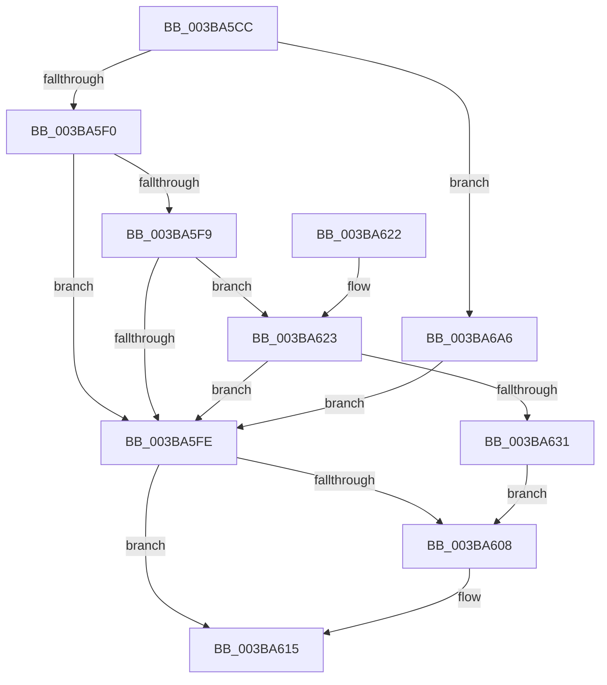

# PfLogForegroundProcess

- RVA: `0x003BA5CC`–`0x003BA6AD` (길이 `225` bytes)
- VA: `0x00000001403BA5CC`
- 실행 섹션: `.text`
- PDB 이름 있음: `예`; PDB Function 태그: `아니요`
- unwind 정보 RVA: `0x0008CB98`
- 디코드: `55`개 명령, `225/225` bytes 표시
- 미해석 바이트: `0` (있으면 어셈블리에 `.byte`로 보존)

> 이 문서는 커널 이미지의 기계어와 PDB 기호를 분석해 생성했습니다. 4번과 5번은 함수 원형과 자료형을 바이너리 사용 방식에서 추정한 C 해석이며 원본 소스 복구 결과는 아닙니다.

## 1. Dependencies

- 직접 호출 지점: **3**; 고유 호출 대상: **3**
- 직접 호출자로 확인된 함수: **1**
- RIP 상대 이미지 참조: **1**

### Outgoing calls
- `0x003BA5E3` → [PsReferencePartitionSafe](PsReferencePartitionSafe_function_003BA6C0.md) (function, `0x003BA6C0`)
- `0x003BA610` → [PsDereferencePartition](../34/PsDereferencePartition_function_00342E70.md) (function, `0x00342E70`)
- `0x003BA69A` → [PfLogEvent](../34/PfLogEvent_function_00349BA8.md) (function, `0x00349BA8`)

### Direct callers
- [MiTrimOrAgeWorkingSet](../34/MiTrimOrAgeWorkingSet_function_0034EFC0.md) at `0x0034EFF4`

### Static image references
- `0x003BA693` → RVA `0x00E670CC` (`.data`; read)

## 2. Other-region calls and transfers

- 다른 실행 섹션으로 향하는 call: **0**
- 별도 외부 분기/꼬리 이동을 확인하지 못했습니다.

## 3. Assembly (complete function range)

```asm
003BA5CC  48 89 5C 24 10                  mov qword ptr [rsp + 0x10], rbx
003BA5D1  57                              push rdi
003BA5D2  48 83 EC 40                     sub rsp, 0x40
003BA5D6  48 8B 99 58 03 00 00            mov rbx, qword ptr [rcx + 0x358]
003BA5DD  4C 8B C1                        mov r8, rcx
003BA5E0  48 8B CB                        mov rcx, rbx
003BA5E3  E8 D8 00 00 00                  call 0x1403ba6c0
003BA5E8  84 C0                           test al, al
003BA5EA  0F 84 B6 00 00 00               je 0x1403ba6a6
003BA5F0  48 8B 4B 20                     mov rcx, qword ptr [rbx + 0x20]
003BA5F4  48 85 DB                        test rbx, rbx
003BA5F7  74 05                           je 0x1403ba5fe
003BA5F9  48 85 C9                        test rcx, rcx
003BA5FC  75 25                           jne 0x1403ba623
003BA5FE  BF BB 00 00 C0                  mov edi, 0xc00000bb
003BA603  48 85 DB                        test rbx, rbx
003BA606  74 0D                           je 0x1403ba615
003BA608  BA 50 66 50 74                  mov edx, 0x74506650
003BA60D  48 8B CB                        mov rcx, rbx
003BA610  E8 5B 88 F8 FF                  call 0x140342e70
003BA615  48 8B 5C 24 58                  mov rbx, qword ptr [rsp + 0x58]
003BA61A  8B C7                           mov eax, edi
003BA61C  48 83 C4 40                     add rsp, 0x40
003BA620  5F                              pop rdi
003BA621  C3                              ret
003BA622  CC                              int3
003BA623  8B 81 64 02 00 00               mov eax, dword ptr [rcx + 0x264]
003BA629  39 81 60 02 00 00               cmp dword ptr [rcx + 0x260], eax
003BA62F  73 CD                           jae 0x1403ba5fe
003BA631  41 8B 80 D0 FD FF FF            mov eax, dword ptr [r8 - 0x230]
003BA638  4C 8D 4C 24 30                  lea r9, [rsp + 0x30]
003BA63D  83 64 24 3C 00                  and dword ptr [rsp + 0x3c], 0
003BA642  48 BA 04 00 00 00 80 F7 FF FF   movabs rdx, 0xfffff78000000004
003BA64C  48 89 44 24 30                  mov qword ptr [rsp + 0x30], rax
003BA651  41 8B 40 84                     mov eax, dword ptr [r8 - 0x7c]
003BA655  89 44 24 38                     mov dword ptr [rsp + 0x38], eax
003BA659  48 B8 20 03 00 00 80 F7 FF FF   movabs rax, 0xfffff78000000320
003BA663  C7 44 24 20 10 00 00 00         mov dword ptr [rsp + 0x20], 0x10
003BA66B  48 8B 00                        mov rax, qword ptr [rax]
003BA66E  8B 12                           mov edx, dword ptr [rdx]
003BA670  44 8B C0                        mov r8d, eax
003BA673  4C 0F AF C2                     imul r8, rdx
003BA677  48 C1 E8 20                     shr rax, 0x20
003BA67B  49 C1 E8 18                     shr r8, 0x18
003BA67F  48 0F AF C2                     imul rax, rdx
003BA683  BA 07 00 00 00                  mov edx, 7
003BA688  48 C1 E0 08                     shl rax, 8
003BA68C  4C 03 C0                        add r8, rax
003BA68F  49 C1 E8 0A                     shr r8, 0xa
003BA693  44 03 05 32 CA AA 00            add r8d, dword ptr [rip + 0xaaca32]
003BA69A  E8 09 F5 F8 FF                  call 0x140349ba8
003BA69F  8B F8                           mov edi, eax
003BA6A1  E9 62 FF FF FF                  jmp 0x1403ba608
003BA6A6  33 DB                           xor ebx, ebx
003BA6A8  E9 51 FF FF FF                  jmp 0x1403ba5fe
```

## 4. C-style interpretation (structured pseudocode)

```c
__int64 __fastcall PfLogForegroundProcess(__int64 a1)
{
    __int64 result;
    __int64 v_rbx;
    __int64 v_rsp;
    unsigned __int64 v_stack_p10;
    unsigned int v_stack_p20;
    unsigned __int64 v_stack_p30;
    unsigned int v_stack_p38;
    unsigned int v_stack_p3C;

    v_stack_p10 = v_rbx;
    v_rsp = (v_rsp) - (64);
    result = PsReferencePartitionSafe(*(unsigned __int64 *)(a1 + 856), a2, a1, a4);
    if ((unsigned __int8)(result) == 0) goto loc_003BA6A6;
    if (*(unsigned __int64 *)(a1 + 856) == 0) goto loc_003BA5FE;
    if (*(unsigned __int64 *)(*(unsigned __int64 *)(a1 + 856) + 32) != 0) goto loc_003BA623;
loc_003BA5FE:
    if (*(unsigned __int64 *)(a1 + 856) != 0) {
        a2 = 0x74506650ULL;
        a1 = *(unsigned __int64 *)(a1 + 856);
        result = PsDereferencePartition(a1, a2, a1, a4);
    }
    v_rsp = (v_rsp) + (64);
    return (unsigned int)((unsigned int)((unsigned int)(0xC00000BBULL)));
loc_003BA623:
    if ((*(unsigned int *)(a1 + 608)) >= ((unsigned int)((unsigned int)(*(unsigned int *)(a1 + 612))))) goto loc_003BA5FE;
    v_stack_p30 = (unsigned int)(*(unsigned int *)(a1 - 560));
    v_stack_p38 = (unsigned int)((unsigned int)(*(unsigned int *)(a1 - 124)));
    v_stack_p20 = 16;
    a3 = ((unsigned int)((unsigned int)(*(unsigned __int64 *)((unsigned int)(*(unsigned int *)(a1 - 124)))))) * ((unsigned int)(*(unsigned int *)(a2)));
    result = (*(unsigned __int64 *)((unsigned int)(*(unsigned int *)(a1 - 124)))) >> (32);
    a3 = (a3) >> (24);
    result = (result) * ((unsigned int)(*(unsigned int *)(a2)));
    result = (result) << (8);
    a3 = (a3) + (result);
    a3 = (a3) >> (10);
    a3 = (unsigned int)((a3) + (*(unsigned int *)(v_rip + 11192882)));
    result = PfLogEvent(a1, 7, a3, v_stack_p30);
    goto loc_003BA608;
loc_003BA6A6:
    v_rbx = 0;
    goto loc_003BA5FE;
}
```

## 5. (Beta) C Style

```c
int64_t PfLogForegroundProcess(void *Arg1)
{
    uint8_t *arg1 = (uint8_t *)Arg1;

    int64_t result;
    int64_t local_rbx;
    int64_t local_rsp;
    uint64_t v_stack_p10;
    uint32_t v_stack_p20;
    uint64_t v_stack_p30;
    uint32_t v_stack_p38;
    uint32_t v_stack_p3C;

    v_stack_p10 = local_rbx;
    local_rsp = (local_rsp) - (64);
    result = PsReferencePartitionSafe(*(uint64_t *)(arg1 + 0x358), a2, Arg1, a4);
    if ((uint8_t)(result) == 0) goto loc_003BA6A6;
    if (*(uint64_t *)(arg1 + 0x358) == 0) goto loc_003BA5FE;
    if (*(uint64_t *)(*(uint64_t *)(arg1 + 0x358) + 0x20) != 0) goto loc_003BA623;
loc_003BA5FE:
    if (*(uint64_t *)(arg1 + 0x358) != 0) {
        a2 = 0x74506650ULL;
        Arg1 = *(uint64_t *)(arg1 + 0x358);
        result = PsDereferencePartition(Arg1, a2, Arg1, a4);
    }
    local_rsp = (local_rsp) + (64);
    return (uint32_t)((uint32_t)((uint32_t)(0xC00000BBULL)));
loc_003BA623:
    if ((*(uint32_t *)(arg1 + 0x260)) >= ((uint32_t)((uint32_t)(*(uint32_t *)(arg1 + 0x264))))) goto loc_003BA5FE;
    v_stack_p30 = (uint32_t)(*(uint32_t *)(arg1 - 0x230));
    v_stack_p38 = (uint32_t)((uint32_t)(*(uint32_t *)(arg1 - 0x7C)));
    v_stack_p20 = 16;
    a3 = ((uint32_t)((uint32_t)(*(uint64_t *)((uint32_t)(*(uint32_t *)(arg1 - 0x7C)))))) * ((uint32_t)(*(uint32_t *)(a2)));
    result = (*(uint64_t *)((uint32_t)(*(uint32_t *)(arg1 - 0x7C)))) >> (32);
    a3 = (a3) >> (24);
    result = (result) * ((uint32_t)(*(uint32_t *)(a2)));
    result = (result) << (8);
    a3 = (a3) + (result);
    a3 = (a3) >> (10);
    a3 = (uint32_t)((a3) + (*(uint32_t *)(v_rip + 0xAACA32)));
    result = PfLogEvent(Arg1, 7, a3, v_stack_p30);
    goto loc_003BA608;
loc_003BA6A6:
    local_rbx = 0;
    goto loc_003BA5FE;
}
```

### 관측된 메모리 오프셋

구조체 형식이 확인되지 않은 접근은 인자 기준의 오프셋으로만 기록했습니다.

| 기준 인자 | 오프셋 표현 | 폭 (bit) | 접근 |
|---|---:|---:|---|
| `Arg1` | `+ 0x358` | `64` | `R` |

## 6. Execution-region graph

[열기: 2D/3D 그래프와 함수 탐색 컨트롤 패널](../../../control-panel.html?section=text&rva=0x003BA5CC&view=graph)

- 2D 그래프는 위에서 아래로 흐르고, 3D 그래프는 빈 공간을 드래그해 회전합니다. Shift+드래그는 이동, 휠은 확대·축소, 함수 노드 선택은 대상 보고서 이동입니다.

### Static fallback


