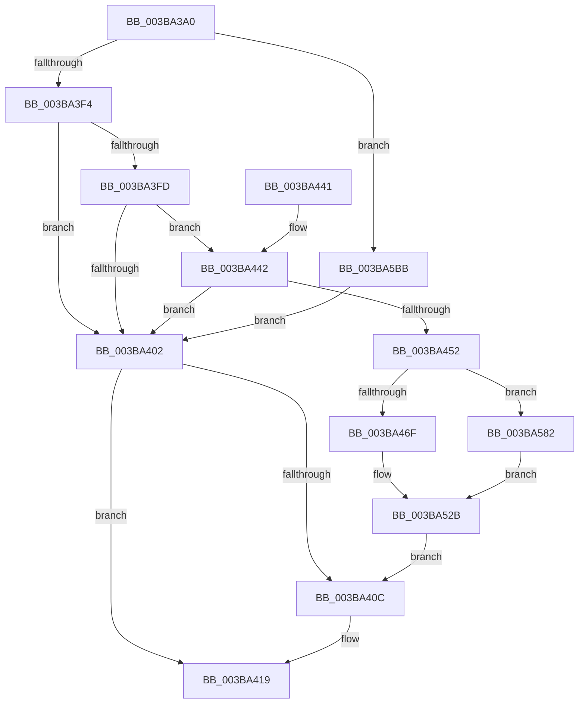

# PfpLogApplicationEvent

- RVA: `0x003BA3A0`–`0x003BA5C3` (길이 `547` bytes)
- VA: `0x00000001403BA3A0`
- 실행 섹션: `.text`
- PDB 이름 있음: `예`; PDB Function 태그: `아니요`
- unwind 정보 RVA: `0x0008CB74`
- 디코드: `129`개 명령, `547/547` bytes 표시
- 미해석 바이트: `0` (있으면 어셈블리에 `.byte`로 보존)

> 이 문서는 커널 이미지의 기계어와 PDB 기호를 분석해 생성했습니다. 4번과 5번은 함수 원형과 자료형을 바이너리 사용 방식에서 추정한 C 해석이며 원본 소스 복구 결과는 아닙니다.

## 1. Dependencies

- 직접 호출 지점: **8**; 고유 호출 대상: **7**
- 직접 호출자로 확인된 함수: **2**
- RIP 상대 이미지 참조: **3**

### Outgoing calls
- `0x003BA3E4` → [PsReferencePartitionSafe](PsReferencePartitionSafe_function_003BA6C0.md) (function, `0x003BA6C0`)
- `0x003BA414` → [PsDereferencePartition](../34/PsDereferencePartition_function_00342E70.md) (function, `0x00342E70`)
- `0x003BA425` → [_security_check_cookie](../6A/_security_check_cookie_function_006AC640.md) (function, `0x006AC640`)
- `0x003BA4B7` → [MmGetDirectoryFrameFromProcess](../../page/AB/MmGetDirectoryFrameFromProcess_function_00AB5BF4.md) (function, `0x00AB5BF4`)
- `0x003BA4EC` → [memcpy](../6C/memcpy_function_006C6840.md) (function, `0x006C6840`)
- `0x003BA4FE` → [PsGetProcessSessionId](../22/PsGetProcessSessionId_function_002233A0.md) (function, `0x002233A0`)
- `0x003BA50A` → [PsGetProcessSessionId](../22/PsGetProcessSessionId_function_002233A0.md) (function, `0x002233A0`)
- `0x003BA576` → [PfLogEvent](../34/PfLogEvent_function_00349BA8.md) (function, `0x00349BA8`)

### Direct callers
- [PfProcessExitNotification](../../page/90/PfProcessExitNotification_function_00903CA4.md) at `0x00903CB6`
- [PfCalculateProcessHash](../../page/96/PfCalculateProcessHash_function_00960310.md) at `0x0096050D`

### Static image references
- `0x003BA3BB` → RVA `0x00E0A740` (`.data`; read)
- `0x003BA517` → RVA `0x00FC6B70` (`ALMOSTRO`; read)
- `0x003BA56F` → RVA `0x00E670CC` (`.data`; read)

## 2. Other-region calls and transfers

- 다른 실행 섹션으로 향하는 call: **1**
  - `0x003BA4B7` → [MmGetDirectoryFrameFromProcess](../../page/AB/MmGetDirectoryFrameFromProcess_function_00AB5BF4.md) (`.text` → `PAGE`)
- 별도 외부 분기/꼬리 이동을 확인하지 못했습니다.

## 3. Assembly (complete function range)

```asm
003BA3A0  48 89 5C 24 18                  mov qword ptr [rsp + 0x18], rbx
003BA3A5  55                              push rbp
003BA3A6  56                              push rsi
003BA3A7  57                              push rdi
003BA3A8  41 56                           push r14
003BA3AA  41 57                           push r15
003BA3AC  48 8D AC 24 A0 F8 FF FF         lea rbp, [rsp - 0x760]
003BA3B4  48 81 EC 60 08 00 00            sub rsp, 0x860
003BA3BB  48 8B 05 7E 03 A5 00            mov rax, qword ptr [rip + 0xa5037e]
003BA3C2  48 33 C4                        xor rax, rsp
003BA3C5  48 89 85 50 07 00 00            mov qword ptr [rbp + 0x750], rax
003BA3CC  48 8B B9 58 07 00 00            mov rdi, qword ptr [rcx + 0x758]
003BA3D3  48 8B F1                        mov rsi, rcx
003BA3D6  0F 57 C0                        xorps xmm0, xmm0
003BA3D9  48 8B CF                        mov rcx, rdi
003BA3DC  4C 8B CA                        mov r9, rdx
003BA3DF  0F 11 44 24 38                  movups xmmword ptr [rsp + 0x38], xmm0
003BA3E4  E8 D7 02 00 00                  call 0x1403ba6c0
003BA3E9  45 33 FF                        xor r15d, r15d
003BA3EC  84 C0                           test al, al
003BA3EE  0F 84 C7 01 00 00               je 0x1403ba5bb
003BA3F4  4C 8B 77 20                     mov r14, qword ptr [rdi + 0x20]
003BA3F8  48 85 FF                        test rdi, rdi
003BA3FB  74 05                           je 0x1403ba402
003BA3FD  4D 85 F6                        test r14, r14
003BA400  75 40                           jne 0x1403ba442
003BA402  BB BB 00 00 C0                  mov ebx, 0xc00000bb
003BA407  48 85 FF                        test rdi, rdi
003BA40A  74 0D                           je 0x1403ba419
003BA40C  BA 50 66 50 74                  mov edx, 0x74506650
003BA411  48 8B CF                        mov rcx, rdi
003BA414  E8 57 8A F8 FF                  call 0x140342e70
003BA419  8B C3                           mov eax, ebx
003BA41B  48 8B 8D 50 07 00 00            mov rcx, qword ptr [rbp + 0x750]
003BA422  48 33 CC                        xor rcx, rsp
003BA425  E8 16 22 2F 00                  call 0x1406ac640
003BA42A  48 8B 9C 24 A0 08 00 00         mov rbx, qword ptr [rsp + 0x8a0]
003BA432  48 81 C4 60 08 00 00            add rsp, 0x860
003BA439  41 5F                           pop r15
003BA43B  41 5E                           pop r14
003BA43D  5F                              pop rdi
003BA43E  5E                              pop rsi
003BA43F  5D                              pop rbp
003BA440  C3                              ret
003BA441  CC                              int3
003BA442  41 8B 86 5C 02 00 00            mov eax, dword ptr [r14 + 0x25c]
003BA449  41 39 86 58 02 00 00            cmp dword ptr [r14 + 0x258], eax
003BA450  73 B0                           jae 0x1403ba402
003BA452  8B 86 D0 01 00 00               mov eax, dword ptr [rsi + 0x1d0]
003BA458  48 8B 8E F8 01 00 00            mov rcx, qword ptr [rsi + 0x1f8]
003BA45F  4C 89 BD 48 07 00 00            mov qword ptr [rbp + 0x748], r15
003BA466  45 84 C0                        test r8b, r8b
003BA469  0F 85 13 01 00 00               jne 0x1403ba582
003BA46F  48 89 45 80                     mov qword ptr [rbp - 0x80], rax
003BA473  48 8D 54 24 38                  lea rdx, [rsp + 0x38]
003BA478  89 44 24 6C                     mov dword ptr [rsp + 0x6c], eax
003BA47C  4D 85 C9                        test r9, r9
003BA47F  48 B8 FF FF FF FF FF FF FF 1F   movabs rax, 0x1fffffffffffffff
003BA489  44 89 7C 24 54                  mov dword ptr [rsp + 0x54], r15d
003BA48E  49 0F 45 D1                     cmovne rdx, r9
003BA492  44 89 7D 88                     mov dword ptr [rbp - 0x78], r15d
003BA496  48 33 8E D0 01 00 00            xor rcx, qword ptr [rsi + 0x1d0]
003BA49D  48 23 C8                        and rcx, rax
003BA4A0  66 44 89 7D 8E                  mov word ptr [rbp - 0x72], r15w
003BA4A5  8B 86 84 03 00 00               mov eax, dword ptr [rsi + 0x384]
003BA4AB  48 89 4C 24 70                  mov qword ptr [rsp + 0x70], rcx
003BA4B0  48 8B CE                        mov rcx, rsi
003BA4B3  89 44 24 68                     mov dword ptr [rsp + 0x68], eax
003BA4B7  E8 38 B7 6F 00                  call 0x140ab5bf4
003BA4BC  44 0F B7 0A                     movzx r9d, word ptr [rdx]
003BA4C0  48 8D 4D 8E                     lea rcx, [rbp - 0x72]
003BA4C4  48 8B 52 08                     mov rdx, qword ptr [rdx + 8]
003BA4C8  41 8B D9                        mov ebx, r9d
003BA4CB  48 89 44 24 78                  mov qword ptr [rsp + 0x78], rax
003BA4D0  B8 C0 07 00 00                  mov eax, 0x7c0
003BA4D5  44 3B C8                        cmp r9d, eax
003BA4D8  0F 47 D8                        cmova ebx, eax
003BA4DB  44 8B C3                        mov r8d, ebx
003BA4DE  8B C3                           mov eax, ebx
003BA4E0  49 2B D0                        sub rdx, r8
003BA4E3  D1 E8                           shr eax, 1
003BA4E5  49 03 D1                        add rdx, r9
003BA4E8  66 89 45 8C                     mov word ptr [rbp - 0x74], ax
003BA4EC  E8 4F C3 30 00                  call 0x1406c6840
003BA4F1  0F B7 45 8C                     movzx eax, word ptr [rbp - 0x74]
003BA4F5  48 8B CE                        mov rcx, rsi
003BA4F8  66 44 89 7C 45 8E               mov word ptr [rbp + rax*2 - 0x72], r15w
003BA4FE  E8 9D 8E E6 FF                  call 0x1402233a0
003BA503  48 8B CE                        mov rcx, rsi
003BA506  89 44 24 50                     mov dword ptr [rsp + 0x50], eax
003BA50A  E8 91 8E E6 FF                  call 0x1402233a0
003BA50F  44 8B C0                        mov r8d, eax
003BA512  BA 01 00 00 00                  mov edx, 1
003BA517  48 8B 05 52 C6 C0 00            mov rax, qword ptr [rip + 0xc0c652]
003BA51E  83 C3 40                        add ebx, 0x40
003BA521  48 89 44 24 60                  mov qword ptr [rsp + 0x60], rax
003BA526  4C 89 44 24 58                  mov qword ptr [rsp + 0x58], r8
003BA52B  48 B9 04 00 00 00 80 F7 FF FF   movabs rcx, 0xfffff78000000004
003BA535  89 5C 24 20                     mov dword ptr [rsp + 0x20], ebx
003BA539  48 B8 20 03 00 00 80 F7 FF FF   movabs rax, 0xfffff78000000320
003BA543  48 8B 00                        mov rax, qword ptr [rax]
003BA546  44 8B 09                        mov r9d, dword ptr [rcx]
003BA549  49 8B CE                        mov rcx, r14
003BA54C  44 8B C0                        mov r8d, eax
003BA54F  4D 0F AF C1                     imul r8, r9
003BA553  48 C1 E8 20                     shr rax, 0x20
003BA557  49 C1 E8 18                     shr r8, 0x18
003BA55B  49 0F AF C1                     imul rax, r9
003BA55F  4C 8D 4C 24 50                  lea r9, [rsp + 0x50]
003BA564  48 C1 E0 08                     shl rax, 8
003BA568  4C 03 C0                        add r8, rax
003BA56B  49 C1 E8 0A                     shr r8, 0xa
003BA56F  44 03 05 56 CB AA 00            add r8d, dword ptr [rip + 0xaacb56]
003BA576  E8 2D F6 F8 FF                  call 0x140349ba8
003BA57B  8B D8                           mov ebx, eax
003BA57D  E9 8A FE FF FF                  jmp 0x1403ba40c
003BA582  48 33 8E D0 01 00 00            xor rcx, qword ptr [rsi + 0x1d0]
003BA589  BA 0E 00 00 00                  mov edx, 0xe
003BA58E  48 89 44 24 50                  mov qword ptr [rsp + 0x50], rax
003BA593  89 44 24 60                     mov dword ptr [rsp + 0x60], eax
003BA597  48 B8 FF FF FF FF FF FF FF 1F   movabs rax, 0x1fffffffffffffff
003BA5A1  48 23 C8                        and rcx, rax
003BA5A4  8B 86 84 03 00 00               mov eax, dword ptr [rsi + 0x384]
003BA5AA  48 89 4C 24 58                  mov qword ptr [rsp + 0x58], rcx
003BA5AF  8D 5A 0A                        lea ebx, [rdx + 0xa]
003BA5B2  89 44 24 64                     mov dword ptr [rsp + 0x64], eax
003BA5B6  E9 70 FF FF FF                  jmp 0x1403ba52b
003BA5BB  49 8B FF                        mov rdi, r15
003BA5BE  E9 3F FE FF FF                  jmp 0x1403ba402
```

## 4. C-style interpretation (structured pseudocode)

```c
__int64 __fastcall PfpLogApplicationEvent(__int64 a1, __int64 a2, unsigned __int8 a3)
{
    __int64 result;
    __int64 v_r15;
    __int64 v_rbx;
    __int64 v_rsp;
    unsigned __int64 v_stack_m38;
    unsigned __int64 v_stack_m40;
    unsigned __int64 v_stack_m788;
    unsigned __int16 v_stack_m7FA;
    unsigned __int16 v_stack_m7FC;
    unsigned int v_stack_m800;
    unsigned __int64 v_stack_m808;
    unsigned __int64 v_stack_m850;
    unsigned __int64 v_stack_p18;
    unsigned int v_stack_p20;
    unsigned __int64 v_stack_p38;
    unsigned int v_stack_p50;
    unsigned int v_stack_p54;
    unsigned __int64 v_stack_p58;
    unsigned __int64 v_stack_p60;
    unsigned int v_stack_p64;
    unsigned int v_stack_p68;
    unsigned int v_stack_p6C;
    unsigned __int64 v_stack_p70;
    unsigned __int64 v_stack_p78;

    v_stack_p18 = v_rbx;
    v_rsp = (v_rsp) - (0x860ULL);
    result = (*(unsigned __int64 *)(v_rip + 10814334)) ^ (v_rsp);
    v_stack_m38 = result;
    v_stack_m850 = v_xmm0;
    result = PsReferencePartitionSafe(*(unsigned __int64 *)(a1 + 1880), a2, a3, a2);
    v_r15 = 0;
    if ((unsigned __int8)(result) == 0) goto loc_003BA5BB;
    if (*(unsigned __int64 *)(a1 + 1880) == 0) goto loc_003BA402;
    if (*(unsigned __int64 *)(*(unsigned __int64 *)(a1 + 1880) + 32) != 0) goto loc_003BA442;
loc_003BA402:
    if (*(unsigned __int64 *)(a1 + 1880) != 0) {
        a2 = 0x74506650ULL;
        a1 = *(unsigned __int64 *)(a1 + 1880);
        result = PsDereferencePartition(a1, a2, a3, a2);
    }
    a1 = (v_stack_m38) ^ (v_rsp);
    result = _security_check_cookie(a1, a2, a3, a2);
    v_rsp = (v_rsp) + (0x860ULL);
    return result;
loc_003BA442:
    if ((*(unsigned int *)(*(unsigned __int64 *)(*(unsigned __int64 *)(a1 + 1880) + 32) + 600)) >= ((unsigned int)((unsigned int)(*(unsigned int *)(*(unsigned __int64 *)(*(unsigned __int64 *)(a1 + 1880) + 32) + 604))))) goto loc_003BA402;
    v_stack_m40 = 0;
    if (a3 != 0) goto loc_003BA582;
    v_stack_m808 = (unsigned int)(*(unsigned int *)(a1 + 464));
    v_stack_p6C = (unsigned int)((unsigned int)(*(unsigned int *)(a1 + 464)));
    v_stack_p54 = 0;
    a2 = v_stack_p38;
    if (a2 != 0) { a2 = a2; }
    v_stack_m800 = 0;
    a1 = (*(unsigned __int64 *)(a1 + 504)) ^ (*(unsigned __int64 *)(a1 + 464));
    a1 = (a1) & ((unsigned int)(*(unsigned int *)(a1 + 464)));
    v_stack_m7FA = 0;
    v_stack_p70 = a1;
    v_stack_p68 = (unsigned int)((unsigned int)(*(unsigned int *)(a1 + 900)));
    result = MmGetDirectoryFrameFromProcess(a1, a2, a3, a2);
    v_stack_p78 = result;
    v_rbx = (unsigned int)((unsigned int)(*(unsigned __int16 *)(a2)));
    if (((unsigned int)(*(unsigned __int16 *)(a2))) > ((unsigned int)((unsigned int)(0x7C0ULL)))) { v_rbx = (unsigned int)((unsigned int)(0x7C0ULL)); }
    a2 = (*(unsigned __int64 *)(a2 + 8)) - ((unsigned int)((unsigned int)(v_rbx)));
    result = (unsigned int)(((unsigned int)((unsigned int)(v_rbx))) >> (1));
    a2 = (a2) + (*(unsigned __int16 *)(a2));
    v_stack_m7FC = (unsigned __int16)(result);
    result = memcpy(v_stack_m7FA, a2, (unsigned int)((unsigned int)(v_rbx)), *(unsigned __int16 *)(a2));
    *(unsigned __int16 *)(v_stack_m788 + v_stack_m7FC * 2 - 114) = 0;
    result = PsGetProcessSessionId(a1, a2, (unsigned int)((unsigned int)(v_rbx)), *(unsigned __int16 *)(a2));
    v_stack_p50 = (unsigned int)(result);
    result = PsGetProcessSessionId(a1, a2, (unsigned int)((unsigned int)(v_rbx)), *(unsigned __int16 *)(a2));
    v_rbx = (unsigned int)((v_rbx) + (64));
    v_stack_p60 = *(unsigned __int64 *)(v_rip + 12633682);
    v_stack_p58 = (unsigned int)((unsigned int)(result));
loc_003BA52B:
    v_stack_p20 = (unsigned int)(v_rbx);
    a3 = ((unsigned int)((unsigned int)(*(unsigned __int64 *)(*(unsigned __int64 *)(v_rip + 12633682))))) * ((unsigned int)(*(unsigned int *)(a1)));
    result = (*(unsigned __int64 *)(*(unsigned __int64 *)(v_rip + 12633682))) >> (32);
    a3 = (a3) >> (24);
    result = (result) * ((unsigned int)(*(unsigned int *)(a1)));
    result = (result) << (8);
    a3 = (a3) + (result);
    a3 = (a3) >> (10);
    a3 = (unsigned int)((a3) + (*(unsigned int *)(v_rip + 11193174)));
    result = PfLogEvent(*(unsigned __int64 *)(*(unsigned __int64 *)(a1 + 1880) + 32), 1, a3, v_stack_p50);
    goto loc_003BA40C;
loc_003BA582:
    a1 = (*(unsigned __int64 *)(*(unsigned __int64 *)(a1 + 1880) + 32)) ^ (*(unsigned __int64 *)(a1 + 464));
    v_stack_p50 = result;
    v_stack_p60 = (unsigned int)(result);
    a1 = (a1) & (result);
    v_stack_p58 = a1;
    v_stack_p64 = (unsigned int)((unsigned int)(*(unsigned int *)(a1 + 900)));
    goto loc_003BA52B;
loc_003BA5BB:
    goto loc_003BA402;
}
```

## 5. (Beta) C Style

```c
int64_t PfpLogApplicationEvent(void *Arg1, int64_t Arg2, uint8_t Arg3)
{
    uint8_t *arg1 = (uint8_t *)Arg1;

    int64_t result;
    int64_t local_r15;
    int64_t local_rbx;
    int64_t local_rsp;
    uint64_t v_stack_m38;
    uint64_t v_stack_m40;
    uint64_t v_stack_m788;
    uint16_t v_stack_m7FA;
    uint16_t v_stack_m7FC;
    uint32_t v_stack_m800;
    uint64_t v_stack_m808;
    uint64_t v_stack_m850;
    uint64_t v_stack_p18;
    uint32_t v_stack_p20;
    uint64_t v_stack_p38;
    uint32_t v_stack_p50;
    uint32_t v_stack_p54;
    uint64_t v_stack_p58;
    uint64_t v_stack_p60;
    uint32_t v_stack_p64;
    uint32_t v_stack_p68;
    uint32_t v_stack_p6C;
    uint64_t v_stack_p70;
    uint64_t v_stack_p78;

    v_stack_p18 = local_rbx;
    local_rsp = (local_rsp) - (0x860ULL);
    result = (*(uint64_t *)(v_rip + 0xA5037E)) ^ (local_rsp);
    v_stack_m38 = result;
    v_stack_m850 = v_xmm0;
    result = PsReferencePartitionSafe(*(uint64_t *)(arg1 + 0x758), Arg2, Arg3, Arg2);
    local_r15 = 0;
    if ((uint8_t)(result) == 0) goto loc_003BA5BB;
    if (*(uint64_t *)(arg1 + 0x758) == 0) goto loc_003BA402;
    if (*(uint64_t *)(*(uint64_t *)(arg1 + 0x758) + 0x20) != 0) goto loc_003BA442;
loc_003BA402:
    if (*(uint64_t *)(arg1 + 0x758) != 0) {
        Arg2 = 0x74506650ULL;
        Arg1 = *(uint64_t *)(arg1 + 0x758);
        result = PsDereferencePartition(Arg1, Arg2, Arg3, Arg2);
    }
    Arg1 = (v_stack_m38) ^ (local_rsp);
    result = _security_check_cookie(Arg1, Arg2, Arg3, Arg2);
    local_rsp = (local_rsp) + (0x860ULL);
    return result;
loc_003BA442:
    if ((*(uint32_t *)(*(uint64_t *)(*(uint64_t *)(arg1 + 0x758) + 0x20) + 0x258)) >= ((uint32_t)((uint32_t)(*(uint32_t *)(*(uint64_t *)(*(uint64_t *)(arg1 + 0x758) + 0x20) + 0x25C))))) goto loc_003BA402;
    v_stack_m40 = 0;
    if (Arg3 != 0) goto loc_003BA582;
    v_stack_m808 = (uint32_t)(*(uint32_t *)(arg1 + 0x1D0));
    v_stack_p6C = (uint32_t)((uint32_t)(*(uint32_t *)(arg1 + 0x1D0)));
    v_stack_p54 = 0;
    Arg2 = v_stack_p38;
    if (Arg2 != 0) { Arg2 = Arg2; }
    v_stack_m800 = 0;
    Arg1 = (*(uint64_t *)(arg1 + 0x1F8)) ^ (*(uint64_t *)(arg1 + 0x1D0));
    Arg1 = (Arg1) & ((uint32_t)(*(uint32_t *)(arg1 + 0x1D0)));
    v_stack_m7FA = 0;
    v_stack_p70 = Arg1;
    v_stack_p68 = (uint32_t)((uint32_t)(*(uint32_t *)(arg1 + 0x384)));
    result = MmGetDirectoryFrameFromProcess(Arg1, Arg2, Arg3, Arg2);
    v_stack_p78 = result;
    local_rbx = (uint32_t)((uint32_t)(*(uint16_t *)(Arg2)));
    if (((uint32_t)(*(uint16_t *)(Arg2))) > ((uint32_t)((uint32_t)(0x7C0ULL)))) { local_rbx = (uint32_t)((uint32_t)(0x7C0ULL)); }
    Arg2 = (*(uint64_t *)(Arg2 + 0x8)) - ((uint32_t)((uint32_t)(local_rbx)));
    result = (uint32_t)(((uint32_t)((uint32_t)(local_rbx))) >> (1));
    Arg2 = (Arg2) + (*(uint16_t *)(Arg2));
    v_stack_m7FC = (uint16_t)(result);
    result = memcpy(v_stack_m7FA, Arg2, (uint32_t)((uint32_t)(local_rbx)), *(uint16_t *)(Arg2));
    *(uint16_t *)(v_stack_m788 + v_stack_m7FC * 2 - 0x72) = 0;
    result = PsGetProcessSessionId(Arg1, Arg2, (uint32_t)((uint32_t)(local_rbx)), *(uint16_t *)(Arg2));
    v_stack_p50 = (uint32_t)(result);
    result = PsGetProcessSessionId(Arg1, Arg2, (uint32_t)((uint32_t)(local_rbx)), *(uint16_t *)(Arg2));
    local_rbx = (uint32_t)((local_rbx) + (64));
    v_stack_p60 = *(uint64_t *)(v_rip + 0xC0C652);
    v_stack_p58 = (uint32_t)((uint32_t)(result));
loc_003BA52B:
    v_stack_p20 = (uint32_t)(local_rbx);
    Arg3 = ((uint32_t)((uint32_t)(*(uint64_t *)(*(uint64_t *)(v_rip + 0xC0C652))))) * ((uint32_t)(*(uint32_t *)(arg1)));
    result = (*(uint64_t *)(*(uint64_t *)(v_rip + 0xC0C652))) >> (32);
    Arg3 = (Arg3) >> (24);
    result = (result) * ((uint32_t)(*(uint32_t *)(arg1)));
    result = (result) << (8);
    Arg3 = (Arg3) + (result);
    Arg3 = (Arg3) >> (10);
    Arg3 = (uint32_t)((Arg3) + (*(uint32_t *)(v_rip + 0xAACB56)));
    result = PfLogEvent(*(uint64_t *)(*(uint64_t *)(arg1 + 0x758) + 0x20), 1, Arg3, v_stack_p50);
    goto loc_003BA40C;
loc_003BA582:
    Arg1 = (*(uint64_t *)(*(uint64_t *)(arg1 + 0x758) + 0x20)) ^ (*(uint64_t *)(arg1 + 0x1D0));
    v_stack_p50 = result;
    v_stack_p60 = (uint32_t)(result);
    Arg1 = (Arg1) & (result);
    v_stack_p58 = Arg1;
    v_stack_p64 = (uint32_t)((uint32_t)(*(uint32_t *)(arg1 + 0x384)));
    goto loc_003BA52B;
loc_003BA5BB:
    goto loc_003BA402;
}
```

### 관측된 메모리 오프셋

구조체 형식이 확인되지 않은 접근은 인자 기준의 오프셋으로만 기록했습니다.

| 기준 인자 | 오프셋 표현 | 폭 (bit) | 접근 |
|---|---:|---:|---|
| `Arg1` | `+ 0x1D0` | `32` | `R` |
| `Arg1` | `+ 0x1D0` | `64` | `R` |
| `Arg1` | `+ 0x1F8` | `64` | `R` |
| `Arg1` | `+ 0x384` | `32` | `R` |
| `Arg1` | `+ 0x758` | `64` | `R` |

## 6. Execution-region graph

[열기: 2D/3D 그래프와 함수 탐색 컨트롤 패널](../../../control-panel.html?section=text&rva=0x003BA3A0&view=graph)

- 2D 그래프는 위에서 아래로 흐르고, 3D 그래프는 빈 공간을 드래그해 회전합니다. Shift+드래그는 이동, 휠은 확대·축소, 함수 노드 선택은 대상 보고서 이동입니다.

### Static fallback


