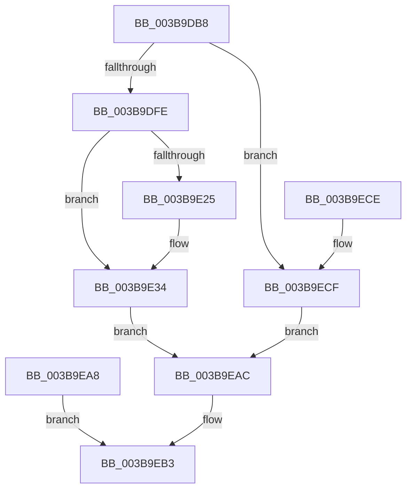

# PfpMemoryListQuery

- RVA: `0x003B9DB8`–`0x003B9ED6` (길이 `286` bytes)
- VA: `0x00000001403B9DB8`
- 실행 섹션: `.text`
- PDB 이름 있음: `예`; PDB Function 태그: `아니요`
- unwind 정보 RVA: `0x0008CAF8`
- 디코드: `69`개 명령, `286/286` bytes 표시
- 미해석 바이트: `0` (있으면 어셈블리에 `.byte`로 보존)

> 이 문서는 커널 이미지의 기계어와 PDB 기호를 분석해 생성했습니다. 4번과 5번은 함수 원형과 자료형을 바이너리 사용 방식에서 추정한 C 해석이며 원본 소스 복구 결과는 아닙니다.

## 1. Dependencies

- 직접 호출 지점: **3**; 고유 호출 대상: **3**
- 직접 호출자로 확인된 함수: **1**
- RIP 상대 이미지 참조: **0**

### Outgoing calls
- `0x003B9DE6` → [memset](../6C/memset_function_006C6C40.md) (function, `0x006C6C40`)
- `0x003B9E17` → [MmQueryMemoryListInformation](MmQueryMemoryListInformation_function_003B9EDC.md) (function, `0x003B9EDC`)
- `0x003B9E2F` → [ProbeForWrite](../../page/8E/ProbeForWrite_function_008E91C0.md) (function, `0x008E91C0`)

### Direct callers
- [PfQuerySuperfetchInformation](../../page/90/PfQuerySuperfetchInformation_function_0090210C.md) at `0x00902275`

### Static image references
- 디코드된 RIP-relative 메모리 참조가 없습니다.

## 2. Other-region calls and transfers

- 다른 실행 섹션으로 향하는 call: **1**
  - `0x003B9E2F` → [ProbeForWrite](../../page/8E/ProbeForWrite_function_008E91C0.md) (`.text` → `PAGE`)
- 별도 외부 분기/꼬리 이동을 확인하지 못했습니다.

## 3. Assembly (complete function range)

```asm
003B9DB8  48 89 5C 24 10                  mov qword ptr [rsp + 0x10], rbx
003B9DBD  48 89 74 24 18                  mov qword ptr [rsp + 0x18], rsi
003B9DC2  57                              push rdi
003B9DC3  41 56                           push r14
003B9DC5  41 57                           push r15
003B9DC7  48 81 EC E0 00 00 00            sub rsp, 0xe0
003B9DCE  4D 8B F0                        mov r14, r8
003B9DD1  44 8A FA                        mov r15b, dl
003B9DD4  48 8B F1                        mov rsi, rcx
003B9DD7  BF B0 00 00 00                  mov edi, 0xb0
003B9DDC  44 8B C7                        mov r8d, edi
003B9DDF  33 D2                           xor edx, edx
003B9DE1  48 8D 4C 24 30                  lea rcx, [rsp + 0x30]
003B9DE6  E8 55 CE 30 00                  call 0x1406c6c40
003B9DEB  33 DB                           xor ebx, ebx
003B9DED  89 9C 24 00 01 00 00            mov dword ptr [rsp + 0x100], ebx
003B9DF4  83 7E 18 40                     cmp dword ptr [rsi + 0x18], 0x40
003B9DF8  0F 82 D1 00 00 00               jb 0x1403b9ecf
003B9DFE  48 8D 84 24 00 01 00 00         lea rax, [rsp + 0x100]
003B9E06  48 89 44 24 20                  mov qword ptr [rsp + 0x20], rax
003B9E0B  44 8B C7                        mov r8d, edi
003B9E0E  48 8D 54 24 30                  lea rdx, [rsp + 0x30]
003B9E13  48 83 C9 FF                     or rcx, 0xffffffffffffffff
003B9E17  E8 C0 00 00 00                  call 0x1403b9edc
003B9E1C  48 8B 7E 10                     mov rdi, qword ptr [rsi + 0x10]
003B9E20  45 84 FF                        test r15b, r15b
003B9E23  74 0F                           je 0x1403b9e34
003B9E25  8B 56 18                        mov edx, dword ptr [rsi + 0x18]
003B9E28  44 8D 43 08                     lea r8d, [rbx + 8]
003B9E2C  48 8B CF                        mov rcx, rdi
003B9E2F  E8 8C F3 52 00                  call 0x1408e91c0
003B9E34  B8 01 00 00 00                  mov eax, 1
003B9E39  89 07                           mov dword ptr [rdi], eax
003B9E3B  C7 47 04 40 00 00 00            mov dword ptr [rdi + 4], 0x40
003B9E42  89 47 08                        mov dword ptr [rdi + 8], eax
003B9E45  48 81 67 10 00 FF FF FF         and qword ptr [rdi + 0x10], 0xffffffffffffff00
003B9E4D  48 8B 54 24 78                  mov rdx, qword ptr [rsp + 0x78]
003B9E52  48 03 54 24 58                  add rdx, qword ptr [rsp + 0x58]
003B9E57  48 03 54 24 60                  add rdx, qword ptr [rsp + 0x60]
003B9E5C  48 03 54 24 68                  add rdx, qword ptr [rsp + 0x68]
003B9E61  48 03 54 24 70                  add rdx, qword ptr [rsp + 0x70]
003B9E66  48 89 57 18                     mov qword ptr [rdi + 0x18], rdx
003B9E6A  48 8B 84 24 80 00 00 00         mov rax, qword ptr [rsp + 0x80]
003B9E72  48 89 47 20                     mov qword ptr [rdi + 0x20], rax
003B9E76  48 8B 8C 24 88 00 00 00         mov rcx, qword ptr [rsp + 0x88]
003B9E7E  48 03 8C 24 90 00 00 00         add rcx, qword ptr [rsp + 0x90]
003B9E86  48 89 4F 28                     mov qword ptr [rdi + 0x28], rcx
003B9E8A  48 8B 4C 24 38                  mov rcx, qword ptr [rsp + 0x38]
003B9E8F  48 03 4C 24 30                  add rcx, qword ptr [rsp + 0x30]
003B9E94  48 89 4F 30                     mov qword ptr [rdi + 0x30], rcx
003B9E98  48 8B 4C 24 40                  mov rcx, qword ptr [rsp + 0x40]
003B9E9D  48 03 4C 24 48                  add rcx, qword ptr [rsp + 0x48]
003B9EA2  48 89 4F 38                     mov qword ptr [rdi + 0x38], rcx
003B9EA6  EB 04                           jmp 0x1403b9eac
003B9EA8  8B D8                           mov ebx, eax
003B9EAA  EB 07                           jmp 0x1403b9eb3
003B9EAC  41 C7 06 40 00 00 00            mov dword ptr [r14], 0x40
003B9EB3  8B C3                           mov eax, ebx
003B9EB5  4C 8D 9C 24 E0 00 00 00         lea r11, [rsp + 0xe0]
003B9EBD  49 8B 5B 28                     mov rbx, qword ptr [r11 + 0x28]
003B9EC1  49 8B 73 30                     mov rsi, qword ptr [r11 + 0x30]
003B9EC5  49 8B E3                        mov rsp, r11
003B9EC8  41 5F                           pop r15
003B9ECA  41 5E                           pop r14
003B9ECC  5F                              pop rdi
003B9ECD  C3                              ret
003B9ECE  CC                              int3
003B9ECF  BB 23 00 00 C0                  mov ebx, 0xc0000023
003B9ED4  EB D6                           jmp 0x1403b9eac
```

## 4. C-style interpretation (structured pseudocode)

```c
__int64 __fastcall PfpMemoryListQuery(__int64 a1, int a2, __int64 a3)
{
    __int64 result;
    __int64 v_rbx;
    __int64 v_rsp;
    unsigned __int64 v_stack_m18;
    unsigned __int64 v_stack_m68;
    unsigned __int64 v_stack_m70;
    unsigned __int64 v_stack_m78;
    unsigned __int64 v_stack_m80;
    unsigned __int64 v_stack_m88;
    unsigned __int64 v_stack_m90;
    unsigned __int64 v_stack_m98;
    unsigned __int64 v_stack_mA0;
    unsigned __int64 v_stack_mB0;
    unsigned __int64 v_stack_mB8;
    unsigned __int64 v_stack_mC0;
    unsigned __int64 v_stack_mC8;
    unsigned __int64 v_stack_mD8;
    unsigned __int64 v_stack_p10;
    unsigned __int64 v_stack_p18;
    unsigned int v_stack_p8;

    v_stack_p10 = v_rbx;
    v_stack_p18 = v_rsi;
    v_rsp = (v_rsp) - (224);
    a2 = 0;
    result = memset(v_stack_mC8, a2, 176, a4);
    v_rbx = 0;
    v_stack_p8 = 0;
    if ((*(unsigned int *)(a1 + 24)) < 64) goto loc_003B9ECF;
    v_stack_mD8 = v_stack_p8;
    a1 = (v_stack_mC8) | (-1);
    result = MmQueryMemoryListInformation(a1, v_stack_mC8, 176, a4);
    if ((unsigned __int8)((unsigned __int8)(a2)) != 0) {
        a2 = *(unsigned int *)(a1 + 24);
        a3 = v_rbx + 8;
        a1 = *(unsigned __int64 *)(a1 + 16);
        result = ProbeForWrite(a1, a2, a3, a4);
    }
    *(unsigned int *)(*(unsigned __int64 *)(a1 + 16)) = 1;
    *(unsigned int *)(*(unsigned __int64 *)(a1 + 16) + 4) = 64;
    *(unsigned int *)(*(unsigned __int64 *)(a1 + 16) + 8) = 1;
    a2 = (v_stack_m80) + (v_stack_mA0);
    a2 = (a2) + (v_stack_m98);
    a2 = (a2) + (v_stack_m90);
    a2 = (a2) + (v_stack_m88);
    *(unsigned __int64 *)(*(unsigned __int64 *)(a1 + 16) + 24) = a2;
    *(unsigned __int64 *)(*(unsigned __int64 *)(a1 + 16) + 32) = v_stack_m78;
    a1 = (v_stack_m70) + (v_stack_m68);
    *(unsigned __int64 *)(*(unsigned __int64 *)(a1 + 16) + 40) = a1;
    a1 = (v_stack_mC0) + (v_stack_mC8);
    *(unsigned __int64 *)(*(unsigned __int64 *)(a1 + 16) + 48) = a1;
    a1 = (v_stack_mB8) + (v_stack_mB0);
    *(unsigned __int64 *)(*(unsigned __int64 *)(a1 + 16) + 56) = a1;
    goto loc_003B9EAC;
loc_003B9EAC:
    *(unsigned int *)(a3) = 64;
loc_003B9EB3:
    return 0;
loc_003B9ECF:
    goto loc_003B9EAC;
}
```

## 5. (Beta) C Style

```c
int64_t PfpMemoryListQuery(void *Arg1, int32_t Arg2, void *Arg3)
{
    uint8_t *arg1 = (uint8_t *)Arg1;
    uint8_t *arg3 = (uint8_t *)Arg3;

    int64_t result;
    int64_t local_rbx;
    int64_t local_rsp;
    uint64_t v_stack_m18;
    uint64_t v_stack_m68;
    uint64_t v_stack_m70;
    uint64_t v_stack_m78;
    uint64_t v_stack_m80;
    uint64_t v_stack_m88;
    uint64_t v_stack_m90;
    uint64_t v_stack_m98;
    uint64_t v_stack_mA0;
    uint64_t v_stack_mB0;
    uint64_t v_stack_mB8;
    uint64_t v_stack_mC0;
    uint64_t v_stack_mC8;
    uint64_t v_stack_mD8;
    uint64_t v_stack_p10;
    uint64_t v_stack_p18;
    uint32_t v_stack_p8;

    v_stack_p10 = local_rbx;
    v_stack_p18 = local_rsi;
    local_rsp = (local_rsp) - (224);
    Arg2 = 0;
    result = memset(v_stack_mC8, Arg2, 176, a4);
    local_rbx = 0;
    v_stack_p8 = 0;
    if ((*(uint32_t *)(arg1 + 0x18)) < 64) goto loc_003B9ECF;
    v_stack_mD8 = v_stack_p8;
    Arg1 = (v_stack_mC8) | (-1);
    result = MmQueryMemoryListInformation(Arg1, v_stack_mC8, 176, a4);
    if ((uint8_t)((uint8_t)(Arg2)) != 0) {
        Arg2 = *(uint32_t *)(arg1 + 0x18);
        Arg3 = local_rbx + 8;
        Arg1 = *(uint64_t *)(arg1 + 0x10);
        result = ProbeForWrite(Arg1, Arg2, Arg3, a4);
    }
    *(uint32_t *)(*(uint64_t *)(arg1 + 0x10)) = 1;
    *(uint32_t *)(*(uint64_t *)(arg1 + 0x10) + 0x4) = 64;
    *(uint32_t *)(*(uint64_t *)(arg1 + 0x10) + 0x8) = 1;
    Arg2 = (v_stack_m80) + (v_stack_mA0);
    Arg2 = (Arg2) + (v_stack_m98);
    Arg2 = (Arg2) + (v_stack_m90);
    Arg2 = (Arg2) + (v_stack_m88);
    *(uint64_t *)(*(uint64_t *)(arg1 + 0x10) + 0x18) = Arg2;
    *(uint64_t *)(*(uint64_t *)(arg1 + 0x10) + 0x20) = v_stack_m78;
    Arg1 = (v_stack_m70) + (v_stack_m68);
    *(void **)(*(uint64_t *)(arg1 + 0x10) + 0x28) = Arg1;
    Arg1 = (v_stack_mC0) + (v_stack_mC8);
    *(void **)(*(uint64_t *)(arg1 + 0x10) + 0x30) = Arg1;
    Arg1 = (v_stack_mB8) + (v_stack_mB0);
    *(void **)(*(uint64_t *)(arg1 + 0x10) + 0x38) = Arg1;
    goto loc_003B9EAC;
loc_003B9EAC:
    *(uint32_t *)(arg3) = 64;
loc_003B9EB3:
    return 0;
loc_003B9ECF:
    goto loc_003B9EAC;
}
```

### 관측된 메모리 오프셋

구조체 형식이 확인되지 않은 접근은 인자 기준의 오프셋으로만 기록했습니다.

| 기준 인자 | 오프셋 표현 | 폭 (bit) | 접근 |
|---|---:|---:|---|
| `Arg1` | `+ 0x10` | `64` | `R` |
| `Arg1` | `+ 0x18` | `32` | `R` |
| `Arg3` | `+ 0x0` | `32` | `W` |

## 6. Execution-region graph

[열기: 2D/3D 그래프와 함수 탐색 컨트롤 패널](../../../control-panel.html?section=text&rva=0x003B9DB8&view=graph)

- 2D 그래프는 위에서 아래로 흐르고, 3D 그래프는 빈 공간을 드래그해 회전합니다. Shift+드래그는 이동, 휠은 확대·축소, 함수 노드 선택은 대상 보고서 이동입니다.

### Static fallback


