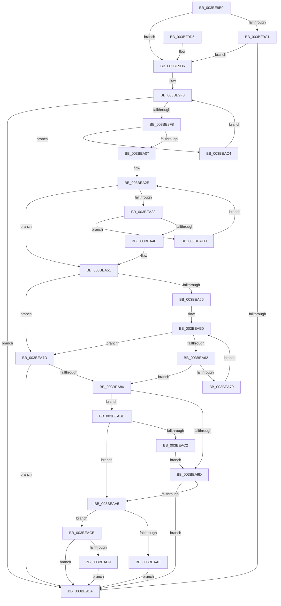

# PoLatencySensitivityHint

- RVA: `0x003BE9B0`–`0x003BEAF4` (길이 `324` bytes)
- VA: `0x00000001403BE9B0`
- 실행 섹션: `.text`
- PDB 이름 있음: `예`; PDB Function 태그: `아니요`
- unwind 정보 RVA: `0x0008DE64`
- 디코드: `83`개 명령, `324/324` bytes 표시
- 미해석 바이트: `0` (있으면 어셈블리에 `.byte`로 보존)

> 이 문서는 커널 이미지의 기계어와 PDB 기호를 분석해 생성했습니다. 4번과 5번은 함수 원형과 자료형을 바이너리 사용 방식에서 추정한 C 해석이며 원본 소스 복구 결과는 아닙니다.

## 1. Dependencies

- 직접 호출 지점: **4**; 고유 호출 대상: **4**
- 직접 호출자로 확인된 함수: **2**
- RIP 상대 이미지 참조: **9**

### Outgoing calls
- `0x003BEA09` → [PpmEventTraceLatencySensitivityHint](PpmEventTraceLatencySensitivityHint_function_003BEAFC.md) (function, `0x003BEAFC`)
- `0x003BEAA5` → [PpmTryAcquireLock](PpmTryAcquireLock_function_003BEB9C.md) (function, `0x003BEB9C`)
- `0x003BEAB3` → [PpmCheckCustomRun](PpmCheckCustomRun_function_003BEC2C.md) (function, `0x003BEC2C`)
- `0x003BEAE3` → [ExQueueWorkItem](../2F/ExQueueWorkItem_function_002F9520.md) (function, `0x002F9520`)

### Direct callers
- [PopPowerInformationInternal](../../page/A8/PopPowerInformationInternal_function_00A8B7C0.md) at `0x00A8BC78`
- [PopPowerRequestCallbackPerfBoostRequired](../../page/A9/PopPowerRequestCallbackPerfBoostRequired_function_00A96F70.md) at `0x00A97018`

### Static image references
- `0x003BE9C1` → RVA `0x00F0E178` (`.data`; read)
- `0x003BE9D6` → RVA `0x00E08380` (`.data`; read)
- `0x003BE9DD` → RVA `0x00F0CE0C` (`.data`; read)
- `0x003BEA1D` → RVA `0x00F0B268` (`.data`; read)
- `0x003BEA24` → RVA `0x00F0E100` (`.data`; read)
- `0x003BEA56` → RVA `0x00F0E0F8` (`.data`; read)
- `0x003BEA8B` → RVA `0x00F0B270` (`.data`; read)
- `0x003BEACB` → RVA `0x00F0E108` (`.data`; read/write)
- `0x003BEADC` → RVA `0x00F0E120` (`.data`; read)

## 2. Other-region calls and transfers

- 다른 실행 섹션으로 향하는 call: **0**
- 별도 외부 분기/꼬리 이동을 확인하지 못했습니다.

## 3. Assembly (complete function range)

```asm
003BE9B0  48 89 5C 24 08                  mov qword ptr [rsp + 8], rbx
003BE9B5  57                              push rdi
003BE9B6  48 83 EC 20                     sub rsp, 0x20
003BE9BA  8B F9                           mov edi, ecx
003BE9BC  83 F9 04                        cmp ecx, 4
003BE9BF  75 15                           jne 0x1403be9d6
003BE9C1  80 3D B0 F7 B4 00 00            cmp byte ptr [rip + 0xb4f7b0], 0
003BE9C8  74 0C                           je 0x1403be9d6
003BE9CA  48 8B 5C 24 30                  mov rbx, qword ptr [rsp + 0x30]
003BE9CF  48 83 C4 20                     add rsp, 0x20
003BE9D3  5F                              pop rdi
003BE9D4  C3                              ret
003BE9D5  CC                              int3
003BE9D6  4C 8B 05 A3 99 A4 00            mov r8, qword ptr [rip + 0xa499a3]
003BE9DD  48 63 05 28 E4 B4 00            movsxd rax, dword ptr [rip + 0xb4e428]
003BE9E4  4C 69 C8 E8 01 00 00            imul r9, rax, 0x1e8
003BE9EB  4D 03 C8                        add r9, r8
003BE9EE  33 C9                           xor ecx, ecx
003BE9F0  8D 59 01                        lea ebx, [rcx + 1]
003BE9F3  83 F9 02                        cmp ecx, 2
003BE9F6  73 D2                           jae 0x1403be9ca
003BE9F8  42 80 BC 09 85 00 00 00 00      cmp byte ptr [rcx + r9 + 0x85], 0
003BEA01  0F 84 BD 00 00 00               je 0x1403beac4
003BEA07  8B CF                           mov ecx, edi
003BEA09  E8 EE 00 00 00                  call 0x1403beafc
003BEA0E  49 B8 08 00 00 00 80 F7 FF FF   movabs r8, 0xfffff78000000008
003BEA18  33 D2                           xor edx, edx
003BEA1A  4D 8B 00                        mov r8, qword ptr [r8]
003BEA1D  4C 03 05 44 C8 B4 00            add r8, qword ptr [rip + 0xb4c844]
003BEA24  4C 8B 15 D5 F6 B4 00            mov r10, qword ptr [rip + 0xb4f6d5]
003BEA2B  45 32 C9                        xor r9b, r9b
003BEA2E  4D 3B D0                        cmp r10, r8
003BEA31  73 1E                           jae 0x1403bea51
003BEA33  49 8B CA                        mov rcx, r10
003BEA36  49 8B C2                        mov rax, r10
003BEA39  F0 4C 0F B1 05 BE F6 B4 00      lock cmpxchg qword ptr [rip + 0xb4f6be], r8
003BEA42  4C 8B D0                        mov r10, rax
003BEA45  48 3B C8                        cmp rcx, rax
003BEA48  0F 85 9F 00 00 00               jne 0x1403beaed
003BEA4E  44 8A CB                        mov r9b, bl
003BEA51  83 FF 04                        cmp edi, 4
003BEA54  75 27                           jne 0x1403bea7d
003BEA56  48 8B 15 9B F6 B4 00            mov rdx, qword ptr [rip + 0xb4f69b]
003BEA5D  49 3B D0                        cmp rdx, r8
003BEA60  73 1B                           jae 0x1403bea7d
003BEA62  48 8B CA                        mov rcx, rdx
003BEA65  48 8B C2                        mov rax, rdx
003BEA68  F0 4C 0F B1 05 87 F6 B4 00      lock cmpxchg qword ptr [rip + 0xb4f687], r8
003BEA71  48 8B D0                        mov rdx, rax
003BEA74  48 3B C8                        cmp rcx, rax
003BEA77  74 0D                           je 0x1403bea86
003BEA79  F3 90                           pause
003BEA7B  EB E0                           jmp 0x1403bea5d
003BEA7D  45 84 C9                        test r9b, r9b
003BEA80  0F 84 44 FF FF FF               je 0x1403be9ca
003BEA86  F0 83 0C 24 00                  lock or dword ptr [rsp], 0
003BEA8B  48 8B 0D DE C7 B4 00            mov rcx, qword ptr [rip + 0xb4c7de]
003BEA92  4C 3B D1                        cmp r10, rcx
003BEA95  0F 96 C0                        setbe al
003BEA98  83 FF 04                        cmp edi, 4
003BEA9B  74 20                           je 0x1403beabd
003BEA9D  84 C0                           test al, al
003BEA9F  0F 84 25 FF FF FF               je 0x1403be9ca
003BEAA5  E8 F2 00 00 00                  call 0x1403beb9c
003BEAAA  84 C0                           test al, al
003BEAAC  74 1D                           je 0x1403beacb
003BEAAE  B9 03 00 00 00                  mov ecx, 3
003BEAB3  E8 74 01 00 00                  call 0x1403bec2c
003BEAB8  E9 0D FF FF FF                  jmp 0x1403be9ca
003BEABD  48 3B D1                        cmp rdx, rcx
003BEAC0  76 E3                           jbe 0x1403beaa5
003BEAC2  EB D9                           jmp 0x1403bea9d
003BEAC4  03 CB                           add ecx, ebx
003BEAC6  E9 28 FF FF FF                  jmp 0x1403be9f3
003BEACB  87 1D 37 F6 B4 00               xchg dword ptr [rip + 0xb4f637], ebx
003BEAD1  85 DB                           test ebx, ebx
003BEAD3  0F 85 F1 FE FF FF               jne 0x1403be9ca
003BEAD9  8D 53 3B                        lea edx, [rbx + 0x3b]
003BEADC  48 8D 0D 3D F6 B4 00            lea rcx, [rip + 0xb4f63d]
003BEAE3  E8 38 AA F3 FF                  call 0x1402f9520
003BEAE8  E9 DD FE FF FF                  jmp 0x1403be9ca
003BEAED  F3 90                           pause
003BEAEF  E9 3A FF FF FF                  jmp 0x1403bea2e
```

## 4. C-style interpretation (structured pseudocode)

```c
__int64 __fastcall PoLatencySensitivityHint(int a1, int a2)
{
    __int64 result;
    __int64 v_rsp;
    unsigned int v_stack_p0;
    unsigned __int64 v_stack_p8;

    v_stack_p8 = v_rbx;
    v_rsp = (v_rsp) - (32);
    if (a1 != 4) goto loc_003BE9D6;
    if ((*(unsigned __int8 *)(v_rip + 11859888)) == 0) goto loc_003BE9D6;
loc_003BE9CA:
    v_rsp = (v_rsp) + (32);
    return result;
loc_003BE9D6:
    a4 = (a4) * ((int)(*(unsigned int *)(v_rip + 11854888)));
    a4 = (a4) + (*(unsigned __int64 *)(v_rip + 10787235));
    a1 = 0;
loc_003BE9F3:
    if (0 >= 2) goto loc_003BE9CA;
    if ((*(unsigned __int8 *)(a1 + a4 * 1 + 133)) == 0) goto loc_003BEAC4;
    result = PpmEventTraceLatencySensitivityHint((unsigned int)((unsigned int)((unsigned int)(a1))), a2, *(unsigned __int64 *)(v_rip + 10787235), a4);
    a2 = 0;
    a3 = (*(unsigned __int64 *)(*(unsigned __int64 *)(v_rip + 10787235))) + (*(unsigned __int64 *)(v_rip + 11847748));
    a4 = 0;
loc_003BEA2E:
    if ((*(unsigned __int64 *)(v_rip + 11859669)) >= a3) goto loc_003BEA51;
    if ((*(unsigned __int64 *)(v_rip + 11859669)) != (*(unsigned __int64 *)(v_rip + 11859669))) goto loc_003BEAED;
loc_003BEA51:
    if (((unsigned int)((unsigned int)(a1))) != 4) goto loc_003BEA7D;
loc_003BEA5D:
    if ((*(unsigned __int64 *)(v_rip + 11859611)) >= a3) goto loc_003BEA7D;
    if ((*(unsigned __int64 *)(v_rip + 11859611)) == (*(unsigned __int64 *)(v_rip + 11859611))) goto loc_003BEA86;
    goto loc_003BEA5D;
loc_003BEA7D:
    if ((unsigned __int8)((unsigned __int8)(a1 + 1)) == 0) goto loc_003BE9CA;
loc_003BEA86:
    result = ((*(unsigned __int64 *)(v_rip + 11859669)) <= (*(unsigned __int64 *)(v_rip + 11847646))) ? 1 : 0;
    if (((unsigned int)((unsigned int)(a1))) == 4) goto loc_003BEABD;
loc_003BEA9D:
    if ((unsigned __int8)(result) == 0) goto loc_003BE9CA;
loc_003BEAA5:
    result = PpmTryAcquireLock(*(unsigned __int64 *)(v_rip + 11847646), *(unsigned __int64 *)(v_rip + 11859611), a3, (unsigned __int8)(a1 + 1));
    if ((unsigned __int8)(result) == 0) goto loc_003BEACB;
    result = PpmCheckCustomRun(3, *(unsigned __int64 *)(v_rip + 11859611), a3, (unsigned __int8)(a1 + 1));
    goto loc_003BE9CA;
loc_003BEABD:
    if ((*(unsigned __int64 *)(v_rip + 11859611)) <= 3) goto loc_003BEAA5;
    goto loc_003BEA9D;
loc_003BEAC4:
    a1 = (unsigned int)((3) + ((unsigned int)(a1 + 1)));
    goto loc_003BE9F3;
loc_003BEACB:
    if ((unsigned int)(a1 + 1) != 0) goto loc_003BE9CA;
    result = ExQueueWorkItem(v_rip + 11859517, a1 + 1 + 59, a3, (unsigned __int8)(a1 + 1));
    goto loc_003BE9CA;
loc_003BEAED:
    goto loc_003BEA2E;
}
```

## 5. (Beta) C Style

```c
int64_t PoLatencySensitivityHint(int32_t Arg1, int32_t Arg2)
{
    int64_t result;
    int64_t local_rsp;
    uint32_t v_stack_p0;
    uint64_t v_stack_p8;

    v_stack_p8 = local_rbx;
    local_rsp = (local_rsp) - (32);
    if (Arg1 != 4) goto loc_003BE9D6;
    if ((*(uint8_t *)(v_rip + 0xB4F7B0)) == 0) goto loc_003BE9D6;
loc_003BE9CA:
    local_rsp = (local_rsp) + (32);
    return result;
loc_003BE9D6:
    a4 = (a4) * ((int32_t)(*(uint32_t *)(v_rip + 0xB4E428)));
    a4 = (a4) + (*(uint64_t *)(v_rip + 0xA499A3));
    Arg1 = 0;
loc_003BE9F3:
    if (0 >= 2) goto loc_003BE9CA;
    if ((*(uint8_t *)(Arg1 + a4 * 1 + 0x85)) == 0) goto loc_003BEAC4;
    result = PpmEventTraceLatencySensitivityHint((uint32_t)((uint32_t)((uint32_t)(Arg1))), Arg2, *(uint64_t *)(v_rip + 0xA499A3), a4);
    Arg2 = 0;
    a3 = (*(uint64_t *)(*(uint64_t *)(v_rip + 0xA499A3))) + (*(uint64_t *)(v_rip + 0xB4C844));
    a4 = 0;
loc_003BEA2E:
    if ((*(uint64_t *)(v_rip + 0xB4F6D5)) >= a3) goto loc_003BEA51;
    if ((*(uint64_t *)(v_rip + 0xB4F6D5)) != (*(uint64_t *)(v_rip + 0xB4F6D5))) goto loc_003BEAED;
loc_003BEA51:
    if (((uint32_t)((uint32_t)(Arg1))) != 4) goto loc_003BEA7D;
loc_003BEA5D:
    if ((*(uint64_t *)(v_rip + 0xB4F69B)) >= a3) goto loc_003BEA7D;
    if ((*(uint64_t *)(v_rip + 0xB4F69B)) == (*(uint64_t *)(v_rip + 0xB4F69B))) goto loc_003BEA86;
    goto loc_003BEA5D;
loc_003BEA7D:
    if ((uint8_t)((uint8_t)(Arg1 + 1)) == 0) goto loc_003BE9CA;
loc_003BEA86:
    result = ((*(uint64_t *)(v_rip + 0xB4F6D5)) <= (*(uint64_t *)(v_rip + 0xB4C7DE))) ? 1 : 0;
    if (((uint32_t)((uint32_t)(Arg1))) == 4) goto loc_003BEABD;
loc_003BEA9D:
    if ((uint8_t)(result) == 0) goto loc_003BE9CA;
loc_003BEAA5:
    result = PpmTryAcquireLock(*(uint64_t *)(v_rip + 0xB4C7DE), *(uint64_t *)(v_rip + 0xB4F69B), a3, (uint8_t)(Arg1 + 1));
    if ((uint8_t)(result) == 0) goto loc_003BEACB;
    result = PpmCheckCustomRun(3, *(uint64_t *)(v_rip + 0xB4F69B), a3, (uint8_t)(Arg1 + 1));
    goto loc_003BE9CA;
loc_003BEABD:
    if ((*(uint64_t *)(v_rip + 0xB4F69B)) <= 3) goto loc_003BEAA5;
    goto loc_003BEA9D;
loc_003BEAC4:
    Arg1 = (uint32_t)((3) + ((uint32_t)(Arg1 + 1)));
    goto loc_003BE9F3;
loc_003BEACB:
    if ((uint32_t)(Arg1 + 1) != 0) goto loc_003BE9CA;
    result = ExQueueWorkItem(v_rip + 11859517, Arg1 + 1 + 59, a3, (uint8_t)(Arg1 + 1));
    goto loc_003BE9CA;
loc_003BEAED:
    goto loc_003BEA2E;
}
```

## 6. Execution-region graph

[열기: 2D/3D 그래프와 함수 탐색 컨트롤 패널](../../../control-panel.html?section=text&rva=0x003BE9B0&view=graph)

- 2D 그래프는 위에서 아래로 흐르고, 3D 그래프는 빈 공간을 드래그해 회전합니다. Shift+드래그는 이동, 휠은 확대·축소, 함수 노드 선택은 대상 보고서 이동입니다.

### Static fallback


