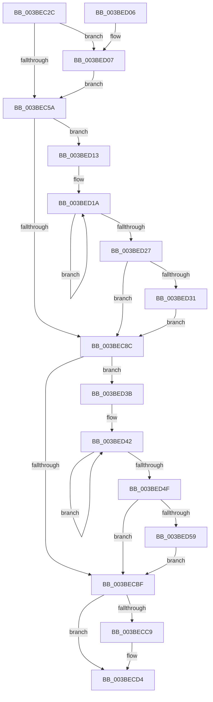

# PpmCheckCustomRun

- RVA: `0x003BEC2C`–`0x003BED63` (길이 `311` bytes)
- VA: `0x00000001403BEC2C`
- 실행 섹션: `.text`
- PDB 이름 있음: `예`; PDB Function 태그: `아니요`
- unwind 정보 RVA: `0x0008DE94`
- 디코드: `73`개 명령, `311/311` bytes 표시
- 미해석 바이트: `0` (있으면 어셈블리에 `.byte`로 보존)

> 이 문서는 커널 이미지의 기계어와 PDB 기호를 분석해 생성했습니다. 4번과 5번은 함수 원형과 자료형을 바이너리 사용 방식에서 추정한 C 해석이며 원본 소스 복구 결과는 아닙니다.

## 1. Dependencies

- 직접 호출 지점: **9**; 고유 호출 대상: **8**
- 직접 호출자로 확인된 함수: **9**
- RIP 상대 이미지 참조: **2**

### Outgoing calls
- `0x003BEC6E` → [KiEndThreadCycleAccumulation](../37/KiEndThreadCycleAccumulation_function_0037BFF0.md) (function, `0x0037BFF0`)
- `0x003BEC8F` → [PpmCheckStart](PpmCheckStart_function_003BEE14.md) (function, `0x003BEE14`)
- `0x003BECA5` → [KiStartThreadCycleAccumulation](../37/KiStartThreadCycleAccumulation_function_0037DB30.md) (function, `0x0037DB30`)
- `0x003BECCF` → [KiLowerIrqlProcessIrqlFlags](../4F/KiLowerIrqlProcessIrqlFlags_function_004F5698.md) (function, `0x004F5698`)
- `0x003BECF1` → [KiClearSystemPriority](../2C/KiClearSystemPriority_function_002C05A8.md) (function, `0x002C05A8`)
- `0x003BECF6` → [KeLeaveCriticalRegion](../25/KeLeaveCriticalRegion_function_0025D8B0.md) (function, `0x0025D8B0`)
- `0x003BED09` → [KiRaiseIrqlProcessIrqlFlags](../4F/KiRaiseIrqlProcessIrqlFlags_function_004F56FC.md) (function, `0x004F56FC`)
- `0x003BED31` → [KiRemoveSystemWorkPriorityKick](../26/KiRemoveSystemWorkPriorityKick_function_002631D0.md) (function, `0x002631D0`)
- `0x003BED59` → [KiRemoveSystemWorkPriorityKick](../26/KiRemoveSystemWorkPriorityKick_function_002631D0.md) (function, `0x002631D0`)

### Direct callers
- [PpmPerfLatencySensitivityHintWorker](PpmPerfLatencySensitivityHintWorker_function_003BE910.md) at `0x003BE92F`
- [PpmCheckDelayedPeriodicStart](PpmCheckDelayedPeriodicStart_function_003BE940.md) at `0x003BE95D`
- [PpmCheckApplyResetNotification](PpmCheckApplyResetNotification_function_003BE978.md) at `0x003BE981`
- [PpmCheckApplyParkConstraints](PpmCheckApplyParkConstraints_function_003BE994.md) at `0x003BE99D`
- [PoLatencySensitivityHint](PoLatencySensitivityHint_function_003BE9B0.md) at `0x003BEAB3`
- [PpmParkSetLpiCap](../4D/PpmParkSetLpiCap_function_004D9358.md) at `0x004D948C`
- [PopIntSteerSetMode](../5D/PopIntSteerSetMode_function_005DD3B0.md) at `0x005DD3F3`
- [PpmPerfReApplyStates](../../page/75/PpmPerfReApplyStates_function_0075ADA4.md) at `0x0075ADCC`
- [PpmCheckApplyPerfConstraints](../../page/A9/PpmCheckApplyPerfConstraints_function_00A971EC.md) at `0x00A971F8`

### Static image references
- `0x003BEC36` → RVA `0x00F0CC00` (`.data`; read/write)
- `0x003BEC4D` → RVA `0x00FC6D20` (`ALMOSTRO`; read)

## 2. Other-region calls and transfers

- 다른 실행 섹션으로 향하는 call: **0**
- 별도 외부 분기/꼬리 이동을 확인하지 못했습니다.

## 3. Assembly (complete function range)

```asm
003BEC2C  48 89 5C 24 08                  mov qword ptr [rsp + 8], rbx
003BEC31  57                              push rdi
003BEC32  48 83 EC 20                     sub rsp, 0x20
003BEC36  48 83 25 C2 DF B4 00 00         and qword ptr [rip + 0xb4dfc2], 0
003BEC3E  8B F9                           mov edi, ecx
003BEC40  44 0F 20 C3                     mov rbx, cr8
003BEC44  BA 02 00 00 00                  mov edx, 2
003BEC49  44 0F 22 C2                     mov cr8, rdx
003BEC4D  83 3D CC 80 C0 00 00            cmp dword ptr [rip + 0xc080cc], 0
003BEC54  0F 85 AD 00 00 00               jne 0x1403bed07
003BEC5A  65 48 8B 0C 25 20 00 00 00      mov rcx, qword ptr gs:[0x20]
003BEC63  48 8B 51 08                     mov rdx, qword ptr [rcx + 8]
003BEC67  FA                              cli
003BEC68  45 33 C9                        xor r9d, r9d
003BEC6B  45 33 C0                        xor r8d, r8d
003BEC6E  E8 7D D3 FB FF                  call 0x14037bff0
003BEC73  65 48 8B 0C 25 20 00 00 00      mov rcx, qword ptr gs:[0x20]
003BEC7C  4C 8B 81 B8 8E 00 00            mov r8, qword ptr [rcx + 0x8eb8]
003BEC83  4D 85 C0                        test r8, r8
003BEC86  0F 85 87 00 00 00               jne 0x1403bed13
003BEC8C  FB                              sti
003BEC8D  8B CF                           mov ecx, edi
003BEC8F  E8 80 01 00 00                  call 0x1403bee14
003BEC94  65 48 8B 0C 25 20 00 00 00      mov rcx, qword ptr gs:[0x20]
003BEC9D  48 8B 51 08                     mov rdx, qword ptr [rcx + 8]
003BECA1  FA                              cli
003BECA2  45 33 C0                        xor r8d, r8d
003BECA5  E8 86 EE FB FF                  call 0x14037db30
003BECAA  65 48 8B 0C 25 20 00 00 00      mov rcx, qword ptr gs:[0x20]
003BECB3  4C 8B 81 B8 8E 00 00            mov r8, qword ptr [rcx + 0x8eb8]
003BECBA  4D 85 C0                        test r8, r8
003BECBD  75 7C                           jne 0x1403bed3b
003BECBF  FB                              sti
003BECC0  83 3D 59 80 C0 00 00            cmp dword ptr [rip + 0xc08059], 0
003BECC7  74 0B                           je 0x1403becd4
003BECC9  44 0F 20 C1                     mov rcx, cr8
003BECCD  8A D3                           mov dl, bl
003BECCF  E8 C4 69 13 00                  call 0x1404f5698
003BECD4  0F B6 C3                        movzx eax, bl
003BECD7  44 0F 22 C0                     mov cr8, rax
003BECDB  65 48 8B 0C 25 88 01 00 00      mov rcx, qword ptr gs:[0x188]
003BECE4  48 8D 54 24 38                  lea rdx, [rsp + 0x38]
003BECE9  C7 44 24 38 16 00 00 00         mov dword ptr [rsp + 0x38], 0x16
003BECF1  E8 B2 18 F0 FF                  call 0x1402c05a8
003BECF6  E8 B5 EB E9 FF                  call 0x14025d8b0
003BECFB  48 8B 5C 24 30                  mov rbx, qword ptr [rsp + 0x30]
003BED00  48 83 C4 20                     add rsp, 0x20
003BED04  5F                              pop rdi
003BED05  C3                              ret
003BED06  CC                              int3
003BED07  8A CB                           mov cl, bl
003BED09  E8 EE 69 13 00                  call 0x1404f56fc
003BED0E  E9 47 FF FF FF                  jmp 0x1403bec5a
003BED13  41 0F 0D 08                     prefetchw byte ptr [r8]
003BED17  41 8B 00                        mov eax, dword ptr [r8]
003BED1A  8B D0                           mov edx, eax
003BED1C  0F BA F2 15                     btr edx, 0x15
003BED20  F0 41 0F B1 10                  lock cmpxchg dword ptr [r8], edx
003BED25  75 F3                           jne 0x1403bed1a
003BED27  0F BA E0 15                     bt eax, 0x15
003BED2B  0F 83 5B FF FF FF               jae 0x1403bec8c
003BED31  E8 9A 44 EA FF                  call 0x1402631d0
003BED36  E9 51 FF FF FF                  jmp 0x1403bec8c
003BED3B  41 0F 0D 08                     prefetchw byte ptr [r8]
003BED3F  41 8B 00                        mov eax, dword ptr [r8]
003BED42  8B D0                           mov edx, eax
003BED44  0F BA F2 15                     btr edx, 0x15
003BED48  F0 41 0F B1 10                  lock cmpxchg dword ptr [r8], edx
003BED4D  75 F3                           jne 0x1403bed42
003BED4F  0F BA E0 15                     bt eax, 0x15
003BED53  0F 83 66 FF FF FF               jae 0x1403becbf
003BED59  E8 72 44 EA FF                  call 0x1402631d0
003BED5E  E9 5C FF FF FF                  jmp 0x1403becbf
```

## 4. C-style interpretation (structured pseudocode)

```c
__int64 __fastcall PpmCheckCustomRun(int a1, __int64 a2, int a3, int a4)
{
    __int64 result;
    __int64 v_rsp;
    unsigned __int64 v_stack_p10;
    unsigned __int64 v_stack_p8;

    v_stack_p8 = v_rbx;
    v_rsp = (v_rsp) - (32);
    if ((*(unsigned int *)(v_rip + 12615884)) != 0) goto loc_003BED07;
loc_003BEC5A:
    a4 = 0;
    a3 = 0;
    result = KiEndThreadCycleAccumulation(*(unsigned __int64 *)(gs_base + (0 + 32)), *(unsigned __int64 *)(*(unsigned __int64 *)(gs_base + (0 + 32)) + 8), a3, a4);
    if (*(unsigned __int64 *)(*(unsigned __int64 *)(gs_base + (0 + 32)) + 36536) != 0) goto loc_003BED13;
loc_003BEC8C:
    result = PpmCheckStart((unsigned int)((unsigned int)((unsigned int)(a1))), *(unsigned __int64 *)(*(unsigned __int64 *)(gs_base + (0 + 32)) + 8), *(unsigned __int64 *)(*(unsigned __int64 *)(gs_base + (0 + 32)) + 36536), a4);
    a3 = 0;
    result = KiStartThreadCycleAccumulation(*(unsigned __int64 *)(gs_base + (0 + 32)), *(unsigned __int64 *)(*(unsigned __int64 *)(gs_base + (0 + 32)) + 8), a3, a4);
    if (*(unsigned __int64 *)(*(unsigned __int64 *)(gs_base + (0 + 32)) + 36536) != 0) goto loc_003BED3B;
loc_003BECBF:
    if ((*(unsigned int *)(v_rip + 12615769)) != 0) {
        a1 = 2;
        a2 = (unsigned __int8)(v_cr8);
        result = KiLowerIrqlProcessIrqlFlags(a1, a2, *(unsigned __int64 *)(*(unsigned __int64 *)(gs_base + (0 + 32)) + 36536), a4);
    }
    v_stack_p10 = 22;
    result = KiClearSystemPriority(*(unsigned __int64 *)(gs_base + (0 + 392)), v_stack_p10, *(unsigned __int64 *)(*(unsigned __int64 *)(gs_base + (0 + 32)) + 36536), a4);
    result = KeLeaveCriticalRegion(*(unsigned __int64 *)(gs_base + (0 + 392)), v_stack_p10, *(unsigned __int64 *)(*(unsigned __int64 *)(gs_base + (0 + 32)) + 36536), a4);
    v_rsp = (v_rsp) + (32);
    return result;
loc_003BED07:
    result = KiRaiseIrqlProcessIrqlFlags((unsigned __int8)(v_stack_p8), v_stack_p10, *(unsigned __int64 *)(*(unsigned __int64 *)(gs_base + (0 + 32)) + 36536), a4);
    goto loc_003BEC5A;
loc_003BED13:
loc_003BED1A:
    if (condition_is_not_equal) goto loc_003BED1A;
    if (condition_is_above_or_equal) goto loc_003BEC8C;
    result = KiRemoveSystemWorkPriorityKick((unsigned __int8)(v_stack_p8), (unsigned int)((unsigned int)((unsigned int)(*(unsigned int *)(*(unsigned __int64 *)(*(unsigned __int64 *)(gs_base + (0 + 32)) + 36536))))), *(unsigned __int64 *)(*(unsigned __int64 *)(gs_base + (0 + 32)) + 36536), a4);
    goto loc_003BEC8C;
loc_003BED3B:
loc_003BED42:
    if (condition_is_not_equal) goto loc_003BED42;
    if (condition_is_above_or_equal) goto loc_003BECBF;
    result = KiRemoveSystemWorkPriorityKick((unsigned __int8)(v_stack_p8), (unsigned int)((unsigned int)((unsigned int)(*(unsigned int *)(*(unsigned __int64 *)(*(unsigned __int64 *)(gs_base + (0 + 32)) + 36536))))), *(unsigned __int64 *)(*(unsigned __int64 *)(gs_base + (0 + 32)) + 36536), a4);
    goto loc_003BECBF;
}
```

## 5. (Beta) C Style

```c
int64_t PpmCheckCustomRun(int32_t Arg1, int64_t Arg2, int32_t Arg3, int32_t Arg4)
{
    int64_t result;
    int64_t local_rsp;
    uint64_t v_stack_p10;
    uint64_t v_stack_p8;

    v_stack_p8 = local_rbx;
    local_rsp = (local_rsp) - (32);
    if ((*(uint32_t *)(v_rip + 0xC080CC)) != 0) goto loc_003BED07;
loc_003BEC5A:
    Arg4 = 0;
    Arg3 = 0;
    result = KiEndThreadCycleAccumulation(*(uint64_t *)(gs_base + (0 + 0x20)), *(uint64_t *)(*(uint64_t *)(gs_base + (0 + 0x20)) + 0x8), Arg3, Arg4);
    if (*(uint64_t *)(*(uint64_t *)(gs_base + (0 + 0x20)) + 0x8EB8) != 0) goto loc_003BED13;
loc_003BEC8C:
    result = PpmCheckStart((uint32_t)((uint32_t)((uint32_t)(Arg1))), *(uint64_t *)(*(uint64_t *)(gs_base + (0 + 0x20)) + 0x8), *(uint64_t *)(*(uint64_t *)(gs_base + (0 + 0x20)) + 0x8EB8), Arg4);
    Arg3 = 0;
    result = KiStartThreadCycleAccumulation(*(uint64_t *)(gs_base + (0 + 0x20)), *(uint64_t *)(*(uint64_t *)(gs_base + (0 + 0x20)) + 0x8), Arg3, Arg4);
    if (*(uint64_t *)(*(uint64_t *)(gs_base + (0 + 0x20)) + 0x8EB8) != 0) goto loc_003BED3B;
loc_003BECBF:
    if ((*(uint32_t *)(v_rip + 0xC08059)) != 0) {
        Arg1 = 2;
        Arg2 = (uint8_t)(v_cr8);
        result = KiLowerIrqlProcessIrqlFlags(Arg1, Arg2, *(uint64_t *)(*(uint64_t *)(gs_base + (0 + 0x20)) + 0x8EB8), Arg4);
    }
    v_stack_p10 = 22;
    result = KiClearSystemPriority(*(uint64_t *)(gs_base + (0 + 0x188)), v_stack_p10, *(uint64_t *)(*(uint64_t *)(gs_base + (0 + 0x20)) + 0x8EB8), Arg4);
    result = KeLeaveCriticalRegion(*(uint64_t *)(gs_base + (0 + 0x188)), v_stack_p10, *(uint64_t *)(*(uint64_t *)(gs_base + (0 + 0x20)) + 0x8EB8), Arg4);
    local_rsp = (local_rsp) + (32);
    return result;
loc_003BED07:
    result = KiRaiseIrqlProcessIrqlFlags((uint8_t)(v_stack_p8), v_stack_p10, *(uint64_t *)(*(uint64_t *)(gs_base + (0 + 0x20)) + 0x8EB8), Arg4);
    goto loc_003BEC5A;
loc_003BED13:
loc_003BED1A:
    if (condition_is_not_equal) goto loc_003BED1A;
    if (condition_is_above_or_equal) goto loc_003BEC8C;
    result = KiRemoveSystemWorkPriorityKick((uint8_t)(v_stack_p8), (uint32_t)((uint32_t)((uint32_t)(*(uint32_t *)(*(uint64_t *)(*(uint64_t *)(gs_base + (0 + 0x20)) + 0x8EB8))))), *(uint64_t *)(*(uint64_t *)(gs_base + (0 + 0x20)) + 0x8EB8), Arg4);
    goto loc_003BEC8C;
loc_003BED3B:
loc_003BED42:
    if (condition_is_not_equal) goto loc_003BED42;
    if (condition_is_above_or_equal) goto loc_003BECBF;
    result = KiRemoveSystemWorkPriorityKick((uint8_t)(v_stack_p8), (uint32_t)((uint32_t)((uint32_t)(*(uint32_t *)(*(uint64_t *)(*(uint64_t *)(gs_base + (0 + 0x20)) + 0x8EB8))))), *(uint64_t *)(*(uint64_t *)(gs_base + (0 + 0x20)) + 0x8EB8), Arg4);
    goto loc_003BECBF;
}
```

## 6. Execution-region graph

[열기: 2D/3D 그래프와 함수 탐색 컨트롤 패널](../../../control-panel.html?section=text&rva=0x003BEC2C&view=graph)

- 2D 그래프는 위에서 아래로 흐르고, 3D 그래프는 빈 공간을 드래그해 회전합니다. Shift+드래그는 이동, 휠은 확대·축소, 함수 노드 선택은 대상 보고서 이동입니다.

### Static fallback


