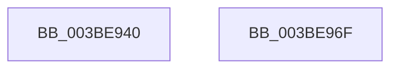

# PpmCheckDelayedPeriodicStart

- RVA: `0x003BE940`–`0x003BE970` (길이 `48` bytes)
- VA: `0x00000001403BE940`
- 실행 섹션: `.text`
- PDB 이름 있음: `예`; PDB Function 태그: `아니요`
- unwind 정보 RVA: `0x0005CF00`
- 디코드: `13`개 명령, `48/48` bytes 표시
- 미해석 바이트: `0` (있으면 어셈블리에 `.byte`로 보존)

> 이 문서는 커널 이미지의 기계어와 PDB 기호를 분석해 생성했습니다. 4번과 5번은 함수 원형과 자료형을 바이너리 사용 방식에서 추정한 C 해석이며 원본 소스 복구 결과는 아닙니다.

## 1. Dependencies

- 직접 호출 지점: **2**; 고유 호출 대상: **2**
- 직접 호출자로 확인된 함수: **0**
- RIP 상대 이미지 참조: **3**

### Outgoing calls
- `0x003BE950` → [PpmAcquireLock](../2D/PpmAcquireLock_function_002D9AA4.md) (function, `0x002D9AA4`)
- `0x003BE95D` → [PpmCheckCustomRun](PpmCheckCustomRun_function_003BEC2C.md) (function, `0x003BEC2C`)

### Direct callers
- 이 함수 시작 RVA로 연결되는 직접 call은 확인되지 않았습니다. 간접 호출은 완전히 역산할 수 없습니다.

### Static image references
- `0x003BE949` → RVA `0x00F0CC00` (`.data`; read)
- `0x003BE957` → RVA `0x00F0B27C` (`.data`; write)
- `0x003BE962` → RVA `0x00F0B301` (`.data`; write)

## 2. Other-region calls and transfers

- 다른 실행 섹션으로 향하는 call: **0**
- 별도 외부 분기/꼬리 이동을 확인하지 못했습니다.

## 3. Assembly (complete function range)

```asm
003BE940  40 53                           push rbx
003BE942  48 83 EC 20                     sub rsp, 0x20
003BE946  48 8B D9                        mov rbx, rcx
003BE949  48 8D 0D B0 E2 B4 00            lea rcx, [rip + 0xb4e2b0]
003BE950  E8 4F B1 F1 FF                  call 0x1402d9aa4
003BE955  33 C9                           xor ecx, ecx
003BE957  89 1D 1F C9 B4 00               mov dword ptr [rip + 0xb4c91f], ebx
003BE95D  E8 CA 02 00 00                  call 0x1403bec2c
003BE962  C6 05 98 C9 B4 00 00            mov byte ptr [rip + 0xb4c998], 0
003BE969  48 83 C4 20                     add rsp, 0x20
003BE96D  5B                              pop rbx
003BE96E  C3                              ret
003BE96F  CC                              int3
```

## 4. C-style interpretation (structured pseudocode)

```c
__int64 __fastcall PpmCheckDelayedPeriodicStart(__int64 a1)
{
    __int64 result;
    __int64 v_rsp;

    v_rsp = (v_rsp) - (32);
    result = PpmAcquireLock(v_rip + 11854512, a2, a3, a4);
    a1 = 0;
    *(unsigned int *)(v_rip + 11847967) = 0;
    result = PpmCheckCustomRun(a1, a2, a3, a4);
    *(unsigned __int8 *)(v_rip + 11848088) = 0;
    v_rsp = (v_rsp) + (32);
    return result;
}
```

## 5. (Beta) C Style

```c
int64_t PpmCheckDelayedPeriodicStart(int64_t Arg1)
{
    int64_t result;
    int64_t local_rsp;

    local_rsp = (local_rsp) - (32);
    result = PpmAcquireLock(v_rip + 11854512, a2, a3, a4);
    Arg1 = 0;
    *(uint32_t *)(v_rip + 0xB4C91F) = 0;
    result = PpmCheckCustomRun(Arg1, a2, a3, a4);
    *(uint8_t *)(v_rip + 0xB4C998) = 0;
    local_rsp = (local_rsp) + (32);
    return result;
}
```

## 6. Execution-region graph

[열기: 2D/3D 그래프와 함수 탐색 컨트롤 패널](../../../control-panel.html?section=text&rva=0x003BE940&view=graph)

- 2D 그래프는 위에서 아래로 흐르고, 3D 그래프는 빈 공간을 드래그해 회전합니다. Shift+드래그는 이동, 휠은 확대·축소, 함수 노드 선택은 대상 보고서 이동입니다.

### Static fallback


