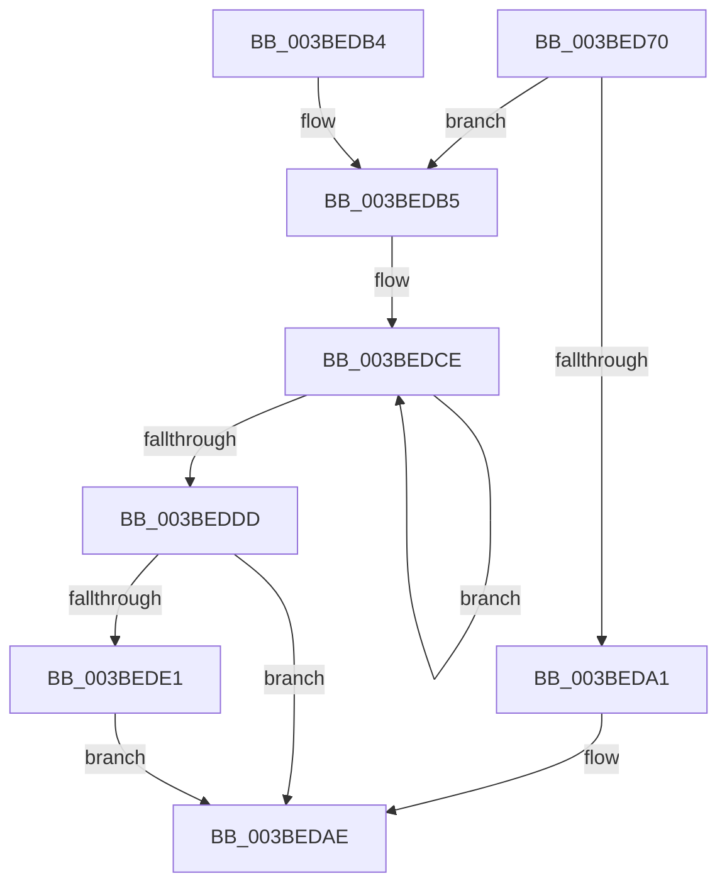

# PpmCheckPeriodicStart

- RVA: `0x003BED70`–`0x003BEE0E` (길이 `158` bytes)
- VA: `0x00000001403BED70`
- 실행 섹션: `.text`
- PDB 이름 있음: `예`; PDB Function 태그: `아니요`
- unwind 정보 RVA: `0x0008DEA4`
- 디코드: `38`개 명령, `158/158` bytes 표시
- 미해석 바이트: `0` (있으면 어셈블리에 `.byte`로 보존)

> 이 문서는 커널 이미지의 기계어와 PDB 기호를 분석해 생성했습니다. 4번과 5번은 함수 원형과 자료형을 바이너리 사용 방식에서 추정한 C 해석이며 원본 소스 복구 결과는 아닙니다.

## 1. Dependencies

- 직접 호출 지점: **4**; 고유 호출 대상: **4**
- 직접 호출자로 확인된 함수: **0**
- RIP 상대 이미지 참조: **9**

### Outgoing calls
- `0x003BED98` → [KeWaitForSingleObject](../20/KeWaitForSingleObject_function_0020E6B0.md) (function, `0x0020E6B0`)
- `0x003BEDA9` → [PpmCheckStart](PpmCheckStart_function_003BEE14.md) (function, `0x003BEE14`)
- `0x003BEDBC` → [PpmEventTraceFailedPerfCheckStart](PpmEventTraceFailedPerfCheckStart_function_003BF06C.md) (function, `0x003BF06C`)
- `0x003BEE07` → [ExQueueWorkItem](../2F/ExQueueWorkItem_function_002F9520.md) (function, `0x002F9520`)

### Direct callers
- 이 함수 시작 RVA로 연결되는 직접 call은 확인되지 않았습니다. 간접 호출은 완전히 역산할 수 없습니다.

### Static image references
- `0x003BED8C` → RVA `0x00F0CC08` (`.data`; read)
- `0x003BEDA3` → RVA `0x00F0B27C` (`.data`; write)
- `0x003BEDB5` → RVA `0x00F0B270` (`.data`; read)
- `0x003BEDC1` → RVA `0x00F0B301` (`.data`; read)
- `0x003BEDE1` → RVA `0x00F0B320` (`.data`; read/write)
- `0x003BEDE9` → RVA `0x003BE940` (`PpmCheckDelayedPeriodicStart`; read)
- `0x003BEDF2` → RVA `0x00F0B330` (`.data`; write)
- `0x003BEDF9` → RVA `0x00F0B320` (`.data`; read)
- `0x003BEE00` → RVA `0x00F0B338` (`.data`; write)

## 2. Other-region calls and transfers

- 다른 실행 섹션으로 향하는 call: **0**
- 별도 외부 분기/꼬리 이동을 확인하지 못했습니다.

## 3. Assembly (complete function range)

```asm
003BED70  40 53                           push rbx
003BED72  48 83 EC 40                     sub rsp, 0x40
003BED76  48 83 64 24 30 00               and qword ptr [rsp + 0x30], 0
003BED7C  48 8D 44 24 30                  lea rax, [rsp + 0x30]
003BED81  49 8B D8                        mov rbx, r8
003BED84  48 89 44 24 20                  mov qword ptr [rsp + 0x20], rax
003BED89  45 33 C0                        xor r8d, r8d
003BED8C  48 8D 0D 75 DE B4 00            lea rcx, [rip + 0xb4de75]
003BED93  45 33 C9                        xor r9d, r9d
003BED96  33 D2                           xor edx, edx
003BED98  E8 13 F9 E4 FF                  call 0x14020e6b0
003BED9D  85 C0                           test eax, eax
003BED9F  75 14                           jne 0x1403bedb5
003BEDA1  33 C9                           xor ecx, ecx
003BEDA3  89 1D D3 C4 B4 00               mov dword ptr [rip + 0xb4c4d3], ebx
003BEDA9  E8 66 00 00 00                  call 0x1403bee14
003BEDAE  48 83 C4 40                     add rsp, 0x40
003BEDB2  5B                              pop rbx
003BEDB3  C3                              ret
003BEDB4  CC                              int3
003BEDB5  48 8B 0D B4 C4 B4 00            mov rcx, qword ptr [rip + 0xb4c4b4]
003BEDBC  E8 AB 02 00 00                  call 0x1403bf06c
003BEDC1  0F 0D 0D 39 C5 B4 00            prefetchw byte ptr [rip + 0xb4c539]
003BEDC8  8A 05 33 C5 B4 00               mov al, byte ptr [rip + 0xb4c533]
003BEDCE  8A C8                           mov cl, al
003BEDD0  80 C9 01                        or cl, 1
003BEDD3  F0 0F B0 0D 26 C5 B4 00         lock cmpxchg byte ptr [rip + 0xb4c526], cl
003BEDDB  75 F1                           jne 0x1403bedce
003BEDDD  84 C0                           test al, al
003BEDDF  75 CD                           jne 0x1403bedae
003BEDE1  48 83 25 37 C5 B4 00 00         and qword ptr [rip + 0xb4c537], 0
003BEDE9  48 8D 05 50 FB FF FF            lea rax, [rip - 0x4b0]
003BEDF0  33 D2                           xor edx, edx
003BEDF2  48 89 05 37 C5 B4 00            mov qword ptr [rip + 0xb4c537], rax
003BEDF9  48 8D 0D 20 C5 B4 00            lea rcx, [rip + 0xb4c520]
003BEE00  48 89 1D 31 C5 B4 00            mov qword ptr [rip + 0xb4c531], rbx
003BEE07  E8 14 A7 F3 FF                  call 0x1402f9520
003BEE0C  EB A0                           jmp 0x1403bedae
```

## 4. C-style interpretation (structured pseudocode)

```c
__int64 __fastcall PpmCheckPeriodicStart(__int64 a1, int a2, __int64 a3, int a4)
{
    __int64 result;
    __int64 v_rsp;
    unsigned __int64 v_stack_m18;
    unsigned __int64 v_stack_m28;

    v_rsp = (v_rsp) - (64);
    v_stack_m28 = v_stack_m18;
    a3 = 0;
    a4 = 0;
    a2 = 0;
    result = KeWaitForSingleObject(v_rip + 11853429, a2, a3, a4);
    if ((unsigned int)(result) != 0) goto loc_003BEDB5;
    a1 = 0;
    *(unsigned int *)(v_rip + 11846867) = 0;
    result = PpmCheckStart(a1, a2, a3, a4);
loc_003BEDAE:
    v_rsp = (v_rsp) + (64);
    return result;
loc_003BEDB5:
    result = PpmEventTraceFailedPerfCheckStart(*(unsigned __int64 *)(v_rip + 11846836), a2, a3, a4);
loc_003BEDCE:
    a1 = (unsigned __int8)(((unsigned __int8)(*(unsigned __int8 *)(v_rip + 11846963))) | (1));
    if (condition_is_not_equal) goto loc_003BEDCE;
    if ((unsigned __int8)(*(unsigned __int8 *)(v_rip + 11846963)) != 0) goto loc_003BEDAE;
    a2 = 0;
    *(unsigned __int64 *)(v_rip + 11846967) = v_rip - 1200;
    *(unsigned __int64 *)(v_rip + 11846961) = 0;
    result = ExQueueWorkItem(v_rip + 11846944, a2, a3, a4);
    goto loc_003BEDAE;
}
```

## 5. (Beta) C Style

```c
int64_t PpmCheckPeriodicStart(int64_t Arg1, int32_t Arg2, int64_t Arg3, int32_t Arg4)
{
    int64_t result;
    int64_t local_rsp;
    uint64_t v_stack_m18;
    uint64_t v_stack_m28;

    local_rsp = (local_rsp) - (64);
    v_stack_m28 = v_stack_m18;
    Arg3 = 0;
    Arg4 = 0;
    Arg2 = 0;
    result = KeWaitForSingleObject(v_rip + 11853429, Arg2, Arg3, Arg4);
    if ((uint32_t)(result) != 0) goto loc_003BEDB5;
    Arg1 = 0;
    *(uint32_t *)(v_rip + 0xB4C4D3) = 0;
    result = PpmCheckStart(Arg1, Arg2, Arg3, Arg4);
loc_003BEDAE:
    local_rsp = (local_rsp) + (64);
    return result;
loc_003BEDB5:
    result = PpmEventTraceFailedPerfCheckStart(*(uint64_t *)(v_rip + 0xB4C4B4), Arg2, Arg3, Arg4);
loc_003BEDCE:
    Arg1 = (uint8_t)(((uint8_t)(*(uint8_t *)(v_rip + 0xB4C533))) | (1));
    if (condition_is_not_equal) goto loc_003BEDCE;
    if ((uint8_t)(*(uint8_t *)(v_rip + 0xB4C533)) != 0) goto loc_003BEDAE;
    Arg2 = 0;
    *(uint64_t *)(v_rip + 0xB4C537) = v_rip - 1200;
    *(uint64_t *)(v_rip + 0xB4C531) = 0;
    result = ExQueueWorkItem(v_rip + 11846944, Arg2, Arg3, Arg4);
    goto loc_003BEDAE;
}
```

## 6. Execution-region graph

[열기: 2D/3D 그래프와 함수 탐색 컨트롤 패널](../../../control-panel.html?section=text&rva=0x003BED70&view=graph)

- 2D 그래프는 위에서 아래로 흐르고, 3D 그래프는 빈 공간을 드래그해 회전합니다. Shift+드래그는 이동, 휠은 확대·축소, 함수 노드 선택은 대상 보고서 이동입니다.

### Static fallback


