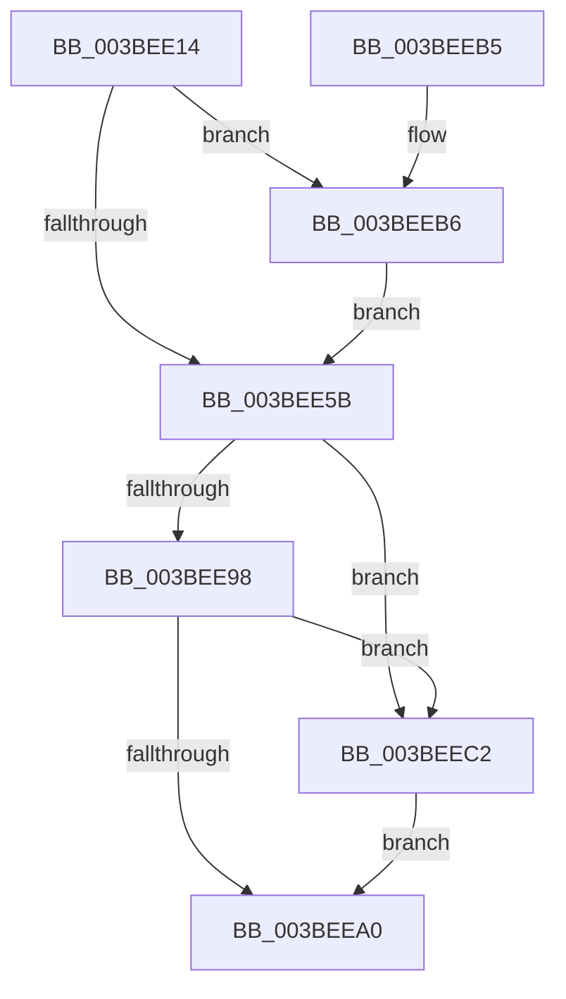

# PpmCheckStart

- RVA: `0x003BEE14`–`0x003BEEDB` (길이 `199` bytes)
- VA: `0x00000001403BEE14`
- 실행 섹션: `.text`
- PDB 이름 있음: `예`; PDB Function 태그: `아니요`
- unwind 정보 RVA: `0x0007811C`
- 디코드: `48`개 명령, `199/199` bytes 표시
- 미해석 바이트: `0` (있으면 어셈블리에 `.byte`로 보존)

> 이 문서는 커널 이미지의 기계어와 PDB 기호를 분석해 생성했습니다. 4번과 5번은 함수 원형과 자료형을 바이너리 사용 방식에서 추정한 C 해석이며 원본 소스 복구 결과는 아닙니다.

## 1. Dependencies

- 직접 호출 지점: **5**; 고유 호출 대상: **5**
- 직접 호출자로 확인된 함수: **2**
- RIP 상대 이미지 참조: **12**

### Outgoing calls
- `0x003BEE28` → [RtlGetInterruptTimePrecise](../20/RtlGetInterruptTimePrecise_function_0020A4C0.md) (function, `0x0020A4C0`)
- `0x003BEE3D` → [PpmEventTracePerfCheckStart](PpmEventTracePerfCheckStart_function_003BEEE4.md) (function, `0x003BEEE4`)
- `0x003BEEAA` → [PpmCheckRun](../2D/PpmCheckRun_function_002DA0C0.md) (function, `0x002DA0C0`)
- `0x003BEEC2` → [PpmPerfSetAllDomainsToUpdate](PpmPerfSetAllDomainsToUpdate_function_003BF044.md) (function, `0x003BF044`)
- `0x003BEED4` → [PpmHeteroHgsCheckContainmentDecision](PpmHeteroHgsCheckContainmentDecision_function_003BEFF8.md) (function, `0x003BEFF8`)

### Direct callers
- [PpmCheckCustomRun](PpmCheckCustomRun_function_003BEC2C.md) at `0x003BEC8F`
- [PpmCheckPeriodicStart](PpmCheckPeriodicStart_function_003BED70.md) at `0x003BEDA9`

### Static image references
- `0x003BEE22` → RVA `0x00F0B244` (`.data`; write)
- `0x003BEE2D` → RVA `0x00F0B270` (`.data`; read)
- `0x003BEE36` → RVA `0x00F0B260` (`.data`; write)
- `0x003BEE42` → RVA `0x00F0B400` (`.data`; read)
- `0x003BEE4F` → RVA `0x00F0B3F8` (`.data`; write)
- `0x003BEE5B` → RVA `0x00F0E100` (`.data`; read)
- `0x003BEE6F` → RVA `0x00F0B3F0` (`.data`; write)
- `0x003BEE7B` → RVA `0x00F0E0F8` (`.data`; read)
- `0x003BEE8F` → RVA `0x00F0B24C` (`.data`; read)
- `0x003BEE98` → RVA `0x00F0B248` (`.data`; read)
- `0x003BEEC7` → RVA `0x00F0B24C` (`.data`; write)
- `0x003BEECE` → RVA `0x00F0B248` (`.data`; write)

## 2. Other-region calls and transfers

- 다른 실행 섹션으로 향하는 call: **0**
- 별도 외부 분기/꼬리 이동을 확인하지 못했습니다.

## 3. Assembly (complete function range)

```asm
003BEE14  40 53                           push rbx
003BEE16  48 83 EC 20                     sub rsp, 0x20
003BEE1A  48 63 D9                        movsxd rbx, ecx
003BEE1D  48 8D 4C 24 38                  lea rcx, [rsp + 0x38]
003BEE22  89 1D 1C C4 B4 00               mov dword ptr [rip + 0xb4c41c], ebx
003BEE28  E8 93 B6 E4 FF                  call 0x14020a4c0
003BEE2D  48 8B 0D 3C C4 B4 00            mov rcx, qword ptr [rip + 0xb4c43c]
003BEE34  8B D3                           mov edx, ebx
003BEE36  48 89 05 23 C4 B4 00            mov qword ptr [rip + 0xb4c423], rax
003BEE3D  E8 A2 00 00 00                  call 0x1403beee4
003BEE42  4C 8B 05 B7 C5 B4 00            mov r8, qword ptr [rip + 0xb4c5b7]
003BEE49  33 D2                           xor edx, edx
003BEE4B  49 8B 0C D8                     mov rcx, qword ptr [r8 + rbx*8]
003BEE4F  48 89 0D A2 C5 B4 00            mov qword ptr [rip + 0xb4c5a2], rcx
003BEE56  48 85 C9                        test rcx, rcx
003BEE59  74 5B                           je 0x1403beeb6
003BEE5B  48 8B 0D 9E F2 B4 00            mov rcx, qword ptr [rip + 0xb4f29e]
003BEE62  44 8B C2                        mov r8d, edx
003BEE65  49 B9 08 00 00 00 80 F7 FF FF   movabs r9, 0xfffff78000000008
003BEE6F  89 15 7B C5 B4 00               mov dword ptr [rip + 0xb4c57b], edx
003BEE75  49 8B 01                        mov rax, qword ptr [r9]
003BEE78  48 3B C8                        cmp rcx, rax
003BEE7B  48 8B 0D 76 F2 B4 00            mov rcx, qword ptr [rip + 0xb4f276]
003BEE82  49 8B 01                        mov rax, qword ptr [r9]
003BEE85  41 0F 93 C0                     setae r8b
003BEE89  48 3B C8                        cmp rcx, rax
003BEE8C  0F 93 C2                        setae dl
003BEE8F  44 39 05 B6 C3 B4 00            cmp dword ptr [rip + 0xb4c3b6], r8d
003BEE96  75 2A                           jne 0x1403beec2
003BEE98  39 15 AA C3 B4 00               cmp dword ptr [rip + 0xb4c3aa], edx
003BEE9E  75 22                           jne 0x1403beec2
003BEEA0  45 33 C9                        xor r9d, r9d
003BEEA3  45 33 C0                        xor r8d, r8d
003BEEA6  33 D2                           xor edx, edx
003BEEA8  33 C9                           xor ecx, ecx
003BEEAA  E8 11 B2 F1 FF                  call 0x1402da0c0
003BEEAF  48 83 C4 20                     add rsp, 0x20
003BEEB3  5B                              pop rbx
003BEEB4  C3                              ret
003BEEB5  CC                              int3
003BEEB6  49 8B 00                        mov rax, qword ptr [r8]
003BEEB9  48 89 05 38 C5 B4 00            mov qword ptr [rip + 0xb4c538], rax
003BEEC0  EB 99                           jmp 0x1403bee5b
003BEEC2  E8 7D 01 00 00                  call 0x1403bf044
003BEEC7  44 89 05 7E C3 B4 00            mov dword ptr [rip + 0xb4c37e], r8d
003BEECE  89 15 74 C3 B4 00               mov dword ptr [rip + 0xb4c374], edx
003BEED4  E8 1F 01 00 00                  call 0x1403beff8
003BEED9  EB C5                           jmp 0x1403beea0
```

## 4. C-style interpretation (structured pseudocode)

```c
__int64 __fastcall PpmCheckStart(int a1)
{
    __int64 result;
    __int64 v_rsp;
    unsigned __int64 v_stack_p10;

    v_rsp = (v_rsp) - (32);
    *(unsigned int *)(v_rip + 11846684) = (unsigned int)((int)(a1));
    result = RtlGetInterruptTimePrecise(v_stack_p10, a2, a3, a4);
    *(unsigned __int64 *)(v_rip + 11846691) = result;
    result = PpmEventTracePerfCheckStart(*(unsigned __int64 *)(v_rip + 11846716), (unsigned int)((unsigned int)((int)(a1))), a3, a4);
    a2 = 0;
    *(unsigned __int64 *)(v_rip + 11847074) = *(unsigned __int64 *)(*(unsigned __int64 *)(v_rip + 11847095) + (int)(a1) * 8);
    if (*(unsigned __int64 *)(*(unsigned __int64 *)(v_rip + 11847095) + (int)(a1) * 8) == 0) goto loc_003BEEB6;
loc_003BEE5B:
    *(unsigned int *)(v_rip + 11847035) = 0;
    a3 = ((*(unsigned __int64 *)(v_rip + 11858590)) >= (*(unsigned __int64 *)(a4))) ? 1 : 0;
    a2 = ((*(unsigned __int64 *)(v_rip + 11858550)) >= (*(unsigned __int64 *)(a4))) ? 1 : 0;
    if ((*(unsigned int *)(v_rip + 11846582)) != ((unsigned int)(a3))) goto loc_003BEEC2;
    if ((*(unsigned int *)(v_rip + 11846570)) != ((unsigned int)(a2))) goto loc_003BEEC2;
loc_003BEEA0:
    a4 = 0;
    a3 = 0;
    a2 = 0;
    a1 = 0;
    result = PpmCheckRun(a1, a2, a3, a4);
    v_rsp = (v_rsp) + (32);
    return result;
loc_003BEEB6:
    *(unsigned __int64 *)(v_rip + 11846968) = *(unsigned __int64 *)(a3);
    goto loc_003BEE5B;
loc_003BEEC2:
    result = PpmPerfSetAllDomainsToUpdate(a1, a2, a3, a4);
    *(unsigned int *)(v_rip + 11846526) = 0;
    *(unsigned int *)(v_rip + 11846516) = 0;
    result = PpmHeteroHgsCheckContainmentDecision(a1, a2, a3, a4);
    goto loc_003BEEA0;
}
```

## 5. (Beta) C Style

```c
int64_t PpmCheckStart(int32_t Arg1)
{
    int64_t result;
    int64_t local_rsp;
    uint64_t v_stack_p10;

    local_rsp = (local_rsp) - (32);
    *(uint32_t *)(v_rip + 0xB4C41C) = (uint32_t)((int32_t)(Arg1));
    result = RtlGetInterruptTimePrecise(v_stack_p10, a2, a3, a4);
    *(uint64_t *)(v_rip + 0xB4C423) = result;
    result = PpmEventTracePerfCheckStart(*(uint64_t *)(v_rip + 0xB4C43C), (uint32_t)((uint32_t)((int32_t)(Arg1))), a3, a4);
    a2 = 0;
    *(uint64_t *)(v_rip + 0xB4C5A2) = *(uint64_t *)(*(uint64_t *)(v_rip + 0xB4C5B7) + (int32_t)(Arg1) * 8);
    if (*(uint64_t *)(*(uint64_t *)(v_rip + 0xB4C5B7) + (int32_t)(Arg1) * 8) == 0) goto loc_003BEEB6;
loc_003BEE5B:
    *(uint32_t *)(v_rip + 0xB4C57B) = 0;
    a3 = ((*(uint64_t *)(v_rip + 0xB4F29E)) >= (*(uint64_t *)(a4))) ? 1 : 0;
    a2 = ((*(uint64_t *)(v_rip + 0xB4F276)) >= (*(uint64_t *)(a4))) ? 1 : 0;
    if ((*(uint32_t *)(v_rip + 0xB4C3B6)) != ((uint32_t)(a3))) goto loc_003BEEC2;
    if ((*(uint32_t *)(v_rip + 0xB4C3AA)) != ((uint32_t)(a2))) goto loc_003BEEC2;
loc_003BEEA0:
    a4 = 0;
    a3 = 0;
    a2 = 0;
    Arg1 = 0;
    result = PpmCheckRun(Arg1, a2, a3, a4);
    local_rsp = (local_rsp) + (32);
    return result;
loc_003BEEB6:
    *(uint64_t *)(v_rip + 0xB4C538) = *(uint64_t *)(a3);
    goto loc_003BEE5B;
loc_003BEEC2:
    result = PpmPerfSetAllDomainsToUpdate(Arg1, a2, a3, a4);
    *(uint32_t *)(v_rip + 0xB4C37E) = 0;
    *(uint32_t *)(v_rip + 0xB4C374) = 0;
    result = PpmHeteroHgsCheckContainmentDecision(Arg1, a2, a3, a4);
    goto loc_003BEEA0;
}
```

## 6. Execution-region graph

[열기: 2D/3D 그래프와 함수 탐색 컨트롤 패널](../../../control-panel.html?section=text&rva=0x003BEE14&view=graph)

- 2D 그래프는 위에서 아래로 흐르고, 3D 그래프는 빈 공간을 드래그해 회전합니다. Shift+드래그는 이동, 휠은 확대·축소, 함수 노드 선택은 대상 보고서 이동입니다.

### Static fallback


