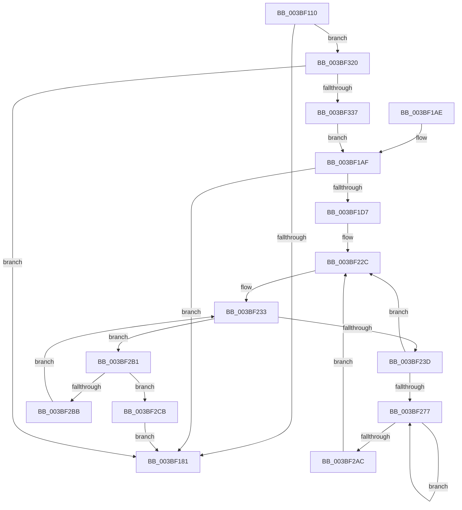

# PpmEventHgsHardwareTable

- RVA: `0x003BF110`–`0x003BF33C` (길이 `556` bytes)
- VA: `0x00000001403BF110`
- 실행 섹션: `.text`
- PDB 이름 있음: `예`; PDB Function 태그: `아니요`
- unwind 정보 RVA: `0x0008DED8`
- 디코드: `136`개 명령, `556/556` bytes 표시
- 미해석 바이트: `0` (있으면 어셈블리에 `.byte`로 보존)

> 이 문서는 커널 이미지의 기계어와 PDB 기호를 분석해 생성했습니다. 4번과 5번은 함수 원형과 자료형을 바이너리 사용 방식에서 추정한 C 해석이며 원본 소스 복구 결과는 아닙니다.

## 1. Dependencies

- 직접 호출 지점: **7**; 고유 호출 대상: **7**
- 직접 호출자로 확인된 함수: **2**
- RIP 상대 이미지 참조: **10**

### Outgoing calls
- `0x003BF148` → [KeQueryMaximumProcessorCountEx](../26/KeQueryMaximumProcessorCountEx_function_00264D60.md) (function, `0x00264D60`)
- `0x003BF188` → [_security_check_cookie](../6A/_security_check_cookie_function_006AC640.md) (function, `0x006AC640`)
- `0x003BF1CA` → [ExAllocatePool2](../../poolcode/B8/ExAllocatePool2_function_00B820F0.md) (function, `0x00B820F0`)
- `0x003BF261` → [KeGetPrcb](../2D/KeGetPrcb_function_002D85D0.md) (function, `0x002D85D0`)
- `0x003BF309` → [EtwWriteEx](../25/EtwWriteEx_function_0025F0D0.md) (function, `0x0025F0D0`)
- `0x003BF316` → [ExFreePoolWithTag](../../poolcode/B8/ExFreePoolWithTag_function_00B82870.md) (function, `0x00B82870`)
- `0x003BF32A` → [EtwEventEnabled](../39/EtwEventEnabled_function_00392450.md) (function, `0x00392450`)

### Direct callers
- [PpmHeteroUpdateHgsConfiguration](PpmHeteroUpdateHgsConfiguration_function_003BF344.md) at `0x003BFCCB`
- [PpmEventTraceControlCallback](../../page/A5/PpmEventTraceControlCallback_function_00A51F60.md) at `0x00A52116`

### Static image references
- `0x003BF133` → RVA `0x00E0A740` (`.data`; read)
- `0x003BF150` → RVA `0x00011D98` (`.rdata`; read)
- `0x003BF157` → RVA `0x00FC6BC8` (`ALMOSTRO`; read)
- `0x003BF166` → RVA `0x00011D88` (`.rdata`; read)
- `0x003BF174` → RVA `0x00E67A39` (`.data`; read)
- `0x003BF1D7` → RVA `0x00FC6A96` (`ALMOSTRO`; read)
- `0x003BF1E2` → RVA `0x00E0B5A8` (`.data`; read)
- `0x003BF22C` → RVA `0x00E0B5A0` (`.data`; read)
- `0x003BF253` → RVA `0x00F231B8` (`.data`; read)
- `0x003BF2F0` → RVA `0x00F083E8` (`.data`; read)

## 2. Other-region calls and transfers

- 다른 실행 섹션으로 향하는 call: **2**
  - `0x003BF1CA` → [ExAllocatePool2](../../poolcode/B8/ExAllocatePool2_function_00B820F0.md) (`.text` → `POOLCODE`)
  - `0x003BF316` → [ExFreePoolWithTag](../../poolcode/B8/ExFreePoolWithTag_function_00B82870.md) (`.text` → `POOLCODE`)
- 별도 외부 분기/꼬리 이동을 확인하지 못했습니다.

## 3. Assembly (complete function range)

```asm
003BF110  48 8B C4                        mov rax, rsp
003BF113  48 89 58 08                     mov qword ptr [rax + 8], rbx
003BF117  48 89 70 10                     mov qword ptr [rax + 0x10], rsi
003BF11B  48 89 78 18                     mov qword ptr [rax + 0x18], rdi
003BF11F  4C 89 60 20                     mov qword ptr [rax + 0x20], r12
003BF123  55                              push rbp
003BF124  41 56                           push r14
003BF126  41 57                           push r15
003BF128  48 8D 68 A1                     lea rbp, [rax - 0x5f]
003BF12C  48 81 EC C0 00 00 00            sub rsp, 0xc0
003BF133  48 8B 05 06 B6 A4 00            mov rax, qword ptr [rip + 0xa4b606]
003BF13A  48 33 C4                        xor rax, rsp
003BF13D  48 89 45 37                     mov qword ptr [rbp + 0x37], rax
003BF141  8A D9                           mov bl, cl
003BF143  B9 FF FF 00 00                  mov ecx, 0xffff
003BF148  E8 13 5C EA FF                  call 0x140264d60
003BF14D  89 45 CB                        mov dword ptr [rbp - 0x35], eax
003BF150  48 8D 35 41 2C C5 FF            lea rsi, [rip - 0x3ad3bf]
003BF157  48 8B 05 6A 7A C0 00            mov rax, qword ptr [rip + 0xc07a6a]
003BF15E  45 33 E4                        xor r12d, r12d
003BF161  84 DB                           test bl, bl
003BF163  8B 50 04                        mov edx, dword ptr [rax + 4]
003BF166  48 8D 05 1B 2C C5 FF            lea rax, [rip - 0x3ad3e5]
003BF16D  48 0F 44 F0                     cmove rsi, rax
003BF171  89 55 C7                        mov dword ptr [rbp - 0x39], edx
003BF174  44 38 25 BE 88 AA 00            cmp byte ptr [rip + 0xaa88be], r12b
003BF17B  0F 85 9F 01 00 00               jne 0x1403bf320
003BF181  48 8B 4D 37                     mov rcx, qword ptr [rbp + 0x37]
003BF185  48 33 CC                        xor rcx, rsp
003BF188  E8 B3 D4 2E 00                  call 0x1406ac640
003BF18D  4C 8D 9C 24 C0 00 00 00         lea r11, [rsp + 0xc0]
003BF195  49 8B 5B 20                     mov rbx, qword ptr [r11 + 0x20]
003BF199  49 8B 73 28                     mov rsi, qword ptr [r11 + 0x28]
003BF19D  49 8B 7B 30                     mov rdi, qword ptr [r11 + 0x30]
003BF1A1  4D 8B 63 38                     mov r12, qword ptr [r11 + 0x38]
003BF1A5  49 8B E3                        mov rsp, r11
003BF1A8  41 5F                           pop r15
003BF1AA  41 5E                           pop r14
003BF1AC  5D                              pop rbp
003BF1AD  C3                              ret
003BF1AE  CC                              int3
003BF1AF  8B 45 C7                        mov eax, dword ptr [rbp - 0x39]
003BF1B2  B9 00 01 00 00                  mov ecx, 0x100
003BF1B7  0F AF 45 CB                     imul eax, dword ptr [rbp - 0x35]
003BF1BB  41 B8 50 50 4D 65               mov r8d, 0x654d5050
003BF1C1  89 45 CF                        mov dword ptr [rbp - 0x31], eax
003BF1C4  8D 04 80                        lea eax, [rax + rax*4]
003BF1C7  8D 14 00                        lea edx, [rax + rax]
003BF1CA  E8 21 2F 7C 00                  call 0x140b820f0
003BF1CF  48 8B F8                        mov rdi, rax
003BF1D2  48 85 C0                        test rax, rax
003BF1D5  74 AA                           je 0x1403bf181
003BF1D7  0F B6 0D B8 78 C0 00            movzx ecx, byte ptr [rip + 0xc078b8]
003BF1DE  48 8D 45 D3                     lea rax, [rbp - 0x2d]
003BF1E2  4C 8B 35 BF C3 A4 00            mov r14, qword ptr [rip + 0xa4c3bf]
003BF1E9  41 0F B7 DC                     movzx ebx, r12w
003BF1ED  48 89 45 E7                     mov qword ptr [rbp - 0x19], rax
003BF1F1  48 8D 45 CB                     lea rax, [rbp - 0x35]
003BF1F5  48 89 45 F7                     mov qword ptr [rbp - 9], rax
003BF1F9  48 8D 45 C7                     lea rax, [rbp - 0x39]
003BF1FD  48 89 45 07                     mov qword ptr [rbp + 7], rax
003BF201  48 8D 45 CF                     lea rax, [rbp - 0x31]
003BF205  48 89 45 17                     mov qword ptr [rbp + 0x17], rax
003BF209  89 4D D3                        mov dword ptr [rbp - 0x2d], ecx
003BF20C  48 C7 45 EF 04 00 00 00         mov qword ptr [rbp - 0x11], 4
003BF214  48 C7 45 FF 04 00 00 00         mov qword ptr [rbp - 1], 4
003BF21C  48 C7 45 0F 04 00 00 00         mov qword ptr [rbp + 0xf], 4
003BF224  48 C7 45 1F 04 00 00 00         mov qword ptr [rbp + 0x1f], 4
003BF22C  0F B7 0D 6D C3 A4 00            movzx ecx, word ptr [rip + 0xa4c36d]
003BF233  B8 01 00 00 00                  mov eax, 1
003BF238  4D 85 F6                        test r14, r14
003BF23B  74 74                           je 0x1403bf2b1
003BF23D  49 0F BC D6                     bsf rdx, r14
003BF241  0F B7 CB                        movzx ecx, bx
003BF244  0F B6 C2                        movzx eax, dl
003BF247  C1 E1 06                        shl ecx, 6
003BF24A  49 0F B3 C6                     btr r14, rax
003BF24E  0F B6 C2                        movzx eax, dl
003BF251  03 C8                           add ecx, eax
003BF253  48 8B 05 5E 3F B6 00            mov rax, qword ptr [rip + 0xb63f5e]
003BF25A  44 8B 3C 88                     mov r15d, dword ptr [rax + rcx*4]
003BF25E  41 8B CF                        mov ecx, r15d
003BF261  E8 6A 93 F1 FF                  call 0x1402d85d0
003BF266  45 8B CC                        mov r9d, r12d
003BF269  4C 8B 90 50 8A 00 00            mov r10, qword ptr [rax + 0x8a50]
003BF270  8B 45 C7                        mov eax, dword ptr [rbp - 0x39]
003BF273  85 C0                           test eax, eax
003BF275  74 B5                           je 0x1403bf22c
003BF277  41 0F AF C7                     imul eax, r15d
003BF27B  41 8B D1                        mov edx, r9d
003BF27E  45 8A 44 92 07                  mov r8b, byte ptr [r10 + rdx*4 + 7]
003BF283  41 03 C1                        add eax, r9d
003BF286  48 8D 0C 80                     lea rcx, [rax + rax*4]
003BF28A  41 8A 44 92 06                  mov al, byte ptr [r10 + rdx*4 + 6]
003BF28F  44 89 4C 4F 04                  mov dword ptr [rdi + rcx*2 + 4], r9d
003BF294  41 FF C1                        inc r9d
003BF297  88 44 4F 08                     mov byte ptr [rdi + rcx*2 + 8], al
003BF29B  44 88 44 4F 09                  mov byte ptr [rdi + rcx*2 + 9], r8b
003BF2A0  44 89 3C 4F                     mov dword ptr [rdi + rcx*2], r15d
003BF2A4  8B 45 C7                        mov eax, dword ptr [rbp - 0x39]
003BF2A7  44 3B C8                        cmp r9d, eax
003BF2AA  72 CB                           jb 0x1403bf277
003BF2AC  E9 7B FF FF FF                  jmp 0x1403bf22c
003BF2B1  66 03 D8                        add bx, ax
003BF2B4  0F B7 DB                        movzx ebx, bx
003BF2B7  3B D9                           cmp ebx, ecx
003BF2B9  73 10                           jae 0x1403bf2cb
003BF2BB  4C 8D 35 E6 C2 A4 00            lea r14, [rip + 0xa4c2e6]
003BF2C2  4D 8B 34 DE                     mov r14, qword ptr [r14 + rbx*8]
003BF2C6  E9 68 FF FF FF                  jmp 0x1403bf233
003BF2CB  8B 45 CF                        mov eax, dword ptr [rbp - 0x31]
003BF2CE  45 33 C9                        xor r9d, r9d
003BF2D1  45 33 C0                        xor r8d, r8d
003BF2D4  48 89 7D 27                     mov qword ptr [rbp + 0x27], rdi
003BF2D8  48 8B D6                        mov rdx, rsi
003BF2DB  44 89 65 33                     mov dword ptr [rbp + 0x33], r12d
003BF2DF  8D 0C 80                        lea ecx, [rax + rax*4]
003BF2E2  03 C9                           add ecx, ecx
003BF2E4  48 8D 45 E7                     lea rax, [rbp - 0x19]
003BF2E8  48 89 44 24 38                  mov qword ptr [rsp + 0x38], rax
003BF2ED  89 4D 2F                        mov dword ptr [rbp + 0x2f], ecx
003BF2F0  48 8B 0D F1 90 B4 00            mov rcx, qword ptr [rip + 0xb490f1]
003BF2F7  C7 44 24 30 05 00 00 00         mov dword ptr [rsp + 0x30], 5
003BF2FF  4C 89 64 24 28                  mov qword ptr [rsp + 0x28], r12
003BF304  4C 89 64 24 20                  mov qword ptr [rsp + 0x20], r12
003BF309  E8 C2 FD E9 FF                  call 0x14025f0d0
003BF30E  BA 50 50 4D 65                  mov edx, 0x654d5050
003BF313  48 8B CF                        mov rcx, rdi
003BF316  E8 55 35 7C 00                  call 0x140b82870
003BF31B  E9 61 FE FF FF                  jmp 0x1403bf181
003BF320  48 8B 0D C1 90 B4 00            mov rcx, qword ptr [rip + 0xb490c1]
003BF327  48 8B D6                        mov rdx, rsi
003BF32A  E8 21 31 FD FF                  call 0x140392450
003BF32F  84 C0                           test al, al
003BF331  0F 84 4A FE FF FF               je 0x1403bf181
003BF337  E9 73 FE FF FF                  jmp 0x1403bf1af
```

## 4. C-style interpretation (structured pseudocode)

```c
__int64 __fastcall PpmEventHgsHardwareTable(unsigned __int8 a1)
{
    __int64 result;
    __int64 v_r12;
    __int64 v_rbx;
    __int64 v_rsi;
    __int64 v_rsp;
    unsigned __int64 v_stack_m18;
    unsigned __int64 v_stack_m88;
    unsigned int v_stack_m90;
    unsigned __int64 v_stack_m98;
    unsigned __int64 v_stack_mA0;

    *(unsigned __int64 *)(v_rsp + 8) = v_rbx;
    *(unsigned __int64 *)(v_rsp + 16) = v_rsi;
    *(unsigned __int64 *)(v_rsp + 24) = v_rdi;
    *(unsigned __int64 *)(v_rsp + 32) = v_r12;
    v_rsp = (v_rsp) - (192);
    result = (*(unsigned __int64 *)(v_rip + 10794502)) ^ (v_rsp);
    *(unsigned __int64 *)(v_rsp - 95 + 55) = result;
    result = KeQueryMaximumProcessorCountEx((unsigned int)(0xFFFFULL), a2, a3, a4);
    *(unsigned int *)(v_rsp - 95 - 53) = (unsigned int)(result);
    v_r12 = 0;
    v_rsi = v_rip - 3855295;
    if (a1 == 0) { v_rsi = v_rip - 3855333; }
    *(unsigned int *)(v_rsp - 95 - 57) = (unsigned int)((unsigned int)(*(unsigned int *)(*(unsigned __int64 *)(v_rip + 12614250) + 4)));
    if ((*(unsigned __int8 *)(v_rip + 11176126)) != 0) goto loc_003BF320;
loc_003BF181:
    a1 = (*(unsigned __int64 *)(v_rsp - 95 + 55)) ^ (v_rsp);
    result = _security_check_cookie(a1, (unsigned int)(*(unsigned int *)(*(unsigned __int64 *)(v_rip + 12614250) + 4)), a3, a4);
    return result;
loc_003BF1AF:
    result = (unsigned int)(((unsigned int)(*(unsigned int *)(v_rsp - 95 - 57))) * (*(unsigned int *)(v_rsp - 95 - 53)));
    *(unsigned int *)(v_rsp - 95 - 49) = (unsigned int)(result);
    result = ExAllocatePool2(256, result + result * 4 + result + result * 4 * 1, (unsigned int)(0x654D5050ULL), a4);
    if (result == 0) goto loc_003BF181;
    *(unsigned __int64 *)(v_rsp - 95 - 25) = v_rsp - 95 - 45;
    *(unsigned __int64 *)(v_rsp - 95 - 9) = v_rsp - 95 - 53;
    *(unsigned __int64 *)(v_rsp - 95 + 7) = v_rsp - 95 - 57;
    *(unsigned __int64 *)(v_rsp - 95 + 23) = v_rsp - 95 - 49;
    *(unsigned int *)(v_rsp - 95 - 45) = (unsigned int)(*(unsigned __int8 *)(v_rip + 12613816));
    *(unsigned __int64 *)(v_rsp - 95 - 17) = 4;
    *(unsigned __int64 *)(v_rsp - 95 - 1) = 4;
    *(unsigned __int64 *)(v_rsp - 95 + 15) = 4;
    *(unsigned __int64 *)(v_rsp - 95 + 31) = 4;
loc_003BF22C:
loc_003BF233:
    if (*(unsigned __int64 *)(v_rip + 10798015) == 0) goto loc_003BF2B1;
    a1 = (unsigned int)(((unsigned __int16)((unsigned __int16)(*(unsigned __int64 *)(v_stack_m18 + 56)))) << (6));
    a1 = (unsigned int)((a1) + ((unsigned int)((unsigned __int8)(result + result * 4 + result + result * 4 * 1))));
    result = KeGetPrcb((unsigned int)((unsigned int)((unsigned int)(*(unsigned int *)(*(unsigned __int64 *)(v_rip + 11943774) + a1 * 4)))), result + result * 4 + result + result * 4 * 1, (unsigned int)(0x654D5050ULL), a4);
    if ((unsigned int)((unsigned int)(*(unsigned int *)(v_rsp - 95 - 57))) == 0) goto loc_003BF22C;
loc_003BF277:
    result = (unsigned int)(((unsigned int)(*(unsigned int *)(v_rsp - 95 - 57))) * ((unsigned int)((unsigned int)(*(unsigned int *)(*(unsigned __int64 *)(v_rip + 11943774) + a1 * 4)))));
    result = (unsigned int)((result) + ((unsigned int)((unsigned int)((unsigned int)(*(unsigned __int64 *)(v_stack_m18 + 56))))));
    *(unsigned int *)(result + result + result * 4 * 2 + 4) = (unsigned int)((unsigned int)((unsigned int)(*(unsigned __int64 *)(v_stack_m18 + 56))));
    a4 = (unsigned int)(((unsigned int)((unsigned int)(*(unsigned __int64 *)(v_stack_m18 + 56)))) + 1);
    *(unsigned __int8 *)(result + result + result * 4 * 2 + 8) = (unsigned __int8)(*(unsigned __int8 *)(*(unsigned __int64 *)(result + 35408) + (unsigned int)((unsigned int)((unsigned int)((unsigned int)(*(unsigned __int64 *)(v_stack_m18 + 56))))) * 4 + 6));
    *(unsigned __int8 *)(result + result + result * 4 * 2 + 9) = (unsigned __int8)(*(unsigned __int8 *)(*(unsigned __int64 *)(result + 35408) + (unsigned int)((unsigned int)((unsigned int)((unsigned int)(*(unsigned __int64 *)(v_stack_m18 + 56))))) * 4 + 7));
    *(unsigned int *)(result + result + result * 4 * 2) = (unsigned int)((unsigned int)(*(unsigned int *)(*(unsigned __int64 *)(v_rip + 11943774) + a1 * 4)));
    if (((unsigned int)(a4)) < ((unsigned int)((unsigned int)(*(unsigned int *)(v_rsp - 95 - 57))))) goto loc_003BF277;
    goto loc_003BF22C;
loc_003BF2B1:
    v_rbx = (unsigned __int16)(((unsigned __int16)(*(unsigned __int64 *)(v_stack_m18 + 56))) + ((unsigned __int16)((unsigned int)(*(unsigned int *)(v_rsp - 95 - 57)))));
    if (((unsigned int)((unsigned __int16)(v_rbx))) >= ((unsigned int)(result + result * 4))) goto loc_003BF2CB;
    goto loc_003BF233;
loc_003BF2CB:
    a4 = 0;
    a3 = 0;
    *(unsigned __int64 *)(v_rsp - 95 + 39) = result;
    *(unsigned int *)(v_rsp - 95 + 51) = (unsigned int)(*(unsigned __int64 *)(v_stack_m18 + 56));
    a1 = (unsigned int)(((unsigned int)(*(unsigned int *)(v_rsp - 95 - 49)) + (unsigned int)(*(unsigned int *)(v_rsp - 95 - 49)) * 4) + ((unsigned int)((unsigned int)(*(unsigned int *)(v_rsp - 95 - 49)) + (unsigned int)(*(unsigned int *)(v_rsp - 95 - 49)) * 4)));
    v_stack_m88 = v_rsp - 95 - 25;
    *(unsigned int *)(v_rsp - 95 + 47) = a1;
    v_stack_m90 = 5;
    v_stack_m98 = *(unsigned __int64 *)(v_stack_m18 + 56);
    v_stack_mA0 = *(unsigned __int64 *)(v_stack_m18 + 56);
    result = EtwWriteEx(*(unsigned __int64 *)(v_rip + 11833585), *(unsigned __int64 *)(v_stack_m18 + 40), a3, a4);
    result = ExFreePoolWithTag(result, (unsigned int)(0x654D5050ULL), a3, a4);
    goto loc_003BF181;
loc_003BF320:
    result = EtwEventEnabled(*(unsigned __int64 *)(v_rip + 11833537), *(unsigned __int64 *)(v_stack_m18 + 40), a3, a4);
    if ((unsigned __int8)(result) == 0) goto loc_003BF181;
    goto loc_003BF1AF;
}
```

## 5. (Beta) C Style

```c
int64_t PpmEventHgsHardwareTable(uint8_t Arg1)
{
    int64_t result;
    int64_t local_r12;
    int64_t local_rbx;
    int64_t local_rsi;
    int64_t local_rsp;
    uint64_t v_stack_m18;
    uint64_t v_stack_m88;
    uint32_t v_stack_m90;
    uint64_t v_stack_m98;
    uint64_t v_stack_mA0;

    *(uint64_t *)(local_rsp + 0x8) = local_rbx;
    *(uint64_t *)(local_rsp + 0x10) = local_rsi;
    *(uint64_t *)(local_rsp + 0x18) = local_rdi;
    *(uint64_t *)(local_rsp + 0x20) = local_r12;
    local_rsp = (local_rsp) - (192);
    result = (*(uint64_t *)(v_rip + 0xA4B606)) ^ (local_rsp);
    *(uint64_t *)(local_rsp - 0x5F + 0x37) = result;
    result = KeQueryMaximumProcessorCountEx((uint32_t)(0xFFFFULL), a2, a3, a4);
    *(uint32_t *)(local_rsp - 0x5F - 0x35) = (uint32_t)(result);
    local_r12 = 0;
    local_rsi = v_rip - 3855295;
    if (Arg1 == 0) { local_rsi = v_rip - 3855333; }
    *(uint32_t *)(local_rsp - 0x5F - 0x39) = (uint32_t)((uint32_t)(*(uint32_t *)(*(uint64_t *)(v_rip + 0xC07A6A) + 0x4)));
    if ((*(uint8_t *)(v_rip + 0xAA88BE)) != 0) goto loc_003BF320;
loc_003BF181:
    Arg1 = (*(uint64_t *)(local_rsp - 0x5F + 0x37)) ^ (local_rsp);
    result = _security_check_cookie(Arg1, (uint32_t)(*(uint32_t *)(*(uint64_t *)(v_rip + 0xC07A6A) + 0x4)), a3, a4);
    return result;
loc_003BF1AF:
    result = (uint32_t)(((uint32_t)(*(uint32_t *)(local_rsp - 0x5F - 0x39))) * (*(uint32_t *)(local_rsp - 0x5F - 0x35)));
    *(uint32_t *)(local_rsp - 0x5F - 0x31) = (uint32_t)(result);
    result = ExAllocatePool2(256, result + result * 4 + result + result * 4 * 1, (uint32_t)(0x654D5050ULL), a4);
    if (result == 0) goto loc_003BF181;
    *(uint64_t *)(local_rsp - 0x5F - 0x19) = local_rsp - 95 - 45;
    *(uint64_t *)(local_rsp - 0x5F - 0x9) = local_rsp - 95 - 53;
    *(uint64_t *)(local_rsp - 0x5F + 0x7) = local_rsp - 95 - 57;
    *(uint64_t *)(local_rsp - 0x5F + 0x17) = local_rsp - 95 - 49;
    *(uint32_t *)(local_rsp - 0x5F - 0x2D) = (uint32_t)(*(uint8_t *)(v_rip + 0xC078B8));
    *(uint64_t *)(local_rsp - 0x5F - 0x11) = 4;
    *(uint64_t *)(local_rsp - 0x5F - 0x1) = 4;
    *(uint64_t *)(local_rsp - 0x5F + 0xF) = 4;
    *(uint64_t *)(local_rsp - 0x5F + 0x1F) = 4;
loc_003BF22C:
loc_003BF233:
    if (*(uint64_t *)(v_rip + 0xA4C3BF) == 0) goto loc_003BF2B1;
    Arg1 = (uint32_t)(((uint16_t)((uint16_t)(*(uint64_t *)(v_stack_m18 + 0x38)))) << (6));
    Arg1 = (uint32_t)((Arg1) + ((uint32_t)((uint8_t)(result + result * 4 + result + result * 4 * 1))));
    result = KeGetPrcb((uint32_t)((uint32_t)((uint32_t)(*(uint32_t *)(*(uint64_t *)(v_rip + 0xB63F5E) + Arg1 * 4)))), result + result * 4 + result + result * 4 * 1, (uint32_t)(0x654D5050ULL), a4);
    if ((uint32_t)((uint32_t)(*(uint32_t *)(local_rsp - 0x5F - 0x39))) == 0) goto loc_003BF22C;
loc_003BF277:
    result = (uint32_t)(((uint32_t)(*(uint32_t *)(local_rsp - 0x5F - 0x39))) * ((uint32_t)((uint32_t)(*(uint32_t *)(*(uint64_t *)(v_rip + 0xB63F5E) + Arg1 * 4)))));
    result = (uint32_t)((result) + ((uint32_t)((uint32_t)((uint32_t)(*(uint64_t *)(v_stack_m18 + 0x38))))));
    *(uint32_t *)(result + result + result * 4 * 2 + 0x4) = (uint32_t)((uint32_t)((uint32_t)(*(uint64_t *)(v_stack_m18 + 0x38))));
    a4 = (uint32_t)(((uint32_t)((uint32_t)(*(uint64_t *)(v_stack_m18 + 0x38)))) + 1);
    *(uint8_t *)(result + result + result * 4 * 2 + 0x8) = (uint8_t)(*(uint8_t *)(*(uint64_t *)(result + 0x8A50) + (uint32_t)((uint32_t)((uint32_t)((uint32_t)(*(uint64_t *)(v_stack_m18 + 0x38))))) * 4 + 0x6));
    *(uint8_t *)(result + result + result * 4 * 2 + 0x9) = (uint8_t)(*(uint8_t *)(*(uint64_t *)(result + 0x8A50) + (uint32_t)((uint32_t)((uint32_t)((uint32_t)(*(uint64_t *)(v_stack_m18 + 0x38))))) * 4 + 0x7));
    *(uint32_t *)(result + result + result * 4 * 2) = (uint32_t)((uint32_t)(*(uint32_t *)(*(uint64_t *)(v_rip + 0xB63F5E) + Arg1 * 4)));
    if (((uint32_t)(a4)) < ((uint32_t)((uint32_t)(*(uint32_t *)(local_rsp - 0x5F - 0x39))))) goto loc_003BF277;
    goto loc_003BF22C;
loc_003BF2B1:
    local_rbx = (uint16_t)(((uint16_t)(*(uint64_t *)(v_stack_m18 + 0x38))) + ((uint16_t)((uint32_t)(*(uint32_t *)(local_rsp - 0x5F - 0x39)))));
    if (((uint32_t)((uint16_t)(local_rbx))) >= ((uint32_t)(result + result * 4))) goto loc_003BF2CB;
    goto loc_003BF233;
loc_003BF2CB:
    a4 = 0;
    a3 = 0;
    *(uint64_t *)(local_rsp - 0x5F + 0x27) = result;
    *(uint32_t *)(local_rsp - 0x5F + 0x33) = (uint32_t)(*(uint64_t *)(v_stack_m18 + 0x38));
    Arg1 = (uint32_t)(((uint32_t)(*(uint32_t *)(local_rsp - 0x5F - 0x31)) + (uint32_t)(*(uint32_t *)(local_rsp - 0x5F - 0x31)) * 4) + ((uint32_t)((uint32_t)(*(uint32_t *)(local_rsp - 0x5F - 0x31)) + (uint32_t)(*(uint32_t *)(local_rsp - 0x5F - 0x31)) * 4)));
    v_stack_m88 = local_rsp - 95 - 25;
    *(uint32_t *)(local_rsp - 0x5F + 0x2F) = Arg1;
    v_stack_m90 = 5;
    v_stack_m98 = *(uint64_t *)(v_stack_m18 + 0x38);
    v_stack_mA0 = *(uint64_t *)(v_stack_m18 + 0x38);
    result = EtwWriteEx(*(uint64_t *)(v_rip + 0xB490F1), *(uint64_t *)(v_stack_m18 + 0x28), a3, a4);
    result = ExFreePoolWithTag(result, (uint32_t)(0x654D5050ULL), a3, a4);
    goto loc_003BF181;
loc_003BF320:
    result = EtwEventEnabled(*(uint64_t *)(v_rip + 0xB490C1), *(uint64_t *)(v_stack_m18 + 0x28), a3, a4);
    if ((uint8_t)(result) == 0) goto loc_003BF181;
    goto loc_003BF1AF;
}
```

## 6. Execution-region graph

[열기: 2D/3D 그래프와 함수 탐색 컨트롤 패널](../../../control-panel.html?section=text&rva=0x003BF110&view=graph)

- 2D 그래프는 위에서 아래로 흐르고, 3D 그래프는 빈 공간을 드래그해 회전합니다. Shift+드래그는 이동, 휠은 확대·축소, 함수 노드 선택은 대상 보고서 이동입니다.

### Static fallback


