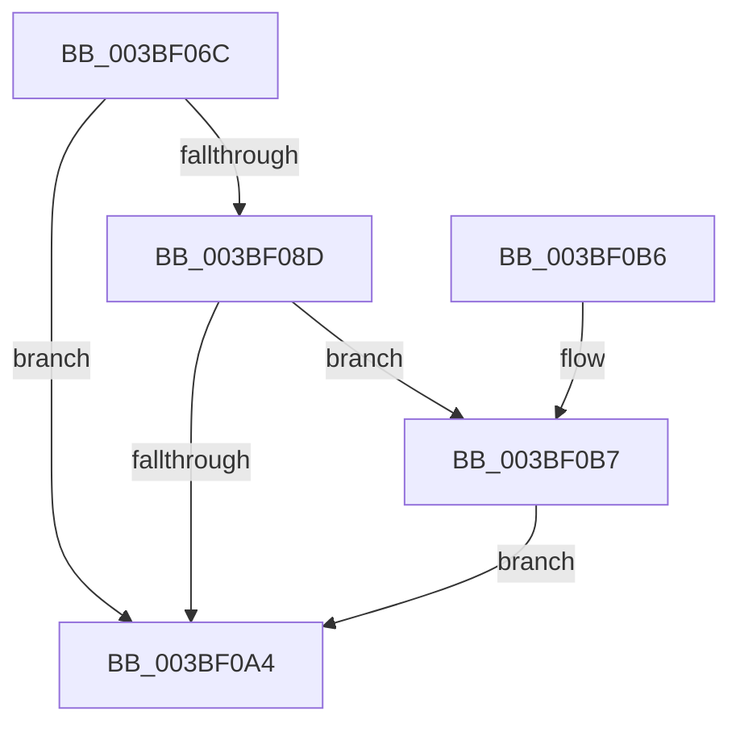

# PpmEventTraceFailedPerfCheckStart

- RVA: `0x003BF06C`–`0x003BF107` (길이 `155` bytes)
- VA: `0x00000001403BF06C`
- 실행 섹션: `.text`
- PDB 이름 있음: `예`; PDB Function 태그: `아니요`
- unwind 정보 RVA: `0x0008DEC4`
- 디코드: `33`개 명령, `155/155` bytes 표시
- 미해석 바이트: `0` (있으면 어셈블리에 `.byte`로 보존)

> 이 문서는 커널 이미지의 기계어와 PDB 기호를 분석해 생성했습니다. 4번과 5번은 함수 원형과 자료형을 바이너리 사용 방식에서 추정한 C 해석이며 원본 소스 복구 결과는 아닙니다.

## 1. Dependencies

- 직접 호출 지점: **3**; 고유 호출 대상: **3**
- 직접 호출자로 확인된 함수: **1**
- RIP 상대 이미지 참조: **4**

### Outgoing calls
- `0x003BF09B` → [EtwEventEnabled](../39/EtwEventEnabled_function_00392450.md) (function, `0x00392450`)
- `0x003BF0AC` → [_security_check_cookie](../6A/_security_check_cookie_function_006AC640.md) (function, `0x006AC640`)
- `0x003BF100` → [EtwWriteEx](../25/EtwWriteEx_function_0025F0D0.md) (function, `0x0025F0D0`)

### Direct callers
- [PpmCheckPeriodicStart](PpmCheckPeriodicStart_function_003BED70.md) at `0x003BEDBC`

### Static image references
- `0x003BF075` → RVA `0x00E0A740` (`.data`; read)
- `0x003BF084` → RVA `0x00E67A39` (`.data`; read)
- `0x003BF08D` → RVA `0x00F083E8` (`.data`; read)
- `0x003BF094` → RVA `0x00011D78` (`.rdata`; read)

## 2. Other-region calls and transfers

- 다른 실행 섹션으로 향하는 call: **0**
- 별도 외부 분기/꼬리 이동을 확인하지 못했습니다.

## 3. Assembly (complete function range)

```asm
003BF06C  48 89 4C 24 08                  mov qword ptr [rsp + 8], rcx
003BF071  48 83 EC 68                     sub rsp, 0x68
003BF075  48 8B 05 C4 B6 A4 00            mov rax, qword ptr [rip + 0xa4b6c4]
003BF07C  48 33 C4                        xor rax, rsp
003BF07F  48 89 44 24 50                  mov qword ptr [rsp + 0x50], rax
003BF084  80 3D AE 89 AA 00 00            cmp byte ptr [rip + 0xaa89ae], 0
003BF08B  74 17                           je 0x1403bf0a4
003BF08D  48 8B 0D 54 93 B4 00            mov rcx, qword ptr [rip + 0xb49354]
003BF094  48 8D 15 DD 2C C5 FF            lea rdx, [rip - 0x3ad323]
003BF09B  E8 B0 33 FD FF                  call 0x140392450
003BF0A0  84 C0                           test al, al
003BF0A2  75 13                           jne 0x1403bf0b7
003BF0A4  48 8B 4C 24 50                  mov rcx, qword ptr [rsp + 0x50]
003BF0A9  48 33 CC                        xor rcx, rsp
003BF0AC  E8 8F D5 2E 00                  call 0x1406ac640
003BF0B1  48 83 C4 68                     add rsp, 0x68
003BF0B5  C3                              ret
003BF0B6  CC                              int3
003BF0B7  83 64 24 4C 00                  and dword ptr [rsp + 0x4c], 0
003BF0BC  48 8D 44 24 70                  lea rax, [rsp + 0x70]
003BF0C1  48 8B 0D 20 93 B4 00            mov rcx, qword ptr [rip + 0xb49320]
003BF0C8  48 8D 15 A9 2C C5 FF            lea rdx, [rip - 0x3ad357]
003BF0CF  48 89 44 24 40                  mov qword ptr [rsp + 0x40], rax
003BF0D4  45 33 C9                        xor r9d, r9d
003BF0D7  48 8D 44 24 40                  lea rax, [rsp + 0x40]
003BF0DC  C7 44 24 48 08 00 00 00         mov dword ptr [rsp + 0x48], 8
003BF0E4  48 89 44 24 38                  mov qword ptr [rsp + 0x38], rax
003BF0E9  45 33 C0                        xor r8d, r8d
003BF0EC  C7 44 24 30 01 00 00 00         mov dword ptr [rsp + 0x30], 1
003BF0F4  48 83 64 24 28 00               and qword ptr [rsp + 0x28], 0
003BF0FA  48 83 64 24 20 00               and qword ptr [rsp + 0x20], 0
003BF100  E8 CB FF E9 FF                  call 0x14025f0d0
003BF105  EB 9D                           jmp 0x1403bf0a4
```

## 4. C-style interpretation (structured pseudocode)

```c
__int64 __fastcall PpmEventTraceFailedPerfCheckStart(__int64 a1, __int64 a2, int a3, int a4)
{
    __int64 result;
    __int64 v_rsp;
    unsigned __int64 v_stack_m18;
    unsigned __int64 v_stack_p20;
    unsigned __int64 v_stack_p28;
    unsigned int v_stack_p30;
    unsigned __int64 v_stack_p38;
    unsigned __int64 v_stack_p40;
    unsigned int v_stack_p48;
    unsigned int v_stack_p4C;
    unsigned __int64 v_stack_p70;
    unsigned __int64 v_stack_p8;

    v_stack_p8 = a1;
    v_rsp = (v_rsp) - (104);
    result = (*(unsigned __int64 *)(v_rip + 10794692)) ^ (v_rsp);
    v_stack_m18 = result;
    if ((*(unsigned __int8 *)(v_rip + 11176366)) == 0) goto loc_003BF0A4;
    result = EtwEventEnabled(*(unsigned __int64 *)(v_rip + 11834196), v_rip - 3855139, a3, a4);
    if ((unsigned __int8)(result) != 0) goto loc_003BF0B7;
loc_003BF0A4:
    a1 = (v_stack_m18) ^ (v_rsp);
    result = _security_check_cookie(a1, v_rip - 3855139, a3, a4);
    v_rsp = (v_rsp) + (104);
    return result;
loc_003BF0B7:
    v_stack_p40 = v_stack_p70;
    a4 = 0;
    v_stack_p48 = 8;
    v_stack_p38 = v_stack_p40;
    a3 = 0;
    v_stack_p30 = 1;
    result = EtwWriteEx(*(unsigned __int64 *)(v_rip + 11834144), v_rip - 3855191, a3, a4);
    goto loc_003BF0A4;
}
```

## 5. (Beta) C Style

```c
int64_t PpmEventTraceFailedPerfCheckStart(int64_t Arg1, int64_t Arg2, int32_t Arg3, int32_t Arg4)
{
    int64_t result;
    int64_t local_rsp;
    uint64_t v_stack_m18;
    uint64_t v_stack_p20;
    uint64_t v_stack_p28;
    uint32_t v_stack_p30;
    uint64_t v_stack_p38;
    uint64_t v_stack_p40;
    uint32_t v_stack_p48;
    uint32_t v_stack_p4C;
    uint64_t v_stack_p70;
    uint64_t v_stack_p8;

    v_stack_p8 = Arg1;
    local_rsp = (local_rsp) - (104);
    result = (*(uint64_t *)(v_rip + 0xA4B6C4)) ^ (local_rsp);
    v_stack_m18 = result;
    if ((*(uint8_t *)(v_rip + 0xAA89AE)) == 0) goto loc_003BF0A4;
    result = EtwEventEnabled(*(uint64_t *)(v_rip + 0xB49354), v_rip - 3855139, Arg3, Arg4);
    if ((uint8_t)(result) != 0) goto loc_003BF0B7;
loc_003BF0A4:
    Arg1 = (v_stack_m18) ^ (local_rsp);
    result = _security_check_cookie(Arg1, v_rip - 3855139, Arg3, Arg4);
    local_rsp = (local_rsp) + (104);
    return result;
loc_003BF0B7:
    v_stack_p40 = v_stack_p70;
    Arg4 = 0;
    v_stack_p48 = 8;
    v_stack_p38 = v_stack_p40;
    Arg3 = 0;
    v_stack_p30 = 1;
    result = EtwWriteEx(*(uint64_t *)(v_rip + 0xB49320), v_rip - 3855191, Arg3, Arg4);
    goto loc_003BF0A4;
}
```

## 6. Execution-region graph

[열기: 2D/3D 그래프와 함수 탐색 컨트롤 패널](../../../control-panel.html?section=text&rva=0x003BF06C&view=graph)

- 2D 그래프는 위에서 아래로 흐르고, 3D 그래프는 빈 공간을 드래그해 회전합니다. Shift+드래그는 이동, 휠은 확대·축소, 함수 노드 선택은 대상 보고서 이동입니다.

### Static fallback


