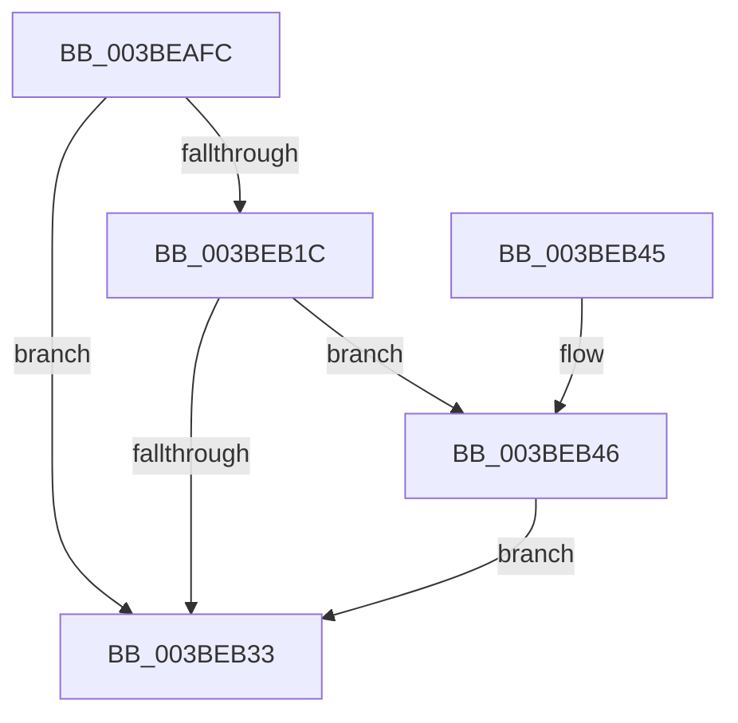

# PpmEventTraceLatencySensitivityHint

- RVA: `0x003BEAFC`–`0x003BEB96` (길이 `154` bytes)
- VA: `0x00000001403BEAFC`
- 실행 섹션: `.text`
- PDB 이름 있음: `예`; PDB Function 태그: `아니요`
- unwind 정보 RVA: `0x0008DE74`
- 디코드: `33`개 명령, `154/154` bytes 표시
- 미해석 바이트: `0` (있으면 어셈블리에 `.byte`로 보존)

> 이 문서는 커널 이미지의 기계어와 PDB 기호를 분석해 생성했습니다. 4번과 5번은 함수 원형과 자료형을 바이너리 사용 방식에서 추정한 C 해석이며 원본 소스 복구 결과는 아닙니다.

## 1. Dependencies

- 직접 호출 지점: **3**; 고유 호출 대상: **3**
- 직접 호출자로 확인된 함수: **1**
- RIP 상대 이미지 참조: **4**

### Outgoing calls
- `0x003BEB2A` → [EtwEventEnabled](../39/EtwEventEnabled_function_00392450.md) (function, `0x00392450`)
- `0x003BEB3B` → [_security_check_cookie](../6A/_security_check_cookie_function_006AC640.md) (function, `0x006AC640`)
- `0x003BEB8F` → [EtwWriteEx](../25/EtwWriteEx_function_0025F0D0.md) (function, `0x0025F0D0`)

### Direct callers
- [PoLatencySensitivityHint](PoLatencySensitivityHint_function_003BE9B0.md) at `0x003BEA09`

### Static image references
- `0x003BEB04` → RVA `0x00E0A740` (`.data`; read)
- `0x003BEB13` → RVA `0x00E67A39` (`.data`; read)
- `0x003BEB1C` → RVA `0x00F083E8` (`.data`; read)
- `0x003BEB23` → RVA `0x00011D68` (`.rdata`; read)

## 2. Other-region calls and transfers

- 다른 실행 섹션으로 향하는 call: **0**
- 별도 외부 분기/꼬리 이동을 확인하지 못했습니다.

## 3. Assembly (complete function range)

```asm
003BEAFC  89 4C 24 08                     mov dword ptr [rsp + 8], ecx
003BEB00  48 83 EC 68                     sub rsp, 0x68
003BEB04  48 8B 05 35 BC A4 00            mov rax, qword ptr [rip + 0xa4bc35]
003BEB0B  48 33 C4                        xor rax, rsp
003BEB0E  48 89 44 24 50                  mov qword ptr [rsp + 0x50], rax
003BEB13  80 3D 1F 8F AA 00 00            cmp byte ptr [rip + 0xaa8f1f], 0
003BEB1A  74 17                           je 0x1403beb33
003BEB1C  48 8B 0D C5 98 B4 00            mov rcx, qword ptr [rip + 0xb498c5]
003BEB23  48 8D 15 3E 32 C5 FF            lea rdx, [rip - 0x3acdc2]
003BEB2A  E8 21 39 FD FF                  call 0x140392450
003BEB2F  84 C0                           test al, al
003BEB31  75 13                           jne 0x1403beb46
003BEB33  48 8B 4C 24 50                  mov rcx, qword ptr [rsp + 0x50]
003BEB38  48 33 CC                        xor rcx, rsp
003BEB3B  E8 00 DB 2E 00                  call 0x1406ac640
003BEB40  48 83 C4 68                     add rsp, 0x68
003BEB44  C3                              ret
003BEB45  CC                              int3
003BEB46  83 64 24 4C 00                  and dword ptr [rsp + 0x4c], 0
003BEB4B  48 8D 44 24 70                  lea rax, [rsp + 0x70]
003BEB50  48 8B 0D 91 98 B4 00            mov rcx, qword ptr [rip + 0xb49891]
003BEB57  48 8D 15 0A 32 C5 FF            lea rdx, [rip - 0x3acdf6]
003BEB5E  48 89 44 24 40                  mov qword ptr [rsp + 0x40], rax
003BEB63  45 33 C9                        xor r9d, r9d
003BEB66  48 8D 44 24 40                  lea rax, [rsp + 0x40]
003BEB6B  C7 44 24 48 04 00 00 00         mov dword ptr [rsp + 0x48], 4
003BEB73  48 89 44 24 38                  mov qword ptr [rsp + 0x38], rax
003BEB78  45 33 C0                        xor r8d, r8d
003BEB7B  C7 44 24 30 01 00 00 00         mov dword ptr [rsp + 0x30], 1
003BEB83  48 83 64 24 28 00               and qword ptr [rsp + 0x28], 0
003BEB89  48 83 64 24 20 00               and qword ptr [rsp + 0x20], 0
003BEB8F  E8 3C 05 EA FF                  call 0x14025f0d0
003BEB94  EB 9D                           jmp 0x1403beb33
```

## 4. C-style interpretation (structured pseudocode)

```c
__int64 __fastcall PpmEventTraceLatencySensitivityHint(int a1, __int64 a2, int a3, int a4)
{
    __int64 result;
    __int64 v_rsp;
    unsigned __int64 v_stack_m18;
    unsigned __int64 v_stack_p20;
    unsigned __int64 v_stack_p28;
    unsigned int v_stack_p30;
    unsigned __int64 v_stack_p38;
    unsigned __int64 v_stack_p40;
    unsigned int v_stack_p48;
    unsigned int v_stack_p4C;
    unsigned __int64 v_stack_p70;
    unsigned int v_stack_p8;

    v_stack_p8 = a1;
    v_rsp = (v_rsp) - (104);
    result = (*(unsigned __int64 *)(v_rip + 10796085)) ^ (v_rsp);
    v_stack_m18 = result;
    if ((*(unsigned __int8 *)(v_rip + 11177759)) == 0) goto loc_003BEB33;
    result = EtwEventEnabled(*(unsigned __int64 *)(v_rip + 11835589), v_rip - 3853762, a3, a4);
    if ((unsigned __int8)(result) != 0) goto loc_003BEB46;
loc_003BEB33:
    a1 = (v_stack_m18) ^ (v_rsp);
    result = _security_check_cookie(a1, v_rip - 3853762, a3, a4);
    v_rsp = (v_rsp) + (104);
    return result;
loc_003BEB46:
    v_stack_p40 = v_stack_p70;
    a4 = 0;
    v_stack_p48 = 4;
    v_stack_p38 = v_stack_p40;
    a3 = 0;
    v_stack_p30 = 1;
    result = EtwWriteEx(*(unsigned __int64 *)(v_rip + 11835537), v_rip - 3853814, a3, a4);
    goto loc_003BEB33;
}
```

## 5. (Beta) C Style

```c
int64_t PpmEventTraceLatencySensitivityHint(int32_t Arg1, int64_t Arg2, int32_t Arg3, int32_t Arg4)
{
    int64_t result;
    int64_t local_rsp;
    uint64_t v_stack_m18;
    uint64_t v_stack_p20;
    uint64_t v_stack_p28;
    uint32_t v_stack_p30;
    uint64_t v_stack_p38;
    uint64_t v_stack_p40;
    uint32_t v_stack_p48;
    uint32_t v_stack_p4C;
    uint64_t v_stack_p70;
    uint32_t v_stack_p8;

    v_stack_p8 = Arg1;
    local_rsp = (local_rsp) - (104);
    result = (*(uint64_t *)(v_rip + 0xA4BC35)) ^ (local_rsp);
    v_stack_m18 = result;
    if ((*(uint8_t *)(v_rip + 0xAA8F1F)) == 0) goto loc_003BEB33;
    result = EtwEventEnabled(*(uint64_t *)(v_rip + 0xB498C5), v_rip - 3853762, Arg3, Arg4);
    if ((uint8_t)(result) != 0) goto loc_003BEB46;
loc_003BEB33:
    Arg1 = (v_stack_m18) ^ (local_rsp);
    result = _security_check_cookie(Arg1, v_rip - 3853762, Arg3, Arg4);
    local_rsp = (local_rsp) + (104);
    return result;
loc_003BEB46:
    v_stack_p40 = v_stack_p70;
    Arg4 = 0;
    v_stack_p48 = 4;
    v_stack_p38 = v_stack_p40;
    Arg3 = 0;
    v_stack_p30 = 1;
    result = EtwWriteEx(*(uint64_t *)(v_rip + 0xB49891), v_rip - 3853814, Arg3, Arg4);
    goto loc_003BEB33;
}
```

## 6. Execution-region graph

[열기: 2D/3D 그래프와 함수 탐색 컨트롤 패널](../../../control-panel.html?section=text&rva=0x003BEAFC&view=graph)

- 2D 그래프는 위에서 아래로 흐르고, 3D 그래프는 빈 공간을 드래그해 회전합니다. Shift+드래그는 이동, 휠은 확대·축소, 함수 노드 선택은 대상 보고서 이동입니다.

### Static fallback


