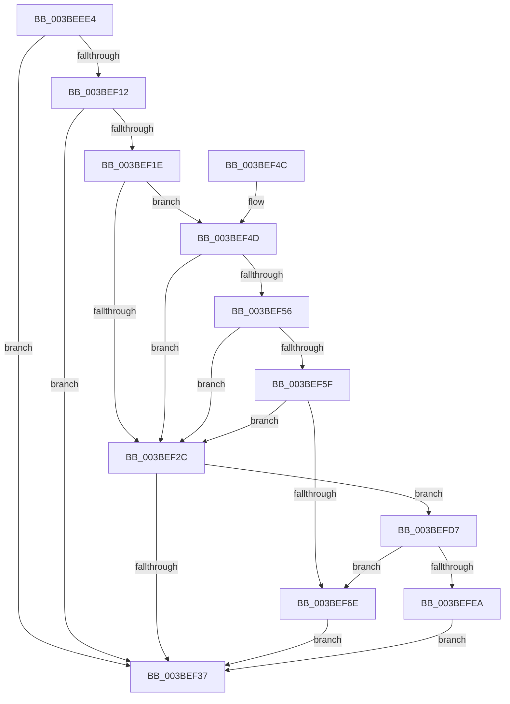

# PpmEventTracePerfCheckStart

- RVA: `0x003BEEE4`–`0x003BEFEF` (길이 `267` bytes)
- VA: `0x00000001403BEEE4`
- 실행 섹션: `.text`
- PDB 이름 있음: `예`; PDB Function 태그: `아니요`
- unwind 정보 RVA: `0x0008DEB0`
- 디코드: `65`개 명령, `267/267` bytes 표시
- 미해석 바이트: `0` (있으면 어셈블리에 `.byte`로 보존)

> 이 문서는 커널 이미지의 기계어와 PDB 기호를 분석해 생성했습니다. 4번과 5번은 함수 원형과 자료형을 바이너리 사용 방식에서 추정한 C 해석이며 원본 소스 복구 결과는 아닙니다.

## 1. Dependencies

- 직접 호출 지점: **3**; 고유 호출 대상: **3**
- 직접 호출자로 확인된 함수: **1**
- RIP 상대 이미지 참조: **5**

### Outgoing calls
- `0x003BEF3E` → [_security_check_cookie](../6A/_security_check_cookie_function_006AC640.md) (function, `0x006AC640`)
- `0x003BEFCD` → [EtwWriteEx](../25/EtwWriteEx_function_0025F0D0.md) (function, `0x0025F0D0`)
- `0x003BEFE1` → [EtwpLevelKeywordEnabled](../2F/EtwpLevelKeywordEnabled_function_002FD110.md) (function, `0x002FD110`)

### Direct callers
- [PpmCheckStart](PpmCheckStart_function_003BEE14.md) at `0x003BEE3D`

### Static image references
- `0x003BEEF8` → RVA `0x00E0A740` (`.data`; read)
- `0x003BEF09` → RVA `0x00E67A39` (`.data`; read)
- `0x003BEF12` → RVA `0x00F083E8` (`.data`; read)
- `0x003BEF75` → RVA `0x00F0B260` (`.data`; read)
- `0x003BEF80` → RVA `0x00011D58` (`.rdata`; read)

## 2. Other-region calls and transfers

- 다른 실행 섹션으로 향하는 call: **0**
- 별도 외부 분기/꼬리 이동을 확인하지 못했습니다.

## 3. Assembly (complete function range)

```asm
003BEEE4  89 54 24 10                     mov dword ptr [rsp + 0x10], edx
003BEEE8  48 89 4C 24 08                  mov qword ptr [rsp + 8], rcx
003BEEED  55                              push rbp
003BEEEE  48 8B EC                        mov rbp, rsp
003BEEF1  48 81 EC 80 00 00 00            sub rsp, 0x80
003BEEF8  48 8B 05 41 B8 A4 00            mov rax, qword ptr [rip + 0xa4b841]
003BEEFF  48 33 C4                        xor rax, rsp
003BEF02  48 89 45 F8                     mov qword ptr [rbp - 8], rax
003BEF06  45 33 C9                        xor r9d, r9d
003BEF09  44 38 0D 29 8B AA 00            cmp byte ptr [rip + 0xaa8b29], r9b
003BEF10  74 25                           je 0x1403bef37
003BEF12  48 8B 15 CF 94 B4 00            mov rdx, qword ptr [rip + 0xb494cf]
003BEF19  48 85 D2                        test rdx, rdx
003BEF1C  74 19                           je 0x1403bef37
003BEF1E  48 8B 4A 20                     mov rcx, qword ptr [rdx + 0x20]
003BEF22  45 8D 41 02                     lea r8d, [r9 + 2]
003BEF26  44 39 49 60                     cmp dword ptr [rcx + 0x60], r9d
003BEF2A  75 21                           jne 0x1403bef4d
003BEF2C  66 44 39 4A 66                  cmp word ptr [rdx + 0x66], r9w
003BEF31  0F 85 A0 00 00 00               jne 0x1403befd7
003BEF37  48 8B 4D F8                     mov rcx, qword ptr [rbp - 8]
003BEF3B  48 33 CC                        xor rcx, rsp
003BEF3E  E8 FD D6 2E 00                  call 0x1406ac640
003BEF43  48 81 C4 80 00 00 00            add rsp, 0x80
003BEF4A  5D                              pop rbp
003BEF4B  C3                              ret
003BEF4C  CC                              int3
003BEF4D  8A 41 64                        mov al, byte ptr [rcx + 0x64]
003BEF50  FE C8                           dec al
003BEF52  3C 03                           cmp al, 3
003BEF54  76 D6                           jbe 0x1403bef2c
003BEF56  8B 41 68                        mov eax, dword ptr [rcx + 0x68]
003BEF59  44 84 41 70                     test byte ptr [rcx + 0x70], r8b
003BEF5D  74 CD                           je 0x1403bef2c
003BEF5F  48 8B 49 78                     mov rcx, qword ptr [rcx + 0x78]
003BEF63  48 8B C1                        mov rax, rcx
003BEF66  49 23 C0                        and rax, r8
003BEF69  48 3B C1                        cmp rax, rcx
003BEF6C  75 BE                           jne 0x1403bef2c
003BEF6E  48 8B 0D 73 94 B4 00            mov rcx, qword ptr [rip + 0xb49473]
003BEF75  48 8D 05 E4 C2 B4 00            lea rax, [rip + 0xb4c2e4]
003BEF7C  48 89 45 C8                     mov qword ptr [rbp - 0x38], rax
003BEF80  48 8D 15 D1 2D C5 FF            lea rdx, [rip - 0x3ad22f]
003BEF87  48 8D 45 10                     lea rax, [rbp + 0x10]
003BEF8B  48 C7 45 D0 08 00 00 00         mov qword ptr [rbp - 0x30], 8
003BEF93  48 89 45 D8                     mov qword ptr [rbp - 0x28], rax
003BEF97  45 33 C0                        xor r8d, r8d
003BEF9A  48 8D 45 18                     lea rax, [rbp + 0x18]
003BEF9E  48 C7 45 E0 08 00 00 00         mov qword ptr [rbp - 0x20], 8
003BEFA6  48 89 45 E8                     mov qword ptr [rbp - 0x18], rax
003BEFAA  48 8D 45 C8                     lea rax, [rbp - 0x38]
003BEFAE  48 89 44 24 38                  mov qword ptr [rsp + 0x38], rax
003BEFB3  C7 44 24 30 03 00 00 00         mov dword ptr [rsp + 0x30], 3
003BEFBB  4C 89 4C 24 28                  mov qword ptr [rsp + 0x28], r9
003BEFC0  4C 89 4C 24 20                  mov qword ptr [rsp + 0x20], r9
003BEFC5  48 C7 45 F0 04 00 00 00         mov qword ptr [rbp - 0x10], 4
003BEFCD  E8 FE 00 EA FF                  call 0x14025f0d0
003BEFD2  E9 60 FF FF FF                  jmp 0x1403bef37
003BEFD7  48 8B 4A 28                     mov rcx, qword ptr [rdx + 0x28]
003BEFDB  B2 05                           mov dl, 5
003BEFDD  48 83 C1 60                     add rcx, 0x60
003BEFE1  E8 2A E1 F3 FF                  call 0x1402fd110
003BEFE6  84 C0                           test al, al
003BEFE8  75 84                           jne 0x1403bef6e
003BEFEA  E9 48 FF FF FF                  jmp 0x1403bef37
```

## 4. C-style interpretation (structured pseudocode)

```c
__int64 __fastcall PpmEventTracePerfCheckStart(__int64 a1, int a2, __int64 a3, int a4)
{
    __int64 result;
    __int64 v_rsp;
    unsigned __int64 v_stack_m10;
    unsigned __int64 v_stack_m18;
    unsigned __int64 v_stack_m20;
    unsigned __int64 v_stack_m28;
    unsigned __int64 v_stack_m30;
    unsigned __int64 v_stack_m38;
    unsigned __int64 v_stack_m40;
    unsigned int v_stack_p10;
    unsigned __int64 v_stack_p20;
    unsigned __int64 v_stack_p28;
    unsigned int v_stack_p30;
    unsigned __int64 v_stack_p38;
    unsigned __int64 v_stack_p8;

    v_stack_p10 = a2;
    v_stack_p8 = a1;
    v_rsp = (v_rsp) - (128);
    result = (*(unsigned __int64 *)(v_rip + 10795073)) ^ (v_rsp);
    v_stack_m10 = result;
    a4 = 0;
    if ((*(unsigned __int8 *)(v_rip + 11176745)) == 0) goto loc_003BEF37;
    if (*(unsigned __int64 *)(v_rip + 11834575) == 0) goto loc_003BEF37;
    if ((*(unsigned int *)(*(unsigned __int64 *)(*(unsigned __int64 *)(v_rip + 11834575) + 32) + 96)) != 0) goto loc_003BEF4D;
loc_003BEF2C:
    if ((*(unsigned __int16 *)(*(unsigned __int64 *)(v_rip + 11834575) + 102)) != 0) goto loc_003BEFD7;
loc_003BEF37:
    a1 = (v_stack_m10) ^ (v_rsp);
    result = _security_check_cookie(a1, *(unsigned __int64 *)(v_rip + 11834575), a4 + 2, a4);
    v_rsp = (v_rsp) + (128);
    return result;
loc_003BEF4D:
    result = (unsigned __int8)((*(unsigned __int8 *)(a1 + 100)) - 1);
    if (((unsigned __int8)(result)) <= 3) goto loc_003BEF2C;
    if (((*(unsigned __int8 *)(a1 + 112)) & ((unsigned __int8)(a4 + 2))) == 0) goto loc_003BEF2C;
    result = (*(unsigned __int64 *)(a1 + 120)) & (a4 + 2);
    if (result != (*(unsigned __int64 *)(a1 + 120))) goto loc_003BEF2C;
loc_003BEF6E:
    v_stack_m40 = v_rip + 11846372;
    v_stack_m38 = 8;
    v_stack_m30 = v_stack_p8;
    a3 = 0;
    v_stack_m28 = 8;
    v_stack_m20 = v_stack_p10;
    v_stack_p38 = v_stack_m40;
    v_stack_p30 = 3;
    v_stack_p28 = 0;
    v_stack_p20 = 0;
    v_stack_m18 = 4;
    result = EtwWriteEx(*(unsigned __int64 *)(v_rip + 11834483), v_rip - 3854895, a3, a4);
    goto loc_003BEF37;
loc_003BEFD7:
    a1 = (*(unsigned __int64 *)(v_rip - 3854895 + 40)) + (96);
    result = EtwpLevelKeywordEnabled(a1, 5, a3, a4);
    if ((unsigned __int8)(result) != 0) goto loc_003BEF6E;
    goto loc_003BEF37;
}
```

## 5. (Beta) C Style

```c
int64_t PpmEventTracePerfCheckStart(int64_t Arg1, int32_t Arg2, int64_t Arg3, int32_t Arg4)
{
    int64_t result;
    int64_t local_rsp;
    uint64_t v_stack_m10;
    uint64_t v_stack_m18;
    uint64_t v_stack_m20;
    uint64_t v_stack_m28;
    uint64_t v_stack_m30;
    uint64_t v_stack_m38;
    uint64_t v_stack_m40;
    uint32_t v_stack_p10;
    uint64_t v_stack_p20;
    uint64_t v_stack_p28;
    uint32_t v_stack_p30;
    uint64_t v_stack_p38;
    uint64_t v_stack_p8;

    v_stack_p10 = Arg2;
    v_stack_p8 = Arg1;
    local_rsp = (local_rsp) - (128);
    result = (*(uint64_t *)(v_rip + 0xA4B841)) ^ (local_rsp);
    v_stack_m10 = result;
    Arg4 = 0;
    if ((*(uint8_t *)(v_rip + 0xAA8B29)) == 0) goto loc_003BEF37;
    if (*(uint64_t *)(v_rip + 0xB494CF) == 0) goto loc_003BEF37;
    if ((*(uint32_t *)(*(uint64_t *)(*(uint64_t *)(v_rip + 0xB494CF) + 0x20) + 0x60)) != 0) goto loc_003BEF4D;
loc_003BEF2C:
    if ((*(uint16_t *)(*(uint64_t *)(v_rip + 0xB494CF) + 0x66)) != 0) goto loc_003BEFD7;
loc_003BEF37:
    Arg1 = (v_stack_m10) ^ (local_rsp);
    result = _security_check_cookie(Arg1, *(uint64_t *)(v_rip + 0xB494CF), Arg4 + 2, Arg4);
    local_rsp = (local_rsp) + (128);
    return result;
loc_003BEF4D:
    result = (uint8_t)((*(uint8_t *)(Arg1 + 0x64)) - 1);
    if (((uint8_t)(result)) <= 3) goto loc_003BEF2C;
    if (((*(uint8_t *)(Arg1 + 0x70)) & ((uint8_t)(Arg4 + 2))) == 0) goto loc_003BEF2C;
    result = (*(uint64_t *)(Arg1 + 0x78)) & (Arg4 + 2);
    if (result != (*(uint64_t *)(Arg1 + 0x78))) goto loc_003BEF2C;
loc_003BEF6E:
    v_stack_m40 = v_rip + 11846372;
    v_stack_m38 = 8;
    v_stack_m30 = v_stack_p8;
    Arg3 = 0;
    v_stack_m28 = 8;
    v_stack_m20 = v_stack_p10;
    v_stack_p38 = v_stack_m40;
    v_stack_p30 = 3;
    v_stack_p28 = 0;
    v_stack_p20 = 0;
    v_stack_m18 = 4;
    result = EtwWriteEx(*(uint64_t *)(v_rip + 0xB49473), v_rip - 3854895, Arg3, Arg4);
    goto loc_003BEF37;
loc_003BEFD7:
    Arg1 = (*(uint64_t *)(v_rip - 0x3AD22F + 0x28)) + (96);
    result = EtwpLevelKeywordEnabled(Arg1, 5, Arg3, Arg4);
    if ((uint8_t)(result) != 0) goto loc_003BEF6E;
    goto loc_003BEF37;
}
```

## 6. Execution-region graph

[열기: 2D/3D 그래프와 함수 탐색 컨트롤 패널](../../../control-panel.html?section=text&rva=0x003BEEE4&view=graph)

- 2D 그래프는 위에서 아래로 흐르고, 3D 그래프는 빈 공간을 드래그해 회전합니다. Shift+드래그는 이동, 휠은 확대·축소, 함수 노드 선택은 대상 보고서 이동입니다.

### Static fallback


