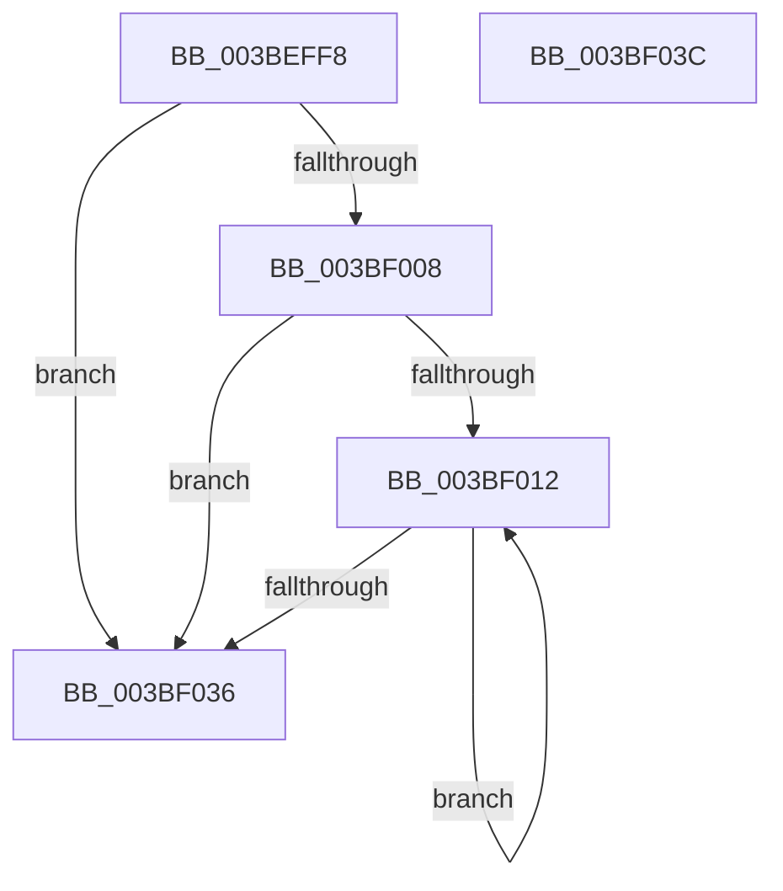

# PpmHeteroHgsCheckContainmentDecision

- RVA: `0x003BEFF8`–`0x003BF03D` (길이 `69` bytes)
- VA: `0x00000001403BEFF8`
- 실행 섹션: `.text`
- PDB 이름 있음: `예`; PDB Function 태그: `아니요`
- unwind 정보 RVA: `0x0005CF00`
- 디코드: `20`개 명령, `69/69` bytes 표시
- 미해석 바이트: `0` (있으면 어셈블리에 `.byte`로 보존)

> 이 문서는 커널 이미지의 기계어와 PDB 기호를 분석해 생성했습니다. 4번과 5번은 함수 원형과 자료형을 바이너리 사용 방식에서 추정한 C 해석이며 원본 소스 복구 결과는 아닙니다.

## 1. Dependencies

- 직접 호출 지점: **1**; 고유 호출 대상: **1**
- 직접 호출자로 확인된 함수: **6**
- RIP 상대 이미지 참조: **3**

### Outgoing calls
- `0x003BF023` → [PpmHeteroHgsEvaluateContainmentDecision](../4F/PpmHeteroHgsEvaluateContainmentDecision_function_004FBDE4.md) (function, `0x004FBDE4`)

### Direct callers
- [PpmCheckStart](PpmCheckStart_function_003BEE14.md) at `0x003BEED4`
- [PpmHeteroUpdateHgsConfiguration](PpmHeteroUpdateHgsConfiguration_function_003BF344.md) at `0x003BFCC4`
- [PpmParkApplyPolicy](../4B/PpmParkApplyPolicy_function_004B613C.md) at `0x004B6846`
- [PpmParkApplyPolicyEx](../4F/PpmParkApplyPolicyEx_function_004F3090.md) at `0x004F3913`
- [PpmReapplyPerfPolicy](../../page/A5/PpmReapplyPerfPolicy_function_00A53148.md) at `0x00A532B3`
- [PopPowerRequestCallbackPerfBoostRequired](../../page/A9/PopPowerRequestCallbackPerfBoostRequired_function_00A96F70.md) at `0x00A96F95`
- [PopPowerRequestCallbackPerfBoostRequired](../../page/A9/PopPowerRequestCallbackPerfBoostRequired_function_00A96F70.md) at `0x00A97002`

### Static image references
- `0x003BEFFE` → RVA `0x00FC501C` (`ALMOSTRO`; read)
- `0x003BF00A` → RVA `0x00F083E0` (`.data`; read)
- `0x003BF01C` → RVA `0x00F083D8` (`.data`; read)

## 2. Other-region calls and transfers

- 다른 실행 섹션으로 향하는 call: **0**
- 별도 외부 분기/꼬리 이동을 확인하지 못했습니다.

## 3. Assembly (complete function range)

```asm
003BEFF8  40 53                           push rbx
003BEFFA  48 83 EC 20                     sub rsp, 0x20
003BEFFE  8B 05 18 60 C0 00               mov eax, dword ptr [rip + 0xc06018]
003BF004  A8 04                           test al, 4
003BF006  74 2E                           je 0x1403bf036
003BF008  33 DB                           xor ebx, ebx
003BF00A  39 1D D0 93 B4 00               cmp dword ptr [rip + 0xb493d0], ebx
003BF010  76 24                           jbe 0x1403bf036
003BF012  0F B7 C3                        movzx eax, bx
003BF015  48 69 C8 10 05 00 00            imul rcx, rax, 0x510
003BF01C  48 03 0D B5 93 B4 00            add rcx, qword ptr [rip + 0xb493b5]
003BF023  E8 BC CD 13 00                  call 0x1404fbde4
003BF028  66 FF C3                        inc bx
003BF02B  0F B7 C3                        movzx eax, bx
003BF02E  3B 05 AC 93 B4 00               cmp eax, dword ptr [rip + 0xb493ac]
003BF034  72 DC                           jb 0x1403bf012
003BF036  48 83 C4 20                     add rsp, 0x20
003BF03A  5B                              pop rbx
003BF03B  C3                              ret
003BF03C  CC                              int3
```

## 4. C-style interpretation (structured pseudocode)

```c
__int64 __fastcall PpmHeteroHgsCheckContainmentDecision(void)
{
    __int64 result;
    __int64 v_rbx;
    __int64 v_rsp;

    v_rsp = (v_rsp) - (32);
    if ((((unsigned __int8)((unsigned int)(*(unsigned int *)(v_rip + 12607512)))) & (4)) == 0) goto loc_003BF036;
    v_rbx = 0;
    if ((*(unsigned int *)(v_rip + 11834320)) <= 0) goto loc_003BF036;
loc_003BF012:
    a1 = (a1) * (0);
    a1 = (a1) + (*(unsigned __int64 *)(v_rip + 11834293));
    result = PpmHeteroHgsEvaluateContainmentDecision(a1, a2, a3, a4);
    v_rbx = (unsigned __int16)((v_rbx) + 1);
    if (((unsigned int)((unsigned __int16)(v_rbx))) < (*(unsigned int *)(v_rip + 11834284))) goto loc_003BF012;
loc_003BF036:
    v_rsp = (v_rsp) + (32);
    return (unsigned __int16)(v_rbx);
}
```

## 5. (Beta) C Style

```c
void PpmHeteroHgsCheckContainmentDecision(void)
{
    int64_t result;
    int64_t local_rbx;
    int64_t local_rsp;

    local_rsp = (local_rsp) - (32);
    if ((((uint8_t)((uint32_t)(*(uint32_t *)(v_rip + 0xC06018)))) & (4)) == 0) goto loc_003BF036;
    local_rbx = 0;
    if ((*(uint32_t *)(v_rip + 0xB493D0)) <= 0) goto loc_003BF036;
loc_003BF012:
    a1 = (a1) * (0);
    a1 = (a1) + (*(uint64_t *)(v_rip + 0xB493B5));
    result = PpmHeteroHgsEvaluateContainmentDecision(a1, a2, a3, a4);
    local_rbx = (uint16_t)((local_rbx) + 1);
    if (((uint32_t)((uint16_t)(local_rbx))) < (*(uint32_t *)(v_rip + 0xB493AC))) goto loc_003BF012;
loc_003BF036:
    local_rsp = (local_rsp) + (32);
    return (uint16_t)(local_rbx);
}
```

## 6. Execution-region graph

[열기: 2D/3D 그래프와 함수 탐색 컨트롤 패널](../../../control-panel.html?section=text&rva=0x003BEFF8&view=graph)

- 2D 그래프는 위에서 아래로 흐르고, 3D 그래프는 빈 공간을 드래그해 회전합니다. Shift+드래그는 이동, 휠은 확대·축소, 함수 노드 선택은 대상 보고서 이동입니다.

### Static fallback


