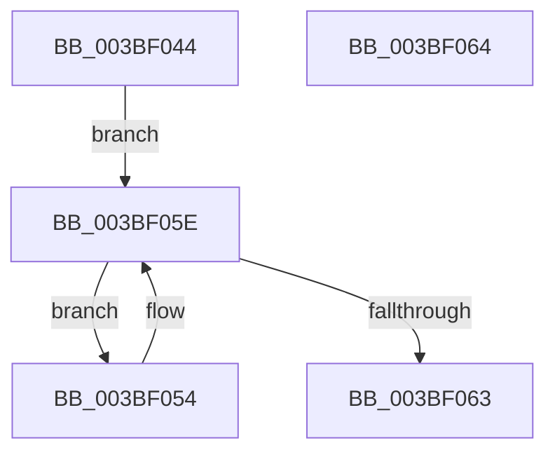

# PpmPerfSetAllDomainsToUpdate

- RVA: `0x003BF044`–`0x003BF065` (길이 `33` bytes)
- VA: `0x00000001403BF044`
- 실행 섹션: `.text`
- PDB 이름 있음: `예`; PDB Function 태그: `아니요`
- unwind 정보 RVA: `0x000DB714`
- 디코드: `9`개 명령, `33/33` bytes 표시
- 미해석 바이트: `0` (있으면 어셈블리에 `.byte`로 보존)

> 이 문서는 커널 이미지의 기계어와 PDB 기호를 분석해 생성했습니다. 4번과 5번은 함수 원형과 자료형을 바이너리 사용 방식에서 추정한 C 해석이며 원본 소스 복구 결과는 아닙니다.

## 1. Dependencies

- 직접 호출 지점: **0**; 고유 호출 대상: **0**
- 직접 호출자로 확인된 함수: **3**
- RIP 상대 이미지 참조: **1**

### Outgoing calls
- 직접 디코드된 call 명령이 없습니다.

### Direct callers
- [PpmCheckStart](PpmCheckStart_function_003BEE14.md) at `0x003BEEC2`
- [PpmPerfReApplyStates](../../page/75/PpmPerfReApplyStates_function_0075ADA4.md) at `0x0075ADB4`
- [PpmPerfUpdateDomainPolicy](../../page/A9/PpmPerfUpdateDomainPolicy_function_00A97030.md) at `0x00A971C1`

### Static image references
- `0x003BF044` → RVA `0x00FC6BA8` (`ALMOSTRO`; read)

## 2. Other-region calls and transfers

- 다른 실행 섹션으로 향하는 call: **0**
- 별도 외부 분기/꼬리 이동을 확인하지 못했습니다.

## 3. Assembly (complete function range)

```asm
003BF044  48 8B 05 5D 7B C0 00            mov rax, qword ptr [rip + 0xc07b5d]
003BF04B  48 8D 0D 56 7B C0 00            lea rcx, [rip + 0xc07b56]
003BF052  EB 0A                           jmp 0x1403bf05e
003BF054  C6 80 BD 04 00 00 01            mov byte ptr [rax + 0x4bd], 1
003BF05B  48 8B 00                        mov rax, qword ptr [rax]
003BF05E  48 3B C1                        cmp rax, rcx
003BF061  75 F1                           jne 0x1403bf054
003BF063  C3                              ret
003BF064  CC                              int3
```

## 4. C-style interpretation (structured pseudocode)

```c
__int64 __fastcall PpmPerfSetAllDomainsToUpdate(void)
{
    goto loc_003BF05E;
loc_003BF054:
    *(unsigned __int8 *)(*(unsigned __int64 *)(v_rip + 12614493) + 1213) = 1;
loc_003BF05E:
    if ((*(unsigned __int64 *)(*(unsigned __int64 *)(v_rip + 12614493))) != (v_rip + 12614486)) goto loc_003BF054;
    return *(unsigned __int64 *)(*(unsigned __int64 *)(v_rip + 12614493));
}
```

## 5. (Beta) C Style

```c
void PpmPerfSetAllDomainsToUpdate(void)
{
    goto loc_003BF05E;
loc_003BF054:
    *(uint8_t *)(*(uint64_t *)(v_rip + 0xC07B5D) + 0x4BD) = 1;
loc_003BF05E:
    if ((*(uint64_t *)(*(uint64_t *)(v_rip + 0xC07B5D))) != (v_rip + 12614486)) goto loc_003BF054;
    return *(uint64_t *)(*(uint64_t *)(v_rip + 0xC07B5D));
}
```

## 6. Execution-region graph

[열기: 2D/3D 그래프와 함수 탐색 컨트롤 패널](../../../control-panel.html?section=text&rva=0x003BF044&view=graph)

- 2D 그래프는 위에서 아래로 흐르고, 3D 그래프는 빈 공간을 드래그해 회전합니다. Shift+드래그는 이동, 휠은 확대·축소, 함수 노드 선택은 대상 보고서 이동입니다.

### Static fallback


