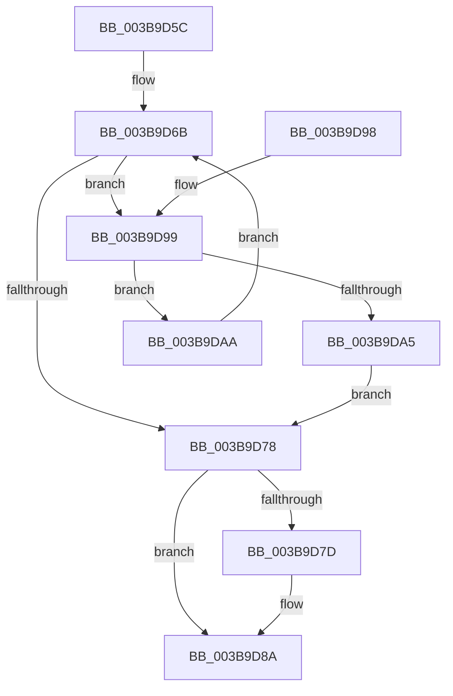

# PsGetNextPartition

- RVA: `0x003B9D5C`–`0x003B9DAF` (길이 `83` bytes)
- VA: `0x00000001403B9D5C`
- 실행 섹션: `.text`
- PDB 이름 있음: `예`; PDB Function 태그: `아니요`
- unwind 정보 RVA: `0x0006BDE4`
- 디코드: `28`개 명령, `83/83` bytes 표시
- 미해석 바이트: `0` (있으면 어셈블리에 `.byte`로 보존)

> 이 문서는 커널 이미지의 기계어와 PDB 기호를 분석해 생성했습니다. 4번과 5번은 함수 원형과 자료형을 바이너리 사용 방식에서 추정한 C 해석이며 원본 소스 복구 결과는 아닙니다.

## 1. Dependencies

- 직접 호출 지점: **3**; 고유 호출 대상: **3**
- 직접 호출자로 확인된 함수: **14**
- RIP 상대 이미지 참조: **0**

### Outgoing calls
- `0x003B9D6B` → [PsGetNextPartitionUnsafe](../2F/PsGetNextPartitionUnsafe_function_002F0E38.md) (function, `0x002F0E38`)
- `0x003B9D85` → [PsDereferencePartition](../34/PsDereferencePartition_function_00342E70.md) (function, `0x00342E70`)
- `0x003B9D9C` → [PsReferencePartitionSafe](PsReferencePartitionSafe_function_003BA6C0.md) (function, `0x003BA6C0`)

### Direct callers
- [MiCheckControlArea](../28/MiCheckControlArea_function_002861B0.md) at `0x002864C1`
- [MiCheckControlArea](../28/MiCheckControlArea_function_002861B0.md) at `0x002864F3`
- [sub_00327F8E](../32/Unknown_function_00327F8E.md) at `0x00327F93`
- [sub_00327F8E](../32/Unknown_function_00327F8E.md) at `0x00327FC1`
- [EtwpLogMemNodeInfo](EtwpLogMemNodeInfo_function_003B991C.md) at `0x003B99B1`
- [ExpCheckForWorker](../4E/ExpCheckForWorker_function_004EC8FC.md) at `0x004EC926`
- [MiDistributeSystemCacheVaReductions](../67/MiDistributeSystemCacheVaReductions_function_00677E94.md) at `0x00677EC0`
- [MmEmptyAllWorkingSets](../67/MmEmptyAllWorkingSets_function_0067EF2C.md) at `0x0067EF41`
- [MmSetTrimWhileAgingState](../67/MmSetTrimWhileAgingState_function_0067EF5C.md) at `0x0067EF7B`
- [MmTrimFilePagesFromWorkingSets](../67/MmTrimFilePagesFromWorkingSets_function_0067EFB8.md) at `0x0067EFDB`
- [MmFlushAllPagesEx](../68/MmFlushAllPagesEx_function_006804E4.md) at `0x0068050D`
- [MiWakeAllZeroConductors](../69/MiWakeAllZeroConductors_function_00696724.md) at `0x00696743`
- [MiWakeAllZeroConductors](../69/MiWakeAllZeroConductors_function_00696724.md) at `0x006967B2`
- [MiSignalNewAcceleratorsAvailable](../69/MiSignalNewAcceleratorsAvailable_function_006974E4.md) at `0x006976AA`
- [MiSignalNewAcceleratorsAvailable](../69/MiSignalNewAcceleratorsAvailable_function_006974E4.md) at `0x00697820`
- [ExpNodeHotAddProcessorWorker](../../page/7C/ExpNodeHotAddProcessorWorker_function_007CF820.md) at `0x007CF834`
- [MmSetMinimumAgeRate](../../page/AB/MmSetMinimumAgeRate_function_00AB16C0.md) at `0x00AB16CE`
- [MmSetMinimumAgeRate](../../page/AB/MmSetMinimumAgeRate_function_00AB16C0.md) at `0x00AB16F9`
- [MiMirrorBrownPhase](../../pagelk/B7/MiMirrorBrownPhase_function_00B7C6B4.md) at `0x00B7C6F6`

### Static image references
- 디코드된 RIP-relative 메모리 참조가 없습니다.

## 2. Other-region calls and transfers

- 다른 실행 섹션으로 향하는 call: **0**
- 별도 외부 분기/꼬리 이동을 확인하지 못했습니다.

## 3. Assembly (complete function range)

```asm
003B9D5C  48 89 5C 24 08                  mov qword ptr [rsp + 8], rbx
003B9D61  57                              push rdi
003B9D62  48 83 EC 20                     sub rsp, 0x20
003B9D66  48 8B D9                        mov rbx, rcx
003B9D69  33 FF                           xor edi, edi
003B9D6B  E8 C8 70 F3 FF                  call 0x1402f0e38
003B9D70  4C 8B C0                        mov r8, rax
003B9D73  48 85 C0                        test rax, rax
003B9D76  75 21                           jne 0x1403b9d99
003B9D78  48 85 DB                        test rbx, rbx
003B9D7B  74 0D                           je 0x1403b9d8a
003B9D7D  BA 50 73 45 6E                  mov edx, 0x6e457350
003B9D82  48 8B CB                        mov rcx, rbx
003B9D85  E8 E6 90 F8 FF                  call 0x140342e70
003B9D8A  48 8B 5C 24 30                  mov rbx, qword ptr [rsp + 0x30]
003B9D8F  48 8B C7                        mov rax, rdi
003B9D92  48 83 C4 20                     add rsp, 0x20
003B9D96  5F                              pop rdi
003B9D97  C3                              ret
003B9D98  CC                              int3
003B9D99  49 8B C8                        mov rcx, r8
003B9D9C  E8 1F 09 00 00                  call 0x1403ba6c0
003B9DA1  84 C0                           test al, al
003B9DA3  74 05                           je 0x1403b9daa
003B9DA5  49 8B F8                        mov rdi, r8
003B9DA8  EB CE                           jmp 0x1403b9d78
003B9DAA  49 8B C8                        mov rcx, r8
003B9DAD  EB BC                           jmp 0x1403b9d6b
```

## 4. C-style interpretation (structured pseudocode)

```c
__int64 __fastcall PsGetNextPartition(__int64 a1)
{
    __int64 result;
    __int64 v_rdi;
    __int64 v_rsp;
    unsigned __int64 v_stack_p8;

    v_stack_p8 = v_rbx;
    v_rsp = (v_rsp) - (32);
    v_rdi = 0;
loc_003B9D6B:
    result = PsGetNextPartitionUnsafe(a1, a2, a3, a4);
    if (result != 0) goto loc_003B9D99;
loc_003B9D78:
    if (a1 != 0) {
        a2 = 0x6E457350ULL;
        a1 = a1;
        result = PsDereferencePartition(a1, a2, result, a4);
    }
    v_rsp = (v_rsp) + (32);
    return 0;
loc_003B9D99:
    result = PsReferencePartitionSafe(result, a2, result, a4);
    if ((unsigned __int8)(result) == 0) goto loc_003B9DAA;
    goto loc_003B9D78;
loc_003B9DAA:
    goto loc_003B9D6B;
}
```

## 5. (Beta) C Style

```c
int64_t PsGetNextPartition(int64_t Arg1)
{
    int64_t result;
    int64_t local_rdi;
    int64_t local_rsp;
    uint64_t v_stack_p8;

    v_stack_p8 = local_rbx;
    local_rsp = (local_rsp) - (32);
    local_rdi = 0;
loc_003B9D6B:
    result = PsGetNextPartitionUnsafe(Arg1, a2, a3, a4);
    if (result != 0) goto loc_003B9D99;
loc_003B9D78:
    if (Arg1 != 0) {
        a2 = 0x6E457350ULL;
        Arg1 = Arg1;
        result = PsDereferencePartition(Arg1, a2, result, a4);
    }
    local_rsp = (local_rsp) + (32);
    return 0;
loc_003B9D99:
    result = PsReferencePartitionSafe(result, a2, result, a4);
    if ((uint8_t)(result) == 0) goto loc_003B9DAA;
    goto loc_003B9D78;
loc_003B9DAA:
    goto loc_003B9D6B;
}
```

## 6. Execution-region graph

[열기: 2D/3D 그래프와 함수 탐색 컨트롤 패널](../../../control-panel.html?section=text&rva=0x003B9D5C&view=graph)

- 2D 그래프는 위에서 아래로 흐르고, 3D 그래프는 빈 공간을 드래그해 회전합니다. Shift+드래그는 이동, 휠은 확대·축소, 함수 노드 선택은 대상 보고서 이동입니다.

### Static fallback


