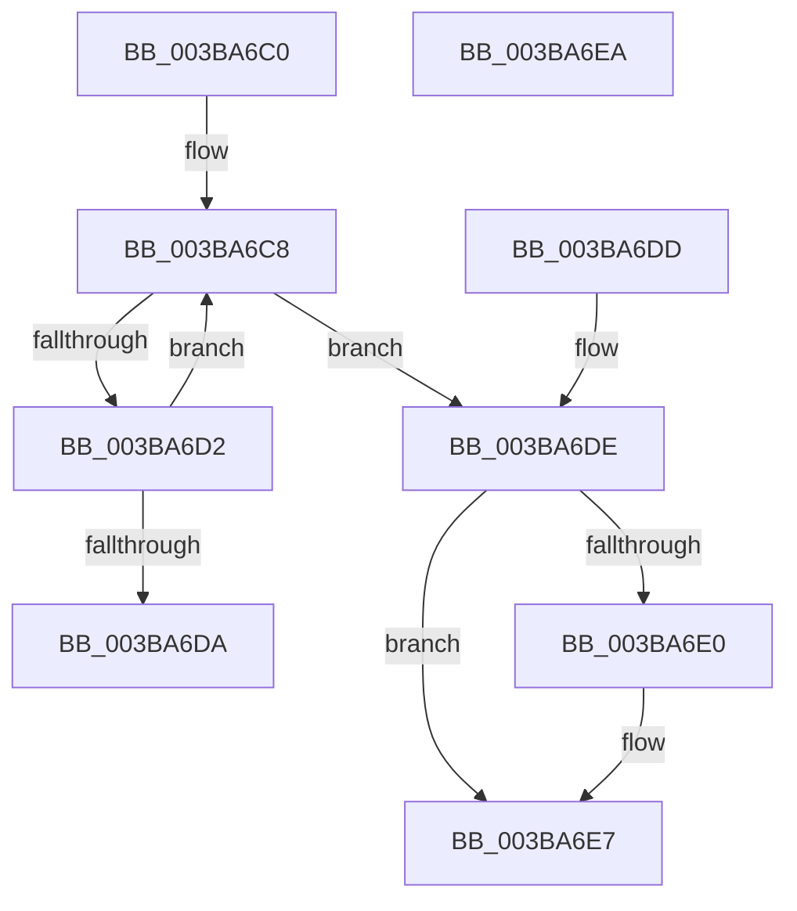

# PsReferencePartitionSafe

- RVA: `0x003BA6C0`–`0x003BA6EB` (길이 `43` bytes)
- VA: `0x00000001403BA6C0`
- 실행 섹션: `.text`
- PDB 이름 있음: `예`; PDB Function 태그: `아니요`
- unwind 정보 RVA: `0x000DB714`
- 디코드: `16`개 명령, `43/43` bytes 표시
- 미해석 바이트: `0` (있으면 어셈블리에 `.byte`로 보존)

> 이 문서는 커널 이미지의 기계어와 PDB 기호를 분석해 생성했습니다. 4번과 5번은 함수 원형과 자료형을 바이너리 사용 방식에서 추정한 C 해석이며 원본 소스 복구 결과는 아닙니다.

## 1. Dependencies

- 직접 호출 지점: **0**; 고유 호출 대상: **0**
- 직접 호출자로 확인된 함수: **23**
- RIP 상대 이미지 참조: **0**

### Outgoing calls
- 직접 디코드된 call 명령이 없습니다.

### Direct callers
- [MiCheckZeroFreeRebalance](../28/MiCheckZeroFreeRebalance_function_0028B1FC.md) at `0x0028B2C1`
- [MiLaunchZeroParent](../2C/MiLaunchZeroParent_function_002CA5F8.md) at `0x002CA692`
- [MiLaunchZeroWorkers](../2C/MiLaunchZeroWorkers_function_002CAF28.md) at `0x002CB02C`
- [MiCheckTrimUnusedPageFileRegions](../2D/MiCheckTrimUnusedPageFileRegions_function_002DB684.md) at `0x002DB6F9`
- [MiCommitExistingVad](../32/MiCommitExistingVad_function_0032A860.md) at `0x0032B347`
- [MiQueryAddressState](../32/MiQueryAddressState_function_0032C380.md) at `0x0032CAEA`
- [MiResolvePageFileFault](../36/MiResolvePageFileFault_function_0036D968.md) at `0x0036EFA3`
- [MiCreateSlabEntry](../37/MiCreateSlabEntry_function_00374DEC.md) at `0x003753ED`
- [PsGetNextPartition](PsGetNextPartition_function_003B9D5C.md) at `0x003B9D9C`
- [MmQueryMemoryListInformation](MmQueryMemoryListInformation_function_003B9EDC.md) at `0x003BA0C0`
- [MiWakeLargePageRebuild](MiWakeLargePageRebuild_function_003BA2C8.md) at `0x003BA354`
- [PfpLogApplicationEvent](PfpLogApplicationEvent_function_003BA3A0.md) at `0x003BA3E4`
- [PfLogForegroundProcess](PfLogForegroundProcess_function_003BA5CC.md) at `0x003BA5E3`
- [MiObtainFreePages](MiObtainFreePages_function_003BB724.md) at `0x003BB763`
- [MiPartitionObjectToPartition](../3E/MiPartitionObjectToPartition_function_003EAB0C.md) at `0x003EABB5`
- [MiReferencePagePartition](../67/MiReferencePagePartition_function_00679304.md) at `0x00679344`
- [sub_006DDE58](../6D/Unknown_function_006DDE58.md) at `0x006DDEA2`
- [sub_006E8790](../6E/Unknown_function_006E8790.md) at `0x006E87DF`
- [MiFindSpecialPurposeMemoryTypeByPartition](../../page/80/MiFindSpecialPurposeMemoryTypeByPartition_function_0080F5D8.md) at `0x0080F61A`
- [PsReferencePartitionByHandle](../../page/90/PsReferencePartitionByHandle_function_0090337C.md) at `0x009033D7`
- [MmQueryVirtualMemory](../../page/9D/MmQueryVirtualMemory_function_009D9280.md) at `0x009D9FFE`
- [PspAllocateProcess](../../page/A1/PspAllocateProcess_function_00A13B3C.md) at `0x00A14377`
- [sub_00B37110](../../page/B3/Unknown_function_00B37110.md) at `0x00B3714A`

### Static image references
- 디코드된 RIP-relative 메모리 참조가 없습니다.

## 2. Other-region calls and transfers

- 다른 실행 섹션으로 향하는 call: **0**
- 별도 외부 분기/꼬리 이동을 확인하지 못했습니다.

## 3. Assembly (complete function range)

```asm
003BA6C0  0F 0D 49 28                     prefetchw byte ptr [rcx + 0x28]
003BA6C4  48 8B 41 28                     mov rax, qword ptr [rcx + 0x28]
003BA6C8  48 8D 50 01                     lea rdx, [rax + 1]
003BA6CC  48 83 FA 01                     cmp rdx, 1
003BA6D0  76 0C                           jbe 0x1403ba6de
003BA6D2  F0 48 0F B1 51 28               lock cmpxchg qword ptr [rcx + 0x28], rdx
003BA6D8  75 EE                           jne 0x1403ba6c8
003BA6DA  B0 01                           mov al, 1
003BA6DC  C3                              ret
003BA6DD  CC                              int3
003BA6DE  74 07                           je 0x1403ba6e7
003BA6E0  B9 0E 00 00 00                  mov ecx, 0xe
003BA6E5  CD 29                           int 0x29
003BA6E7  32 C0                           xor al, al
003BA6E9  C3                              ret
003BA6EA  CC                              int3
```

## 4. C-style interpretation (structured pseudocode)

```c
__int64 __fastcall PsReferencePartitionSafe(__int64 a1)
{
    __int64 result;

loc_003BA6C8:
    if ((*(unsigned __int64 *)(a1 + 40) + 1) <= 1) goto loc_003BA6DE;
    if ((*(unsigned __int64 *)(a1 + 40) + 1) != 1) goto loc_003BA6C8;
    return 1;
loc_003BA6DE:
    if ((*(unsigned __int64 *)(a1 + 40) + 1) != 1) {
        a1 = 14;
    }
    result = 0;
    return result;
}
```

## 5. (Beta) C Style

```c
int64_t PsReferencePartitionSafe(void *Arg1)
{
    uint8_t *arg1 = (uint8_t *)Arg1;

    int64_t result;

loc_003BA6C8:
    if ((*(uint64_t *)(arg1 + 0x28) + 1) <= 1) goto loc_003BA6DE;
    if ((*(uint64_t *)(arg1 + 0x28) + 1) != 1) goto loc_003BA6C8;
    return 1;
loc_003BA6DE:
    if ((*(uint64_t *)(arg1 + 0x28) + 1) != 1) {
        Arg1 = 14;
    }
    result = 0;
    return result;
}
```

### 관측된 메모리 오프셋

구조체 형식이 확인되지 않은 접근은 인자 기준의 오프셋으로만 기록했습니다.

| 기준 인자 | 오프셋 표현 | 폭 (bit) | 접근 |
|---|---:|---:|---|
| `Arg1` | `+ 0x28` | `8` | `R` |
| `Arg1` | `+ 0x28` | `64` | `R` |

## 6. Execution-region graph

[열기: 2D/3D 그래프와 함수 탐색 컨트롤 패널](../../../control-panel.html?section=text&rva=0x003BA6C0&view=graph)

- 2D 그래프는 위에서 아래로 흐르고, 3D 그래프는 빈 공간을 드래그해 회전합니다. Shift+드래그는 이동, 휠은 확대·축소, 함수 노드 선택은 대상 보고서 이동입니다.

### Static fallback


