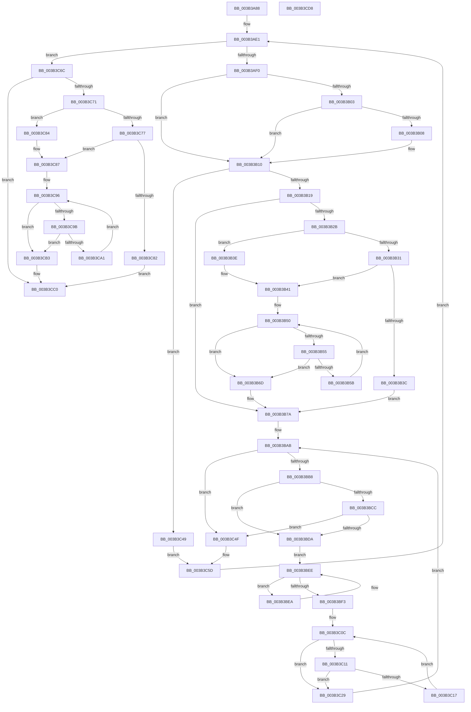

# RtlFindClearRunsEx

- RVA: `0x003B3A88`–`0x003B3CD9` (길이 `593` bytes)
- VA: `0x00000001403B3A88`
- 실행 섹션: `.text`
- PDB 이름 있음: `예`; PDB Function 태그: `아니요`
- unwind 정보 RVA: `0x0008C4BC`
- 디코드: `172`개 명령, `593/593` bytes 표시
- 미해석 바이트: `0` (있으면 어셈블리에 `.byte`로 보존)

> 이 문서는 커널 이미지의 기계어와 PDB 기호를 분석해 생성했습니다. 4번과 5번은 함수 원형과 자료형을 바이너리 사용 방식에서 추정한 C 해석이며 원본 소스 복구 결과는 아닙니다.

## 1. Dependencies

- 직접 호출 지점: **0**; 고유 호출 대상: **0**
- 직접 호출자로 확인된 함수: **1**
- RIP 상대 이미지 참조: **3**

### Outgoing calls
- 직접 디코드된 call 명령이 없습니다.

### Direct callers
- [RtlpHpFixedVsAllocate](RtlpHpFixedVsAllocate_function_003B47F0.md) at `0x003B488A`

### Static image references
- `0x003B3AA9` → RVA `0x00000000` (`image boundary/outside`; read)
- `0x003B3B83` → RVA `0x00012D28` (`.rdata`; read)
- `0x003B3BBC` → RVA `0x00012D30` (`.rdata`; read)

## 2. Other-region calls and transfers

- 다른 실행 섹션으로 향하는 call: **0**
- 별도 외부 분기/꼬리 이동을 확인하지 못했습니다.

## 3. Assembly (complete function range)

```asm
003B3A88  48 89 5C 24 10                  mov qword ptr [rsp + 0x10], rbx
003B3A8D  44 88 4C 24 20                  mov byte ptr [rsp + 0x20], r9b
003B3A92  44 89 44 24 18                  mov dword ptr [rsp + 0x18], r8d
003B3A97  55                              push rbp
003B3A98  56                              push rsi
003B3A99  57                              push rdi
003B3A9A  41 54                           push r12
003B3A9C  41 55                           push r13
003B3A9E  41 56                           push r14
003B3AA0  41 57                           push r15
003B3AA2  48 83 EC 10                     sub rsp, 0x10
003B3AA6  48 8B 01                        mov rax, qword ptr [rcx]
003B3AA9  4C 8D 3D 50 C5 C4 FF            lea r15, [rip - 0x3b3ab0]
003B3AB0  4C 8B D2                        mov r10, rdx
003B3AB3  41 BD 00 00 00 00               mov r13d, 0
003B3AB9  48 8B D0                        mov rdx, rax
003B3ABC  83 E2 07                        and edx, 7
003B3ABF  48 89 54 24 50                  mov qword ptr [rsp + 0x50], rdx
003B3AC4  41 0F 95 C5                     setne r13b
003B3AC8  48 C1 E8 03                     shr rax, 3
003B3ACC  4C 03 E8                        add r13, rax
003B3ACF  45 33 C0                        xor r8d, r8d
003B3AD2  48 8B 41 08                     mov rax, qword ptr [rcx + 8]
003B3AD6  45 33 C9                        xor r9d, r9d
003B3AD9  45 33 F6                        xor r14d, r14d
003B3ADC  33 FF                           xor edi, edi
003B3ADE  45 33 E4                        xor r12d, r12d
003B3AE1  8B CF                           mov ecx, edi
003B3AE3  89 7C 24 68                     mov dword ptr [rsp + 0x68], edi
003B3AE7  49 3B CD                        cmp rcx, r13
003B3AEA  0F 83 7C 01 00 00               jae 0x1403b3c6c
003B3AF0  44 8A 18                        mov r11b, byte ptr [rax]
003B3AF3  48 FF C0                        inc rax
003B3AF6  48 89 04 24                     mov qword ptr [rsp], rax
003B3AFA  49 8D 45 FF                     lea rax, [r13 - 1]
003B3AFE  48 3B C8                        cmp rcx, rax
003B3B01  75 0D                           jne 0x1403b3b10
003B3B03  48 85 D2                        test rdx, rdx
003B3B06  74 08                           je 0x1403b3b10
003B3B08  46 0A 9C 3A 20 2D 01 00         or r11b, byte ptr [rdx + r15 + 0x12d20]
003B3B10  45 84 DB                        test r11b, r11b
003B3B13  0F 84 30 01 00 00               je 0x1403b3c49
003B3B19  41 0F B6 F3                     movzx esi, r11b
003B3B1D  42 0F B6 AC 3E 90 C7 02 00      movzx ebp, byte ptr [rsi + r15 + 0x2c790]
003B3B26  44 03 CD                        add r9d, ebp
003B3B29  74 4F                           je 0x1403b3b7a
003B3B2B  41 83 F8 01                     cmp r8d, 1
003B3B2F  72 0D                           jb 0x1403b3b3e
003B3B31  41 8D 40 FF                     lea eax, [r8 - 1]
003B3B35  45 39 4C C2 04                  cmp dword ptr [r10 + rax*8 + 4], r9d
003B3B3A  72 05                           jb 0x1403b3b41
003B3B3C  EB 3C                           jmp 0x1403b3b7a
003B3B3E  41 FF C0                        inc r8d
003B3B41  41 8D 58 FE                     lea ebx, [r8 - 2]
003B3B45  48 63 D3                        movsxd rdx, ebx
003B3B48  49 8D 7A 08                     lea rdi, [r10 + 8]
003B3B4C  48 8D 3C D7                     lea rdi, [rdi + rdx*8]
003B3B50  48 85 D2                        test rdx, rdx
003B3B53  78 18                           js 0x1403b3b6d
003B3B55  44 39 4F FC                     cmp dword ptr [rdi - 4], r9d
003B3B59  73 12                           jae 0x1403b3b6d
003B3B5B  48 8B 47 F8                     mov rax, qword ptr [rdi - 8]
003B3B5F  FF CB                           dec ebx
003B3B61  48 FF CA                        dec rdx
003B3B64  48 89 07                        mov qword ptr [rdi], rax
003B3B67  48 83 C7 F8                     add rdi, -8
003B3B6B  EB E3                           jmp 0x1403b3b50
003B3B6D  48 63 C3                        movsxd rax, ebx
003B3B70  45 89 4C C2 0C                  mov dword ptr [r10 + rax*8 + 0xc], r9d
003B3B75  45 89 74 C2 08                  mov dword ptr [r10 + rax*8 + 8], r14d
003B3B7A  46 0F B6 8C 3E A0 C8 02 00      movzx r9d, byte ptr [rsi + r15 + 0x2c8a0]
003B3B83  48 8D 0D 9E F1 C5 FF            lea rcx, [rip - 0x3a0e62]
003B3B8A  49 2B C9                        sub rcx, r9
003B3B8D  45 8B F4                        mov r14d, r12d
003B3B90  45 2B F1                        sub r14d, r9d
003B3B93  41 83 C6 08                     add r14d, 8
003B3B97  44 89 74 24 60                  mov dword ptr [rsp + 0x60], r14d
003B3B9C  8A 01                           mov al, byte ptr [rcx]
003B3B9E  42 8A 8C 3D 90 C8 02 00         mov cl, byte ptr [rbp + r15 + 0x2c890]
003B3BA6  0A C8                           or cl, al
003B3BA8  44 0A D9                        or r11b, cl
003B3BAB  41 8B D8                        mov ebx, r8d
003B3BAE  41 80 FB FF                     cmp r11b, 0xff
003B3BB2  0F 84 97 00 00 00               je 0x1403b3c4f
003B3BB8  41 0F B6 D3                     movzx edx, r11b
003B3BBC  48 8D 05 6D F1 C5 FF            lea rax, [rip - 0x3a0e93]
003B3BC3  48 03 D0                        add rdx, rax
003B3BC6  41 83 F8 01                     cmp r8d, 1
003B3BCA  72 0E                           jb 0x1403b3bda
003B3BCC  0F B6 02                        movzx eax, byte ptr [rdx]
003B3BCF  41 8D 48 FF                     lea ecx, [r8 - 1]
003B3BD3  41 39 44 CA 04                  cmp dword ptr [r10 + rcx*8 + 4], eax
003B3BD8  73 75                           jae 0x1403b3c4f
003B3BDA  44 0F B6 32                     movzx r14d, byte ptr [rdx]
003B3BDE  33 F6                           xor esi, esi
003B3BE0  43 8A 94 3E 90 C8 02 00         mov dl, byte ptr [r14 + r15 + 0x2c890]
003B3BE8  EB 04                           jmp 0x1403b3bee
003B3BEA  02 D2                           add dl, dl
003B3BEC  FF C6                           inc esi
003B3BEE  41 84 D3                        test r11b, dl
003B3BF1  75 F7                           jne 0x1403b3bea
003B3BF3  41 FF C0                        inc r8d
003B3BF6  83 FB 01                        cmp ebx, 1
003B3BF9  44 0F 43 C3                     cmovae r8d, ebx
003B3BFD  49 8D 5A 08                     lea rbx, [r10 + 8]
003B3C01  41 8D 68 FE                     lea ebp, [r8 - 2]
003B3C05  48 63 FD                        movsxd rdi, ebp
003B3C08  48 8D 1C FB                     lea rbx, [rbx + rdi*8]
003B3C0C  48 85 FF                        test rdi, rdi
003B3C0F  78 18                           js 0x1403b3c29
003B3C11  44 39 73 FC                     cmp dword ptr [rbx - 4], r14d
003B3C15  73 12                           jae 0x1403b3c29
003B3C17  48 8B 43 F8                     mov rax, qword ptr [rbx - 8]
003B3C1B  FF CD                           dec ebp
003B3C1D  48 FF CF                        dec rdi
003B3C20  48 89 03                        mov qword ptr [rbx], rax
003B3C23  48 83 C3 F8                     add rbx, -8
003B3C27  EB E3                           jmp 0x1403b3c0c
003B3C29  48 63 CD                        movsxd rcx, ebp
003B3C2C  41 8D 04 34                     lea eax, [r12 + rsi]
003B3C30  44 0A DA                        or r11b, dl
003B3C33  4C 8D 3D C6 C3 C4 FF            lea r15, [rip - 0x3b3c3a]
003B3C3A  45 89 74 CA 0C                  mov dword ptr [r10 + rcx*8 + 0xc], r14d
003B3C3F  41 89 44 CA 08                  mov dword ptr [r10 + rcx*8 + 8], eax
003B3C44  E9 62 FF FF FF                  jmp 0x1403b3bab
003B3C49  41 83 C1 08                     add r9d, 8
003B3C4D  EB 0E                           jmp 0x1403b3c5d
003B3C4F  44 8B 74 24 60                  mov r14d, dword ptr [rsp + 0x60]
003B3C54  48 8B 54 24 50                  mov rdx, qword ptr [rsp + 0x50]
003B3C59  8B 7C 24 68                     mov edi, dword ptr [rsp + 0x68]
003B3C5D  48 8B 04 24                     mov rax, qword ptr [rsp]
003B3C61  FF C7                           inc edi
003B3C63  41 83 C4 08                     add r12d, 8
003B3C67  E9 75 FE FF FF                  jmp 0x1403b3ae1
003B3C6C  45 85 C9                        test r9d, r9d
003B3C6F  74 4F                           je 0x1403b3cc0
003B3C71  41 83 F8 01                     cmp r8d, 1
003B3C75  72 0D                           jb 0x1403b3c84
003B3C77  41 8D 40 FF                     lea eax, [r8 - 1]
003B3C7B  45 39 4C C2 04                  cmp dword ptr [r10 + rax*8 + 4], r9d
003B3C80  72 05                           jb 0x1403b3c87
003B3C82  EB 3C                           jmp 0x1403b3cc0
003B3C84  41 FF C0                        inc r8d
003B3C87  41 8D 50 FE                     lea edx, [r8 - 2]
003B3C8B  4C 63 DA                        movsxd r11, edx
003B3C8E  49 8D 5A 08                     lea rbx, [r10 + 8]
003B3C92  4A 8D 1C DB                     lea rbx, [rbx + r11*8]
003B3C96  4D 85 DB                        test r11, r11
003B3C99  78 18                           js 0x1403b3cb3
003B3C9B  44 39 4B FC                     cmp dword ptr [rbx - 4], r9d
003B3C9F  73 12                           jae 0x1403b3cb3
003B3CA1  48 8B 43 F8                     mov rax, qword ptr [rbx - 8]
003B3CA5  FF CA                           dec edx
003B3CA7  49 FF CB                        dec r11
003B3CAA  48 89 03                        mov qword ptr [rbx], rax
003B3CAD  48 83 C3 F8                     add rbx, -8
003B3CB1  EB E3                           jmp 0x1403b3c96
003B3CB3  48 63 CA                        movsxd rcx, edx
003B3CB6  45 89 4C CA 0C                  mov dword ptr [r10 + rcx*8 + 0xc], r9d
003B3CBB  45 89 74 CA 08                  mov dword ptr [r10 + rcx*8 + 8], r14d
003B3CC0  48 8B 5C 24 58                  mov rbx, qword ptr [rsp + 0x58]
003B3CC5  41 8B C0                        mov eax, r8d
003B3CC8  48 83 C4 10                     add rsp, 0x10
003B3CCC  41 5F                           pop r15
003B3CCE  41 5E                           pop r14
003B3CD0  41 5D                           pop r13
003B3CD2  41 5C                           pop r12
003B3CD4  5F                              pop rdi
003B3CD5  5E                              pop rsi
003B3CD6  5D                              pop rbp
003B3CD7  C3                              ret
003B3CD8  CC                              int3
```

## 4. C-style interpretation (structured pseudocode)

```c
__int64 __fastcall RtlFindClearRunsEx(__int64 a1, __int64 a2, int a3, int a4)
{
    __int64 result;
    __int64 v_r11;
    __int64 v_r12;
    __int64 v_r13;
    __int64 v_r14;
    __int64 v_rbp;
    __int64 v_rbx;
    __int64 v_rdi;
    __int64 v_rsi;
    __int64 v_rsp;
    unsigned __int64 v_stack_m48;
    unsigned __int64 v_stack_p10;
    unsigned int v_stack_p18;
    unsigned __int8 v_stack_p20;
    unsigned __int64 v_stack_p8;

    v_stack_p10 = v_rbx;
    v_stack_p20 = (unsigned __int8)(a4);
    v_stack_p18 = a3;
    v_rsp = (v_rsp) - (16);
    a2 = (unsigned int)((*(unsigned __int64 *)(a1)) & (7));
    v_stack_p8 = a2;
    v_r13 = (condition_is_not_equal) ? 1 : 0;
    result = (*(unsigned __int64 *)(a1)) >> (3);
    v_r13 = (v_r13) + (result);
    a3 = 0;
    a4 = 0;
    v_r14 = 0;
    v_rdi = 0;
    v_r12 = 0;
loc_003B3AE1:
    v_stack_p20 = 0;
    if (0 >= v_r13) goto loc_003B3C6C;
    result = (*(unsigned __int64 *)(a1 + 8)) + 1;
    v_stack_m48 = result;
    if (0 != (v_r13 - 1)) goto loc_003B3B10;
    v_r11 = *(unsigned __int8 *)(*(unsigned __int64 *)(a1 + 8));
    if (a2 != 0) {
        v_r11 = (unsigned __int8)((*(unsigned __int8 *)(*(unsigned __int64 *)(a1 + 8))) | (*(unsigned __int8 *)(a2 + v_rip - 3881648 * 1 + 77088)));
    }
    if ((unsigned __int8)(v_r11) == 0) goto loc_003B3C49;
    a4 = (unsigned int)((a4) + ((unsigned int)(*(unsigned __int8 *)((unsigned __int8)(v_r11) + v_rip - 3881648 * 1 + 182160))));
    if (condition_is_equal) goto loc_003B3B7A;
    if (0 < 1) goto loc_003B3B3E;
    if ((*(unsigned int *)(a2 + a3 - 1 * 8 + 4)) < a4) goto loc_003B3B41;
    goto loc_003B3B7A;
loc_003B3B3E:
    a3 = (unsigned int)((a3) + 1);
loc_003B3B41:
loc_003B3B50:
    if (sign_flag) goto loc_003B3B6D;
    if ((*(unsigned int *)(a2 + 8 + (int)((unsigned int)(a3 - 2)) * 8 - 4)) >= a4) goto loc_003B3B6D;
    v_rbx = (unsigned int)((a3 - 2) - 1);
    a2 = ((int)((unsigned int)(a3 - 2))) - 1;
    *(unsigned __int64 *)(a2 + 8 + (int)((unsigned int)(a3 - 2)) * 8) = *(unsigned __int64 *)(a2 + 8 + (int)((unsigned int)(a3 - 2)) * 8 - 8);
    v_rdi = (a2 + 8 + (int)((unsigned int)(a3 - 2)) * 8) + (-8);
    goto loc_003B3B50;
loc_003B3B6D:
    *(unsigned int *)(a2 + (int)((unsigned int)(v_rbx)) * 8 + 12) = a4;
    *(unsigned int *)(a2 + (int)((unsigned int)(v_rbx)) * 8 + 8) = 0;
loc_003B3B7A:
    a1 = (v_rip - 3804770) - (*(unsigned __int8 *)((unsigned __int8)(v_r11) + v_rip - 3881648 * 1 + 182432));
    v_r14 = (unsigned int)((0) - ((unsigned int)(*(unsigned __int8 *)((unsigned __int8)(v_r11) + v_rip - 3881648 * 1 + 182432))));
    v_r14 = (unsigned int)((v_r14) + (8));
    v_stack_p18 = (unsigned int)(v_r14);
    a1 = (unsigned __int8)((*(unsigned __int8 *)(*(unsigned __int8 *)((unsigned __int8)(v_r11) + v_rip - 3881648 * 1 + 182160) + v_rip - 3881648 * 1 + 182416)) | ((unsigned __int8)(*(unsigned __int8 *)(a1))));
    v_r11 = (unsigned __int8)((v_r11) | ((unsigned __int8)(a1)));
loc_003B3BAB:
    if (((unsigned __int8)(v_r11)) == 255) goto loc_003B3C4F;
    a2 = ((unsigned __int8)(v_r11)) + (v_rip - 3804819);
    if (a3 < 1) goto loc_003B3BDA;
    if ((*(unsigned int *)(a2 + a3 - 1 * 8 + 4)) >= ((unsigned int)(*(unsigned __int8 *)(a2)))) goto loc_003B3C4F;
loc_003B3BDA:
    v_rsi = 0;
    goto loc_003B3BEE;
loc_003B3BEA:
    a2 = (unsigned __int8)((*(unsigned __int8 *)(*(unsigned __int8 *)(a2) + v_rip - 3881648 * 1 + 182416)) + ((unsigned __int8)(*(unsigned __int8 *)(*(unsigned __int8 *)(a2) + v_rip - 3881648 * 1 + 182416))));
    v_rsi = (unsigned int)((v_rsi) + 1);
loc_003B3BEE:
    if ((((unsigned __int8)(v_r11)) & ((unsigned __int8)(a2))) != 0) goto loc_003B3BEA;
    a3 = (unsigned int)((a3) + 1);
    if (((unsigned int)((unsigned int)(a3))) >= 1) { a3 = (unsigned int)((unsigned int)(a3)); }
loc_003B3C0C:
    if (sign_flag) goto loc_003B3C29;
    if ((*(unsigned int *)(a2 + 8 + (int)((unsigned int)(a3 - 2)) * 8 - 4)) >= ((unsigned int)(*(unsigned __int8 *)(a2)))) goto loc_003B3C29;
    v_rbp = (unsigned int)((a3 - 2) - 1);
    v_rdi = ((int)((unsigned int)(a3 - 2))) - 1;
    *(unsigned __int64 *)(a2 + 8 + (int)((unsigned int)(a3 - 2)) * 8) = *(unsigned __int64 *)(a2 + 8 + (int)((unsigned int)(a3 - 2)) * 8 - 8);
    v_rbx = (a2 + 8 + (int)((unsigned int)(a3 - 2)) * 8) + (-8);
    goto loc_003B3C0C;
loc_003B3C29:
    v_r11 = (unsigned __int8)((v_r11) | ((unsigned __int8)(a2)));
    *(unsigned int *)(a2 + (int)((unsigned int)(v_rbp)) * 8 + 12) = (unsigned int)(*(unsigned __int8 *)(a2));
    *(unsigned int *)(a2 + (int)((unsigned int)(v_rbp)) * 8 + 8) = (unsigned int)(v_r12 + v_rsi * 1);
    goto loc_003B3BAB;
loc_003B3C49:
    a4 = (unsigned int)((*(unsigned __int8 *)((unsigned __int8)(v_r11) + v_rip - 3881648 * 1 + 182432)) + (8));
    goto loc_003B3C5D;
loc_003B3C4F:
loc_003B3C5D:
    v_rdi = (unsigned int)(((unsigned int)(v_stack_p20)) + 1);
    v_r12 = (unsigned int)((v_r12) + (8));
    goto loc_003B3AE1;
loc_003B3C6C:
    if (a4 == 0) goto loc_003B3CC0;
    if (a3 < 1) goto loc_003B3C84;
    if ((*(unsigned int *)(a2 + a3 - 1 * 8 + 4)) < a4) goto loc_003B3C87;
    goto loc_003B3CC0;
loc_003B3C84:
    a3 = (unsigned int)((a3) + 1);
loc_003B3C87:
loc_003B3C96:
    if (sign_flag) goto loc_003B3CB3;
    if ((*(unsigned int *)(a2 + 8 + (int)((unsigned int)(a3 - 2)) * 8 - 4)) >= a4) goto loc_003B3CB3;
    a2 = (unsigned int)((a3 - 2) - 1);
    v_r11 = ((int)((unsigned int)(a3 - 2))) - 1;
    *(unsigned __int64 *)(a2 + 8 + (int)((unsigned int)(a3 - 2)) * 8) = *(unsigned __int64 *)(a2 + 8 + (int)((unsigned int)(a3 - 2)) * 8 - 8);
    v_rbx = (a2 + 8 + (int)((unsigned int)(a3 - 2)) * 8) + (-8);
    goto loc_003B3C96;
loc_003B3CB3:
    *(unsigned int *)(a2 + (int)((unsigned int)(a2)) * 8 + 12) = a4;
    *(unsigned int *)(a2 + (int)((unsigned int)(a2)) * 8 + 8) = (unsigned int)((unsigned int)(v_stack_p18));
loc_003B3CC0:
    v_rsp = (v_rsp) + (16);
    return (unsigned int)(a3);
}
```

## 5. (Beta) C Style

```c
int64_t RtlFindClearRunsEx(void *Arg1, void *Arg2, int32_t Arg3, int32_t Arg4)
{
    uint8_t *arg1 = (uint8_t *)Arg1;
    uint8_t *arg2 = (uint8_t *)Arg2;

    int64_t result;
    int64_t local_r11;
    int64_t local_r12;
    int64_t local_r13;
    int64_t local_r14;
    int64_t local_rbp;
    int64_t local_rbx;
    int64_t local_rdi;
    int64_t local_rsi;
    int64_t local_rsp;
    uint64_t v_stack_m48;
    uint64_t v_stack_p10;
    uint32_t v_stack_p18;
    uint8_t v_stack_p20;
    uint64_t v_stack_p8;

    v_stack_p10 = local_rbx;
    v_stack_p20 = (uint8_t)(Arg4);
    v_stack_p18 = Arg3;
    local_rsp = (local_rsp) - (16);
    Arg2 = (uint32_t)((*(uint64_t *)(arg1)) & (7));
    v_stack_p8 = Arg2;
    local_r13 = (condition_is_not_equal) ? 1 : 0;
    result = (*(uint64_t *)(arg1)) >> (3);
    local_r13 = (local_r13) + (result);
    Arg3 = 0;
    Arg4 = 0;
    local_r14 = 0;
    local_rdi = 0;
    local_r12 = 0;
loc_003B3AE1:
    v_stack_p20 = 0;
    if (0 >= local_r13) goto loc_003B3C6C;
    result = (*(uint64_t *)(arg1 + 0x8)) + 1;
    v_stack_m48 = result;
    if (0 != (local_r13 - 1)) goto loc_003B3B10;
    local_r11 = *(uint8_t *)(*(uint64_t *)(arg1 + 0x8));
    if (Arg2 != NULL) {
        local_r11 = (uint8_t)((*(uint8_t *)(*(uint64_t *)(arg1 + 0x8))) | (*(uint8_t *)(arg2 + v_rip - 0x3B3AB0 * 1 + 0x12D20)));
    }
    if ((uint8_t)(local_r11) == 0) goto loc_003B3C49;
    Arg4 = (uint32_t)((Arg4) + ((uint32_t)(*(uint8_t *)((uint8_t)(local_r11) + v_rip - 0x3B3AB0 * 1 + 0x2C790))));
    if (condition_is_equal) goto loc_003B3B7A;
    if (0 < 1) goto loc_003B3B3E;
    if ((*(uint32_t *)(arg2 + Arg3 - 0x1 * 8 + 0x4)) < Arg4) goto loc_003B3B41;
    goto loc_003B3B7A;
loc_003B3B3E:
    Arg3 = (uint32_t)((Arg3) + 1);
loc_003B3B41:
loc_003B3B50:
    if (sign_flag) goto loc_003B3B6D;
    if ((*(uint32_t *)(arg2 + 0x8 + (int32_t)((uint32_t)(Arg3 - 0x2)) * 8 - 0x4)) >= Arg4) goto loc_003B3B6D;
    local_rbx = (uint32_t)((Arg3 - 2) - 1);
    Arg2 = ((int32_t)((uint32_t)(Arg3 - 2))) - 1;
    *(uint64_t *)(arg2 + 0x8 + (int32_t)((uint32_t)(Arg3 - 0x2)) * 8) = *(uint64_t *)(arg2 + 0x8 + (int32_t)((uint32_t)(Arg3 - 0x2)) * 8 - 0x8);
    local_rdi = (Arg2 + 8 + (int32_t)((uint32_t)(Arg3 - 2)) * 8) + (-8);
    goto loc_003B3B50;
loc_003B3B6D:
    *(uint32_t *)(arg2 + (int32_t)((uint32_t)(local_rbx)) * 8 + 0xC) = Arg4;
    *(uint32_t *)(arg2 + (int32_t)((uint32_t)(local_rbx)) * 8 + 0x8) = 0;
loc_003B3B7A:
    Arg1 = (v_rip - 3804770) - (*(uint8_t *)((uint8_t)(local_r11) + v_rip - 0x3B3AB0 * 1 + 0x2C8A0));
    local_r14 = (uint32_t)((0) - ((uint32_t)(*(uint8_t *)((uint8_t)(local_r11) + v_rip - 0x3B3AB0 * 1 + 0x2C8A0))));
    local_r14 = (uint32_t)((local_r14) + (8));
    v_stack_p18 = (uint32_t)(local_r14);
    Arg1 = (uint8_t)((*(uint8_t *)(*(uint8_t *)((uint8_t)(local_r11) + v_rip - 0x3B3AB0 * 1 + 0x2C790) + v_rip - 0x3B3AB0 * 1 + 0x2C890)) | ((uint8_t)(*(uint8_t *)(arg1))));
    local_r11 = (uint8_t)((local_r11) | ((uint8_t)(Arg1)));
loc_003B3BAB:
    if (((uint8_t)(local_r11)) == 255) goto loc_003B3C4F;
    Arg2 = ((uint8_t)(local_r11)) + (v_rip - 3804819);
    if (Arg3 < 1) goto loc_003B3BDA;
    if ((*(uint32_t *)(arg2 + Arg3 - 0x1 * 8 + 0x4)) >= ((uint32_t)(*(uint8_t *)(arg2)))) goto loc_003B3C4F;
loc_003B3BDA:
    local_rsi = 0;
    goto loc_003B3BEE;
loc_003B3BEA:
    Arg2 = (uint8_t)((*(uint8_t *)(*(uint8_t *)(arg2) + v_rip - 0x3B3AB0 * 1 + 0x2C890)) + ((uint8_t)(*(uint8_t *)(*(uint8_t *)(arg2) + v_rip - 0x3B3AB0 * 1 + 0x2C890))));
    local_rsi = (uint32_t)((local_rsi) + 1);
loc_003B3BEE:
    if ((((uint8_t)(local_r11)) & ((uint8_t)(Arg2))) != 0) goto loc_003B3BEA;
    Arg3 = (uint32_t)((Arg3) + 1);
    if (((uint32_t)((uint32_t)(Arg3))) >= 1) { Arg3 = (uint32_t)((uint32_t)(Arg3)); }
loc_003B3C0C:
    if (sign_flag) goto loc_003B3C29;
    if ((*(uint32_t *)(arg2 + 0x8 + (int32_t)((uint32_t)(Arg3 - 0x2)) * 8 - 0x4)) >= ((uint32_t)(*(uint8_t *)(arg2)))) goto loc_003B3C29;
    local_rbp = (uint32_t)((Arg3 - 2) - 1);
    local_rdi = ((int32_t)((uint32_t)(Arg3 - 2))) - 1;
    *(uint64_t *)(arg2 + 0x8 + (int32_t)((uint32_t)(Arg3 - 0x2)) * 8) = *(uint64_t *)(arg2 + 0x8 + (int32_t)((uint32_t)(Arg3 - 0x2)) * 8 - 0x8);
    local_rbx = (Arg2 + 8 + (int32_t)((uint32_t)(Arg3 - 2)) * 8) + (-8);
    goto loc_003B3C0C;
loc_003B3C29:
    local_r11 = (uint8_t)((local_r11) | ((uint8_t)(Arg2)));
    *(uint32_t *)(arg2 + (int32_t)((uint32_t)(local_rbp)) * 8 + 0xC) = (uint32_t)(*(uint8_t *)(arg2));
    *(uint32_t *)(arg2 + (int32_t)((uint32_t)(local_rbp)) * 8 + 0x8) = (uint32_t)(local_r12 + local_rsi * 1);
    goto loc_003B3BAB;
loc_003B3C49:
    Arg4 = (uint32_t)((*(uint8_t *)((uint8_t)(local_r11) + v_rip - 0x3B3AB0 * 1 + 0x2C8A0)) + (8));
    goto loc_003B3C5D;
loc_003B3C4F:
loc_003B3C5D:
    local_rdi = (uint32_t)(((uint32_t)(v_stack_p20)) + 1);
    local_r12 = (uint32_t)((local_r12) + (8));
    goto loc_003B3AE1;
loc_003B3C6C:
    if (Arg4 == 0) goto loc_003B3CC0;
    if (Arg3 < 1) goto loc_003B3C84;
    if ((*(uint32_t *)(arg2 + Arg3 - 0x1 * 8 + 0x4)) < Arg4) goto loc_003B3C87;
    goto loc_003B3CC0;
loc_003B3C84:
    Arg3 = (uint32_t)((Arg3) + 1);
loc_003B3C87:
loc_003B3C96:
    if (sign_flag) goto loc_003B3CB3;
    if ((*(uint32_t *)(arg2 + 0x8 + (int32_t)((uint32_t)(Arg3 - 0x2)) * 8 - 0x4)) >= Arg4) goto loc_003B3CB3;
    Arg2 = (uint32_t)((Arg3 - 2) - 1);
    local_r11 = ((int32_t)((uint32_t)(Arg3 - 2))) - 1;
    *(uint64_t *)(arg2 + 0x8 + (int32_t)((uint32_t)(Arg3 - 0x2)) * 8) = *(uint64_t *)(arg2 + 0x8 + (int32_t)((uint32_t)(Arg3 - 0x2)) * 8 - 0x8);
    local_rbx = (Arg2 + 8 + (int32_t)((uint32_t)(Arg3 - 2)) * 8) + (-8);
    goto loc_003B3C96;
loc_003B3CB3:
    *(uint32_t *)(arg2 + (int32_t)((uint32_t)(arg2)) * 8 + 0xC) = Arg4;
    *(uint32_t *)(arg2 + (int32_t)((uint32_t)(arg2)) * 8 + 0x8) = (uint32_t)((uint32_t)(v_stack_p18));
loc_003B3CC0:
    local_rsp = (local_rsp) + (16);
    return (uint32_t)(Arg3);
}
```

### 관측된 메모리 오프셋

구조체 형식이 확인되지 않은 접근은 인자 기준의 오프셋으로만 기록했습니다.

| 기준 인자 | 오프셋 표현 | 폭 (bit) | 접근 |
|---|---:|---:|---|
| `Arg1` | `+ 0x0` | `64` | `R` |
| `Arg1` | `+ 0x8` | `64` | `R` |
| `Arg2` | `- 0x8` | `64` | `R` |
| `Arg2` | `- 0x4` | `32` | `R` |
| `Arg2` | `+ 0x0` | `64` | `W` |
| `Arg2` | `+ 0x0 + r11*8` | `64` | `R` |
| `Arg2` | `+ 0x0 + rdi*8` | `64` | `R` |
| `Arg2` | `+ 0x0 + rdx*8` | `64` | `R` |
| `Arg2` | `+ 0x4 + rax*8` | `32` | `R` |
| `Arg2` | `+ 0x4 + rcx*8` | `32` | `R` |
| `Arg2` | `+ 0x8` | `64` | `R` |
| `Arg2` | `+ 0x8 + rax*8` | `32` | `W` |
| `Arg2` | `+ 0x8 + rcx*8` | `32` | `W` |
| `Arg2` | `+ 0xC + rax*8` | `32` | `W` |
| `Arg2` | `+ 0xC + rcx*8` | `32` | `W` |

## 6. Execution-region graph

[열기: 2D/3D 그래프와 함수 탐색 컨트롤 패널](../../../control-panel.html?section=text&rva=0x003B3A88&view=graph)

- 2D 그래프는 위에서 아래로 흐르고, 3D 그래프는 빈 공간을 드래그해 회전합니다. Shift+드래그는 이동, 휠은 확대·축소, 함수 노드 선택은 대상 보고서 이동입니다.

### Static fallback


