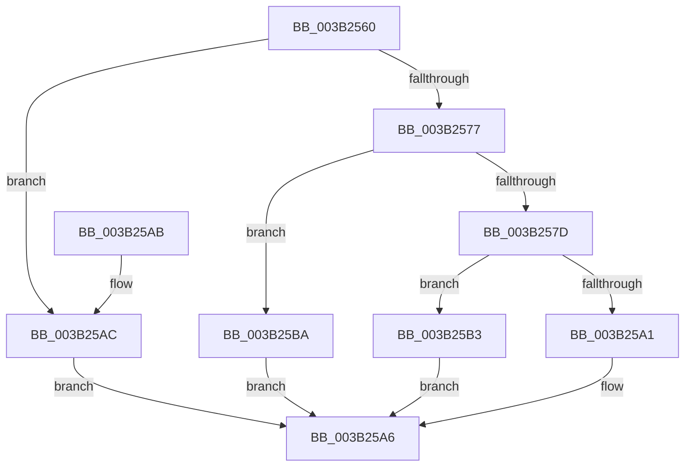

# RtlGetCompressionWorkSpaceSize

- RVA: `0x003B2560`–`0x003B25C1` (길이 `97` bytes)
- VA: `0x00000001403B2560`
- 실행 섹션: `.text`
- PDB 이름 있음: `예`; PDB Function 태그: `아니요`
- unwind 정보 RVA: `0x00068E00`
- 디코드: `26`개 명령, `97/97` bytes 표시
- 미해석 바이트: `0` (있으면 어셈블리에 `.byte`로 보존)

> 이 문서는 커널 이미지의 기계어와 PDB 기호를 분석해 생성했습니다. 4번과 5번은 함수 원형과 자료형을 바이너리 사용 방식에서 추정한 C 해석이며 원본 소스 복구 결과는 아닙니다.

## 1. Dependencies

- 직접 호출 지점: **2**; 고유 호출 대상: **2**
- 직접 호출자로 확인된 함수: **6**
- RIP 상대 이미지 참조: **2**

### Outgoing calls
- `0x003B25A1` → [RtlCompressWorkSpaceSizeLZNT1](../../pagelk/B7/RtlCompressWorkSpaceSizeLZNT1_function_00B789B0.md) (function, `0x00B789B0`)
- `0x003B25B3` → [guard_dispatch_icall](../6B/guard_dispatch_icall_function_006BAAD0.md) (function, `0x006BAAD0`)

### Direct callers
- [ST_STORE&lt;SM_TRAITS&gt;::StStart](ST_STORE_SM_TRAITS_StStart_function_003B1BBC.md) at `0x003B1DA8`
- [EtwpInitializeCompression](../4E/EtwpInitializeCompression_function_004EC774.md) at `0x004EC7CC`
- [SMKM_STORE_MGR&lt;SM_TRAITS&gt;::SmCompressCtxStart](../60/SMKM_STORE_MGR_SM_TRAITS_SmCompressCtxStart_function_0060C290.md) at `0x0060C2C9`
- [PopHiberInitializeResources](../../page/75/PopHiberInitializeResources_function_0075D5FC.md) at `0x0075D686`
- [EtwpInitializeCompressedWriter](../../page/7B/EtwpInitializeCompressedWriter_function_007BED7C.md) at `0x007BEDA5`
- [sub_00BF16D0](../../init/BF/Unknown_function_00BF16D0.md) at `0x00BF1954`

### Static image references
- `0x003B258A` → RVA `0x00002060` (`.rdata`; read)
- `0x003B2595` → RVA `0x00B789B0` (`RtlCompressWorkSpaceSizeLZNT1`; read)

## 2. Other-region calls and transfers

- 다른 실행 섹션으로 향하는 call: **1**
  - `0x003B25A1` → [RtlCompressWorkSpaceSizeLZNT1](../../pagelk/B7/RtlCompressWorkSpaceSizeLZNT1_function_00B789B0.md) (`.text` → `PAGELK`)
- 별도 외부 분기/꼬리 이동을 확인하지 못했습니다.

## 3. Assembly (complete function range)

```asm
003B2560  48 83 EC 28                     sub rsp, 0x28
003B2564  0F B7 C1                        movzx eax, cx
003B2567  41 B9 FF 00 00 00               mov r9d, 0xff
003B256D  66 41 23 C1                     and ax, r9w
003B2571  66 83 F8 02                     cmp ax, 2
003B2575  72 35                           jb 0x1403b25ac
003B2577  66 83 F8 08                     cmp ax, 8
003B257B  77 3D                           ja 0x1403b25ba
003B257D  41 B9 00 FF 00 00               mov r9d, 0xff00
003B2583  0F B7 C0                        movzx eax, ax
003B2586  66 41 23 C9                     and cx, r9w
003B258A  4C 8D 0D CF FA C4 FF            lea r9, [rip - 0x3b0531]
003B2591  49 8B 04 C1                     mov rax, qword ptr [r9 + rax*8]
003B2595  4C 8D 0D 14 64 7C 00            lea r9, [rip + 0x7c6414]
003B259C  49 3B C1                        cmp rax, r9
003B259F  75 12                           jne 0x1403b25b3
003B25A1  E8 0A 64 7C 00                  call 0x140b789b0
003B25A6  48 83 C4 28                     add rsp, 0x28
003B25AA  C3                              ret
003B25AB  CC                              int3
003B25AC  B8 0D 00 00 C0                  mov eax, 0xc000000d
003B25B1  EB F3                           jmp 0x1403b25a6
003B25B3  E8 18 85 30 00                  call 0x1406baad0
003B25B8  EB EC                           jmp 0x1403b25a6
003B25BA  B8 5F 02 00 C0                  mov eax, 0xc000025f
003B25BF  EB E5                           jmp 0x1403b25a6
```

## 4. C-style interpretation (structured pseudocode)

```c
__int64 __fastcall RtlGetCompressionWorkSpaceSize(unsigned __int16 a1)
{
    __int64 result;
    __int64 v_rsp;

    v_rsp = (v_rsp) - (40);
    result = (unsigned __int16)((a1) & (255));
    if (((unsigned __int16)(result)) < 2) goto loc_003B25AC;
    if (((unsigned __int16)(result)) > 8) goto loc_003B25BA;
    a1 = (unsigned __int16)((a1) & ((unsigned __int16)((unsigned int)(0xFF00ULL))));
    if ((*(unsigned __int64 *)(v_rip - 3867953 + (unsigned __int16)(result) * 8)) != (v_rip + 8152084)) goto loc_003B25B3;
    result = RtlCompressWorkSpaceSizeLZNT1(a1, a2, a3, v_rip + 8152084);
loc_003B25A6:
    v_rsp = (v_rsp) + (40);
    return result;
loc_003B25AC:
    goto loc_003B25A6;
loc_003B25B3:
    result = guard_dispatch_icall(a1, a2, a3, v_rip + 8152084);
    goto loc_003B25A6;
loc_003B25BA:
    goto loc_003B25A6;
}
```

## 5. (Beta) C Style

```c
int64_t RtlGetCompressionWorkSpaceSize(uint16_t Arg1)
{
    int64_t result;
    int64_t local_rsp;

    local_rsp = (local_rsp) - (40);
    result = (uint16_t)((Arg1) & (255));
    if (((uint16_t)(result)) < 2) goto loc_003B25AC;
    if (((uint16_t)(result)) > 8) goto loc_003B25BA;
    Arg1 = (uint16_t)((Arg1) & ((uint16_t)((uint32_t)(0xFF00ULL))));
    if ((*(uint64_t *)(v_rip - 0x3B0531 + (uint16_t)(result) * 8)) != (v_rip + 8152084)) goto loc_003B25B3;
    result = RtlCompressWorkSpaceSizeLZNT1(Arg1, a2, a3, v_rip + 8152084);
loc_003B25A6:
    local_rsp = (local_rsp) + (40);
    return result;
loc_003B25AC:
    goto loc_003B25A6;
loc_003B25B3:
    result = guard_dispatch_icall(Arg1, a2, a3, v_rip + 8152084);
    goto loc_003B25A6;
loc_003B25BA:
    goto loc_003B25A6;
}
```

## 6. Execution-region graph

[열기: 2D/3D 그래프와 함수 탐색 컨트롤 패널](../../../control-panel.html?section=text&rva=0x003B2560&view=graph)

- 2D 그래프는 위에서 아래로 흐르고, 3D 그래프는 빈 공간을 드래그해 회전합니다. Shift+드래그는 이동, 휠은 확대·축소, 함수 노드 선택은 대상 보고서 이동입니다.

### Static fallback


