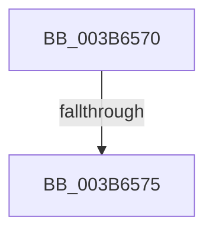

# RtlSetBitsEx

- RVA: `0x003B6570`–`0x003B657A` (길이 `10` bytes)
- VA: `0x00000001403B6570`
- 실행 섹션: `.text`
- PDB 이름 있음: `예`; PDB Function 태그: `아니요`
- unwind 정보 RVA: `0x0008C6EC`
- 디코드: `4`개 명령, `10/10` bytes 표시
- 미해석 바이트: `0` (있으면 어셈블리에 `.byte`로 보존)

> 이 문서는 커널 이미지의 기계어와 PDB 기호를 분석해 생성했습니다. 4번과 5번은 함수 원형과 자료형을 바이너리 사용 방식에서 추정한 C 해석이며 원본 소스 복구 결과는 아닙니다.

## 1. Dependencies

- 직접 호출 지점: **0**; 고유 호출 대상: **0**
- 직접 호출자로 확인된 함수: **22**
- RIP 상대 이미지 참조: **0**

### Outgoing calls
- 직접 디코드된 call 명령이 없습니다.

### Direct callers
- [MiUpdateLargePageBitMap](../37/MiUpdateLargePageBitMap_function_0037619C.md) at `0x0037634D`
- [MiMarkSystemVaAllocated](MiMarkSystemVaAllocated_function_003B3878.md) at `0x003B3A16`
- [MiObtainDynamicVa](MiObtainDynamicVa_function_003B501C.md) at `0x003B52AA`
- [RtlFindClearBitsAndSetEx](RtlFindClearBitsAndSetEx_function_003B60F0.md) at `0x003B6144`
- [MiMirrorAddPagesToBrownList](MiMirrorAddPagesToBrownList_function_003B648C.md) at `0x003B64E7`
- [IopAddPageRangeToPageMaps](../59/IopAddPageRangeToPageMaps_function_005944B0.md) at `0x005944DD`
- [IopAddPageRangeToPageMaps](../59/IopAddPageRangeToPageMaps_function_005944B0.md) at `0x0059454E`
- [IopLiveDumpMirrorPhysicalMemoryCallback](../59/IopLiveDumpMirrorPhysicalMemoryCallback_function_0059D260.md) at `0x0059D475`
- [IopLiveDumpPopulateBitmapForDump](../59/IopLiveDumpPopulateBitmapForDump_function_0059D9B0.md) at `0x0059DB99`
- [IopLiveDumpPopulateBitmapForDump](../59/IopLiveDumpPopulateBitmapForDump_function_0059D9B0.md) at `0x0059DCB2`
- [RtlpHpFixedHeapCreate](../60/RtlpHpFixedHeapCreate_function_006038A0.md) at `0x00603A64`
- [MiPhysicalMemoryEverRemoved](../67/MiPhysicalMemoryEverRemoved_function_00673958.md) at `0x00673A8F`
- [MiAddPartitionHugeRange](../67/MiAddPartitionHugeRange_function_006750D8.md) at `0x006752BC`
- [MiAddRangeToPartitionTree](../69/MiAddRangeToPartitionTree_function_0069020C.md) at `0x00690471`
- [MiFreeInitializationCode](../../page/7F/MiFreeInitializationCode_function_007F88A0.md) at `0x007F897F`
- [MiIdentifyImageDiscardablePages](../../page/80/MiIdentifyImageDiscardablePages_function_00803DB4.md) at `0x00803E99`
- [MiIdentifyPatchImageDataPages](../../page/80/MiIdentifyPatchImageDataPages_function_00803EBC.md) at `0x00803F48`
- [MiPatchDataPagesCallback](../../page/80/MiPatchDataPagesCallback_function_00806610.md) at `0x008066AE`
- [MiSetVadBits](../../page/88/MiSetVadBits_function_008870D8.md) at `0x0088719F`
- [MiUpdateCfgSystemWideBitmapWorker](../../page/8C/MiUpdateCfgSystemWideBitmapWorker_function_008CE650.md) at `0x008CE98C`
- [MiCopyToCfgBitMap](../../page/8D/MiCopyToCfgBitMap_function_008D1140.md) at `0x008D1430`
- [MiMarkRetpolineBits](../../page/AA/MiMarkRetpolineBits_function_00AA0394.md) at `0x00AA044A`
- [MiActOnMirrorBitmap](../../page/AC/MiActOnMirrorBitmap_function_00AC21D0.md) at `0x00AC2249`
- [sub_00B2B81E](../../page/B2/Unknown_function_00B2B81E.md) at `0x00B2B84B`
- [sub_00B2B81E](../../page/B2/Unknown_function_00B2B81E.md) at `0x00B2B85A`

### Static image references
- 디코드된 RIP-relative 메모리 참조가 없습니다.

## 2. Other-region calls and transfers

- 다른 실행 섹션으로 향하는 call: **0**
- call이 아닌 외부 분기/꼬리 이동: **1**
  - `0x003B6573` → [sub_003B657A + 0x4A](Unknown_function_003B657A.md) (`tail-transfer`)

## 3. Assembly (complete function range)

```asm
003B6570  4D 85 C0                        test r8, r8
003B6573  74 4F                           je 0x1403b65c4
003B6575  53                              push rbx
003B6576  48 83 EC 20                     sub rsp, 0x20
```

## 4. C-style interpretation (structured pseudocode)

```c
void __fastcall RtlSetBitsEx(__int64 a1, __int64 a2, __int64 a3)
{
    __int64 v_rsp;

    v_rsp = (v_rsp) - (32);
    return;
}
```

## 5. (Beta) C Style

```c
void RtlSetBitsEx(int64_t Arg1, int64_t Arg2, int64_t Arg3)
{
    int64_t local_rsp;

    local_rsp = (local_rsp) - (32);
    return;
}
```

## 6. Execution-region graph

[열기: 2D/3D 그래프와 함수 탐색 컨트롤 패널](../../../control-panel.html?section=text&rva=0x003B6570&view=graph)

- 2D 그래프는 위에서 아래로 흐르고, 3D 그래프는 빈 공간을 드래그해 회전합니다. Shift+드래그는 이동, 휠은 확대·축소, 함수 노드 선택은 대상 보고서 이동입니다.

### Static fallback


