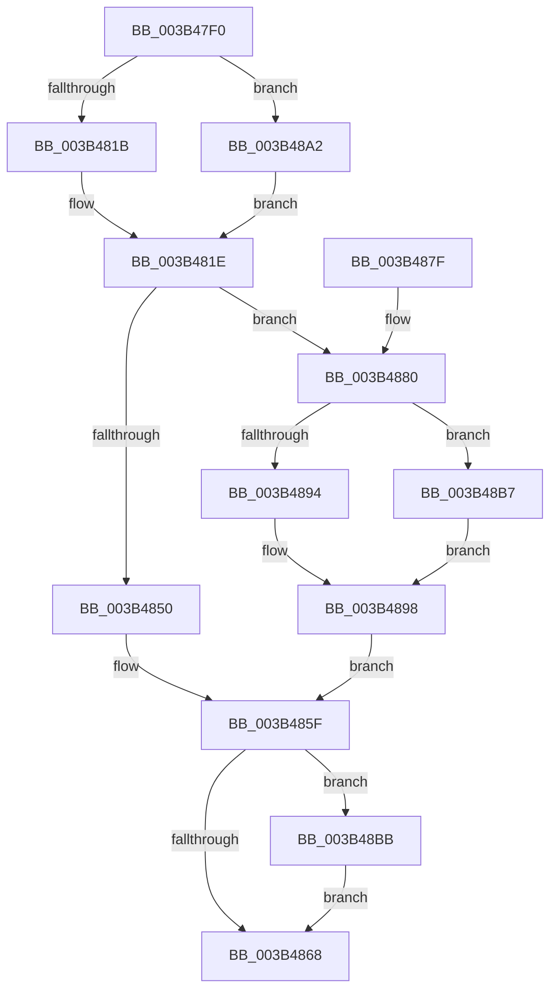

# RtlpHpFixedVsAllocate

- RVA: `0x003B47F0`–`0x003B48CD` (길이 `221` bytes)
- VA: `0x00000001403B47F0`
- 실행 섹션: `.text`
- PDB 이름 있음: `예`; PDB Function 태그: `아니요`
- unwind 정보 RVA: `0x0008C5B0`
- 디코드: `63`개 명령, `221/221` bytes 표시
- 미해석 바이트: `0` (있으면 어셈블리에 `.byte`로 보존)

> 이 문서는 커널 이미지의 기계어와 PDB 기호를 분석해 생성했습니다. 4번과 5번은 함수 원형과 자료형을 바이너리 사용 방식에서 추정한 C 해석이며 원본 소스 복구 결과는 아닙니다.

## 1. Dependencies

- 직접 호출 지점: **4**; 고유 호출 대상: **4**
- 직접 호출자로 확인된 함수: **0**
- RIP 상대 이미지 참조: **0**

### Outgoing calls
- `0x003B4842` → [RtlFindClearBitsAndSetEx](RtlFindClearBitsAndSetEx_function_003B60F0.md) (function, `0x003B60F0`)
- `0x003B488A` → [RtlFindClearRunsEx](RtlFindClearRunsEx_function_003B3A88.md) (function, `0x003B3A88`)
- `0x003B48AA` → [RtlpHpAcquireLockExclusive](../32/RtlpHpAcquireLockExclusive_function_003246B0.md) (function, `0x003246B0`)
- `0x003B48C6` → [RtlpHpReleaseLockExclusive](../32/RtlpHpReleaseLockExclusive_function_00324230.md) (function, `0x00324230`)

### Direct callers
- 이 함수 시작 RVA로 연결되는 직접 call은 확인되지 않았습니다. 간접 호출은 완전히 역산할 수 없습니다.

### Static image references
- 디코드된 RIP-relative 메모리 참조가 없습니다.

## 2. Other-region calls and transfers

- 다른 실행 섹션으로 향하는 call: **0**
- 별도 외부 분기/꼬리 이동을 확인하지 못했습니다.

## 3. Assembly (complete function range)

```asm
003B47F0  48 89 5C 24 10                  mov qword ptr [rsp + 0x10], rbx
003B47F5  48 89 74 24 18                  mov qword ptr [rsp + 0x18], rsi
003B47FA  57                              push rdi
003B47FB  41 56                           push r14
003B47FD  41 57                           push r15
003B47FF  48 83 EC 30                     sub rsp, 0x30
003B4803  F7 41 14 00 00 00 08            test dword ptr [rcx + 0x14], 0x8000000
003B480A  4D 8B F1                        mov r14, r9
003B480D  4D 8B F8                        mov r15, r8
003B4810  8B FA                           mov edi, edx
003B4812  48 8B D9                        mov rbx, rcx
003B4815  0F 84 87 00 00 00               je 0x1403b48a2
003B481B  40 B6 FF                        mov sil, 0xff
003B481E  0F 10 43 30                     movups xmm0, xmmword ptr [rbx + 0x30]
003B4822  48 8B 43 38                     mov rax, qword ptr [rbx + 0x38]
003B4826  48 8D 4C 24 20                  lea rcx, [rsp + 0x20]
003B482B  48 33 C3                        xor rax, rbx
003B482E  48 8B D7                        mov rdx, rdi
003B4831  0F 11 44 24 20                  movups xmmword ptr [rsp + 0x20], xmm0
003B4836  48 C1 EA 0C                     shr rdx, 0xc
003B483A  45 33 C0                        xor r8d, r8d
003B483D  48 89 44 24 28                  mov qword ptr [rsp + 0x28], rax
003B4842  E8 A9 18 00 00                  call 0x1403b60f0
003B4847  48 8B F8                        mov rdi, rax
003B484A  48 83 F8 FF                     cmp rax, -1
003B484E  74 30                           je 0x1403b4880
003B4850  41 83 26 00                     and dword ptr [r14], 0
003B4854  48 C1 E7 0C                     shl rdi, 0xc
003B4858  48 03 FB                        add rdi, rbx
003B485B  41 83 27 00                     and dword ptr [r15], 0
003B485F  F7 43 14 00 00 00 08            test dword ptr [rbx + 0x14], 0x8000000
003B4866  74 53                           je 0x1403b48bb
003B4868  48 8B 5C 24 58                  mov rbx, qword ptr [rsp + 0x58]
003B486D  48 8B C7                        mov rax, rdi
003B4870  48 8B 74 24 60                  mov rsi, qword ptr [rsp + 0x60]
003B4875  48 83 C4 30                     add rsp, 0x30
003B4879  41 5F                           pop r15
003B487B  41 5E                           pop r14
003B487D  5F                              pop rdi
003B487E  C3                              ret
003B487F  CC                              int3
003B4880  48 8D 54 24 50                  lea rdx, [rsp + 0x50]
003B4885  48 8D 4C 24 20                  lea rcx, [rsp + 0x20]
003B488A  E8 F9 F1 FF FF                  call 0x1403b3a88
003B488F  83 F8 01                        cmp eax, 1
003B4892  75 23                           jne 0x1403b48b7
003B4894  8B 44 24 54                     mov eax, dword ptr [rsp + 0x54]
003B4898  C1 E0 0C                        shl eax, 0xc
003B489B  41 89 06                        mov dword ptr [r14], eax
003B489E  33 FF                           xor edi, edi
003B48A0  EB BD                           jmp 0x1403b485f
003B48A2  0F B6 51 20                     movzx edx, byte ptr [rcx + 0x20]
003B48A6  48 83 C1 18                     add rcx, 0x18
003B48AA  E8 01 FE F6 FF                  call 0x1403246b0
003B48AF  40 8A F0                        mov sil, al
003B48B2  E9 67 FF FF FF                  jmp 0x1403b481e
003B48B7  33 C0                           xor eax, eax
003B48B9  EB DD                           jmp 0x1403b4898
003B48BB  0F B6 53 20                     movzx edx, byte ptr [rbx + 0x20]
003B48BF  48 8D 4B 18                     lea rcx, [rbx + 0x18]
003B48C3  44 8A C6                        mov r8b, sil
003B48C6  E8 65 F9 F6 FF                  call 0x140324230
003B48CB  EB 9B                           jmp 0x1403b4868
```

## 4. C-style interpretation (structured pseudocode)

```c
__int64 __fastcall RtlpHpFixedVsAllocate(__int64 a1, int a2, __int64 a3, __int64 a4)
{
    __int64 result;
    __int64 v_rdi;
    __int64 v_rsp;
    unsigned __int64 v_stack_m20;
    unsigned __int64 v_stack_m28;
    unsigned __int64 v_stack_p10;
    unsigned __int64 v_stack_p18;
    unsigned __int64 v_stack_p20;
    unsigned __int64 v_stack_p50;
    unsigned int v_stack_p54;

    v_stack_p10 = v_rbx;
    v_stack_p18 = v_rsi;
    v_rsp = (v_rsp) - (48);
    if (((*(unsigned int *)(a1 + 20)) & (0x8000000ULL)) == 0) goto loc_003B48A2;
loc_003B481E:
    result = (*(unsigned __int64 *)(a1 + 56)) ^ (a1);
    v_stack_m28 = v_xmm0;
    a2 = ((unsigned int)(a2)) >> (12);
    a3 = 0;
    v_stack_m20 = result;
    result = RtlFindClearBitsAndSetEx(v_stack_m28, a2, a3, a4);
    if (result == -1) goto loc_003B4880;
    v_rdi = (result) << (12);
    v_rdi = (v_rdi) + (a1);
loc_003B485F:
    if (((*(unsigned int *)(a1 + 20)) & (0x8000000ULL)) == 0) goto loc_003B48BB;
loc_003B4868:
    v_rsp = (v_rsp) + (48);
    return v_rdi;
loc_003B4880:
    result = RtlFindClearRunsEx(v_stack_p20, v_stack_p50, a3, a4);
    if (((unsigned int)(result)) != 1) goto loc_003B48B7;
loc_003B4898:
    result = (unsigned int)(((unsigned int)(v_stack_p54)) << (12));
    *(unsigned int *)(a4) = (unsigned int)(result);
    v_rdi = 0;
    goto loc_003B485F;
loc_003B48A2:
    a1 = (v_stack_p20) + (24);
    result = RtlpHpAcquireLockExclusive(a1, *(unsigned __int8 *)(v_stack_p20 + 32), a3, a4);
    goto loc_003B481E;
loc_003B48B7:
    result = 0;
    goto loc_003B4898;
loc_003B48BB:
    result = RtlpHpReleaseLockExclusive(v_stack_p10 + 24, *(unsigned __int8 *)(v_stack_p10 + 32), (unsigned __int8)((unsigned __int8)(result)), a4);
    goto loc_003B4868;
}
```

## 5. (Beta) C Style

```c
int64_t RtlpHpFixedVsAllocate(void *Arg1, int32_t Arg2, void *Arg3, void *Arg4)
{
    uint8_t *arg1 = (uint8_t *)Arg1;
    uint8_t *arg3 = (uint8_t *)Arg3;
    uint8_t *arg4 = (uint8_t *)Arg4;

    int64_t result;
    int64_t local_rdi;
    int64_t local_rsp;
    uint64_t v_stack_m20;
    uint64_t v_stack_m28;
    uint64_t v_stack_p10;
    uint64_t v_stack_p18;
    uint64_t v_stack_p20;
    uint64_t v_stack_p50;
    uint32_t v_stack_p54;

    v_stack_p10 = local_rbx;
    v_stack_p18 = local_rsi;
    local_rsp = (local_rsp) - (48);
    if (((*(uint32_t *)(arg1 + 0x14)) & (0x8000000ULL)) == 0) goto loc_003B48A2;
loc_003B481E:
    result = (*(uint64_t *)(arg1 + 0x38)) ^ (Arg1);
    v_stack_m28 = v_xmm0;
    Arg2 = ((uint32_t)(Arg2)) >> (12);
    Arg3 = 0;
    v_stack_m20 = result;
    result = RtlFindClearBitsAndSetEx(v_stack_m28, Arg2, Arg3, Arg4);
    if (result == -1) goto loc_003B4880;
    local_rdi = (result) << (12);
    local_rdi = (local_rdi) + (Arg1);
loc_003B485F:
    if (((*(uint32_t *)(arg1 + 0x14)) & (0x8000000ULL)) == 0) goto loc_003B48BB;
loc_003B4868:
    local_rsp = (local_rsp) + (48);
    return local_rdi;
loc_003B4880:
    result = RtlFindClearRunsEx(v_stack_p20, v_stack_p50, Arg3, Arg4);
    if (((uint32_t)(result)) != 1) goto loc_003B48B7;
loc_003B4898:
    result = (uint32_t)(((uint32_t)(v_stack_p54)) << (12));
    *(uint32_t *)(arg4) = (uint32_t)(result);
    local_rdi = 0;
    goto loc_003B485F;
loc_003B48A2:
    Arg1 = (v_stack_p20) + (24);
    result = RtlpHpAcquireLockExclusive(Arg1, *(uint8_t *)(v_stack_p20 + 0x20), Arg3, Arg4);
    goto loc_003B481E;
loc_003B48B7:
    result = 0;
    goto loc_003B4898;
loc_003B48BB:
    result = RtlpHpReleaseLockExclusive(v_stack_p10 + 24, *(uint8_t *)(v_stack_p10 + 0x20), (uint8_t)((uint8_t)(result)), Arg4);
    goto loc_003B4868;
}
```

### 관측된 메모리 오프셋

구조체 형식이 확인되지 않은 접근은 인자 기준의 오프셋으로만 기록했습니다.

| 기준 인자 | 오프셋 표현 | 폭 (bit) | 접근 |
|---|---:|---:|---|
| `Arg1` | `+ 0x14` | `32` | `R` |
| `Arg1` | `+ 0x18` | `64` | `R` |
| `Arg1` | `+ 0x20` | `8` | `R` |
| `Arg1` | `+ 0x30` | `128` | `R` |
| `Arg1` | `+ 0x38` | `64` | `R` |
| `Arg3` | `+ 0x0` | `32` | `R/W` |
| `Arg4` | `+ 0x0` | `32` | `R/W` |
| `Arg4` | `+ 0x0` | `32` | `W` |

## 6. Execution-region graph

[열기: 2D/3D 그래프와 함수 탐색 컨트롤 패널](../../../control-panel.html?section=text&rva=0x003B47F0&view=graph)

- 2D 그래프는 위에서 아래로 흐르고, 3D 그래프는 빈 공간을 드래그해 회전합니다. Shift+드래그는 이동, 휠은 확대·축소, 함수 노드 선택은 대상 보고서 이동입니다.

### Static fallback


