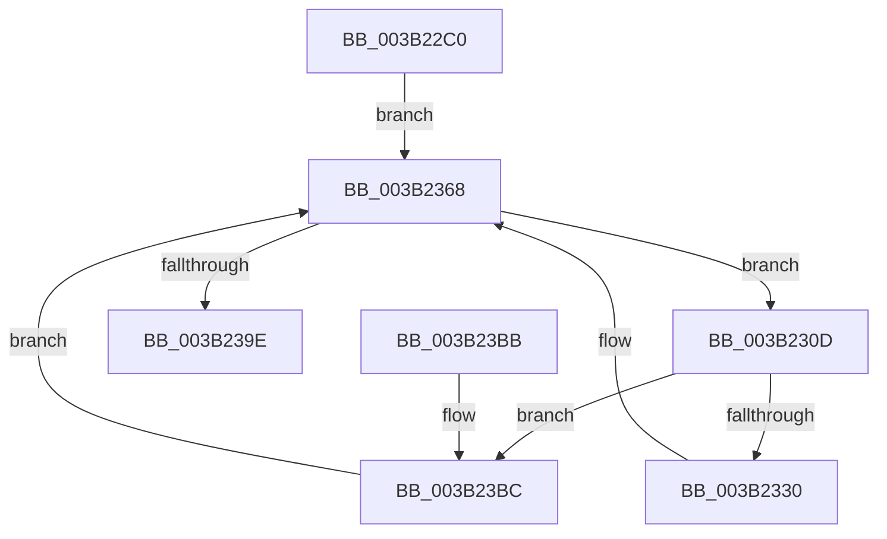

# SMKM_STORE_MGR&lt;SM_TRAITS&gt;::SmCompressCtxBalancerThread

- RVA: `0x003B22C0`–`0x003B23C9` (길이 `265` bytes)
- VA: `0x00000001403B22C0`
- 실행 섹션: `.text`
- PDB 이름 있음: `예`; PDB Function 태그: `아니요`
- unwind 정보 RVA: `0x0008C3B8`
- 디코드: `66`개 명령, `265/265` bytes 표시
- 미해석 바이트: `0` (있으면 어셈블리에 `.byte`로 보존)

> 이 문서는 커널 이미지의 기계어와 PDB 기호를 분석해 생성했습니다. 4번과 5번은 함수 원형과 자료형을 바이너리 사용 방식에서 추정한 C 해석이며 원본 소스 복구 결과는 아닙니다.

## 1. Dependencies

- 직접 호출 지점: **11**; 고유 호출 대상: **10**
- 직접 호출자로 확인된 함수: **0**
- RIP 상대 이미지 참조: **0**

### Outgoing calls
- `0x003B22F8` → [KeSetActualBasePriorityThread](../3C/KeSetActualBasePriorityThread_function_003C4370.md) (function, `0x003C4370`)
- `0x003B2306` → [KeSetEvent](../33/KeSetEvent_function_0033F310.md) (function, `0x0033F310`)
- `0x003B2310` → [ExAcquireSpinLockExclusive](../24/ExAcquireSpinLockExclusive_function_00248690.md) (function, `0x00248690`)
- `0x003B231B` → [KeResetEvent](../24/KeResetEvent_function_00248350.md) (function, `0x00248350`)
- `0x003B2323` → [SMKM_STORE_MGR<SM_TRAITS>::SmCompressCtxNewThreadNeeded](../26/SMKM_STORE_MGR_SM_TRAITS_SmCompressCtxNewThreadNeeded_function_002681AC.md) (function, `0x002681AC`)
- `0x003B2340` → [SMKM_STORE_MGR<SM_TRAITS>::SmCompressManagerGetIdealProcessor](SMKM_STORE_MGR_SM_TRAITS_SmCompressManagerGetIdealProcessor_function_003B21CC.md) (function, `0x003B21CC`)
- `0x003B234F` → [ExReleaseSpinLockExclusive](../2C/ExReleaseSpinLockExclusive_function_002C0EF0.md) (function, `0x002C0EF0`)
- `0x003B2363` → [SMKM_STORE_MGR<SM_TRAITS>::SmCompressCtxCreateThread](SMKM_STORE_MGR_SM_TRAITS_SmCompressCtxCreateThread_function_003B2400.md) (function, `0x003B2400`)
- `0x003B2391` → [KeWaitForMultipleObjects](../20/KeWaitForMultipleObjects_function_0020D110.md) (function, `0x0020D110`)
- `0x003B23A1` → [SMKM_STORE_MGR<SM_TRAITS>::SmCompressCtxDeleteThreadParams](SMKM_STORE_MGR_SM_TRAITS_SmCompressCtxDeleteThreadParams_function_003B23D0.md) (function, `0x003B23D0`)
- `0x003B23C2` → [ExReleaseSpinLockExclusive](../2C/ExReleaseSpinLockExclusive_function_002C0EF0.md) (function, `0x002C0EF0`)

### Direct callers
- 이 함수 시작 RVA로 연결되는 직접 call은 확인되지 않았습니다. 간접 호출은 완전히 역산할 수 없습니다.

### Static image references
- 디코드된 RIP-relative 메모리 참조가 없습니다.

## 2. Other-region calls and transfers

- 다른 실행 섹션으로 향하는 call: **0**
- 별도 외부 분기/꼬리 이동을 확인하지 못했습니다.

## 3. Assembly (complete function range)

```asm
003B22C0  4C 8B DC                        mov r11, rsp
003B22C3  49 89 5B 10                     mov qword ptr [r11 + 0x10], rbx
003B22C7  49 89 6B 18                     mov qword ptr [r11 + 0x18], rbp
003B22CB  49 89 73 20                     mov qword ptr [r11 + 0x20], rsi
003B22CF  57                              push rdi
003B22D0  48 83 EC 50                     sub rsp, 0x50
003B22D4  48 8B 19                        mov rbx, qword ptr [rcx]
003B22D7  48 8B F9                        mov rdi, rcx
003B22DA  65 48 8B 0C 25 88 01 00 00      mov rcx, qword ptr gs:[0x188]
003B22E3  BA 19 00 00 00                  mov edx, 0x19
003B22E8  48 8D 43 50                     lea rax, [rbx + 0x50]
003B22EC  48 8D 6B 38                     lea rbp, [rbx + 0x38]
003B22F0  49 89 43 E8                     mov qword ptr [r11 - 0x18], rax
003B22F4  49 89 6B F0                     mov qword ptr [r11 - 0x10], rbp
003B22F8  E8 73 20 01 00                  call 0x1403c4370
003B22FD  48 8B 4F 10                     mov rcx, qword ptr [rdi + 0x10]
003B2301  45 33 C0                        xor r8d, r8d
003B2304  33 D2                           xor edx, edx
003B2306  E8 05 D0 F8 FF                  call 0x14033f310
003B230B  EB 5B                           jmp 0x1403b2368
003B230D  48 8B CB                        mov rcx, rbx
003B2310  E8 7B 63 E9 FF                  call 0x140248690
003B2315  48 8B CD                        mov rcx, rbp
003B2318  40 8A F0                        mov sil, al
003B231B  E8 30 60 E9 FF                  call 0x140248350
003B2320  48 8B CB                        mov rcx, rbx
003B2323  E8 84 5E EB FF                  call 0x1402681ac
003B2328  85 C0                           test eax, eax
003B232A  0F 84 8C 00 00 00               je 0x1403b23bc
003B2330  8B 93 A8 00 00 00               mov edx, dword ptr [rbx + 0xa8]
003B2336  41 B8 01 00 00 00               mov r8d, 1
003B233C  48 8B 4B 08                     mov rcx, qword ptr [rbx + 8]
003B2340  E8 87 FE FF FF                  call 0x1403b21cc
003B2345  40 8A D6                        mov dl, sil
003B2348  89 44 24 60                     mov dword ptr [rsp + 0x60], eax
003B234C  48 8B CB                        mov rcx, rbx
003B234F  E8 9C EB F0 FF                  call 0x1402c0ef0
003B2354  48 8B 57 08                     mov rdx, qword ptr [rdi + 8]
003B2358  4C 8D 44 24 60                  lea r8, [rsp + 0x60]
003B235D  45 33 C9                        xor r9d, r9d
003B2360  48 8B CB                        mov rcx, rbx
003B2363  E8 98 00 00 00                  call 0x1403b2400
003B2368  48 83 64 24 38 00               and qword ptr [rsp + 0x38], 0
003B236E  48 8D 54 24 40                  lea rdx, [rsp + 0x40]
003B2373  48 83 64 24 30 00               and qword ptr [rsp + 0x30], 0
003B2379  41 B9 1A 00 00 00               mov r9d, 0x1a
003B237F  C6 44 24 28 00                  mov byte ptr [rsp + 0x28], 0
003B2384  C6 44 24 20 00                  mov byte ptr [rsp + 0x20], 0
003B2389  45 8D 41 E7                     lea r8d, [r9 - 0x19]
003B238D  41 8D 49 E8                     lea ecx, [r9 - 0x18]
003B2391  E8 7A AD E5 FF                  call 0x14020d110
003B2396  85 C0                           test eax, eax
003B2398  0F 85 6F FF FF FF               jne 0x1403b230d
003B239E  48 8B CF                        mov rcx, rdi
003B23A1  E8 2A 00 00 00                  call 0x1403b23d0
003B23A6  48 8B 5C 24 68                  mov rbx, qword ptr [rsp + 0x68]
003B23AB  48 8B 6C 24 70                  mov rbp, qword ptr [rsp + 0x70]
003B23B0  48 8B 74 24 78                  mov rsi, qword ptr [rsp + 0x78]
003B23B5  48 83 C4 50                     add rsp, 0x50
003B23B9  5F                              pop rdi
003B23BA  C3                              ret
003B23BB  CC                              int3
003B23BC  40 8A D6                        mov dl, sil
003B23BF  48 8B CB                        mov rcx, rbx
003B23C2  E8 29 EB F0 FF                  call 0x1402c0ef0
003B23C7  EB 9F                           jmp 0x1403b2368
```

## 4. C-style interpretation (structured pseudocode)

```c
__int64 __fastcall SMKM_STORE_MGR_SM_TRAITS___SmCompressCtxBalancerThread(__int64 a1, __int64 a2, int a3, int a4)
{
    __int64 result;
    __int64 v_rsp;
    unsigned __int64 v_stack_m18;
    unsigned __int64 v_stack_m20;
    unsigned __int64 v_stack_m28;
    unsigned __int8 v_stack_m30;
    unsigned __int8 v_stack_m38;
    unsigned __int64 v_stack_p10;
    unsigned __int64 v_stack_p18;
    unsigned __int64 v_stack_p20;
    unsigned int v_stack_p8;

    *(unsigned __int64 *)(v_rsp + 16) = v_rbx;
    *(unsigned __int64 *)(v_rsp + 24) = v_rbp;
    *(unsigned __int64 *)(v_rsp + 32) = v_rsi;
    v_rsp = (v_rsp) - (80);
    *(unsigned __int64 *)(v_rsp - 24) = *(unsigned __int64 *)(a1) + 80;
    *(unsigned __int64 *)(v_rsp - 16) = *(unsigned __int64 *)(a1) + 56;
    result = KeSetActualBasePriorityThread(*(unsigned __int64 *)(gs_base + (0 + 392)), 25, a3, a4);
    a3 = 0;
    a2 = 0;
    result = KeSetEvent(*(unsigned __int64 *)(a1 + 16), a2, a3, a4);
    goto loc_003B2368;
loc_003B230D:
    result = ExAcquireSpinLockExclusive(*(unsigned __int64 *)(a1), a2, a3, a4);
    result = KeResetEvent(*(unsigned __int64 *)(a1) + 56, a2, a3, a4);
    result = SMKM_STORE_MGR_SM_TRAITS___SmCompressCtxNewThreadNeeded(*(unsigned __int64 *)(a1), a2, a3, a4);
    if ((unsigned int)(result) == 0) goto loc_003B23BC;
    result = SMKM_STORE_MGR_SM_TRAITS___SmCompressManagerGetIdealProcessor(*(unsigned __int64 *)(*(unsigned __int64 *)(a1) + 8), (unsigned int)(*(unsigned int *)(*(unsigned __int64 *)(a1) + 168)), 1, a4);
    v_stack_p8 = (unsigned int)(result);
    result = ExReleaseSpinLockExclusive(*(unsigned __int64 *)(a1), (unsigned __int8)((unsigned __int8)(result)), 1, a4);
    a4 = 0;
    result = SMKM_STORE_MGR_SM_TRAITS___SmCompressCtxCreateThread(*(unsigned __int64 *)(a1), *(unsigned __int64 *)(a1 + 8), v_stack_p8, a4);
loc_003B2368:
    v_stack_m30 = 0;
    v_stack_m38 = 0;
    result = KeWaitForMultipleObjects(26 - 24, v_stack_m18, 26 - 25, 26);
    if ((unsigned int)(result) != 0) goto loc_003B230D;
    result = SMKM_STORE_MGR_SM_TRAITS___SmCompressCtxDeleteThreadParams(a1, v_stack_m18, 26 - 25, 26);
    v_rsp = (v_rsp) + (80);
    return result;
loc_003B23BC:
    result = ExReleaseSpinLockExclusive(v_stack_p10, (unsigned __int8)(v_stack_p20), 26 - 25, 26);
    goto loc_003B2368;
}
```

## 5. (Beta) C Style

```c
int64_t SMKM_STORE_MGR_SM_TRAITS___SmCompressCtxBalancerThread(void *Arg1, int64_t Arg2, int32_t Arg3, int32_t Arg4)
{
    uint8_t *arg1 = (uint8_t *)Arg1;

    int64_t result;
    int64_t local_rsp;
    uint64_t v_stack_m18;
    uint64_t v_stack_m20;
    uint64_t v_stack_m28;
    uint8_t v_stack_m30;
    uint8_t v_stack_m38;
    uint64_t v_stack_p10;
    uint64_t v_stack_p18;
    uint64_t v_stack_p20;
    uint32_t v_stack_p8;

    *(uint64_t *)(local_rsp + 0x10) = local_rbx;
    *(uint64_t *)(local_rsp + 0x18) = local_rbp;
    *(uint64_t *)(local_rsp + 0x20) = local_rsi;
    local_rsp = (local_rsp) - (80);
    *(uint64_t *)(local_rsp - 0x18) = *(uint64_t *)(arg1) + 80;
    *(uint64_t *)(local_rsp - 0x10) = *(uint64_t *)(arg1) + 56;
    result = KeSetActualBasePriorityThread(*(uint64_t *)(gs_base + (0 + 0x188)), 25, Arg3, Arg4);
    Arg3 = 0;
    Arg2 = 0;
    result = KeSetEvent(*(uint64_t *)(arg1 + 0x10), Arg2, Arg3, Arg4);
    goto loc_003B2368;
loc_003B230D:
    result = ExAcquireSpinLockExclusive(*(uint64_t *)(arg1), Arg2, Arg3, Arg4);
    result = KeResetEvent(*(uint64_t *)(arg1) + 56, Arg2, Arg3, Arg4);
    result = SMKM_STORE_MGR_SM_TRAITS___SmCompressCtxNewThreadNeeded(*(uint64_t *)(arg1), Arg2, Arg3, Arg4);
    if ((uint32_t)(result) == 0) goto loc_003B23BC;
    result = SMKM_STORE_MGR_SM_TRAITS___SmCompressManagerGetIdealProcessor(*(uint64_t *)(*(uint64_t *)(arg1) + 0x8), (uint32_t)(*(uint32_t *)(*(uint64_t *)(arg1) + 0xA8)), 1, Arg4);
    v_stack_p8 = (uint32_t)(result);
    result = ExReleaseSpinLockExclusive(*(uint64_t *)(arg1), (uint8_t)((uint8_t)(result)), 1, Arg4);
    Arg4 = 0;
    result = SMKM_STORE_MGR_SM_TRAITS___SmCompressCtxCreateThread(*(uint64_t *)(arg1), *(uint64_t *)(arg1 + 0x8), v_stack_p8, Arg4);
loc_003B2368:
    v_stack_m30 = 0;
    v_stack_m38 = 0;
    result = KeWaitForMultipleObjects(26 - 24, v_stack_m18, 26 - 25, 26);
    if ((uint32_t)(result) != 0) goto loc_003B230D;
    result = SMKM_STORE_MGR_SM_TRAITS___SmCompressCtxDeleteThreadParams(Arg1, v_stack_m18, 26 - 25, 26);
    local_rsp = (local_rsp) + (80);
    return result;
loc_003B23BC:
    result = ExReleaseSpinLockExclusive(v_stack_p10, (uint8_t)(v_stack_p20), 26 - 25, 26);
    goto loc_003B2368;
}
```

### 관측된 메모리 오프셋

구조체 형식이 확인되지 않은 접근은 인자 기준의 오프셋으로만 기록했습니다.

| 기준 인자 | 오프셋 표현 | 폭 (bit) | 접근 |
|---|---:|---:|---|
| `Arg1` | `+ 0x0` | `64` | `R` |
| `Arg1` | `+ 0x8` | `64` | `R` |
| `Arg1` | `+ 0x10` | `64` | `R` |

## 6. Execution-region graph

[열기: 2D/3D 그래프와 함수 탐색 컨트롤 패널](../../../control-panel.html?section=text&rva=0x003B22C0&view=graph)

- 2D 그래프는 위에서 아래로 흐르고, 3D 그래프는 빈 공간을 드래그해 회전합니다. Shift+드래그는 이동, 휠은 확대·축소, 함수 노드 선택은 대상 보고서 이동입니다.

### Static fallback


