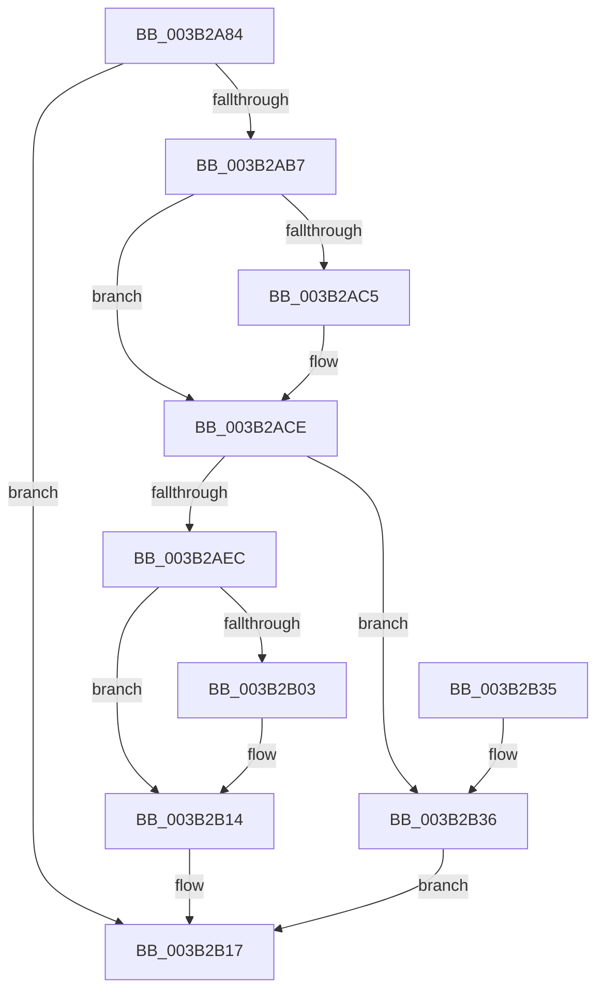

# SMKM_STORE_MGR&lt;SM_TRAITS&gt;::SmCompressCtxCreateThreadParams

- RVA: `0x003B2A84`–`0x003B2B40` (길이 `188` bytes)
- VA: `0x00000001403B2A84`
- 실행 섹션: `.text`
- PDB 이름 있음: `예`; PDB Function 태그: `아니요`
- unwind 정보 RVA: `0x000841B4`
- 디코드: `53`개 명령, `188/188` bytes 표시
- 미해석 바이트: `0` (있으면 어셈블리에 `.byte`로 보존)

> 이 문서는 커널 이미지의 기계어와 PDB 기호를 분석해 생성했습니다. 4번과 5번은 함수 원형과 자료형을 바이너리 사용 방식에서 추정한 C 해석이며 원본 소스 복구 결과는 아닙니다.

## 1. Dependencies

- 직접 호출 지점: **3**; 고유 호출 대상: **3**
- 직접 호출자로 확인된 함수: **1**
- RIP 상대 이미지 참조: **0**

### Outgoing calls
- `0x003B2AAC` → [ExAcquireRundownProtection](../21/ExAcquireRundownProtection_function_00216620.md) (function, `0x00216620`)
- `0x003B2ADF` → [SmAllocEx](../34/SmAllocEx_function_0034C794.md) (function, `0x0034C794`)
- `0x003B2B39` → [ExReleaseRundownProtection](../34/ExReleaseRundownProtection_function_00349E80.md) (function, `0x00349E80`)

### Direct callers
- [SMKM_STORE_MGR&lt;SM_TRAITS&gt;::SmCompressCtxCreateThread](SMKM_STORE_MGR_SM_TRAITS_SmCompressCtxCreateThread_function_003B2400.md) at `0x003B247C`

### Static image references
- 디코드된 RIP-relative 메모리 참조가 없습니다.

## 2. Other-region calls and transfers

- 다른 실행 섹션으로 향하는 call: **0**
- 별도 외부 분기/꼬리 이동을 확인하지 못했습니다.

## 3. Assembly (complete function range)

```asm
003B2A84  48 8B C4                        mov rax, rsp
003B2A87  48 89 58 08                     mov qword ptr [rax + 8], rbx
003B2A8B  48 89 68 10                     mov qword ptr [rax + 0x10], rbp
003B2A8F  48 89 70 18                     mov qword ptr [rax + 0x18], rsi
003B2A93  48 89 78 20                     mov qword ptr [rax + 0x20], rdi
003B2A97  41 56                           push r14
003B2A99  48 83 EC 20                     sub rsp, 0x20
003B2A9D  4C 8D B1 90 00 00 00            lea r14, [rcx + 0x90]
003B2AA4  48 8B F1                        mov rsi, rcx
003B2AA7  49 8B CE                        mov rcx, r14
003B2AAA  8B EA                           mov ebp, edx
003B2AAC  E8 6F 3B E6 FF                  call 0x140216620
003B2AB1  33 DB                           xor ebx, ebx
003B2AB3  84 C0                           test al, al
003B2AB5  74 60                           je 0x1403b2b17
003B2AB7  8D 4B 28                        lea ecx, [rbx + 0x28]
003B2ABA  48 8D BE A4 00 00 00            lea rdi, [rsi + 0xa4]
003B2AC1  85 ED                           test ebp, ebp
003B2AC3  74 09                           je 0x1403b2ace
003B2AC5  8B 0F                           mov ecx, dword ptr [rdi]
003B2AC7  48 81 C1 28 10 00 00            add rcx, 0x1028
003B2ACE  44 8B 86 A8 00 00 00            mov r8d, dword ptr [rsi + 0xa8]
003B2AD5  BA 73 6D 43 74                  mov edx, 0x74436d73
003B2ADA  41 0F BA E8 1F                  bts r8d, 0x1f
003B2ADF  E8 B0 9C F9 FF                  call 0x14034c794
003B2AE4  48 8B D0                        mov rdx, rax
003B2AE7  48 85 C0                        test rax, rax
003B2AEA  74 4A                           je 0x1403b2b36
003B2AEC  48 89 58 08                     mov qword ptr [rax + 8], rbx
003B2AF0  48 89 58 10                     mov qword ptr [rax + 0x10], rbx
003B2AF4  48 89 58 18                     mov qword ptr [rax + 0x18], rbx
003B2AF8  48 89 58 20                     mov qword ptr [rax + 0x20], rbx
003B2AFC  48 89 30                        mov qword ptr [rax], rsi
003B2AFF  85 ED                           test ebp, ebp
003B2B01  74 11                           je 0x1403b2b14
003B2B03  48 8D 48 28                     lea rcx, [rax + 0x28]
003B2B07  48 89 48 18                     mov qword ptr [rax + 0x18], rcx
003B2B0B  8B 07                           mov eax, dword ptr [rdi]
003B2B0D  48 03 C1                        add rax, rcx
003B2B10  48 89 42 20                     mov qword ptr [rdx + 0x20], rax
003B2B14  48 8B DA                        mov rbx, rdx
003B2B17  48 8B 6C 24 38                  mov rbp, qword ptr [rsp + 0x38]
003B2B1C  48 8B C3                        mov rax, rbx
003B2B1F  48 8B 5C 24 30                  mov rbx, qword ptr [rsp + 0x30]
003B2B24  48 8B 74 24 40                  mov rsi, qword ptr [rsp + 0x40]
003B2B29  48 8B 7C 24 48                  mov rdi, qword ptr [rsp + 0x48]
003B2B2E  48 83 C4 20                     add rsp, 0x20
003B2B32  41 5E                           pop r14
003B2B34  C3                              ret
003B2B35  CC                              int3
003B2B36  49 8B CE                        mov rcx, r14
003B2B39  E8 42 73 F9 FF                  call 0x140349e80
003B2B3E  EB D7                           jmp 0x1403b2b17
```

## 4. C-style interpretation (structured pseudocode)

```c
__int64 __fastcall SMKM_STORE_MGR_SM_TRAITS___SmCompressCtxCreateThreadParams(__int64 a1, int a2)
{
    __int64 result;
    __int64 v_rbx;
    __int64 v_rsp;
    unsigned __int64 v_stack_p10;
    unsigned __int64 v_stack_p18;
    unsigned __int64 v_stack_p20;
    unsigned __int64 v_stack_p8;

    *(unsigned __int64 *)(v_rsp + 8) = v_rbx;
    *(unsigned __int64 *)(v_rsp + 16) = v_rbp;
    *(unsigned __int64 *)(v_rsp + 24) = v_rsi;
    *(unsigned __int64 *)(v_rsp + 32) = v_rdi;
    v_rsp = (v_rsp) - (32);
    result = ExAcquireRundownProtection(a1 + 144, a2, a3, a4);
    v_rbx = 0;
    if ((unsigned __int8)(result) == 0) goto loc_003B2B17;
    if ((unsigned int)((unsigned int)(a2)) != 0) {
        a1 = *(unsigned int *)(a1 + 164);
        a1 = (a1) + (0x1028ULL);
    }
    result = SmAllocEx(a1, (unsigned int)(0x74436D73ULL), (unsigned int)(*(unsigned int *)(a1 + 168)), a4);
    if (result == 0) goto loc_003B2B36;
    *(unsigned __int64 *)(result + 8) = 0;
    *(unsigned __int64 *)(result + 16) = 0;
    *(unsigned __int64 *)(result + 24) = 0;
    *(unsigned __int64 *)(result + 32) = 0;
    *(unsigned __int64 *)(result) = a1;
    if ((unsigned int)((unsigned int)(a2)) != 0) {
        a1 = result + 40;
        *(unsigned __int64 *)(result + 24) = a1;
        result = *(unsigned int *)(a1 + 164);
        result = (result) + (a1);
        *(unsigned __int64 *)(result + 32) = result;
    }
loc_003B2B17:
    v_rsp = (v_rsp) + (32);
    return result;
loc_003B2B36:
    result = ExReleaseRundownProtection(a1 + 144, result, (unsigned int)(*(unsigned int *)(a1 + 168)), a4);
    goto loc_003B2B17;
}
```

## 5. (Beta) C Style

```c
int64_t SMKM_STORE_MGR_SM_TRAITS___SmCompressCtxCreateThreadParams(void *Arg1, int32_t Arg2)
{
    uint8_t *arg1 = (uint8_t *)Arg1;

    int64_t result;
    int64_t local_rbx;
    int64_t local_rsp;
    uint64_t v_stack_p10;
    uint64_t v_stack_p18;
    uint64_t v_stack_p20;
    uint64_t v_stack_p8;

    *(uint64_t *)(local_rsp + 0x8) = local_rbx;
    *(uint64_t *)(local_rsp + 0x10) = local_rbp;
    *(uint64_t *)(local_rsp + 0x18) = local_rsi;
    *(uint64_t *)(local_rsp + 0x20) = local_rdi;
    local_rsp = (local_rsp) - (32);
    result = ExAcquireRundownProtection(Arg1 + 144, Arg2, a3, a4);
    local_rbx = 0;
    if ((uint8_t)(result) == 0) goto loc_003B2B17;
    if ((uint32_t)((uint32_t)(Arg2)) != 0) {
        Arg1 = *(uint32_t *)(arg1 + 0xA4);
        Arg1 = (Arg1) + (0x1028ULL);
    }
    result = SmAllocEx(Arg1, (uint32_t)(0x74436D73ULL), (uint32_t)(*(uint32_t *)(arg1 + 0xA8)), a4);
    if (result == 0) goto loc_003B2B36;
    *(uint64_t *)(result + 0x8) = 0;
    *(uint64_t *)(result + 0x10) = 0;
    *(uint64_t *)(result + 0x18) = 0;
    *(uint64_t *)(result + 0x20) = 0;
    *(void **)(result) = Arg1;
    if ((uint32_t)((uint32_t)(Arg2)) != 0) {
        Arg1 = result + 40;
        *(void **)(result + 0x18) = Arg1;
        result = *(uint32_t *)(arg1 + 0xA4);
        result = (result) + (Arg1);
        *(uint64_t *)(result + 0x20) = result;
    }
loc_003B2B17:
    local_rsp = (local_rsp) + (32);
    return result;
loc_003B2B36:
    result = ExReleaseRundownProtection(Arg1 + 144, result, (uint32_t)(*(uint32_t *)(arg1 + 0xA8)), a4);
    goto loc_003B2B17;
}
```

### 관측된 메모리 오프셋

구조체 형식이 확인되지 않은 접근은 인자 기준의 오프셋으로만 기록했습니다.

| 기준 인자 | 오프셋 표현 | 폭 (bit) | 접근 |
|---|---:|---:|---|
| `Arg1` | `+ 0x0` | `32` | `R` |
| `Arg1` | `+ 0x90` | `64` | `R` |
| `Arg1` | `+ 0xA4` | `64` | `R` |
| `Arg1` | `+ 0xA8` | `32` | `R` |

## 6. Execution-region graph

[열기: 2D/3D 그래프와 함수 탐색 컨트롤 패널](../../../control-panel.html?section=text&rva=0x003B2A84&view=graph)

- 2D 그래프는 위에서 아래로 흐르고, 3D 그래프는 빈 공간을 드래그해 회전합니다. Shift+드래그는 이동, 휠은 확대·축소, 함수 노드 선택은 대상 보고서 이동입니다.

### Static fallback


