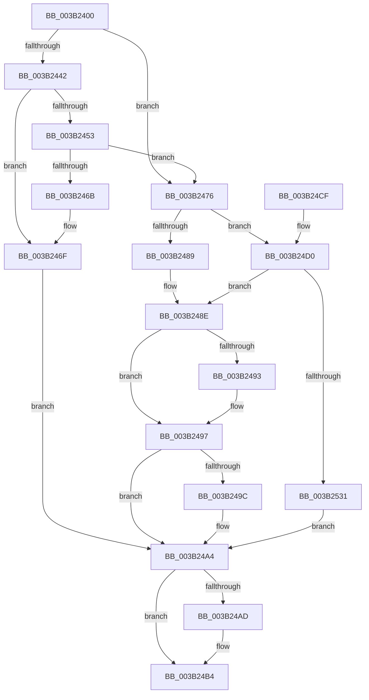

# SMKM_STORE_MGR&lt;SM_TRAITS&gt;::SmCompressCtxCreateThread

- RVA: `0x003B2400`–`0x003B254F` (길이 `335` bytes)
- VA: `0x00000001403B2400`
- 실행 섹션: `.text`
- PDB 이름 있음: `예`; PDB Function 태그: `아니요`
- unwind 정보 RVA: `0x0008C3D0`
- 디코드: `98`개 명령, `335/335` bytes 표시
- 미해석 바이트: `0` (있으면 어셈블리에 `.byte`로 보존)

> 이 문서는 커널 이미지의 기계어와 PDB 기호를 분석해 생성했습니다. 4번과 5번은 함수 원형과 자료형을 바이너리 사용 방식에서 추정한 C 해석이며 원본 소스 복구 결과는 아닙니다.

## 1. Dependencies

- 직접 호출 지점: **5**; 고유 호출 대상: **5**
- 직접 호출자로 확인된 함수: **2**
- RIP 상대 이미지 참조: **1**

### Outgoing calls
- `0x003B247C` → [SMKM_STORE_MGR<SM_TRAITS>::SmCompressCtxCreateThreadParams](SMKM_STORE_MGR_SM_TRAITS_SmCompressCtxCreateThreadParams_function_003B2A84.md) (function, `0x003B2A84`)
- `0x003B249F` → [SMKM_STORE_MGR<SM_TRAITS>::SmCompressCtxDeleteThreadParams](SMKM_STORE_MGR_SM_TRAITS_SmCompressCtxDeleteThreadParams_function_003B23D0.md) (function, `0x003B23D0`)
- `0x003B24AF` → [ObCloseHandle](../../page/8A/ObCloseHandle_function_008A1870.md) (function, `0x008A1870`)
- `0x003B2522` → [PsCreateSystemThreadEx](../../page/9E/PsCreateSystemThreadEx_function_009ED120.md) (function, `0x009ED120`)
- `0x003B2545` → [KeWaitForSingleObject](../20/KeWaitForSingleObject_function_0020E6B0.md) (function, `0x0020E6B0`)

### Direct callers
- [SMKM_STORE_MGR&lt;SM_TRAITS&gt;::SmCompressCtxBalancerThread](SMKM_STORE_MGR_SM_TRAITS_SmCompressCtxBalancerThread_function_003B22C0.md) at `0x003B2363`
- [SMKM_STORE_MGR&lt;SM_TRAITS&gt;::SmCompressCtxStart](../60/SMKM_STORE_MGR_SM_TRAITS_SmCompressCtxStart_function_0060C290.md) at `0x0060C2E2`
- [SMKM_STORE_MGR&lt;SM_TRAITS&gt;::SmCompressCtxStart](../60/SMKM_STORE_MGR_SM_TRAITS_SmCompressCtxStart_function_0060C290.md) at `0x0060C30E`

### Static image references
- `0x003B2445` → RVA `0x00267D20` (`SMKM_STORE_MGR<SM_TRAITS>::SmCompressCtxWorkerThread`; read)

## 2. Other-region calls and transfers

- 다른 실행 섹션으로 향하는 call: **2**
  - `0x003B24AF` → [ObCloseHandle](../../page/8A/ObCloseHandle_function_008A1870.md) (`.text` → `PAGE`)
  - `0x003B2522` → [PsCreateSystemThreadEx](../../page/9E/PsCreateSystemThreadEx_function_009ED120.md) (`.text` → `PAGE`)
- 별도 외부 분기/꼬리 이동을 확인하지 못했습니다.

## 3. Assembly (complete function range)

```asm
003B2400  48 89 5C 24 10                  mov qword ptr [rsp + 0x10], rbx
003B2405  48 89 74 24 18                  mov qword ptr [rsp + 0x18], rsi
003B240A  55                              push rbp
003B240B  57                              push rdi
003B240C  41 54                           push r12
003B240E  41 56                           push r14
003B2410  41 57                           push r15
003B2412  48 8B EC                        mov rbp, rsp
003B2415  48 83 EC 70                     sub rsp, 0x70
003B2419  48 8B 59 08                     mov rbx, qword ptr [rcx + 8]
003B241D  33 C0                           xor eax, eax
003B241F  48 21 45 30                     and qword ptr [rbp + 0x30], rax
003B2423  49 8B F9                        mov rdi, r9
003B2426  45 33 F6                        xor r14d, r14d
003B2429  48 89 45 F0                     mov qword ptr [rbp - 0x10], rax
003B242D  0F 57 C0                        xorps xmm0, xmm0
003B2430  4D 8B E0                        mov r12, r8
003B2433  4C 8B FA                        mov r15, rdx
003B2436  4C 8B C9                        mov r9, rcx
003B2439  0F 11 45 E0                     movups xmmword ptr [rbp - 0x20], xmm0
003B243D  48 85 FF                        test rdi, rdi
003B2440  75 34                           jne 0x1403b2476
003B2442  8B 4B 2C                        mov ecx, dword ptr [rbx + 0x2c]
003B2445  48 8D 3D D4 58 EB FF            lea rdi, [rip - 0x14a72c]
003B244C  8B 43 28                        mov eax, dword ptr [rbx + 0x28]
003B244F  3B C8                           cmp ecx, eax
003B2451  79 1C                           jns 0x1403b246f
003B2453  41 BE 01 00 00 00               mov r14d, 1
003B2459  41 8B CE                        mov ecx, r14d
003B245C  F0 0F C1 4B 2C                  lock xadd dword ptr [rbx + 0x2c], ecx
003B2461  8B 43 28                        mov eax, dword ptr [rbx + 0x28]
003B2464  41 03 CE                        add ecx, r14d
003B2467  3B C8                           cmp ecx, eax
003B2469  76 0B                           jbe 0x1403b2476
003B246B  F0 FF 4B 2C                     lock dec dword ptr [rbx + 0x2c]
003B246F  BF 29 01 00 C0                  mov edi, 0xc0000129
003B2474  EB 2E                           jmp 0x1403b24a4
003B2476  41 8B D6                        mov edx, r14d
003B2479  49 8B C9                        mov rcx, r9
003B247C  E8 03 06 00 00                  call 0x1403b2a84
003B2481  48 8B F0                        mov rsi, rax
003B2484  48 85 C0                        test rax, rax
003B2487  75 47                           jne 0x1403b24d0
003B2489  BF 9A 00 00 C0                  mov edi, 0xc000009a
003B248E  45 85 F6                        test r14d, r14d
003B2491  74 04                           je 0x1403b2497
003B2493  F0 FF 4B 2C                     lock dec dword ptr [rbx + 0x2c]
003B2497  48 85 F6                        test rsi, rsi
003B249A  74 08                           je 0x1403b24a4
003B249C  48 8B CE                        mov rcx, rsi
003B249F  E8 2C FF FF FF                  call 0x1403b23d0
003B24A4  48 8B 4D 30                     mov rcx, qword ptr [rbp + 0x30]
003B24A8  48 85 C9                        test rcx, rcx
003B24AB  74 07                           je 0x1403b24b4
003B24AD  33 D2                           xor edx, edx
003B24AF  E8 BC F3 4E 00                  call 0x1408a1870
003B24B4  4C 8D 5C 24 70                  lea r11, [rsp + 0x70]
003B24B9  8B C7                           mov eax, edi
003B24BB  49 8B 5B 38                     mov rbx, qword ptr [r11 + 0x38]
003B24BF  49 8B 73 40                     mov rsi, qword ptr [r11 + 0x40]
003B24C3  49 8B E3                        mov rsp, r11
003B24C6  41 5F                           pop r15
003B24C8  41 5E                           pop r14
003B24CA  41 5C                           pop r12
003B24CC  5F                              pop rdi
003B24CD  5D                              pop rbp
003B24CE  C3                              ret
003B24CF  CC                              int3
003B24D0  4C 89 78 08                     mov qword ptr [rax + 8], r15
003B24D4  48 8D 4D 30                     lea rcx, [rbp + 0x30]
003B24D8  83 65 E4 00                     and dword ptr [rbp - 0x1c], 0
003B24DC  48 8D 45 E8                     lea rax, [rbp - 0x18]
003B24E0  48 89 45 F0                     mov qword ptr [rbp - 0x10], rax
003B24E4  45 33 C0                        xor r8d, r8d
003B24E7  4C 89 64 24 40                  mov qword ptr [rsp + 0x40], r12
003B24EC  48 8D 45 E8                     lea rax, [rbp - 0x18]
003B24F0  48 83 64 24 38 00               and qword ptr [rsp + 0x38], 0
003B24F6  BA FF FF 1F 00                  mov edx, 0x1fffff
003B24FB  48 89 45 E8                     mov qword ptr [rbp - 0x18], rax
003B24FF  48 8D 45 E0                     lea rax, [rbp - 0x20]
003B2503  C6 45 E2 06                     mov byte ptr [rbp - 0x1e], 6
003B2507  48 89 46 10                     mov qword ptr [rsi + 0x10], rax
003B250B  4D 8B 8F E8 07 00 00            mov r9, qword ptr [r15 + 0x7e8]
003B2512  48 89 74 24 30                  mov qword ptr [rsp + 0x30], rsi
003B2517  48 89 7C 24 28                  mov qword ptr [rsp + 0x28], rdi
003B251C  48 83 64 24 20 00               and qword ptr [rsp + 0x20], 0
003B2522  E8 F9 AB 63 00                  call 0x1409ed120
003B2527  8B F8                           mov edi, eax
003B2529  85 C0                           test eax, eax
003B252B  0F 88 5D FF FF FF               js 0x1403b248e
003B2531  33 FF                           xor edi, edi
003B2533  48 8D 4D E0                     lea rcx, [rbp - 0x20]
003B2537  48 21 7C 24 20                  and qword ptr [rsp + 0x20], rdi
003B253C  45 33 C9                        xor r9d, r9d
003B253F  45 33 C0                        xor r8d, r8d
003B2542  8D 57 1A                        lea edx, [rdi + 0x1a]
003B2545  E8 66 C1 E5 FF                  call 0x14020e6b0
003B254A  E9 55 FF FF FF                  jmp 0x1403b24a4
```

## 4. C-style interpretation (structured pseudocode)

```c
__int64 __fastcall SMKM_STORE_MGR_SM_TRAITS___SmCompressCtxCreateThread(__int64 a1, __int64 a2, __int64 a3, __int64 a4)
{
    __int64 result;
    __int64 v_r14;
    __int64 v_rdi;
    __int64 v_rsp;
    unsigned __int64 v_stack_m28;
    unsigned __int64 v_stack_m30;
    unsigned __int64 v_stack_m38;
    unsigned __int64 v_stack_m40;
    unsigned int v_stack_m44;
    unsigned __int8 v_stack_m46;
    unsigned __int64 v_stack_m48;
    unsigned __int64 v_stack_m50;
    unsigned __int64 v_stack_p10;
    unsigned __int64 v_stack_p18;
    unsigned __int64 v_stack_p8;

    v_stack_p10 = v_rbx;
    v_stack_p18 = v_rsi;
    v_rsp = (v_rsp) - (112);
    result = 0;
    v_r14 = 0;
    v_stack_m38 = 0;
    v_stack_m48 = v_xmm0;
    if (a4 != 0) goto loc_003B2476;
    if (!sign_flag) goto loc_003B246F;
    a1 = (unsigned int)((1) + (1));
    if (((unsigned int)(a1)) <= ((unsigned int)((unsigned int)(*(unsigned int *)(*(unsigned __int64 *)(a1 + 8) + 40))))) goto loc_003B2476;
loc_003B246F:
    goto loc_003B24A4;
loc_003B2476:
    result = SMKM_STORE_MGR_SM_TRAITS___SmCompressCtxCreateThreadParams(a1, 1, a3, a1);
    if (result != 0) goto loc_003B24D0;
loc_003B248E:
    if (1 != 0) {
    }
    if (result != 0) {
        a1 = result;
        result = SMKM_STORE_MGR_SM_TRAITS___SmCompressCtxDeleteThreadParams(a1, 1, a3, a1);
    }
    if (v_stack_p8 != 0) {
        a2 = 0;
        result = ObCloseHandle(v_stack_p8, a2, a3, a1);
    }
    return (unsigned int)((unsigned int)((unsigned int)(0xC000009AULL)));
loc_003B24D0:
    *(unsigned __int64 *)((unsigned int)((unsigned int)((unsigned int)(0xC000009AULL))) + 8) = 0;
    v_stack_m38 = v_stack_m40;
    a3 = 0;
    v_stack_m30 = 0;
    v_stack_m40 = v_stack_m40;
    v_stack_m46 = 6;
    *(unsigned __int64 *)(*(unsigned __int64 *)(v_stack_m28 + 64) + 16) = v_stack_m48;
    v_stack_m40 = *(unsigned __int64 *)(v_stack_m28 + 64);
    v_stack_m48 = (unsigned int)(0xC000009AULL);
    result = PsCreateSystemThreadEx(v_stack_p8, (unsigned int)(0x1FFFFFULL), a3, *(unsigned __int64 *)(a2 + 2024));
    if (sign_flag) goto loc_003B248E;
    v_rdi = 0;
    a4 = 0;
    a3 = 0;
    result = KeWaitForSingleObject(v_stack_m48, v_rdi + 26, a3, a4);
    goto loc_003B24A4;
}
```

## 5. (Beta) C Style

```c
int64_t SMKM_STORE_MGR_SM_TRAITS___SmCompressCtxCreateThread(void *Arg1, void *Arg2, int64_t Arg3, int64_t Arg4)
{
    uint8_t *arg1 = (uint8_t *)Arg1;
    uint8_t *arg2 = (uint8_t *)Arg2;

    int64_t result;
    int64_t local_r14;
    int64_t local_rdi;
    int64_t local_rsp;
    uint64_t v_stack_m28;
    uint64_t v_stack_m30;
    uint64_t v_stack_m38;
    uint64_t v_stack_m40;
    uint32_t v_stack_m44;
    uint8_t v_stack_m46;
    uint64_t v_stack_m48;
    uint64_t v_stack_m50;
    uint64_t v_stack_p10;
    uint64_t v_stack_p18;
    uint64_t v_stack_p8;

    v_stack_p10 = local_rbx;
    v_stack_p18 = local_rsi;
    local_rsp = (local_rsp) - (112);
    result = 0;
    local_r14 = 0;
    v_stack_m38 = 0;
    v_stack_m48 = v_xmm0;
    if (Arg4 != 0) goto loc_003B2476;
    if (!sign_flag) goto loc_003B246F;
    Arg1 = (uint32_t)((1) + (1));
    if (((uint32_t)(Arg1)) <= ((uint32_t)((uint32_t)(*(uint32_t *)(*(uint64_t *)(arg1 + 0x8) + 0x28))))) goto loc_003B2476;
loc_003B246F:
    goto loc_003B24A4;
loc_003B2476:
    result = SMKM_STORE_MGR_SM_TRAITS___SmCompressCtxCreateThreadParams(Arg1, 1, Arg3, Arg1);
    if (result != 0) goto loc_003B24D0;
loc_003B248E:
    if (1 != 0) {
    }
    if (result != 0) {
        Arg1 = result;
        result = SMKM_STORE_MGR_SM_TRAITS___SmCompressCtxDeleteThreadParams(Arg1, 1, Arg3, Arg1);
    }
    if (v_stack_p8 != 0) {
        Arg2 = 0;
        result = ObCloseHandle(v_stack_p8, Arg2, Arg3, Arg1);
    }
    return (uint32_t)((uint32_t)((uint32_t)(0xC000009AULL)));
loc_003B24D0:
    *(uint64_t *)((uint32_t)((uint32_t)((uint32_t)(0xC000009AULL))) + 0x8) = 0;
    v_stack_m38 = v_stack_m40;
    Arg3 = 0;
    v_stack_m30 = 0;
    v_stack_m40 = v_stack_m40;
    v_stack_m46 = 6;
    *(uint64_t *)(*(uint64_t *)(v_stack_m28 + 0x40) + 0x10) = v_stack_m48;
    v_stack_m40 = *(uint64_t *)(v_stack_m28 + 0x40);
    v_stack_m48 = (uint32_t)(0xC000009AULL);
    result = PsCreateSystemThreadEx(v_stack_p8, (uint32_t)(0x1FFFFFULL), Arg3, *(uint64_t *)(arg2 + 0x7E8));
    if (sign_flag) goto loc_003B248E;
    local_rdi = 0;
    Arg4 = 0;
    Arg3 = 0;
    result = KeWaitForSingleObject(v_stack_m48, local_rdi + 26, Arg3, Arg4);
    goto loc_003B24A4;
}
```

### 관측된 메모리 오프셋

구조체 형식이 확인되지 않은 접근은 인자 기준의 오프셋으로만 기록했습니다.

| 기준 인자 | 오프셋 표현 | 폭 (bit) | 접근 |
|---|---:|---:|---|
| `Arg1` | `+ 0x8` | `64` | `R` |
| `Arg2` | `+ 0x7E8` | `64` | `R` |

## 6. Execution-region graph

[열기: 2D/3D 그래프와 함수 탐색 컨트롤 패널](../../../control-panel.html?section=text&rva=0x003B2400&view=graph)

- 2D 그래프는 위에서 아래로 흐르고, 3D 그래프는 빈 공간을 드래그해 회전합니다. Shift+드래그는 이동, 휠은 확대·축소, 함수 노드 선택은 대상 보고서 이동입니다.

### Static fallback


