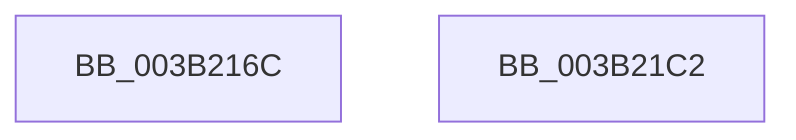

# SMKM_STORE_MGR&lt;SM_TRAITS&gt;::SmCompressCtxUpdateThreadTopology

- RVA: `0x003B216C`–`0x003B21C3` (길이 `87` bytes)
- VA: `0x00000001403B216C`
- 실행 섹션: `.text`
- PDB 이름 있음: `예`; PDB Function 태그: `아니요`
- unwind 정보 RVA: `0x00060BC4`
- 디코드: `24`개 명령, `87/87` bytes 표시
- 미해석 바이트: `0` (있으면 어셈블리에 `.byte`로 보존)

> 이 문서는 커널 이미지의 기계어와 PDB 기호를 분석해 생성했습니다. 4번과 5번은 함수 원형과 자료형을 바이너리 사용 방식에서 추정한 C 해석이며 원본 소스 복구 결과는 아닙니다.

## 1. Dependencies

- 직접 호출 지점: **3**; 고유 호출 대상: **3**
- 직접 호출자로 확인된 함수: **1**
- RIP 상대 이미지 참조: **0**

### Outgoing calls
- `0x003B218C` → [KeSetUserAffinityThread](../2C/KeSetUserAffinityThread_function_002CFA2C.md) (function, `0x002CFA2C`)
- `0x003B21A0` → [SMKM_STORE_MGR<SM_TRAITS>::SmCompressManagerGetIdealProcessor](SMKM_STORE_MGR_SM_TRAITS_SmCompressManagerGetIdealProcessor_function_003B21CC.md) (function, `0x003B21CC`)
- `0x003B21AD` → [KeSetIdealProcessorThreadEx](../2D/KeSetIdealProcessorThreadEx_function_002DD36C.md) (function, `0x002DD36C`)

### Direct callers
- [SMKM_STORE_MGR&lt;SM_TRAITS&gt;::SmCompressCtxWorkerThread](../26/SMKM_STORE_MGR_SM_TRAITS_SmCompressCtxWorkerThread_function_00267D20.md) at `0x00267E0C`

### Static image references
- 디코드된 RIP-relative 메모리 참조가 없습니다.

## 2. Other-region calls and transfers

- 다른 실행 섹션으로 향하는 call: **0**
- 별도 외부 분기/꼬리 이동을 확인하지 못했습니다.

## 3. Assembly (complete function range)

```asm
003B216C  48 89 5C 24 08                  mov qword ptr [rsp + 8], rbx
003B2171  48 89 74 24 10                  mov qword ptr [rsp + 0x10], rsi
003B2176  57                              push rdi
003B2177  48 83 EC 20                     sub rsp, 0x20
003B217B  48 8B 59 08                     mov rbx, qword ptr [rcx + 8]
003B217F  48 8B F2                        mov rsi, rdx
003B2182  48 8B F9                        mov rdi, rcx
003B2185  48 8B CE                        mov rcx, rsi
003B2188  48 8D 53 30                     lea rdx, [rbx + 0x30]
003B218C  E8 9B D8 F1 FF                  call 0x1402cfa2c
003B2191  8B 97 A8 00 00 00               mov edx, dword ptr [rdi + 0xa8]
003B2197  41 B8 01 00 00 00               mov r8d, 1
003B219D  48 8B CB                        mov rcx, rbx
003B21A0  E8 27 00 00 00                  call 0x1403b21cc
003B21A5  45 33 C0                        xor r8d, r8d
003B21A8  8B D0                           mov edx, eax
003B21AA  48 8B CE                        mov rcx, rsi
003B21AD  E8 BA B1 F2 FF                  call 0x1402dd36c
003B21B2  48 8B 5C 24 30                  mov rbx, qword ptr [rsp + 0x30]
003B21B7  48 8B 74 24 38                  mov rsi, qword ptr [rsp + 0x38]
003B21BC  48 83 C4 20                     add rsp, 0x20
003B21C0  5F                              pop rdi
003B21C1  C3                              ret
003B21C2  CC                              int3
```

## 4. C-style interpretation (structured pseudocode)

```c
__int64 __fastcall SMKM_STORE_MGR_SM_TRAITS___SmCompressCtxUpdateThreadTopology(__int64 a1, __int64 a2)
{
    __int64 result;
    __int64 v_rsp;
    unsigned __int64 v_stack_p10;
    unsigned __int64 v_stack_p8;

    v_stack_p8 = v_rbx;
    v_stack_p10 = v_rsi;
    v_rsp = (v_rsp) - (32);
    result = KeSetUserAffinityThread(a2, *(unsigned __int64 *)(a1 + 8) + 48, a3, a4);
    result = SMKM_STORE_MGR_SM_TRAITS___SmCompressManagerGetIdealProcessor(*(unsigned __int64 *)(a1 + 8), (unsigned int)(*(unsigned int *)(a1 + 168)), 1, a4);
    a3 = 0;
    result = KeSetIdealProcessorThreadEx(a2, (unsigned int)((unsigned int)(result)), a3, a4);
    v_rsp = (v_rsp) + (32);
    return result;
}
```

## 5. (Beta) C Style

```c
int64_t SMKM_STORE_MGR_SM_TRAITS___SmCompressCtxUpdateThreadTopology(void *Arg1, int64_t Arg2)
{
    uint8_t *arg1 = (uint8_t *)Arg1;

    int64_t result;
    int64_t local_rsp;
    uint64_t v_stack_p10;
    uint64_t v_stack_p8;

    v_stack_p8 = local_rbx;
    v_stack_p10 = local_rsi;
    local_rsp = (local_rsp) - (32);
    result = KeSetUserAffinityThread(Arg2, *(uint64_t *)(arg1 + 0x8) + 48, a3, a4);
    result = SMKM_STORE_MGR_SM_TRAITS___SmCompressManagerGetIdealProcessor(*(uint64_t *)(arg1 + 0x8), (uint32_t)(*(uint32_t *)(arg1 + 0xA8)), 1, a4);
    a3 = 0;
    result = KeSetIdealProcessorThreadEx(Arg2, (uint32_t)((uint32_t)(result)), a3, a4);
    local_rsp = (local_rsp) + (32);
    return result;
}
```

### 관측된 메모리 오프셋

구조체 형식이 확인되지 않은 접근은 인자 기준의 오프셋으로만 기록했습니다.

| 기준 인자 | 오프셋 표현 | 폭 (bit) | 접근 |
|---|---:|---:|---|
| `Arg1` | `+ 0x8` | `64` | `R` |
| `Arg1` | `+ 0xA8` | `32` | `R` |

## 6. Execution-region graph

[열기: 2D/3D 그래프와 함수 탐색 컨트롤 패널](../../../control-panel.html?section=text&rva=0x003B216C&view=graph)

- 2D 그래프는 위에서 아래로 흐르고, 3D 그래프는 빈 공간을 드래그해 회전합니다. Shift+드래그는 이동, 휠은 확대·축소, 함수 노드 선택은 대상 보고서 이동입니다.

### Static fallback


