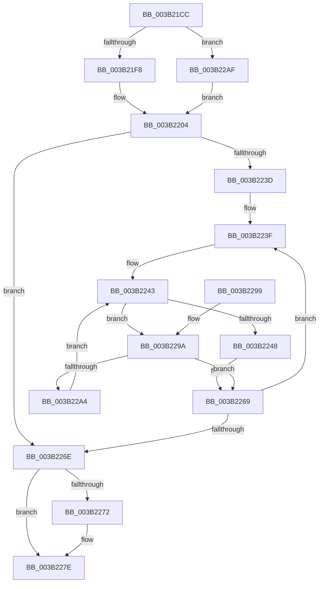

# SMKM_STORE_MGR&lt;SM_TRAITS&gt;::SmCompressManagerGetIdealProcessor

- RVA: `0x003B21CC`–`0x003B22B7` (길이 `235` bytes)
- VA: `0x00000001403B21CC`
- 실행 섹션: `.text`
- PDB 이름 있음: `예`; PDB Function 태그: `아니요`
- unwind 정보 RVA: `0x0008C39C`
- 디코드: `67`개 명령, `235/235` bytes 표시
- 미해석 바이트: `0` (있으면 어셈블리에 `.byte`로 보존)

> 이 문서는 커널 이미지의 기계어와 PDB 기호를 분석해 생성했습니다. 4번과 5번은 함수 원형과 자료형을 바이너리 사용 방식에서 추정한 C 해석이며 원본 소스 복구 결과는 아닙니다.

## 1. Dependencies

- 직접 호출 지점: **2**; 고유 호출 대상: **2**
- 직접 호출자로 확인된 함수: **4**
- RIP 상대 이미지 참조: **1**

### Outgoing calls
- `0x003B21FC` → [ExAcquireSpinLockShared](../24/ExAcquireSpinLockShared_function_0024DCE0.md) (function, `0x0024DCE0`)
- `0x003B2279` → [ExReleaseSpinLockShared](../2F/ExReleaseSpinLockShared_function_002F0EF0.md) (function, `0x002F0EF0`)

### Direct callers
- [SmGetIdealProcessorFromNumaNode](SmGetIdealProcessorFromNumaNode_function_003B214C.md) at `0x003B215A`
- [SMKM_STORE_MGR&lt;SM_TRAITS&gt;::SmCompressCtxUpdateThreadTopology](SMKM_STORE_MGR_SM_TRAITS_SmCompressCtxUpdateThreadTopology_function_003B216C.md) at `0x003B21A0`
- [SMKM_STORE_MGR&lt;SM_TRAITS&gt;::SmCompressCtxBalancerThread](SMKM_STORE_MGR_SM_TRAITS_SmCompressCtxBalancerThread_function_003B22C0.md) at `0x003B2340`
- [SMKM_STORE_MGR&lt;SM_TRAITS&gt;::SmCompressCtxStart](../60/SMKM_STORE_MGR_SM_TRAITS_SmCompressCtxStart_function_0060C290.md) at `0x0060C2F7`

### Static image references
- `0x003B225F` → RVA `0x00F231B8` (`.data`; read)

## 2. Other-region calls and transfers

- 다른 실행 섹션으로 향하는 call: **0**
- 별도 외부 분기/꼬리 이동을 확인하지 못했습니다.

## 3. Assembly (complete function range)

```asm
003B21CC  48 89 5C 24 08                  mov qword ptr [rsp + 8], rbx
003B21D1  48 89 6C 24 18                  mov qword ptr [rsp + 0x18], rbp
003B21D6  48 89 74 24 20                  mov qword ptr [rsp + 0x20], rsi
003B21DB  57                              push rdi
003B21DC  41 56                           push r14
003B21DE  41 57                           push r15
003B21E0  48 83 EC 20                     sub rsp, 0x20
003B21E4  45 33 F6                        xor r14d, r14d
003B21E7  8B F2                           mov esi, edx
003B21E9  41 8B F8                        mov edi, r8d
003B21EC  48 8B D9                        mov rbx, rcx
003B21EF  45 85 C0                        test r8d, r8d
003B21F2  0F 85 B7 00 00 00               jne 0x1403b22af
003B21F8  48 83 C1 08                     add rcx, 8
003B21FC  E8 DF BA E9 FF                  call 0x14024dce0
003B2201  44 8A D8                        mov r11b, al
003B2204  4C 69 D6 10 01 00 00            imul r10, rsi, 0x110
003B220B  41 BF 01 00 00 00               mov r15d, 1
003B2211  4C 03 53 18                     add r10, qword ptr [rbx + 0x18]
003B2215  41 8B C7                        mov eax, r15d
003B2218  F0 41 0F C1 82 0C 01 00 00      lock xadd dword ptr [r10 + 0x10c], eax
003B2221  4D 8B 4A 08                     mov r9, qword ptr [r10 + 8]
003B2225  41 03 C7                        add eax, r15d
003B2228  33 D2                           xor edx, edx
003B222A  41 8B EE                        mov ebp, r14d
003B222D  41 F7 B2 08 01 00 00            div dword ptr [r10 + 0x108]
003B2234  45 0F B7 C6                     movzx r8d, r14w
003B2238  41 03 D7                        add edx, r15d
003B223B  74 31                           je 0x1403b226e
003B223D  8B F2                           mov esi, edx
003B223F  41 0F B7 0A                     movzx ecx, word ptr [r10]
003B2243  4D 85 C9                        test r9, r9
003B2246  74 52                           je 0x1403b229a
003B2248  49 0F BC D1                     bsf rdx, r9
003B224C  41 0F B7 C8                     movzx ecx, r8w
003B2250  0F B6 C2                        movzx eax, dl
003B2253  49 0F B3 C1                     btr r9, rax
003B2257  C1 E1 06                        shl ecx, 6
003B225A  0F B6 C2                        movzx eax, dl
003B225D  03 C8                           add ecx, eax
003B225F  48 8B 05 52 0F B7 00            mov rax, qword ptr [rip + 0xb70f52]
003B2266  8B 2C 88                        mov ebp, dword ptr [rax + rcx*4]
003B2269  49 2B F7                        sub rsi, r15
003B226C  75 D1                           jne 0x1403b223f
003B226E  85 FF                           test edi, edi
003B2270  75 0C                           jne 0x1403b227e
003B2272  48 8D 4B 08                     lea rcx, [rbx + 8]
003B2276  41 8A D3                        mov dl, r11b
003B2279  E8 72 EC F3 FF                  call 0x1402f0ef0
003B227E  48 8B 5C 24 40                  mov rbx, qword ptr [rsp + 0x40]
003B2283  8B C5                           mov eax, ebp
003B2285  48 8B 6C 24 50                  mov rbp, qword ptr [rsp + 0x50]
003B228A  48 8B 74 24 58                  mov rsi, qword ptr [rsp + 0x58]
003B228F  48 83 C4 20                     add rsp, 0x20
003B2293  41 5F                           pop r15
003B2295  41 5E                           pop r14
003B2297  5F                              pop rdi
003B2298  C3                              ret
003B2299  CC                              int3
003B229A  66 45 03 C7                     add r8w, r15w
003B229E  66 44 3B C1                     cmp r8w, cx
003B22A2  73 C5                           jae 0x1403b2269
003B22A4  41 0F B7 C0                     movzx eax, r8w
003B22A8  4D 8B 4C C2 08                  mov r9, qword ptr [r10 + rax*8 + 8]
003B22AD  EB 94                           jmp 0x1403b2243
003B22AF  45 8A DE                        mov r11b, r14b
003B22B2  E9 4D FF FF FF                  jmp 0x1403b2204
```

## 4. C-style interpretation (structured pseudocode)

```c
__int64 __fastcall SMKM_STORE_MGR_SM_TRAITS___SmCompressManagerGetIdealProcessor(__int64 a1, int a2, int a3)
{
    __int64 result;
    __int64 v_r10;
    __int64 v_r14;
    __int64 v_rsi;
    __int64 v_rsp;
    unsigned __int64 v_stack_p18;
    unsigned __int64 v_stack_p20;
    unsigned __int64 v_stack_p8;

    v_stack_p8 = v_rbx;
    v_stack_p18 = v_rbp;
    v_stack_p20 = v_rsi;
    v_rsp = (v_rsp) - (32);
    v_r14 = 0;
    if (a3 != 0) goto loc_003B22AF;
    a1 = (a1) + (8);
    result = ExAcquireSpinLockShared(a1, a2, a3, a4);
loc_003B2204:
    v_r10 = (v_r10) * ((unsigned int)(a2));
    v_r10 = (v_r10) + (*(unsigned __int64 *)(a1 + 24));
    result = (unsigned int)((1) + (1));
    a2 = 0;
    a2 = (unsigned int)((a2) + (1));
    if (condition_is_equal) goto loc_003B226E;
loc_003B223F:
loc_003B2243:
    if (*(unsigned __int64 *)(v_r10 + 8) == 0) goto loc_003B229A;
    a1 = (unsigned int)((0) << (6));
    a1 = (unsigned int)((a1) + ((unsigned int)((unsigned __int8)(a2))));
loc_003B2269:
    v_rsi = ((unsigned int)(a2)) - (1);
    if (condition_is_not_equal) goto loc_003B223F;
loc_003B226E:
    result = *(unsigned __int64 *)(v_rip + 11997010);
    if ((unsigned int)((unsigned int)(a3)) == 0) {
        a1 = a1 + 8;
        a2 = (unsigned __int8)((unsigned __int8)(result));
        result = ExReleaseSpinLockShared(a1, a2, 0, *(unsigned __int64 *)(v_r10 + 8));
    }
    v_rsp = (v_rsp) + (32);
    return (unsigned int)((unsigned int)((unsigned int)(*(unsigned int *)(*(unsigned __int64 *)(v_rip + 11997010) + a1 * 4))));
loc_003B229A:
    a3 = (unsigned __int16)((0) + (1));
    if (((unsigned __int16)(a3)) >= ((unsigned __int16)(a1))) goto loc_003B2269;
    goto loc_003B2243;
loc_003B22AF:
    goto loc_003B2204;
}
```

## 5. (Beta) C Style

```c
int64_t SMKM_STORE_MGR_SM_TRAITS___SmCompressManagerGetIdealProcessor(void *Arg1, int32_t Arg2, int32_t Arg3)
{
    uint8_t *arg1 = (uint8_t *)Arg1;

    int64_t result;
    int64_t local_r10;
    int64_t local_r14;
    int64_t local_rsi;
    int64_t local_rsp;
    uint64_t v_stack_p18;
    uint64_t v_stack_p20;
    uint64_t v_stack_p8;

    v_stack_p8 = local_rbx;
    v_stack_p18 = local_rbp;
    v_stack_p20 = local_rsi;
    local_rsp = (local_rsp) - (32);
    local_r14 = 0;
    if (Arg3 != 0) goto loc_003B22AF;
    Arg1 = (Arg1) + (8);
    result = ExAcquireSpinLockShared(Arg1, Arg2, Arg3, a4);
loc_003B2204:
    local_r10 = (local_r10) * ((uint32_t)(Arg2));
    local_r10 = (local_r10) + (*(uint64_t *)(arg1 + 0x18));
    result = (uint32_t)((1) + (1));
    Arg2 = 0;
    Arg2 = (uint32_t)((Arg2) + (1));
    if (condition_is_equal) goto loc_003B226E;
loc_003B223F:
loc_003B2243:
    if (*(uint64_t *)(local_r10 + 0x8) == 0) goto loc_003B229A;
    Arg1 = (uint32_t)((0) << (6));
    Arg1 = (uint32_t)((Arg1) + ((uint32_t)((uint8_t)(Arg2))));
loc_003B2269:
    local_rsi = ((uint32_t)(Arg2)) - (1);
    if (condition_is_not_equal) goto loc_003B223F;
loc_003B226E:
    result = *(uint64_t *)(v_rip + 0xB70F52);
    if ((uint32_t)((uint32_t)(Arg3)) == 0) {
        Arg1 = Arg1 + 8;
        Arg2 = (uint8_t)((uint8_t)(result));
        result = ExReleaseSpinLockShared(Arg1, Arg2, 0, *(uint64_t *)(local_r10 + 0x8));
    }
    local_rsp = (local_rsp) + (32);
    return (uint32_t)((uint32_t)((uint32_t)(*(uint32_t *)(*(uint64_t *)(v_rip + 0xB70F52) + arg1 * 4))));
loc_003B229A:
    Arg3 = (uint16_t)((0) + (1));
    if (((uint16_t)(Arg3)) >= ((uint16_t)(Arg1))) goto loc_003B2269;
    goto loc_003B2243;
loc_003B22AF:
    goto loc_003B2204;
}
```

### 관측된 메모리 오프셋

구조체 형식이 확인되지 않은 접근은 인자 기준의 오프셋으로만 기록했습니다.

| 기준 인자 | 오프셋 표현 | 폭 (bit) | 접근 |
|---|---:|---:|---|
| `Arg1` | `+ 0x8` | `64` | `R` |
| `Arg1` | `+ 0x18` | `64` | `R` |

## 6. Execution-region graph

[열기: 2D/3D 그래프와 함수 탐색 컨트롤 패널](../../../control-panel.html?section=text&rva=0x003B21CC&view=graph)

- 2D 그래프는 위에서 아래로 흐르고, 3D 그래프는 빈 공간을 드래그해 회전합니다. Shift+드래그는 이동, 휠은 확대·축소, 함수 노드 선택은 대상 보고서 이동입니다.

### Static fallback


