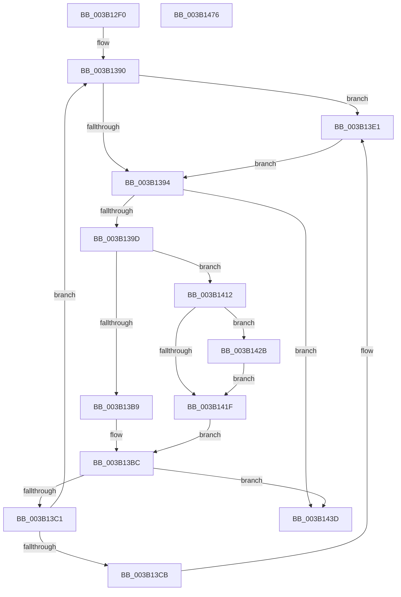

# SMKM_STORE_MGR&lt;SM_TRAITS&gt;::SmFeStoreDelete

- RVA: `0x003B12F0`–`0x003B1477` (길이 `391` bytes)
- VA: `0x00000001403B12F0`
- 실행 섹션: `.text`
- PDB 이름 있음: `예`; PDB Function 태그: `아니요`
- unwind 정보 RVA: `0x0008C2DC`
- 디코드: `99`개 명령, `391/391` bytes 표시
- 미해석 바이트: `0` (있으면 어셈블리에 `.byte`로 보존)

> 이 문서는 커널 이미지의 기계어와 PDB 기호를 분석해 생성했습니다. 4번과 5번은 함수 원형과 자료형을 바이너리 사용 방식에서 추정한 C 해석이며 원본 소스 복구 결과는 아닙니다.

## 1. Dependencies

- 직접 호출 지점: **7**; 고유 호출 대상: **7**
- 직접 호출자로 확인된 함수: **1**
- RIP 상대 이미지 참조: **1**

### Outgoing calls
- `0x003B132F` → [memset](../6C/memset_function_006C6C40.md) (function, `0x006C6C40`)
- `0x003B1373` → [StLockAcquireExclusive](../26/StLockAcquireExclusive_function_00266FF0.md) (function, `0x00266FF0`)
- `0x003B13DC` → [SMKM_STORE_MGR<SM_TRAITS>::SmFeDeleteEntry](../26/SMKM_STORE_MGR_SM_TRAITS_SmFeDeleteEntry_function_00266B70.md) (function, `0x00266B70`)
- `0x003B13EF` → [B_TREE<_SM_PAGE_KEY,SMKM_STORE_MGR<SM_TRAITS>::SMKM_FRONTEND_ENTRY,4096,B_TREE_DUMMY_NODE_POOL,B_TREE_KEY_COMPARATOR<_SM_PAGE_KEY> >::BTreeSearchKey](../26/B_TREE__SM_PAGE_KEY_SMKM_STORE_MGR_SM_TRAITS_SMKM_FRONTEND_ENTRY_4096_B_TREE_DUMMY_NODE_POOL_B_TREE__function_00266E10.md) (function, `0x00266E10`)
- `0x003B13FE` → [B_TREE<_SM_PAGE_KEY,SMKM_STORE_MGR<SM_TRAITS>::SMKM_FRONTEND_ENTRY,4096,B_TREE_DUMMY_NODE_POOL,B_TREE_KEY_COMPARATOR<_SM_PAGE_KEY> >::BTreeIteratorFromSearchResult](../2E/B_TREE__SM_PAGE_KEY_SMKM_STORE_MGR_SM_TRAITS_SMKM_FRONTEND_ENTRY_4096_B_TREE_DUMMY_NODE_POOL_B_TREE__function_002E07E0.md) (function, `0x002E07E0`)
- `0x003B1444` → [StLockReleaseExclusive](../26/StLockReleaseExclusive_function_00267050.md) (function, `0x00267050`)
- `0x003B1454` → [_security_check_cookie](../6A/_security_check_cookie_function_006AC640.md) (function, `0x006AC640`)

### Direct callers
- [SMKM_STORE_MGR&lt;SM_TRAITS&gt;::SmStoreMgrCallback](SMKM_STORE_MGR_SM_TRAITS_SmStoreMgrCallback_function_003B0040.md) at `0x003B00C9`

### Static image references
- `0x003B130B` → RVA `0x00E0A740` (`.data`; read)

## 2. Other-region calls and transfers

- 다른 실행 섹션으로 향하는 call: **0**
- 별도 외부 분기/꼬리 이동을 확인하지 못했습니다.

## 3. Assembly (complete function range)

```asm
003B12F0  48 89 5C 24 10                  mov qword ptr [rsp + 0x10], rbx
003B12F5  48 89 6C 24 18                  mov qword ptr [rsp + 0x18], rbp
003B12FA  48 89 74 24 20                  mov qword ptr [rsp + 0x20], rsi
003B12FF  57                              push rdi
003B1300  41 56                           push r14
003B1302  41 57                           push r15
003B1304  48 81 EC F0 00 00 00            sub rsp, 0xf0
003B130B  48 8B 05 2E 94 A5 00            mov rax, qword ptr [rip + 0xa5942e]
003B1312  48 33 C4                        xor rax, rsp
003B1315  48 89 84 24 E0 00 00 00         mov qword ptr [rsp + 0xe0], rax
003B131D  8B F2                           mov esi, edx
003B131F  48 8B E9                        mov rbp, rcx
003B1322  33 D2                           xor edx, edx
003B1324  48 8D 4C 24 58                  lea rcx, [rsp + 0x58]
003B1329  41 B8 80 00 00 00               mov r8d, 0x80
003B132F  E8 0C 59 31 00                  call 0x1406c6c40
003B1334  45 33 FF                        xor r15d, r15d
003B1337  C7 44 24 4C 08 00 00 00         mov dword ptr [rsp + 0x4c], 8
003B133F  48 8D 44 24 58                  lea rax, [rsp + 0x58]
003B1344  4C 89 7C 24 38                  mov qword ptr [rsp + 0x38], r15
003B1349  0F 57 C0                        xorps xmm0, xmm0
003B134C  4C 89 7C 24 40                  mov qword ptr [rsp + 0x40], r15
003B1351  48 8D 8D B8 01 00 00            lea rcx, [rbp + 0x1b8]
003B1358  4C 89 7C 24 50                  mov qword ptr [rsp + 0x50], r15
003B135D  41 8D 7F 01                     lea edi, [r15 + 1]
003B1361  48 89 44 24 30                  mov qword ptr [rsp + 0x30], rax
003B1366  44 89 7C 24 48                  mov dword ptr [rsp + 0x48], r15d
003B136B  41 8B DF                        mov ebx, r15d
003B136E  0F 11 44 24 20                  movups xmmword ptr [rsp + 0x20], xmm0
003B1373  E8 78 5C EB FF                  call 0x140266ff0
003B1378  0F 57 C0                        xorps xmm0, xmm0
003B137B  0F 57 C9                        xorps xmm1, xmm1
003B137E  66 0F 73 D8 08                  psrldq xmm0, 8
003B1383  66 49 0F 7E C8                  movq r8, xmm1
003B1388  66 48 0F 7E C2                  movq rdx, xmm0
003B138D  0F 1F 00                        nop dword ptr [rax]
003B1390  85 FF                           test edi, edi
003B1392  75 4D                           jne 0x1403b13e1
003B1394  4D 85 C0                        test r8, r8
003B1397  0F 84 A0 00 00 00               je 0x1403b143d
003B139D  41 8B 00                        mov eax, dword ptr [r8]
003B13A0  48 83 C2 08                     add rdx, 8
003B13A4  0F B7 C0                        movzx eax, ax
003B13A7  48 83 C0 02                     add rax, 2
003B13AB  48 89 54 24 28                  mov qword ptr [rsp + 0x28], rdx
003B13B0  49 8D 04 C0                     lea rax, [r8 + rax*8]
003B13B4  48 3B D0                        cmp rdx, rax
003B13B7  73 59                           jae 0x1403b1412
003B13B9  48 8B C2                        mov rax, rdx
003B13BC  48 85 C0                        test rax, rax
003B13BF  74 7C                           je 0x1403b143d
003B13C1  0F B7 48 04                     movzx ecx, word ptr [rax + 4]
003B13C5  8B 18                           mov ebx, dword ptr [rax]
003B13C7  3B CE                           cmp ecx, esi
003B13C9  75 C5                           jne 0x1403b1390
003B13CB  4C 8D 44 24 20                  lea r8, [rsp + 0x20]
003B13D0  44 88 78 06                     mov byte ptr [rax + 6], r15b
003B13D4  48 8D 54 24 30                  lea rdx, [rsp + 0x30]
003B13D9  48 8B CD                        mov rcx, rbp
003B13DC  E8 8F 57 EB FF                  call 0x140266b70
003B13E1  48 8D 8D C0 01 00 00            lea rcx, [rbp + 0x1c0]
003B13E8  8B D3                           mov edx, ebx
003B13EA  4C 8D 44 24 30                  lea r8, [rsp + 0x30]
003B13EF  E8 1C 5A EB FF                  call 0x140266e10
003B13F4  4C 8D 44 24 30                  lea r8, [rsp + 0x30]
003B13F9  48 8D 54 24 20                  lea rdx, [rsp + 0x20]
003B13FE  E8 DD F3 F2 FF                  call 0x1402e07e0
003B1403  48 8B 54 24 28                  mov rdx, qword ptr [rsp + 0x28]
003B1408  41 8B FF                        mov edi, r15d
003B140B  4C 8B 44 24 20                  mov r8, qword ptr [rsp + 0x20]
003B1410  EB 82                           jmp 0x1403b1394
003B1412  49 8B 48 08                     mov rcx, qword ptr [r8 + 8]
003B1416  4C 8D 49 10                     lea r9, [rcx + 0x10]
003B141A  48 85 C9                        test rcx, rcx
003B141D  75 0C                           jne 0x1403b142b
003B141F  48 85 C9                        test rcx, rcx
003B1422  49 8B C7                        mov rax, r15
003B1425  49 0F 45 C1                     cmovne rax, r9
003B1429  EB 91                           jmp 0x1403b13bc
003B142B  49 8B D1                        mov rdx, r9
003B142E  48 89 4C 24 20                  mov qword ptr [rsp + 0x20], rcx
003B1433  48 89 54 24 28                  mov qword ptr [rsp + 0x28], rdx
003B1438  4C 8B C1                        mov r8, rcx
003B143B  EB E2                           jmp 0x1403b141f
003B143D  48 8D 8D B8 01 00 00            lea rcx, [rbp + 0x1b8]
003B1444  E8 07 5C EB FF                  call 0x140267050
003B1449  48 8B 8C 24 E0 00 00 00         mov rcx, qword ptr [rsp + 0xe0]
003B1451  48 33 CC                        xor rcx, rsp
003B1454  E8 E7 B1 2F 00                  call 0x1406ac640
003B1459  4C 8D 9C 24 F0 00 00 00         lea r11, [rsp + 0xf0]
003B1461  49 8B 5B 28                     mov rbx, qword ptr [r11 + 0x28]
003B1465  49 8B 6B 30                     mov rbp, qword ptr [r11 + 0x30]
003B1469  49 8B 73 38                     mov rsi, qword ptr [r11 + 0x38]
003B146D  49 8B E3                        mov rsp, r11
003B1470  41 5F                           pop r15
003B1472  41 5E                           pop r14
003B1474  5F                              pop rdi
003B1475  C3                              ret
003B1476  CC                              int3
```

## 4. C-style interpretation (structured pseudocode)

```c
__int64 __fastcall SMKM_STORE_MGR_SM_TRAITS___SmFeStoreDelete(__int64 a1, int a2)
{
    __int64 result;
    __int64 v_r15;
    __int64 v_rsp;
    unsigned __int64 v_stack_m18;
    unsigned __int64 v_stack_m28;
    unsigned __int64 v_stack_mB0;
    unsigned __int64 v_stack_mB8;
    unsigned int v_stack_mBC;
    unsigned int v_stack_mC0;
    unsigned __int64 v_stack_mC8;
    unsigned __int64 v_stack_mD0;
    unsigned __int64 v_stack_mD8;
    unsigned __int64 v_stack_mE0;
    unsigned __int64 v_stack_mE8;
    unsigned __int64 v_stack_p10;
    unsigned __int64 v_stack_p18;
    unsigned __int64 v_stack_p20;

    v_stack_p10 = v_rbx;
    v_stack_p18 = v_rbp;
    v_stack_p20 = v_rsi;
    v_rsp = (v_rsp) - (240);
    result = (*(unsigned __int64 *)(v_rip + 10851374)) ^ (v_rsp);
    v_stack_m28 = result;
    a2 = 0;
    result = memset(v_stack_mB0, a2, 128, a4);
    v_r15 = 0;
    v_stack_mBC = 8;
    v_stack_mD0 = 0;
    v_stack_mC8 = 0;
    v_stack_mB8 = 0;
    v_stack_mD8 = v_stack_mB0;
    v_stack_mC0 = 0;
    v_stack_mE8 = v_xmm0;
    result = StLockAcquireExclusive(a1 + 440, a2, 128, a4);
loc_003B1390:
    if ((unsigned int)(v_r15 + 1) != 0) goto loc_003B13E1;
loc_003B1394:
    if (128 == 0) goto loc_003B143D;
    a2 = (a2) + (8);
    result = ((unsigned __int16)((unsigned int)(*(unsigned int *)(128)))) + (2);
    v_stack_mE0 = a2;
    if (a2 >= (128 + result * 8)) goto loc_003B1412;
loc_003B13BC:
    if (a2 == 0) goto loc_003B143D;
    if (((unsigned int)(*(unsigned __int16 *)(a2 + 4))) != ((unsigned int)((unsigned int)(a2)))) goto loc_003B1390;
    *(unsigned __int8 *)(a2 + 6) = 0;
    result = SMKM_STORE_MGR_SM_TRAITS___SmFeDeleteEntry(a1, v_stack_mD8, v_stack_mE8, a4);
loc_003B13E1:
    result = B_TREE__SM_PAGE_KEY_SMKM_STORE_MGR_SM_TRAITS___SMKM_FRONTEND_ENTRY_4096_B_TREE_DUMMY_NODE_POOL_B_TRE(a1 + 448, (unsigned int)((unsigned int)((unsigned int)(*(unsigned int *)(a2)))), v_stack_mD8, a4);
    result = B_TREE__SM_PAGE_KEY_SMKM_STORE_MGR_SM_TRAITS___SMKM_FRONTEND_ENTRY_4096_B_TREE_DUMMY_NODE_POOL_B_TRE(a1 + 448, v_stack_mE8, v_stack_mD8, a4);
    goto loc_003B1394;
loc_003B1412:
    if (*(unsigned __int64 *)(v_stack_mE8 + 8) != 0) goto loc_003B142B;
loc_003B141F:
    result = 0;
    if (*(unsigned __int64 *)(v_stack_mE8 + 8) != 0) { result = *(unsigned __int64 *)(v_stack_mE8 + 8) + 16; }
    goto loc_003B13BC;
loc_003B142B:
    v_stack_mE8 = *(unsigned __int64 *)(v_stack_mE8 + 8);
    v_stack_mE0 = *(unsigned __int64 *)(v_stack_mE8 + 8) + 16;
    goto loc_003B141F;
loc_003B143D:
    result = StLockReleaseExclusive(a1 + 440, *(unsigned __int64 *)(v_stack_mE8 + 8) + 16, *(unsigned __int64 *)(v_stack_mE8 + 8), *(unsigned __int64 *)(v_stack_mE8 + 8) + 16);
    a1 = (v_stack_m28) ^ (v_rsp);
    result = _security_check_cookie(a1, *(unsigned __int64 *)(v_stack_mE8 + 8) + 16, *(unsigned __int64 *)(v_stack_mE8 + 8), *(unsigned __int64 *)(v_stack_mE8 + 8) + 16);
    return result;
}
```

## 5. (Beta) C Style

```c
int64_t SMKM_STORE_MGR_SM_TRAITS___SmFeStoreDelete(void *Arg1, int32_t Arg2)
{
    uint8_t *arg1 = (uint8_t *)Arg1;

    int64_t result;
    int64_t local_r15;
    int64_t local_rsp;
    uint64_t v_stack_m18;
    uint64_t v_stack_m28;
    uint64_t v_stack_mB0;
    uint64_t v_stack_mB8;
    uint32_t v_stack_mBC;
    uint32_t v_stack_mC0;
    uint64_t v_stack_mC8;
    uint64_t v_stack_mD0;
    uint64_t v_stack_mD8;
    uint64_t v_stack_mE0;
    uint64_t v_stack_mE8;
    uint64_t v_stack_p10;
    uint64_t v_stack_p18;
    uint64_t v_stack_p20;

    v_stack_p10 = local_rbx;
    v_stack_p18 = local_rbp;
    v_stack_p20 = local_rsi;
    local_rsp = (local_rsp) - (240);
    result = (*(uint64_t *)(v_rip + 0xA5942E)) ^ (local_rsp);
    v_stack_m28 = result;
    Arg2 = 0;
    result = memset(v_stack_mB0, Arg2, 128, a4);
    local_r15 = 0;
    v_stack_mBC = 8;
    v_stack_mD0 = 0;
    v_stack_mC8 = 0;
    v_stack_mB8 = 0;
    v_stack_mD8 = v_stack_mB0;
    v_stack_mC0 = 0;
    v_stack_mE8 = v_xmm0;
    result = StLockAcquireExclusive(Arg1 + 440, Arg2, 128, a4);
loc_003B1390:
    if ((uint32_t)(local_r15 + 1) != 0) goto loc_003B13E1;
loc_003B1394:
    if (128 == 0) goto loc_003B143D;
    Arg2 = (Arg2) + (8);
    result = ((uint16_t)((uint32_t)(*(uint32_t *)(128)))) + (2);
    v_stack_mE0 = Arg2;
    if (Arg2 >= (128 + result * 8)) goto loc_003B1412;
loc_003B13BC:
    if (Arg2 == 0) goto loc_003B143D;
    if (((uint32_t)(*(uint16_t *)(Arg2 + 0x4))) != ((uint32_t)((uint32_t)(Arg2)))) goto loc_003B1390;
    *(uint8_t *)(Arg2 + 0x6) = 0;
    result = SMKM_STORE_MGR_SM_TRAITS___SmFeDeleteEntry(Arg1, v_stack_mD8, v_stack_mE8, a4);
loc_003B13E1:
    result = B_TREE__SM_PAGE_KEY_SMKM_STORE_MGR_SM_TRAITS___SMKM_FRONTEND_ENTRY_4096_B_TREE_DUMMY_NODE_POOL_B_TRE(Arg1 + 448, (uint32_t)((uint32_t)((uint32_t)(*(uint32_t *)(Arg2)))), v_stack_mD8, a4);
    result = B_TREE__SM_PAGE_KEY_SMKM_STORE_MGR_SM_TRAITS___SMKM_FRONTEND_ENTRY_4096_B_TREE_DUMMY_NODE_POOL_B_TRE(Arg1 + 448, v_stack_mE8, v_stack_mD8, a4);
    goto loc_003B1394;
loc_003B1412:
    if (*(uint64_t *)(v_stack_mE8 + 0x8) != 0) goto loc_003B142B;
loc_003B141F:
    result = 0;
    if (*(uint64_t *)(v_stack_mE8 + 0x8) != 0) { result = *(uint64_t *)(v_stack_mE8 + 0x8) + 16; }
    goto loc_003B13BC;
loc_003B142B:
    v_stack_mE8 = *(uint64_t *)(v_stack_mE8 + 0x8);
    v_stack_mE0 = *(uint64_t *)(v_stack_mE8 + 0x8) + 16;
    goto loc_003B141F;
loc_003B143D:
    result = StLockReleaseExclusive(Arg1 + 440, *(uint64_t *)(v_stack_mE8 + 0x8) + 16, *(uint64_t *)(v_stack_mE8 + 0x8), *(uint64_t *)(v_stack_mE8 + 0x8) + 16);
    Arg1 = (v_stack_m28) ^ (local_rsp);
    result = _security_check_cookie(Arg1, *(uint64_t *)(v_stack_mE8 + 0x8) + 16, *(uint64_t *)(v_stack_mE8 + 0x8), *(uint64_t *)(v_stack_mE8 + 0x8) + 16);
    return result;
}
```

### 관측된 메모리 오프셋

구조체 형식이 확인되지 않은 접근은 인자 기준의 오프셋으로만 기록했습니다.

| 기준 인자 | 오프셋 표현 | 폭 (bit) | 접근 |
|---|---:|---:|---|
| `Arg1` | `+ 0x1B8` | `64` | `R` |
| `Arg1` | `+ 0x1C0` | `64` | `R` |

## 6. Execution-region graph

[열기: 2D/3D 그래프와 함수 탐색 컨트롤 패널](../../../control-panel.html?section=text&rva=0x003B12F0&view=graph)

- 2D 그래프는 위에서 아래로 흐르고, 3D 그래프는 빈 공간을 드래그해 회전합니다. Shift+드래그는 이동, 휠은 확대·축소, 함수 노드 선택은 대상 보고서 이동입니다.

### Static fallback


