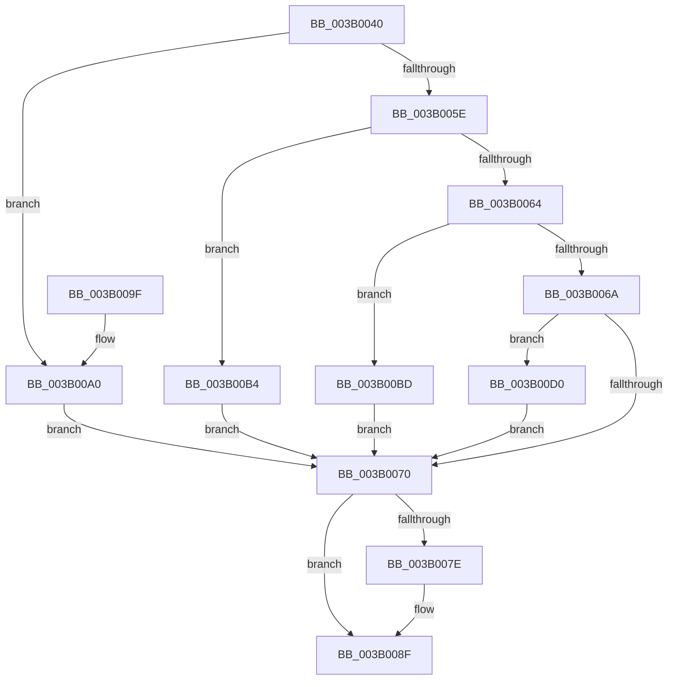

# SMKM_STORE_MGR&lt;SM_TRAITS&gt;::SmStoreMgrCallback

- RVA: `0x003B0040`–`0x003B00D7` (길이 `151` bytes)
- VA: `0x00000001403B0040`
- 실행 섹션: `.text`
- PDB 이름 있음: `예`; PDB Function 태그: `아니요`
- unwind 정보 RVA: `0x00064CD0`
- 디코드: `44`개 명령, `151/151` bytes 표시
- 미해석 바이트: `0` (있으면 어셈블리에 `.byte`로 보존)

> 이 문서는 커널 이미지의 기계어와 PDB 기호를 분석해 생성했습니다. 4번과 5번은 함수 원형과 자료형을 바이너리 사용 방식에서 추정한 C 해석이며 원본 소스 복구 결과는 아닙니다.

## 1. Dependencies

- 직접 호출 지점: **5**; 고유 호출 대상: **5**
- 직접 호출자로 확인된 함수: **0**
- RIP 상대 이미지 참조: **0**

### Outgoing calls
- `0x003B008A` → [guard_dispatch_icall](../6B/guard_dispatch_icall_function_006BAAD0.md) (function, `0x006BAAD0`)
- `0x003B00A3` → [SMKM_STORE<SM_TRAITS>::SmStCleanup](SMKM_STORE_SM_TRAITS_SmStCleanup_function_003B00E0.md) (function, `0x003B00E0`)
- `0x003B00AD` → [ExFreePoolWithTag](../../poolcode/B8/ExFreePoolWithTag_function_00B82870.md) (function, `0x00B82870`)
- `0x003B00C9` → [SMKM_STORE_MGR<SM_TRAITS>::SmFeStoreDelete](SMKM_STORE_MGR_SM_TRAITS_SmFeStoreDelete_function_003B12F0.md) (function, `0x003B12F0`)
- `0x003B00D0` → [SMKM_STORE_MGR<SM_TRAITS>::SmFeEmpty](../60/SMKM_STORE_MGR_SM_TRAITS_SmFeEmpty_function_0060C74C.md) (function, `0x0060C74C`)

### Direct callers
- 이 함수 시작 RVA로 연결되는 직접 call은 확인되지 않았습니다. 간접 호출은 완전히 역산할 수 없습니다.

### Static image references
- 디코드된 RIP-relative 메모리 참조가 없습니다.

## 2. Other-region calls and transfers

- 다른 실행 섹션으로 향하는 call: **1**
  - `0x003B00AD` → [ExFreePoolWithTag](../../poolcode/B8/ExFreePoolWithTag_function_00B82870.md) (`.text` → `POOLCODE`)
- 별도 외부 분기/꼬리 이동을 확인하지 못했습니다.

## 3. Assembly (complete function range)

```asm
003B0040  48 89 5C 24 08                  mov qword ptr [rsp + 8], rbx
003B0045  48 89 74 24 10                  mov qword ptr [rsp + 0x10], rsi
003B004A  57                              push rdi
003B004B  48 83 EC 20                     sub rsp, 0x20
003B004F  41 8B F8                        mov edi, r8d
003B0052  48 8B DA                        mov rbx, rdx
003B0055  48 8B F1                        mov rsi, rcx
003B0058  41 83 F8 01                     cmp r8d, 1
003B005C  74 42                           je 0x1403b00a0
003B005E  41 83 F8 07                     cmp r8d, 7
003B0062  74 50                           je 0x1403b00b4
003B0064  41 83 F8 02                     cmp r8d, 2
003B0068  74 53                           je 0x1403b00bd
003B006A  41 83 F8 04                     cmp r8d, 4
003B006E  74 60                           je 0x1403b00d0
003B0070  4C 8B 8E D8 07 00 00            mov r9, qword ptr [rsi + 0x7d8]
003B0077  33 C0                           xor eax, eax
003B0079  4D 85 C9                        test r9, r9
003B007C  74 11                           je 0x1403b008f
003B007E  44 8B C7                        mov r8d, edi
003B0081  48 8B D3                        mov rdx, rbx
003B0084  48 8B CE                        mov rcx, rsi
003B0087  49 8B C1                        mov rax, r9
003B008A  E8 41 AA 30 00                  call 0x1406baad0
003B008F  48 8B 5C 24 30                  mov rbx, qword ptr [rsp + 0x30]
003B0094  48 8B 74 24 38                  mov rsi, qword ptr [rsp + 0x38]
003B0099  48 83 C4 20                     add rsp, 0x20
003B009D  5F                              pop rdi
003B009E  C3                              ret
003B009F  CC                              int3
003B00A0  48 8B CB                        mov rcx, rbx
003B00A3  E8 38 00 00 00                  call 0x1403b00e0
003B00A8  33 D2                           xor edx, edx
003B00AA  48 8B CB                        mov rcx, rbx
003B00AD  E8 BE 27 7D 00                  call 0x140b82870
003B00B2  EB BC                           jmp 0x1403b0070
003B00B4  80 8A 95 1A 00 00 02            or byte ptr [rdx + 0x1a95], 2
003B00BB  EB B3                           jmp 0x1403b0070
003B00BD  8B 92 90 1A 00 00               mov edx, dword ptr [rdx + 0x1a90]
003B00C3  81 E2 FF 03 00 00               and edx, 0x3ff
003B00C9  E8 22 12 00 00                  call 0x1403b12f0
003B00CE  EB A0                           jmp 0x1403b0070
003B00D0  E8 77 C6 25 00                  call 0x14060c74c
003B00D5  EB 99                           jmp 0x1403b0070
```

## 4. C-style interpretation (structured pseudocode)

```c
__int64 __fastcall SMKM_STORE_MGR_SM_TRAITS___SmStoreMgrCallback(__int64 a1, __int64 a2, int a3)
{
    __int64 result;
    __int64 v_rsp;
    unsigned __int64 v_stack_p10;
    unsigned __int64 v_stack_p8;

    v_stack_p8 = v_rbx;
    v_stack_p10 = v_rsi;
    v_rsp = (v_rsp) - (32);
    if (a3 == 1) goto loc_003B00A0;
    if (a3 == 7) goto loc_003B00B4;
    if (a3 == 2) goto loc_003B00BD;
    if (a3 == 4) goto loc_003B00D0;
loc_003B0070:
    result = 0;
    if (*(unsigned __int64 *)(a1 + 2008) != 0) {
        a3 = (unsigned int)((unsigned int)(a3));
        a2 = a2;
        a1 = a1;
        result = *(unsigned __int64 *)(a1 + 2008);
        result = guard_dispatch_icall(a1, a2, a3, *(unsigned __int64 *)(a1 + 2008));
    }
    v_rsp = (v_rsp) + (32);
    return result;
loc_003B00A0:
    result = SMKM_STORE_SM_TRAITS___SmStCleanup(v_stack_p8, a2, a3, *(unsigned __int64 *)(a1 + 2008));
    a2 = 0;
    result = ExFreePoolWithTag(v_stack_p8, a2, a3, *(unsigned __int64 *)(a1 + 2008));
    goto loc_003B0070;
loc_003B00B4:
    goto loc_003B0070;
loc_003B00BD:
    a2 = (unsigned int)(((unsigned int)(*(unsigned int *)(a2 + 6800))) & (0x3FFULL));
    result = SMKM_STORE_MGR_SM_TRAITS___SmFeStoreDelete(v_stack_p8, a2, a3, *(unsigned __int64 *)(a1 + 2008));
    goto loc_003B0070;
loc_003B00D0:
    result = SMKM_STORE_MGR_SM_TRAITS___SmFeEmpty(v_stack_p8, a2, a3, *(unsigned __int64 *)(a1 + 2008));
    goto loc_003B0070;
}
```

## 5. (Beta) C Style

```c
int64_t SMKM_STORE_MGR_SM_TRAITS___SmStoreMgrCallback(void *Arg1, void *Arg2, int32_t Arg3)
{
    uint8_t *arg1 = (uint8_t *)Arg1;
    uint8_t *arg2 = (uint8_t *)Arg2;

    int64_t result;
    int64_t local_rsp;
    uint64_t v_stack_p10;
    uint64_t v_stack_p8;

    v_stack_p8 = local_rbx;
    v_stack_p10 = local_rsi;
    local_rsp = (local_rsp) - (32);
    if (Arg3 == 1) goto loc_003B00A0;
    if (Arg3 == 7) goto loc_003B00B4;
    if (Arg3 == 2) goto loc_003B00BD;
    if (Arg3 == 4) goto loc_003B00D0;
loc_003B0070:
    result = 0;
    if (*(uint64_t *)(arg1 + 0x7D8) != 0) {
        Arg3 = (uint32_t)((uint32_t)(Arg3));
        Arg2 = Arg2;
        Arg1 = Arg1;
        result = *(uint64_t *)(arg1 + 0x7D8);
        result = guard_dispatch_icall(Arg1, Arg2, Arg3, *(uint64_t *)(arg1 + 0x7D8));
    }
    local_rsp = (local_rsp) + (32);
    return result;
loc_003B00A0:
    result = SMKM_STORE_SM_TRAITS___SmStCleanup(v_stack_p8, Arg2, Arg3, *(uint64_t *)(arg1 + 0x7D8));
    Arg2 = 0;
    result = ExFreePoolWithTag(v_stack_p8, Arg2, Arg3, *(uint64_t *)(arg1 + 0x7D8));
    goto loc_003B0070;
loc_003B00B4:
    goto loc_003B0070;
loc_003B00BD:
    Arg2 = (uint32_t)(((uint32_t)(*(uint32_t *)(arg2 + 0x1A90))) & (0x3FFULL));
    result = SMKM_STORE_MGR_SM_TRAITS___SmFeStoreDelete(v_stack_p8, Arg2, Arg3, *(uint64_t *)(arg1 + 0x7D8));
    goto loc_003B0070;
loc_003B00D0:
    result = SMKM_STORE_MGR_SM_TRAITS___SmFeEmpty(v_stack_p8, Arg2, Arg3, *(uint64_t *)(arg1 + 0x7D8));
    goto loc_003B0070;
}
```

### 관측된 메모리 오프셋

구조체 형식이 확인되지 않은 접근은 인자 기준의 오프셋으로만 기록했습니다.

| 기준 인자 | 오프셋 표현 | 폭 (bit) | 접근 |
|---|---:|---:|---|
| `Arg1` | `+ 0x7D8` | `64` | `R` |
| `Arg2` | `+ 0x1A90` | `32` | `R` |
| `Arg2` | `+ 0x1A95` | `8` | `R/W` |

## 6. Execution-region graph

[열기: 2D/3D 그래프와 함수 탐색 컨트롤 패널](../../../control-panel.html?section=text&rva=0x003B0040&view=graph)

- 2D 그래프는 위에서 아래로 흐르고, 3D 그래프는 빈 공간을 드래그해 회전합니다. Shift+드래그는 이동, 휠은 확대·축소, 함수 노드 선택은 대상 보고서 이동입니다.

### Static fallback


