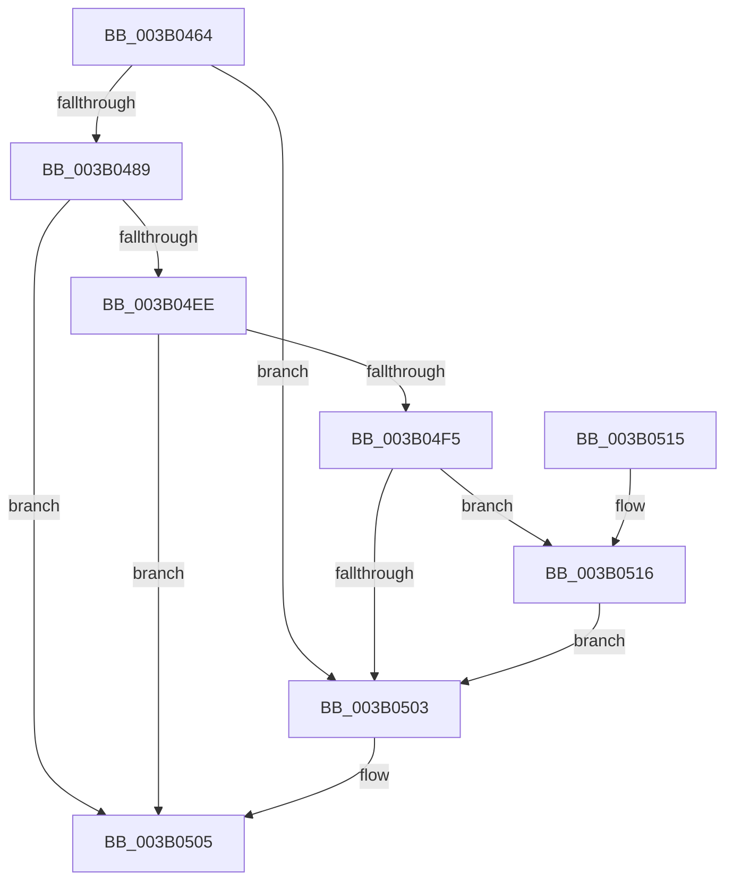

# SMKM_STORE&lt;SM_TRAITS&gt;::SmStAllocateVirtualRegion

- RVA: `0x003B0464`–`0x003B0529` (길이 `197` bytes)
- VA: `0x00000001403B0464`
- 실행 섹션: `.text`
- PDB 이름 있음: `예`; PDB Function 태그: `아니요`
- unwind 정보 RVA: `0x0008C1F8`
- 디코드: `54`개 명령, `197/197` bytes 표시
- 미해석 바이트: `0` (있으면 어셈블리에 `.byte`로 보존)

> 이 문서는 커널 이미지의 기계어와 PDB 기호를 분석해 생성했습니다. 4번과 5번은 함수 원형과 자료형을 바이너리 사용 방식에서 추정한 C 해석이며 원본 소스 복구 결과는 아닙니다.

## 1. Dependencies

- 직접 호출 지점: **1**; 고유 호출 대상: **1**
- 직접 호출자로 확인된 함수: **1**
- RIP 상대 이미지 참조: **0**

### Outgoing calls
- `0x003B04E5` → [SMKM_STORE<SM_TRAITS>::SmStHelperSendCommand](SMKM_STORE_SM_TRAITS_SmStHelperSendCommand_function_003B0530.md) (function, `0x003B0530`)

### Direct callers
- [ST_STORE&lt;SM_TRAITS&gt;::StMapAndLockRegion](../4E/ST_STORE_SM_TRAITS_StMapAndLockRegion_function_004EC090.md) at `0x004EC0E7`

### Static image references
- 디코드된 RIP-relative 메모리 참조가 없습니다.

## 2. Other-region calls and transfers

- 다른 실행 섹션으로 향하는 call: **0**
- 별도 외부 분기/꼬리 이동을 확인하지 못했습니다.

## 3. Assembly (complete function range)

```asm
003B0464  48 89 5C 24 08                  mov qword ptr [rsp + 8], rbx
003B0469  48 89 7C 24 10                  mov qword ptr [rsp + 0x10], rdi
003B046E  55                              push rbp
003B046F  48 8B EC                        mov rbp, rsp
003B0472  48 83 EC 60                     sub rsp, 0x60
003B0476  48 8B B9 68 1B 00 00            mov rdi, qword ptr [rcx + 0x1b68]
003B047D  4C 8B D1                        mov r10, rcx
003B0480  8B DA                           mov ebx, edx
003B0482  48 83 3C DF 00                  cmp qword ptr [rdi + rbx*8], 0
003B0487  75 7A                           jne 0x1403b0503
003B0489  33 C0                           xor eax, eax
003B048B  4C 8D 45 C0                     lea r8, [rbp - 0x40]
003B048F  48 89 45 F0                     mov qword ptr [rbp - 0x10], rax
003B0493  0F 57 C0                        xorps xmm0, xmm0
003B0496  8B 81 60 1B 00 00               mov eax, dword ptr [rcx + 0x1b60]
003B049C  41 B9 04 00 00 00               mov r9d, 4
003B04A2  0F 11 45 D0                     movups xmmword ptr [rbp - 0x30], xmm0
003B04A6  0F 11 45 C0                     movups xmmword ptr [rbp - 0x40], xmm0
003B04AA  48 89 45 C8                     mov qword ptr [rbp - 0x38], rax
003B04AE  41 8D 51 FE                     lea edx, [r9 - 2]
003B04B2  8B 81 9C 1D 00 00               mov eax, dword ptr [rcx + 0x1d9c]
003B04B8  0F B6 89 95 1A 00 00            movzx ecx, byte ptr [rcx + 0x1a95]
003B04BF  89 45 D8                        mov dword ptr [rbp - 0x28], eax
003B04C2  8B 45 DC                        mov eax, dword ptr [rbp - 0x24]
003B04C5  C1 E9 06                        shr ecx, 6
003B04C8  83 E0 FE                        and eax, 0xfffffffe
003B04CB  83 E1 01                        and ecx, 1
003B04CE  0B C8                           or ecx, eax
003B04D0  49 8B 82 90 1D 00 00            mov rax, qword ptr [r10 + 0x1d90]
003B04D7  89 4D DC                        mov dword ptr [rbp - 0x24], ecx
003B04DA  49 8B CA                        mov rcx, r10
003B04DD  0F 11 45 E0                     movups xmmword ptr [rbp - 0x20], xmm0
003B04E1  48 89 45 D0                     mov qword ptr [rbp - 0x30], rax
003B04E5  E8 46 00 00 00                  call 0x1403b0530
003B04EA  85 C0                           test eax, eax
003B04EC  78 17                           js 0x1403b0505
003B04EE  8B 45 F0                        mov eax, dword ptr [rbp - 0x10]
003B04F1  85 C0                           test eax, eax
003B04F3  78 10                           js 0x1403b0505
003B04F5  F6 45 E8 01                     test byte ptr [rbp - 0x18], 1
003B04F9  48 8B 45 E0                     mov rax, qword ptr [rbp - 0x20]
003B04FD  48 89 04 DF                     mov qword ptr [rdi + rbx*8], rax
003B0501  75 13                           jne 0x1403b0516
003B0503  33 C0                           xor eax, eax
003B0505  48 8B 5C 24 70                  mov rbx, qword ptr [rsp + 0x70]
003B050A  48 8B 7C 24 78                  mov rdi, qword ptr [rsp + 0x78]
003B050F  48 83 C4 60                     add rsp, 0x60
003B0513  5D                              pop rbp
003B0514  C3                              ret
003B0515  CC                              int3
003B0516  48 B9 00 00 00 00 00 00 00 80   movabs rcx, 0x8000000000000000
003B0520  48 0B C1                        or rax, rcx
003B0523  48 89 04 DF                     mov qword ptr [rdi + rbx*8], rax
003B0527  EB DA                           jmp 0x1403b0503
```

## 4. C-style interpretation (structured pseudocode)

```c
__int64 __fastcall SMKM_STORE_SM_TRAITS___SmStAllocateVirtualRegion(__int64 a1, int a2)
{
    __int64 result;
    __int64 v_rsp;
    unsigned __int64 v_stack_m18;
    unsigned __int8 v_stack_m20;
    unsigned __int64 v_stack_m28;
    unsigned int v_stack_m2C;
    unsigned int v_stack_m30;
    unsigned __int64 v_stack_m38;
    unsigned __int64 v_stack_m40;
    unsigned __int64 v_stack_m48;
    unsigned __int64 v_stack_p10;
    unsigned __int64 v_stack_p8;

    v_stack_p8 = v_rbx;
    v_stack_p10 = v_rdi;
    v_rsp = (v_rsp) - (96);
    if ((*(unsigned __int64 *)(*(unsigned __int64 *)(a1 + 7016) + (unsigned int)(a2) * 8)) != 0) goto loc_003B0503;
    result = 0;
    v_stack_m18 = 0;
    v_stack_m38 = v_xmm0;
    v_stack_m48 = v_xmm0;
    v_stack_m40 = (unsigned int)(*(unsigned int *)(a1 + 7008));
    v_stack_m30 = (unsigned int)((unsigned int)(*(unsigned int *)(a1 + 7580)));
    a1 = (unsigned int)((*(unsigned __int8 *)(a1 + 6805)) >> (6));
    result = (unsigned int)(((unsigned int)(v_stack_m2C)) & (0xFFFFFFFEULL));
    a1 = (unsigned int)((a1) & (1));
    a1 = (unsigned int)((a1) | ((unsigned int)(result)));
    v_stack_m2C = (unsigned int)(a1);
    v_stack_m28 = v_xmm0;
    v_stack_m38 = *(unsigned __int64 *)(a1 + 7568);
    result = SMKM_STORE_SM_TRAITS___SmStHelperSendCommand(a1, 4 - 2, v_stack_m48, 4);
    if (sign_flag) goto loc_003B0505;
    if (sign_flag) goto loc_003B0505;
    *(unsigned __int64 *)(*(unsigned __int64 *)(a1 + 7016) + (unsigned int)(a2) * 8) = v_stack_m28;
    if (((v_stack_m20) & (1)) != 0) goto loc_003B0516;
loc_003B0503:
    result = 0;
loc_003B0505:
    v_rsp = (v_rsp) + (96);
    return result;
loc_003B0516:
    result = (result) | (a1);
    *(unsigned __int64 *)(v_stack_p10 + v_stack_p8 * 8) = result;
    goto loc_003B0503;
}
```

## 5. (Beta) C Style

```c
int64_t SMKM_STORE_SM_TRAITS___SmStAllocateVirtualRegion(void *Arg1, int32_t Arg2)
{
    uint8_t *arg1 = (uint8_t *)Arg1;

    int64_t result;
    int64_t local_rsp;
    uint64_t v_stack_m18;
    uint8_t v_stack_m20;
    uint64_t v_stack_m28;
    uint32_t v_stack_m2C;
    uint32_t v_stack_m30;
    uint64_t v_stack_m38;
    uint64_t v_stack_m40;
    uint64_t v_stack_m48;
    uint64_t v_stack_p10;
    uint64_t v_stack_p8;

    v_stack_p8 = local_rbx;
    v_stack_p10 = local_rdi;
    local_rsp = (local_rsp) - (96);
    if ((*(uint64_t *)(*(uint64_t *)(arg1 + 0x1B68) + (uint32_t)(Arg2) * 8)) != 0) goto loc_003B0503;
    result = 0;
    v_stack_m18 = 0;
    v_stack_m38 = v_xmm0;
    v_stack_m48 = v_xmm0;
    v_stack_m40 = (uint32_t)(*(uint32_t *)(arg1 + 0x1B60));
    v_stack_m30 = (uint32_t)((uint32_t)(*(uint32_t *)(arg1 + 0x1D9C)));
    Arg1 = (uint32_t)((*(uint8_t *)(arg1 + 0x1A95)) >> (6));
    result = (uint32_t)(((uint32_t)(v_stack_m2C)) & (0xFFFFFFFEULL));
    Arg1 = (uint32_t)((Arg1) & (1));
    Arg1 = (uint32_t)((Arg1) | ((uint32_t)(result)));
    v_stack_m2C = (uint32_t)(Arg1);
    v_stack_m28 = v_xmm0;
    v_stack_m38 = *(uint64_t *)(arg1 + 0x1D90);
    result = SMKM_STORE_SM_TRAITS___SmStHelperSendCommand(Arg1, 4 - 2, v_stack_m48, 4);
    if (sign_flag) goto loc_003B0505;
    if (sign_flag) goto loc_003B0505;
    *(uint64_t *)(*(uint64_t *)(arg1 + 0x1B68) + (uint32_t)(Arg2) * 8) = v_stack_m28;
    if (((v_stack_m20) & (1)) != 0) goto loc_003B0516;
loc_003B0503:
    result = 0;
loc_003B0505:
    local_rsp = (local_rsp) + (96);
    return result;
loc_003B0516:
    result = (result) | (Arg1);
    *(uint64_t *)(v_stack_p10 + v_stack_p8 * 8) = result;
    goto loc_003B0503;
}
```

### 관측된 메모리 오프셋

구조체 형식이 확인되지 않은 접근은 인자 기준의 오프셋으로만 기록했습니다.

| 기준 인자 | 오프셋 표현 | 폭 (bit) | 접근 |
|---|---:|---:|---|
| `Arg1` | `+ 0x1A95` | `8` | `R` |
| `Arg1` | `+ 0x1B60` | `32` | `R` |
| `Arg1` | `+ 0x1B68` | `64` | `R` |
| `Arg1` | `+ 0x1D90` | `64` | `R` |
| `Arg1` | `+ 0x1D9C` | `32` | `R` |

## 6. Execution-region graph

[열기: 2D/3D 그래프와 함수 탐색 컨트롤 패널](../../../control-panel.html?section=text&rva=0x003B0464&view=graph)

- 2D 그래프는 위에서 아래로 흐르고, 3D 그래프는 빈 공간을 드래그해 회전합니다. Shift+드래그는 이동, 휠은 확대·축소, 함수 노드 선택은 대상 보고서 이동입니다.

### Static fallback


