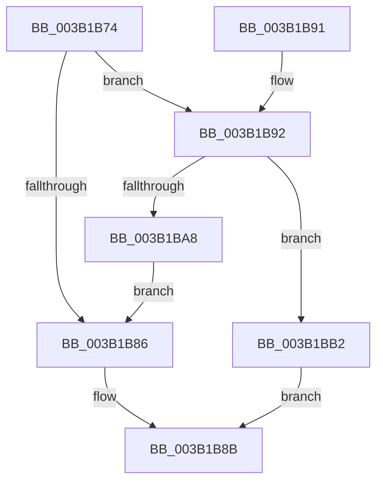

# SMKM_STORE&lt;SM_TRAITS&gt;::SmStCheckLockInProgressRegionComplete

- RVA: `0x003B1B74`–`0x003B1BB6` (길이 `66` bytes)
- VA: `0x00000001403B1B74`
- 실행 섹션: `.text`
- PDB 이름 있음: `예`; PDB Function 태그: `아니요`
- unwind 정보 RVA: `0x0008C34C`
- 디코드: `19`개 명령, `66/66` bytes 표시
- 미해석 바이트: `0` (있으면 어셈블리에 `.byte`로 보존)

> 이 문서는 커널 이미지의 기계어와 PDB 기호를 분석해 생성했습니다. 4번과 5번은 함수 원형과 자료형을 바이너리 사용 방식에서 추정한 C 해석이며 원본 소스 복구 결과는 아닙니다.

## 1. Dependencies

- 직접 호출 지점: **1**; 고유 호출 대상: **1**
- 직접 호출자로 확인된 함수: **2**
- RIP 상대 이미지 참조: **0**

### Outgoing calls
- `0x003B1B9C` → [SmKmStoreHelperCheckWaitCommand](SmKmStoreHelperCheckWaitCommand_function_003B06E0.md) (function, `0x003B06E0`)

### Direct callers
- [SMKM_STORE&lt;SM_TRAITS&gt;::SmStReleaseVirtualRegion](../3A/SMKM_STORE_SM_TRAITS_SmStReleaseVirtualRegion_function_003AF338.md) at `0x003AF3BB`
- [SMKM_STORE&lt;SM_TRAITS&gt;::SmStLockVirtualRegion](../4E/SMKM_STORE_SM_TRAITS_SmStLockVirtualRegion_function_004EAF8C.md) at `0x004EAFD4`

### Static image references
- 디코드된 RIP-relative 메모리 참조가 없습니다.

## 2. Other-region calls and transfers

- 다른 실행 섹션으로 향하는 call: **0**
- 별도 외부 분기/꼬리 이동을 확인하지 못했습니다.

## 3. Assembly (complete function range)

```asm
003B1B74  40 53                           push rbx
003B1B76  48 83 EC 20                     sub rsp, 0x20
003B1B7A  48 8B D9                        mov rbx, rcx
003B1B7D  48 39 91 F8 1C 00 00            cmp qword ptr [rcx + 0x1cf8], rdx
003B1B84  74 0C                           je 0x1403b1b92
003B1B86  B8 01 00 00 00                  mov eax, 1
003B1B8B  48 83 C4 20                     add rsp, 0x20
003B1B8F  5B                              pop rbx
003B1B90  C3                              ret
003B1B91  CC                              int3
003B1B92  48 81 C1 08 1C 00 00            add rcx, 0x1c08
003B1B99  41 8B D0                        mov edx, r8d
003B1B9C  E8 3F EB FF FF                  call 0x1403b06e0
003B1BA1  3D 20 01 00 C0                  cmp eax, 0xc0000120
003B1BA6  75 0A                           jne 0x1403b1bb2
003B1BA8  48 83 A3 F8 1C 00 00 00         and qword ptr [rbx + 0x1cf8], 0
003B1BB0  EB D4                           jmp 0x1403b1b86
003B1BB2  33 C0                           xor eax, eax
003B1BB4  EB D5                           jmp 0x1403b1b8b
```

## 4. C-style interpretation (structured pseudocode)

```c
__int64 __fastcall SMKM_STORE_SM_TRAITS___SmStCheckLockInProgressRegionComplete(__int64 a1, __int64 a2, int a3)
{
    __int64 result;
    __int64 v_rsp;

    v_rsp = (v_rsp) - (32);
    if ((*(unsigned __int64 *)(a1 + 7416)) == a2) goto loc_003B1B92;
loc_003B1B86:
loc_003B1B8B:
    v_rsp = (v_rsp) + (32);
    return 1;
loc_003B1B92:
    a1 = (a1) + (0x1C08ULL);
    result = SmKmStoreHelperCheckWaitCommand(a1, (unsigned int)(a3), a3, a4);
    if (((unsigned int)(result)) != 0xC0000120ULL) goto loc_003B1BB2;
    goto loc_003B1B86;
loc_003B1BB2:
    result = 0;
    goto loc_003B1B8B;
}
```

## 5. (Beta) C Style

```c
int64_t SMKM_STORE_SM_TRAITS___SmStCheckLockInProgressRegionComplete(void *Arg1, int64_t Arg2, int32_t Arg3)
{
    uint8_t *arg1 = (uint8_t *)Arg1;

    int64_t result;
    int64_t local_rsp;

    local_rsp = (local_rsp) - (32);
    if ((*(uint64_t *)(arg1 + 0x1CF8)) == Arg2) goto loc_003B1B92;
loc_003B1B86:
loc_003B1B8B:
    local_rsp = (local_rsp) + (32);
    return 1;
loc_003B1B92:
    Arg1 = (Arg1) + (0x1C08ULL);
    result = SmKmStoreHelperCheckWaitCommand(Arg1, (uint32_t)(Arg3), Arg3, a4);
    if (((uint32_t)(result)) != 0xC0000120ULL) goto loc_003B1BB2;
    goto loc_003B1B86;
loc_003B1BB2:
    result = 0;
    goto loc_003B1B8B;
}
```

### 관측된 메모리 오프셋

구조체 형식이 확인되지 않은 접근은 인자 기준의 오프셋으로만 기록했습니다.

| 기준 인자 | 오프셋 표현 | 폭 (bit) | 접근 |
|---|---:|---:|---|
| `Arg1` | `+ 0x1CF8` | `64` | `R` |
| `Arg1` | `+ 0x1CF8` | `64` | `R/W` |

## 6. Execution-region graph

[열기: 2D/3D 그래프와 함수 탐색 컨트롤 패널](../../../control-panel.html?section=text&rva=0x003B1B74&view=graph)

- 2D 그래프는 위에서 아래로 흐르고, 3D 그래프는 빈 공간을 드래그해 회전합니다. Shift+드래그는 이동, 휠은 확대·축소, 함수 노드 선택은 대상 보고서 이동입니다.

### Static fallback


