# SMKM_STORE&lt;SM_TRAITS&gt;::SmStCleanup

- RVA: `0x003B00E0`–`0x003B03AD` (길이 `717` bytes)
- VA: `0x00000001403B00E0`
- 실행 섹션: `.text`
- PDB 이름 있음: `예`; PDB Function 태그: `아니요`
- unwind 정보 RVA: `0x0008C1D8`
- 디코드: `157`개 명령, `717/717` bytes 표시
- 미해석 바이트: `0` (있으면 어셈블리에 `.byte`로 보존)

> 이 문서는 커널 이미지의 기계어와 PDB 기호를 분석해 생성했습니다. 4번과 5번은 함수 원형과 자료형을 바이너리 사용 방식에서 추정한 C 해석이며 원본 소스 복구 결과는 아닙니다.

## 1. Dependencies

- 직접 호출 지점: **23**; 고유 호출 대상: **17**
- 직접 호출자로 확인된 함수: **2**
- RIP 상대 이미지 참조: **1**

### Outgoing calls
- `0x003B0136` → [KeSetEvent](../33/KeSetEvent_function_0033F310.md) (function, `0x0033F310`)
- `0x003B0150` → [KeWaitForSingleObject](../20/KeWaitForSingleObject_function_0020E6B0.md) (function, `0x0020E6B0`)
- `0x003B0168` → [ObfDereferenceObjectWithTag](../2F/ObfDereferenceObjectWithTag_function_002F78E0.md) (function, `0x002F78E0`)
- `0x003B017C` → [SmKmStoreHelperCheckWaitCommand](SmKmStoreHelperCheckWaitCommand_function_003B06E0.md) (function, `0x003B06E0`)
- `0x003B01A0` → [KeSetEvent](../33/KeSetEvent_function_0033F310.md) (function, `0x0033F310`)
- `0x003B01BA` → [KeWaitForSingleObject](../20/KeWaitForSingleObject_function_0020E6B0.md) (function, `0x0020E6B0`)
- `0x003B01C8` → [ObfDereferenceObjectWithTag](../2F/ObfDereferenceObjectWithTag_function_002F78E0.md) (function, `0x002F78E0`)
- `0x003B01F3` → [SMKM_STORE<SM_TRAITS>::SmStAcquireStoreLockExclusive](../20/SMKM_STORE_SM_TRAITS_SmStAcquireStoreLockExclusive_function_00206630.md) (function, `0x00206630`)
- `0x003B01FB` → [ST_STORE<SM_TRAITS>::StCleanup](ST_STORE_SM_TRAITS_StCleanup_function_003B03B4.md) (function, `0x003B03B4`)
- `0x003B0203` → [SMKM_STORE<SM_TRAITS>::SmStReleaseStoreLockExclusive](../2D/SMKM_STORE_SM_TRAITS_SmStReleaseStoreLockExclusive_function_002DFE68.md) (function, `0x002DFE68`)
- `0x003B0208` → [KeLeaveCriticalRegion](../25/KeLeaveCriticalRegion_function_0025D8B0.md) (function, `0x0025D8B0`)
- `0x003B0237` → [SmFpCleanup](SmFpCleanup_function_003B082C.md) (function, `0x003B082C`)
- `0x003B025B` → [SmAcquireReleaseCharges](../28/SmAcquireReleaseCharges_function_00285C40.md) (function, `0x00285C40`)
- `0x003B0281` → [_security_check_cookie](../6A/_security_check_cookie_function_006AC640.md) (function, `0x006AC640`)
- `0x003B02AF` → [KeStackAttachProcess](../21/KeStackAttachProcess_function_00216800.md) (function, `0x00216800`)
- `0x003B02E5` → [ExFreePoolWithTag](../../poolcode/B8/ExFreePoolWithTag_function_00B82870.md) (function, `0x00B82870`)
- `0x003B030E` → [SmKmStoreHelperCleanup](../3A/SmKmStoreHelperCleanup_function_003AFFE8.md) (function, `0x003AFFE8`)
- `0x003B031A` → [SmKmStoreHelperCleanup](../3A/SmKmStoreHelperCleanup_function_003AFFE8.md) (function, `0x003AFFE8`)
- `0x003B032D` → [ExFreePoolWithTag](../../poolcode/B8/ExFreePoolWithTag_function_00B82870.md) (function, `0x00B82870`)
- `0x003B034C` → [KiUnstackDetachProcess](../21/KiUnstackDetachProcess_function_00217D30.md) (function, `0x00217D30`)
- `0x003B0356` → [AlpcpFreeBuffer](../../page/90/AlpcpFreeBuffer_function_009071C0.md) (function, `0x009071C0`)
- `0x003B035F` → [ExFreePoolWithTag](../../poolcode/B8/ExFreePoolWithTag_function_00B82870.md) (function, `0x00B82870`)
- `0x003B036D` → [SmKmFileInfoCleanup](../../page/AC/SmKmFileInfoCleanup_function_00AC9A90.md) (function, `0x00AC9A90`)

### Direct callers
- [SMKM_STORE_MGR&lt;SM_TRAITS&gt;::SmStoreMgrCallback](SMKM_STORE_MGR_SM_TRAITS_SmStoreMgrCallback_function_003B0040.md) at `0x003B00A3`
- [SmProcessCreateRequest](../../page/A5/SmProcessCreateRequest_function_00A50DD0.md) at `0x00A51292`

### Static image references
- `0x003B00F5` → RVA `0x00E0A740` (`.data`; read)

## 2. Other-region calls and transfers

- 다른 실행 섹션으로 향하는 call: **5**
  - `0x003B02E5` → [ExFreePoolWithTag](../../poolcode/B8/ExFreePoolWithTag_function_00B82870.md) (`.text` → `POOLCODE`)
  - `0x003B032D` → [ExFreePoolWithTag](../../poolcode/B8/ExFreePoolWithTag_function_00B82870.md) (`.text` → `POOLCODE`)
  - `0x003B0356` → [AlpcpFreeBuffer](../../page/90/AlpcpFreeBuffer_function_009071C0.md) (`.text` → `PAGE`)
  - `0x003B035F` → [ExFreePoolWithTag](../../poolcode/B8/ExFreePoolWithTag_function_00B82870.md) (`.text` → `POOLCODE`)
  - `0x003B036D` → [SmKmFileInfoCleanup](../../page/AC/SmKmFileInfoCleanup_function_00AC9A90.md) (`.text` → `PAGE`)
- 별도 외부 분기/꼬리 이동을 확인하지 못했습니다.

## 3. Assembly (complete function range)

```asm
003B00E0  48 89 5C 24 10                  mov qword ptr [rsp + 0x10], rbx
003B00E5  48 89 74 24 18                  mov qword ptr [rsp + 0x18], rsi
003B00EA  48 89 7C 24 20                  mov qword ptr [rsp + 0x20], rdi
003B00EF  41 54                           push r12
003B00F1  48 83 EC 70                     sub rsp, 0x70
003B00F5  48 8B 05 44 A6 A5 00            mov rax, qword ptr [rip + 0xa5a644]
003B00FC  48 33 C4                        xor rax, rsp
003B00FF  48 89 44 24 60                  mov qword ptr [rsp + 0x60], rax
003B0104  80 89 95 1A 00 00 01            or byte ptr [rcx + 0x1a95], 1
003B010B  0F 57 C0                        xorps xmm0, xmm0
003B010E  48 83 B9 58 1B 00 00 00         cmp qword ptr [rcx + 0x1b58], 0
003B0116  48 8B D9                        mov rbx, rcx
003B0119  0F 11 44 24 30                  movups xmmword ptr [rsp + 0x30], xmm0
003B011E  0F 11 44 24 40                  movups xmmword ptr [rsp + 0x40], xmm0
003B0123  0F 11 44 24 50                  movups xmmword ptr [rsp + 0x50], xmm0
003B0128  74 2B                           je 0x1403b0155
003B012A  48 81 C1 28 1B 00 00            add rcx, 0x1b28
003B0131  41 B0 01                        mov r8b, 1
003B0134  33 D2                           xor edx, edx
003B0136  E8 D5 F1 F8 FF                  call 0x14033f310
003B013B  48 8B 8B 58 1B 00 00            mov rcx, qword ptr [rbx + 0x1b58]
003B0142  45 33 C9                        xor r9d, r9d
003B0145  48 83 64 24 20 00               and qword ptr [rsp + 0x20], 0
003B014B  45 33 C0                        xor r8d, r8d
003B014E  33 D2                           xor edx, edx
003B0150  E8 5B E5 E5 FF                  call 0x14020e6b0
003B0155  48 8B 8B 58 1B 00 00            mov rcx, qword ptr [rbx + 0x1b58]
003B015C  BF 44 66 6C 74                  mov edi, 0x746c6644
003B0161  48 85 C9                        test rcx, rcx
003B0164  74 07                           je 0x1403b016d
003B0166  8B D7                           mov edx, edi
003B0168  E8 73 77 F4 FF                  call 0x1402f78e0
003B016D  48 8D B3 78 1B 00 00            lea rsi, [rbx + 0x1b78]
003B0174  BA 01 00 00 00                  mov edx, 1
003B0179  48 8B CE                        mov rcx, rsi
003B017C  E8 5F 05 00 00                  call 0x1403b06e0
003B0181  F6 83 95 1A 00 00 04            test byte ptr [rbx + 0x1a95], 4
003B0188  74 50                           je 0x1403b01da
003B018A  48 83 BB 98 1C 00 00 00         cmp qword ptr [rbx + 0x1c98], 0
003B0192  74 39                           je 0x1403b01cd
003B0194  48 8D 8B A0 1C 00 00            lea rcx, [rbx + 0x1ca0]
003B019B  45 33 C0                        xor r8d, r8d
003B019E  33 D2                           xor edx, edx
003B01A0  E8 6B F1 F8 FF                  call 0x14033f310
003B01A5  48 8B 8B 98 1C 00 00            mov rcx, qword ptr [rbx + 0x1c98]
003B01AC  45 33 C9                        xor r9d, r9d
003B01AF  48 83 64 24 20 00               and qword ptr [rsp + 0x20], 0
003B01B5  45 33 C0                        xor r8d, r8d
003B01B8  33 D2                           xor edx, edx
003B01BA  E8 F1 E4 E5 FF                  call 0x14020e6b0
003B01BF  48 8B 8B 98 1C 00 00            mov rcx, qword ptr [rbx + 0x1c98]
003B01C6  8B D7                           mov edx, edi
003B01C8  E8 13 77 F4 FF                  call 0x1402f78e0
003B01CD  F6 83 95 1A 00 00 04            test byte ptr [rbx + 0x1a95], 4
003B01D4  0F 85 C4 00 00 00               jne 0x1403b029e
003B01DA  65 48 8B 04 25 88 01 00 00      mov rax, qword ptr gs:[0x188]
003B01E3  49 83 CC FF                     or r12, 0xffffffffffffffff
003B01E7  48 8B CB                        mov rcx, rbx
003B01EA  66 44 01 A0 E4 01 00 00         add word ptr [rax + 0x1e4], r12w
003B01F2  90                              nop
003B01F3  E8 38 64 E5 FF                  call 0x140206630
003B01F8  48 8B CB                        mov rcx, rbx
003B01FB  E8 B4 01 00 00                  call 0x1403b03b4
003B0200  48 8B CB                        mov rcx, rbx
003B0203  E8 60 FC F2 FF                  call 0x1402dfe68
003B0208  E8 A3 D6 EA FF                  call 0x14025d8b0
003B020D  F6 83 95 1A 00 00 04            test byte ptr [rbx + 0x1a95], 4
003B0214  0F 85 1D 01 00 00               jne 0x1403b0337
003B021A  8A 83 94 1A 00 00               mov al, byte ptr [rbx + 0x1a94]
003B0220  84 C0                           test al, al
003B0222  0F 84 C7 00 00 00               je 0x1403b02ef
003B0228  3C 01                           cmp al, 1
003B022A  0F 84 36 01 00 00               je 0x1403b0366
003B0230  48 8D 8B 18 1D 00 00            lea rcx, [rbx + 0x1d18]
003B0237  E8 F0 05 00 00                  call 0x1403b082c
003B023C  F6 83 95 1A 00 00 10            test byte ptr [rbx + 0x1a95], 0x10
003B0243  74 1B                           je 0x1403b0260
003B0245  8B 93 60 1B 00 00               mov edx, dword ptr [rbx + 0x1b60]
003B024B  41 B9 01 00 00 00               mov r9d, 1
003B0251  48 8B 8B 90 1D 00 00            mov rcx, qword ptr [rbx + 0x1d90]
003B0258  45 8B C1                        mov r8d, r9d
003B025B  E8 E0 59 ED FF                  call 0x140285c40
003B0260  80 BB 95 1A 00 00 00            cmp byte ptr [rbx + 0x1a95], 0
003B0267  7D 10                           jge 0x1403b0279
003B0269  0F B6 93 A4 1D 00 00            movzx edx, byte ptr [rbx + 0x1da4]
003B0270  80 FA FF                        cmp dl, 0xff
003B0273  0F 85 FE 00 00 00               jne 0x1403b0377
003B0279  48 8B 4C 24 60                  mov rcx, qword ptr [rsp + 0x60]
003B027E  48 33 CC                        xor rcx, rsp
003B0281  E8 BA C3 2F 00                  call 0x1406ac640
003B0286  4C 8D 5C 24 70                  lea r11, [rsp + 0x70]
003B028B  49 8B 5B 18                     mov rbx, qword ptr [r11 + 0x18]
003B028F  49 8B 73 20                     mov rsi, qword ptr [r11 + 0x20]
003B0293  49 8B 7B 28                     mov rdi, qword ptr [r11 + 0x28]
003B0297  49 8B E3                        mov rsp, r11
003B029A  41 5C                           pop r12
003B029C  C3                              ret
003B029D  CC                              int3
003B029E  48 8B 8B 00 1D 00 00            mov rcx, qword ptr [rbx + 0x1d00]
003B02A5  48 85 C9                        test rcx, rcx
003B02A8  74 0A                           je 0x1403b02b4
003B02AA  48 8D 54 24 30                  lea rdx, [rsp + 0x30]
003B02AF  E8 4C 65 E6 FF                  call 0x140216800
003B02B4  F6 83 95 1A 00 00 04            test byte ptr [rbx + 0x1a95], 4
003B02BB  0F 84 19 FF FF FF               je 0x1403b01da
003B02C1  48 8B 83 F0 1C 00 00            mov rax, qword ptr [rbx + 0x1cf0]
003B02C8  48 85 C0                        test rax, rax
003B02CB  0F 84 09 FF FF FF               je 0x1403b01da
003B02D1  48 8B BB F0 1C 00 00            mov rdi, qword ptr [rbx + 0x1cf0]
003B02D8  48 8B 0F                        mov rcx, qword ptr [rdi]
003B02DB  48 85 C9                        test rcx, rcx
003B02DE  75 76                           jne 0x1403b0356
003B02E0  33 D2                           xor edx, edx
003B02E2  48 8B CF                        mov rcx, rdi
003B02E5  E8 86 25 7D 00                  call 0x140b82870
003B02EA  E9 EB FE FF FF                  jmp 0x1403b01da
003B02EF  F6 83 95 1A 00 00 04            test byte ptr [rbx + 0x1a95], 4
003B02F6  48 8B BB 68 1B 00 00            mov rdi, qword ptr [rbx + 0x1b68]
003B02FD  74 20                           je 0x1403b031f
003B02FF  48 8B 8B 70 1B 00 00            mov rcx, qword ptr [rbx + 0x1b70]
003B0306  48 85 C9                        test rcx, rcx
003B0309  75 52                           jne 0x1403b035d
003B030B  48 8B CE                        mov rcx, rsi
003B030E  E8 D5 FC FF FF                  call 0x1403affe8
003B0313  48 8D 8B 08 1C 00 00            lea rcx, [rbx + 0x1c08]
003B031A  E8 C9 FC FF FF                  call 0x1403affe8
003B031F  48 85 FF                        test rdi, rdi
003B0322  0F 84 08 FF FF FF               je 0x1403b0230
003B0328  33 D2                           xor edx, edx
003B032A  48 8B CF                        mov rcx, rdi
003B032D  E8 3E 25 7D 00                  call 0x140b82870
003B0332  E9 F9 FE FF FF                  jmp 0x1403b0230
003B0337  48 83 BB 00 1D 00 00 00         cmp qword ptr [rbx + 0x1d00], 0
003B033F  0F 84 D5 FE FF FF               je 0x1403b021a
003B0345  33 D2                           xor edx, edx
003B0347  48 8D 4C 24 30                  lea rcx, [rsp + 0x30]
003B034C  E8 DF 79 E6 FF                  call 0x140217d30
003B0351  E9 C4 FE FF FF                  jmp 0x1403b021a
003B0356  E8 65 6E 55 00                  call 0x1409071c0
003B035B  EB 83                           jmp 0x1403b02e0
003B035D  33 D2                           xor edx, edx
003B035F  E8 0C 25 7D 00                  call 0x140b82870
003B0364  EB A5                           jmp 0x1403b030b
003B0366  48 8D 8B 68 1B 00 00            lea rcx, [rbx + 0x1b68]
003B036D  E8 1E 97 71 00                  call 0x140ac9a90
003B0372  E9 B9 FE FF FF                  jmp 0x1403b0230
003B0377  48 8B 83 90 1D 00 00            mov rax, qword ptr [rbx + 0x1d90]
003B037E  48 8B 88 30 08 00 00            mov rcx, qword ptr [rax + 0x830]
003B0385  48 8B 01                        mov rax, qword ptr [rcx]
003B0388  49 8B CC                        mov rcx, r12
003B038B  F0 48 0F C1 8C D0 58 45 00 00   lock xadd qword ptr [rax + rdx*8 + 0x4558], rcx
003B0395  49 03 CC                        add rcx, r12
003B0398  49 3B CC                        cmp rcx, r12
003B039B  0F 8F D8 FE FF FF               jg 0x1403b0279
003B03A1  B9 0E 00 00 00                  mov ecx, 0xe
003B03A6  CD 29                           int 0x29
003B03A8  E9 CC FE FF FF                  jmp 0x1403b0279
```

## 4. C-style interpretation (structured pseudocode)

```c
__int64 __fastcall SMKM_STORE_SM_TRAITS___SmStCleanup(__int64 a1, int a2, __int64 a3, int a4)
{
    __int64 result;
    __int64 v_r12;
    __int64 v_rsp;
    unsigned __int64 v_stack_m18;
    unsigned __int64 v_stack_m28;
    unsigned __int64 v_stack_m38;
    unsigned __int64 v_stack_m40;
    unsigned __int64 v_stack_m48;
    unsigned __int64 v_stack_m58;
    unsigned __int64 v_stack_m8;
    unsigned __int64 v_stack_p10;
    unsigned __int64 v_stack_p18;
    unsigned __int64 v_stack_p20;

    v_stack_p10 = v_rbx;
    v_stack_p18 = v_rsi;
    v_stack_p20 = v_rdi;
    v_rsp = (v_rsp) - (112);
    result = (*(unsigned __int64 *)(v_rip + 10856004)) ^ (v_rsp);
    v_stack_m18 = result;
    v_stack_m48 = v_xmm0;
    v_stack_m38 = v_xmm0;
    v_stack_m28 = v_xmm0;
    if ((*(unsigned __int64 *)(a1 + 7000)) != 0) {
        a1 = (a1) + (0x1B28ULL);
        a3 = 1;
        a2 = 0;
        result = KeSetEvent(a1, a2, a3, a4);
        a1 = *(unsigned __int64 *)(a1 + 7000);
        a4 = 0;
        a3 = 0;
        a2 = 0;
        result = KeWaitForSingleObject(a1, a2, a3, a4);
    }
    if (*(unsigned __int64 *)(a1 + 7000) != 0) {
        a2 = (unsigned int)((unsigned int)(0x746C6644ULL));
        result = ObfDereferenceObjectWithTag(*(unsigned __int64 *)(a1 + 7000), a2, a3, a4);
    }
    result = SmKmStoreHelperCheckWaitCommand(a1 + 7032, 1, a3, a4);
    if (((*(unsigned __int8 *)(a1 + 6805)) & (4)) == 0) goto loc_003B01DA;
    if ((*(unsigned __int64 *)(a1 + 7320)) != 0) {
        a1 = a1 + 7328;
        a3 = 0;
        a2 = 0;
        result = KeSetEvent(a1, a2, a3, a4);
        a1 = *(unsigned __int64 *)(a1 + 7320);
        a4 = 0;
        a3 = 0;
        a2 = 0;
        result = KeWaitForSingleObject(a1, a2, a3, a4);
        a1 = *(unsigned __int64 *)(a1 + 7320);
        a2 = (unsigned int)((unsigned int)(0x746C6644ULL));
        result = ObfDereferenceObjectWithTag(a1, a2, a3, a4);
    }
    if (((*(unsigned __int8 *)(a1 + 6805)) & (4)) != 0) goto loc_003B029E;
loc_003B01DA:
    v_r12 = (v_r12) | (-1);
    result = SMKM_STORE_SM_TRAITS___SmStAcquireStoreLockExclusive(a1, a2, a3, a4);
    result = ST_STORE_SM_TRAITS___StCleanup(a1, a2, a3, a4);
    result = SMKM_STORE_SM_TRAITS___SmStReleaseStoreLockExclusive(a1, a2, a3, a4);
    result = KeLeaveCriticalRegion(a1, a2, a3, a4);
    if (((*(unsigned __int8 *)(a1 + 6805)) & (4)) != 0) goto loc_003B0337;
loc_003B021A:
    if ((unsigned __int8)(*(unsigned __int8 *)(a1 + 6804)) == 0) goto loc_003B02EF;
    if (((unsigned __int8)(*(unsigned __int8 *)(a1 + 6804))) == 1) goto loc_003B0366;
loc_003B0230:
    result = SmFpCleanup(a1 + 7448, a2, a3, a4);
    if (((*(unsigned __int8 *)(a1 + 6805)) & (16)) != 0) {
        a2 = *(unsigned int *)(a1 + 7008);
        a4 = 1;
        a1 = *(unsigned __int64 *)(a1 + 7568);
        a3 = a4;
        result = SmAcquireReleaseCharges(a1, a2, a3, a4);
    }
    if ((*(unsigned __int8 *)(a1 + 6805)) >= 0) goto loc_003B0279;
    if (((unsigned __int8)(*(unsigned __int8 *)(a1 + 7588))) != 255) goto loc_003B0377;
loc_003B0279:
    a1 = (v_stack_m18) ^ (v_rsp);
    result = _security_check_cookie(a1, *(unsigned __int8 *)(a1 + 7588), a3, a4);
    return result;
loc_003B029E:
    if (*(unsigned __int64 *)(*(unsigned __int64 *)(v_stack_m8 + 24) + 7424) != 0) {
        a2 = v_stack_m40;
        result = KeStackAttachProcess(*(unsigned __int64 *)(*(unsigned __int64 *)(v_stack_m8 + 24) + 7424), a2, a3, a4);
    }
    if (((*(unsigned __int8 *)(*(unsigned __int64 *)(v_stack_m8 + 24) + 6805)) & (4)) == 0) goto loc_003B01DA;
    if (*(unsigned __int64 *)(*(unsigned __int64 *)(v_stack_m8 + 24) + 7408) == 0) goto loc_003B01DA;
    if (*(unsigned __int64 *)(*(unsigned __int64 *)(*(unsigned __int64 *)(v_stack_m8 + 24) + 7408)) != 0) goto loc_003B0356;
loc_003B02E0:
    a2 = 0;
    result = ExFreePoolWithTag(*(unsigned __int64 *)(*(unsigned __int64 *)(v_stack_m8 + 24) + 7408), a2, a3, a4);
    goto loc_003B01DA;
loc_003B02EF:
    if (((*(unsigned __int8 *)(*(unsigned __int64 *)(v_stack_m8 + 24) + 6805)) & (4)) == 0) goto loc_003B031F;
    if (*(unsigned __int64 *)(*(unsigned __int64 *)(v_stack_m8 + 24) + 7024) != 0) goto loc_003B035D;
loc_003B030B:
    result = SmKmStoreHelperCleanup(*(unsigned __int64 *)(v_stack_m8 + 32), a2, a3, a4);
    result = SmKmStoreHelperCleanup(*(unsigned __int64 *)(v_stack_m8 + 24) + 7176, a2, a3, a4);
loc_003B031F:
    if (*(unsigned __int64 *)(*(unsigned __int64 *)(v_stack_m8 + 24) + 7016) == 0) goto loc_003B0230;
    a2 = 0;
    result = ExFreePoolWithTag(*(unsigned __int64 *)(*(unsigned __int64 *)(v_stack_m8 + 24) + 7016), a2, a3, a4);
    goto loc_003B0230;
loc_003B0337:
    if ((*(unsigned __int64 *)(*(unsigned __int64 *)(v_stack_m8 + 24) + 7424)) == 0) goto loc_003B021A;
    a2 = 0;
    result = KiUnstackDetachProcess(v_stack_m40, a2, a3, a4);
    goto loc_003B021A;
loc_003B0356:
    result = AlpcpFreeBuffer(v_stack_m40, a2, a3, a4);
    goto loc_003B02E0;
loc_003B035D:
    a2 = 0;
    result = ExFreePoolWithTag(v_stack_m40, a2, a3, a4);
    goto loc_003B030B;
loc_003B0366:
    result = SmKmFileInfoCleanup(*(unsigned __int64 *)(v_stack_m8 + 24) + 7016, a2, a3, a4);
    goto loc_003B0230;
loc_003B0377:
    a1 = (v_r12) + (v_r12);
    if (a1 > v_r12) goto loc_003B0279;
    goto loc_003B0279;
}
```

## 5. (Beta) C Style

```c
int64_t SMKM_STORE_SM_TRAITS___SmStCleanup(void *Arg1, int32_t Arg2, int64_t Arg3, int32_t Arg4)
{
    uint8_t *arg1 = (uint8_t *)Arg1;

    int64_t result;
    int64_t local_r12;
    int64_t local_rsp;
    uint64_t v_stack_m18;
    uint64_t v_stack_m28;
    uint64_t v_stack_m38;
    uint64_t v_stack_m40;
    uint64_t v_stack_m48;
    uint64_t v_stack_m58;
    uint64_t v_stack_m8;
    uint64_t v_stack_p10;
    uint64_t v_stack_p18;
    uint64_t v_stack_p20;

    v_stack_p10 = local_rbx;
    v_stack_p18 = local_rsi;
    v_stack_p20 = local_rdi;
    local_rsp = (local_rsp) - (112);
    result = (*(uint64_t *)(v_rip + 0xA5A644)) ^ (local_rsp);
    v_stack_m18 = result;
    v_stack_m48 = v_xmm0;
    v_stack_m38 = v_xmm0;
    v_stack_m28 = v_xmm0;
    if ((*(uint64_t *)(arg1 + 0x1B58)) != 0) {
        Arg1 = (Arg1) + (0x1B28ULL);
        Arg3 = 1;
        Arg2 = 0;
        result = KeSetEvent(Arg1, Arg2, Arg3, Arg4);
        Arg1 = *(uint64_t *)(arg1 + 0x1B58);
        Arg4 = 0;
        Arg3 = 0;
        Arg2 = 0;
        result = KeWaitForSingleObject(Arg1, Arg2, Arg3, Arg4);
    }
    if (*(uint64_t *)(arg1 + 0x1B58) != 0) {
        Arg2 = (uint32_t)((uint32_t)(0x746C6644ULL));
        result = ObfDereferenceObjectWithTag(*(uint64_t *)(arg1 + 0x1B58), Arg2, Arg3, Arg4);
    }
    result = SmKmStoreHelperCheckWaitCommand(Arg1 + 7032, 1, Arg3, Arg4);
    if (((*(uint8_t *)(arg1 + 0x1A95)) & (4)) == 0) goto loc_003B01DA;
    if ((*(uint64_t *)(arg1 + 0x1C98)) != 0) {
        Arg1 = Arg1 + 7328;
        Arg3 = 0;
        Arg2 = 0;
        result = KeSetEvent(Arg1, Arg2, Arg3, Arg4);
        Arg1 = *(uint64_t *)(arg1 + 0x1C98);
        Arg4 = 0;
        Arg3 = 0;
        Arg2 = 0;
        result = KeWaitForSingleObject(Arg1, Arg2, Arg3, Arg4);
        Arg1 = *(uint64_t *)(arg1 + 0x1C98);
        Arg2 = (uint32_t)((uint32_t)(0x746C6644ULL));
        result = ObfDereferenceObjectWithTag(Arg1, Arg2, Arg3, Arg4);
    }
    if (((*(uint8_t *)(arg1 + 0x1A95)) & (4)) != 0) goto loc_003B029E;
loc_003B01DA:
    local_r12 = (local_r12) | (-1);
    result = SMKM_STORE_SM_TRAITS___SmStAcquireStoreLockExclusive(Arg1, Arg2, Arg3, Arg4);
    result = ST_STORE_SM_TRAITS___StCleanup(Arg1, Arg2, Arg3, Arg4);
    result = SMKM_STORE_SM_TRAITS___SmStReleaseStoreLockExclusive(Arg1, Arg2, Arg3, Arg4);
    result = KeLeaveCriticalRegion(Arg1, Arg2, Arg3, Arg4);
    if (((*(uint8_t *)(arg1 + 0x1A95)) & (4)) != 0) goto loc_003B0337;
loc_003B021A:
    if ((uint8_t)(*(uint8_t *)(arg1 + 0x1A94)) == 0) goto loc_003B02EF;
    if (((uint8_t)(*(uint8_t *)(arg1 + 0x1A94))) == 1) goto loc_003B0366;
loc_003B0230:
    result = SmFpCleanup(Arg1 + 7448, Arg2, Arg3, Arg4);
    if (((*(uint8_t *)(arg1 + 0x1A95)) & (16)) != 0) {
        Arg2 = *(uint32_t *)(arg1 + 0x1B60);
        Arg4 = 1;
        Arg1 = *(uint64_t *)(arg1 + 0x1D90);
        Arg3 = Arg4;
        result = SmAcquireReleaseCharges(Arg1, Arg2, Arg3, Arg4);
    }
    if ((*(uint8_t *)(arg1 + 0x1A95)) >= 0) goto loc_003B0279;
    if (((uint8_t)(*(uint8_t *)(arg1 + 0x1DA4))) != 255) goto loc_003B0377;
loc_003B0279:
    Arg1 = (v_stack_m18) ^ (local_rsp);
    result = _security_check_cookie(Arg1, *(uint8_t *)(arg1 + 0x1DA4), Arg3, Arg4);
    return result;
loc_003B029E:
    if (*(uint64_t *)(*(uint64_t *)(v_stack_m8 + 0x18) + 0x1D00) != 0) {
        Arg2 = v_stack_m40;
        result = KeStackAttachProcess(*(uint64_t *)(*(uint64_t *)(v_stack_m8 + 0x18) + 0x1D00), Arg2, Arg3, Arg4);
    }
    if (((*(uint8_t *)(*(uint64_t *)(v_stack_m8 + 0x18) + 0x1A95)) & (4)) == 0) goto loc_003B01DA;
    if (*(uint64_t *)(*(uint64_t *)(v_stack_m8 + 0x18) + 0x1CF0) == 0) goto loc_003B01DA;
    if (*(uint64_t *)(*(uint64_t *)(*(uint64_t *)(v_stack_m8 + 0x18) + 0x1CF0)) != 0) goto loc_003B0356;
loc_003B02E0:
    Arg2 = 0;
    result = ExFreePoolWithTag(*(uint64_t *)(*(uint64_t *)(v_stack_m8 + 0x18) + 0x1CF0), Arg2, Arg3, Arg4);
    goto loc_003B01DA;
loc_003B02EF:
    if (((*(uint8_t *)(*(uint64_t *)(v_stack_m8 + 0x18) + 0x1A95)) & (4)) == 0) goto loc_003B031F;
    if (*(uint64_t *)(*(uint64_t *)(v_stack_m8 + 0x18) + 0x1B70) != 0) goto loc_003B035D;
loc_003B030B:
    result = SmKmStoreHelperCleanup(*(uint64_t *)(v_stack_m8 + 0x20), Arg2, Arg3, Arg4);
    result = SmKmStoreHelperCleanup(*(uint64_t *)(v_stack_m8 + 0x18) + 7176, Arg2, Arg3, Arg4);
loc_003B031F:
    if (*(uint64_t *)(*(uint64_t *)(v_stack_m8 + 0x18) + 0x1B68) == 0) goto loc_003B0230;
    Arg2 = 0;
    result = ExFreePoolWithTag(*(uint64_t *)(*(uint64_t *)(v_stack_m8 + 0x18) + 0x1B68), Arg2, Arg3, Arg4);
    goto loc_003B0230;
loc_003B0337:
    if ((*(uint64_t *)(*(uint64_t *)(v_stack_m8 + 0x18) + 0x1D00)) == 0) goto loc_003B021A;
    Arg2 = 0;
    result = KiUnstackDetachProcess(v_stack_m40, Arg2, Arg3, Arg4);
    goto loc_003B021A;
loc_003B0356:
    result = AlpcpFreeBuffer(v_stack_m40, Arg2, Arg3, Arg4);
    goto loc_003B02E0;
loc_003B035D:
    Arg2 = 0;
    result = ExFreePoolWithTag(v_stack_m40, Arg2, Arg3, Arg4);
    goto loc_003B030B;
loc_003B0366:
    result = SmKmFileInfoCleanup(*(uint64_t *)(v_stack_m8 + 0x18) + 7016, Arg2, Arg3, Arg4);
    goto loc_003B0230;
loc_003B0377:
    Arg1 = (local_r12) + (local_r12);
    if (Arg1 > local_r12) goto loc_003B0279;
    goto loc_003B0279;
}
```

### 관측된 메모리 오프셋

구조체 형식이 확인되지 않은 접근은 인자 기준의 오프셋으로만 기록했습니다.

| 기준 인자 | 오프셋 표현 | 폭 (bit) | 접근 |
|---|---:|---:|---|
| `Arg1` | `+ 0x1A94` | `8` | `R` |
| `Arg1` | `+ 0x1A95` | `8` | `R` |
| `Arg1` | `+ 0x1A95` | `8` | `R/W` |
| `Arg1` | `+ 0x1B58` | `64` | `R` |
| `Arg1` | `+ 0x1B60` | `32` | `R` |
| `Arg1` | `+ 0x1B68` | `64` | `R` |
| `Arg1` | `+ 0x1B70` | `64` | `R` |
| `Arg1` | `+ 0x1B78` | `64` | `R` |
| `Arg1` | `+ 0x1C08` | `64` | `R` |
| `Arg1` | `+ 0x1C98` | `64` | `R` |
| `Arg1` | `+ 0x1CA0` | `64` | `R` |
| `Arg1` | `+ 0x1CF0` | `64` | `R` |
| `Arg1` | `+ 0x1D00` | `64` | `R` |
| `Arg1` | `+ 0x1D18` | `64` | `R` |
| `Arg1` | `+ 0x1D90` | `64` | `R` |
| `Arg1` | `+ 0x1DA4` | `8` | `R` |

## 6. Execution-region graph

[열기: 2D/3D 그래프와 함수 탐색 컨트롤 패널](../../../control-panel.html?section=text&rva=0x003B00E0&view=graph)

- 2D 그래프는 위에서 아래로 흐르고, 3D 그래프는 빈 공간을 드래그해 회전합니다. Shift+드래그는 이동, 휠은 확대·축소, 함수 노드 선택은 대상 보고서 이동입니다.

### Static fallback

```mermaid
flowchart TD
  bb_003B00E0[BB_003B00E0]
  bb_003B012A[BB_003B012A]
  bb_003B0155[BB_003B0155]
  bb_003B0166[BB_003B0166]
  bb_003B016D[BB_003B016D]
  bb_003B018A[BB_003B018A]
  bb_003B0194[BB_003B0194]
  bb_003B01CD[BB_003B01CD]
  bb_003B01DA[BB_003B01DA]
  bb_003B021A[BB_003B021A]
  bb_003B0228[BB_003B0228]
  bb_003B0230[BB_003B0230]
  bb_003B0245[BB_003B0245]
  bb_003B0260[BB_003B0260]
  bb_003B0269[BB_003B0269]
  bb_003B0279[BB_003B0279]
  bb_003B029D[BB_003B029D]
  bb_003B029E[BB_003B029E]
  bb_003B02AA[BB_003B02AA]
  bb_003B02B4[BB_003B02B4]
  bb_003B02C1[BB_003B02C1]
  bb_003B02D1[BB_003B02D1]
  bb_003B02E0[BB_003B02E0]
  bb_003B02EF[BB_003B02EF]
  bb_003B02FF[BB_003B02FF]
  bb_003B030B[BB_003B030B]
  bb_003B031F[BB_003B031F]
  bb_003B0328[BB_003B0328]
  bb_003B0337[BB_003B0337]
  bb_003B0345[BB_003B0345]
  bb_003B0356[BB_003B0356]
  bb_003B035D[BB_003B035D]
  bb_003B0366[BB_003B0366]
  bb_003B0377[BB_003B0377]
  bb_003B03A1[BB_003B03A1]
  bb_003B00E0 -->|branch| bb_003B0155
  bb_003B00E0 -->|fallthrough| bb_003B012A
  bb_003B012A -->|flow| bb_003B0155
  bb_003B0155 -->|branch| bb_003B016D
  bb_003B0155 -->|fallthrough| bb_003B0166
  bb_003B0166 -->|flow| bb_003B016D
  bb_003B016D -->|branch| bb_003B01DA
  bb_003B016D -->|fallthrough| bb_003B018A
  bb_003B018A -->|branch| bb_003B01CD
  bb_003B018A -->|fallthrough| bb_003B0194
  bb_003B0194 -->|flow| bb_003B01CD
  bb_003B01CD -->|branch| bb_003B029E
  bb_003B01CD -->|fallthrough| bb_003B01DA
  bb_003B01DA -->|branch| bb_003B0337
  bb_003B01DA -->|fallthrough| bb_003B021A
  bb_003B021A -->|branch| bb_003B02EF
  bb_003B021A -->|fallthrough| bb_003B0228
  bb_003B0228 -->|branch| bb_003B0366
  bb_003B0228 -->|fallthrough| bb_003B0230
  bb_003B0230 -->|branch| bb_003B0260
  bb_003B0230 -->|fallthrough| bb_003B0245
  bb_003B0245 -->|flow| bb_003B0260
  bb_003B0260 -->|branch| bb_003B0279
  bb_003B0260 -->|fallthrough| bb_003B0269
  bb_003B0269 -->|branch| bb_003B0377
  bb_003B0269 -->|fallthrough| bb_003B0279
  bb_003B029D -->|flow| bb_003B029E
  bb_003B029E -->|branch| bb_003B02B4
  bb_003B029E -->|fallthrough| bb_003B02AA
  bb_003B02AA -->|flow| bb_003B02B4
  bb_003B02B4 -->|branch| bb_003B01DA
  bb_003B02B4 -->|fallthrough| bb_003B02C1
  bb_003B02C1 -->|branch| bb_003B01DA
  bb_003B02C1 -->|fallthrough| bb_003B02D1
  bb_003B02D1 -->|branch| bb_003B0356
  bb_003B02D1 -->|fallthrough| bb_003B02E0
  bb_003B02E0 -->|branch| bb_003B01DA
  bb_003B02EF -->|branch| bb_003B031F
  bb_003B02EF -->|fallthrough| bb_003B02FF
  bb_003B02FF -->|branch| bb_003B035D
  bb_003B02FF -->|fallthrough| bb_003B030B
  bb_003B030B -->|flow| bb_003B031F
  bb_003B031F -->|branch| bb_003B0230
  bb_003B031F -->|fallthrough| bb_003B0328
  bb_003B0328 -->|branch| bb_003B0230
  bb_003B0337 -->|branch| bb_003B021A
  bb_003B0337 -->|fallthrough| bb_003B0345
  bb_003B0345 -->|branch| bb_003B021A
  bb_003B0356 -->|branch| bb_003B02E0
  bb_003B035D -->|branch| bb_003B030B
  bb_003B0366 -->|branch| bb_003B0230
  bb_003B0377 -->|branch| bb_003B0279
  bb_003B0377 -->|fallthrough| bb_003B03A1
  bb_003B03A1 -->|branch| bb_003B0279
```


