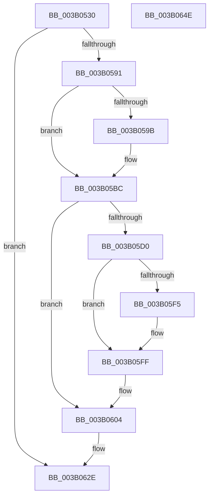

# SMKM_STORE&lt;SM_TRAITS&gt;::SmStHelperSendCommand

- RVA: `0x003B0530`–`0x003B064F` (길이 `287` bytes)
- VA: `0x00000001403B0530`
- 실행 섹션: `.text`
- PDB 이름 있음: `예`; PDB Function 태그: `아니요`
- unwind 정보 RVA: `0x0008C20C`
- 디코드: `81`개 명령, `287/287` bytes 표시
- 미해석 바이트: `0` (있으면 어셈블리에 `.byte`로 보존)

> 이 문서는 커널 이미지의 기계어와 PDB 기호를 분석해 생성했습니다. 4번과 5번은 함수 원형과 자료형을 바이너리 사용 방식에서 추정한 C 해석이며 원본 소스 복구 결과는 아닙니다.

## 1. Dependencies

- 직접 호출 지점: **5**; 고유 호출 대상: **5**
- 직접 호출자로 확인된 함수: **4**
- RIP 상대 이미지 참조: **0**

### Outgoing calls
- `0x003B057E` → [SmKmStoreHelperCheckWaitCommand](SmKmStoreHelperCheckWaitCommand_function_003B06E0.md) (function, `0x003B06E0`)
- `0x003B05C5` → [KeSetEvent](../33/KeSetEvent_function_0033F310.md) (function, `0x0033F310`)
- `0x003B0607` → [SMKM_STORE<SM_TRAITS>::SmStReleaseStoreLockExclusive](../2D/SMKM_STORE_SM_TRAITS_SmStReleaseStoreLockExclusive_function_002DFE68.md) (function, `0x002DFE68`)
- `0x003B061E` → [SmKmStoreHelperWaitForCommand](SmKmStoreHelperWaitForCommand_function_003B075C.md) (function, `0x003B075C`)
- `0x003B0629` → [SMKM_STORE<SM_TRAITS>::SmStAcquireStoreLockExclusive](../20/SMKM_STORE_SM_TRAITS_SmStAcquireStoreLockExclusive_function_00206630.md) (function, `0x00206630`)

### Direct callers
- [SMKM_STORE&lt;SM_TRAITS&gt;::SmStReleaseVirtualRegion](../3A/SMKM_STORE_SM_TRAITS_SmStReleaseVirtualRegion_function_003AF338.md) at `0x003AF440`
- [SMKM_STORE&lt;SM_TRAITS&gt;::SmStAllocateVirtualRegion](SMKM_STORE_SM_TRAITS_SmStAllocateVirtualRegion_function_003B0464.md) at `0x003B04E5`
- [SMKM_STORE&lt;SM_TRAITS&gt;::SmStLockVirtualRegion](../4E/SMKM_STORE_SM_TRAITS_SmStLockVirtualRegion_function_004EAF8C.md) at `0x004EB04C`
- [SMKM_STORE&lt;SM_TRAITS&gt;::SmStLockVirtualRegion](../4E/SMKM_STORE_SM_TRAITS_SmStLockVirtualRegion_function_004EAF8C.md) at `0x004EB140`
- [ST_STORE&lt;SM_TRAITS&gt;::StDmCombineBufferProcess](../4E/ST_STORE_SM_TRAITS_StDmCombineBufferProcess_function_004EB9AC.md) at `0x004EBA39`

### Static image references
- 디코드된 RIP-relative 메모리 참조가 없습니다.

## 2. Other-region calls and transfers

- 다른 실행 섹션으로 향하는 call: **0**
- 별도 외부 분기/꼬리 이동을 확인하지 못했습니다.

## 3. Assembly (complete function range)

```asm
003B0530  48 8B C4                        mov rax, rsp
003B0533  48 89 58 08                     mov qword ptr [rax + 8], rbx
003B0537  48 89 68 10                     mov qword ptr [rax + 0x10], rbp
003B053B  48 89 70 18                     mov qword ptr [rax + 0x18], rsi
003B053F  57                              push rdi
003B0540  41 54                           push r12
003B0542  41 55                           push r13
003B0544  41 56                           push r14
003B0546  41 57                           push r15
003B0548  48 83 EC 30                     sub rsp, 0x30
003B054C  4C 8B F9                        mov r15, rcx
003B054F  33 ED                           xor ebp, ebp
003B0551  44 8B E2                        mov r12d, edx
003B0554  48 89 68 C8                     mov qword ptr [rax - 0x38], rbp
003B0558  B9 78 1B 00 00                  mov ecx, 0x1b78
003B055D  BB 08 1C 00 00                  mov ebx, 0x1c08
003B0562  41 8B F9                        mov edi, r9d
003B0565  49 8B F0                        mov rsi, r8
003B0568  44 8D 6D 04                     lea r13d, [rbp + 4]
003B056C  41 3B D5                        cmp edx, r13d
003B056F  41 8B D1                        mov edx, r9d
003B0572  0F 45 D9                        cmovne ebx, ecx
003B0575  83 E2 01                        and edx, 1
003B0578  49 03 DF                        add rbx, r15
003B057B  48 8B CB                        mov rcx, rbx
003B057E  E8 5D 01 00 00                  call 0x1403b06e0
003B0583  44 8B F0                        mov r14d, eax
003B0586  3D AE 00 00 C0                  cmp eax, 0xc00000ae
003B058B  0F 84 9D 00 00 00               je 0x1403b062e
003B0591  66 44 89 63 3A                  mov word ptr [rbx + 0x3a], r12w
003B0596  48 85 F6                        test rsi, rsi
003B0599  74 21                           je 0x1403b05bc
003B059B  0F 10 06                        movups xmm0, xmmword ptr [rsi]
003B059E  0F 11 43 40                     movups xmmword ptr [rbx + 0x40], xmm0
003B05A2  0F 10 4E 10                     movups xmm1, xmmword ptr [rsi + 0x10]
003B05A6  0F 11 4B 50                     movups xmmword ptr [rbx + 0x50], xmm1
003B05AA  0F 10 46 20                     movups xmm0, xmmword ptr [rsi + 0x20]
003B05AE  0F 11 43 60                     movups xmmword ptr [rbx + 0x60], xmm0
003B05B2  F2 0F 10 4E 30                  movsd xmm1, qword ptr [rsi + 0x30]
003B05B7  F2 0F 11 4B 70                  movsd qword ptr [rbx + 0x70], xmm1
003B05BC  48 8D 4B 08                     lea rcx, [rbx + 8]
003B05C0  45 33 C0                        xor r8d, r8d
003B05C3  33 D2                           xor edx, edx
003B05C5  E8 46 ED F8 FF                  call 0x14033f310
003B05CA  40 F6 C7 02                     test dil, 2
003B05CE  75 34                           jne 0x1403b0604
003B05D0  41 80 BF 96 1A 00 00 01         cmp byte ptr [r15 + 0x1a96], 1
003B05D8  48 C7 C0 C0 BD F0 FF            mov rax, 0xfffffffffff0bdc0
003B05DF  48 C7 C1 C0 B4 B3 FF            mov rcx, 0xffffffffffb3b4c0
003B05E6  48 0F 47 C1                     cmova rax, rcx
003B05EA  48 89 44 24 20                  mov qword ptr [rsp + 0x20], rax
003B05EF  40 F6 C7 08                     test dil, 8
003B05F3  74 0A                           je 0x1403b05ff
003B05F5  48 99                           cqo
003B05F7  49 F7 FD                        idiv r13
003B05FA  48 89 44 24 20                  mov qword ptr [rsp + 0x20], rax
003B05FF  48 8D 6C 24 20                  lea rbp, [rsp + 0x20]
003B0604  49 8B CF                        mov rcx, r15
003B0607  E8 5C F8 F2 FF                  call 0x1402dfe68
003B060C  C1 EF 02                        shr edi, 2
003B060F  4C 8B C5                        mov r8, rbp
003B0612  83 E7 01                        and edi, 1
003B0615  48 8B D6                        mov rdx, rsi
003B0618  44 8B CF                        mov r9d, edi
003B061B  48 8B CB                        mov rcx, rbx
003B061E  E8 39 01 00 00                  call 0x1403b075c
003B0623  49 8B CF                        mov rcx, r15
003B0626  44 8B F0                        mov r14d, eax
003B0629  E8 02 60 E5 FF                  call 0x140206630
003B062E  48 8B 5C 24 60                  mov rbx, qword ptr [rsp + 0x60]
003B0633  41 8B C6                        mov eax, r14d
003B0636  48 8B 6C 24 68                  mov rbp, qword ptr [rsp + 0x68]
003B063B  48 8B 74 24 70                  mov rsi, qword ptr [rsp + 0x70]
003B0640  48 83 C4 30                     add rsp, 0x30
003B0644  41 5F                           pop r15
003B0646  41 5E                           pop r14
003B0648  41 5D                           pop r13
003B064A  41 5C                           pop r12
003B064C  5F                              pop rdi
003B064D  C3                              ret
003B064E  CC                              int3
```

## 4. C-style interpretation (structured pseudocode)

```c
__int64 __fastcall SMKM_STORE_SM_TRAITS___SmStHelperSendCommand(__int64 a1, int a2, __int64 a3, int a4)
{
    __int64 result;
    __int64 v_rbp;
    __int64 v_rbx;
    __int64 v_rdi;
    __int64 v_rsp;
    unsigned __int64 v_stack_m38;
    unsigned __int64 v_stack_p10;
    unsigned __int64 v_stack_p18;
    unsigned __int64 v_stack_p8;

    *(unsigned __int64 *)(v_rsp + 8) = v_rbx;
    *(unsigned __int64 *)(v_rsp + 16) = v_rbp;
    *(unsigned __int64 *)(v_rsp + 24) = v_rsi;
    v_rsp = (v_rsp) - (48);
    v_rbp = 0;
    *(unsigned __int64 *)(v_rsp - 56) = 0;
    v_rbx = (unsigned int)(0x1C08ULL);
    if (a2 != ((unsigned int)(v_rbp + 4))) { v_rbx = (unsigned int)((unsigned int)(0x1B78ULL)); }
    a2 = (unsigned int)(((unsigned int)(a4)) & (1));
    v_rbx = (v_rbx) + (a1);
    result = SmKmStoreHelperCheckWaitCommand(v_rbx, a2, a3, a4);
    if (((unsigned int)(result)) == 0xC00000AEULL) goto loc_003B062E;
    *(unsigned __int16 *)(v_rbx + 58) = (unsigned __int16)((unsigned int)(a2));
    if (a3 != 0) {
        *(unsigned __int64 *)(v_rbx + 64) = v_xmm0;
        *(unsigned __int64 *)(v_rbx + 80) = v_xmm1;
        *(unsigned __int64 *)(v_rbx + 96) = v_xmm0;
        *(unsigned __int64 *)(v_rbx + 112) = v_xmm1;
    }
    a3 = 0;
    a2 = 0;
    result = KeSetEvent(v_rbx + 8, a2, a3, a4);
    if ((((unsigned __int8)((unsigned int)(a4))) & (2)) != 0) goto loc_003B0604;
    result = 0xFFFFFFFFFFF0BDC0ULL;
    if ((*(unsigned __int8 *)(a1 + 6806)) > 1) { result = 0xFFFFFFFFFFB3B4C0ULL; }
    v_stack_m38 = result;
    if ((((unsigned __int8)((unsigned int)(a4))) & (8)) != 0) {
        v_stack_m38 = result;
    }
loc_003B0604:
    result = SMKM_STORE_SM_TRAITS___SmStReleaseStoreLockExclusive(a1, a2, a3, a4);
    v_rdi = (unsigned int)(((unsigned int)(a4)) >> (2));
    v_rdi = (unsigned int)((v_rdi) & (1));
    result = SmKmStoreHelperWaitForCommand(v_rbx, 0, v_stack_m38, (unsigned int)((unsigned int)(v_rdi)));
    result = SMKM_STORE_SM_TRAITS___SmStAcquireStoreLockExclusive(a1, 0, v_stack_m38, (unsigned int)((unsigned int)(v_rdi)));
loc_003B062E:
    v_rsp = (v_rsp) + (48);
    return (unsigned int)((unsigned int)((unsigned int)((unsigned int)(result))));
}
```

## 5. (Beta) C Style

```c
int64_t SMKM_STORE_SM_TRAITS___SmStHelperSendCommand(void *Arg1, int32_t Arg2, int64_t Arg3, int32_t Arg4)
{
    uint8_t *arg1 = (uint8_t *)Arg1;

    int64_t result;
    int64_t local_rbp;
    int64_t local_rbx;
    int64_t local_rdi;
    int64_t local_rsp;
    uint64_t v_stack_m38;
    uint64_t v_stack_p10;
    uint64_t v_stack_p18;
    uint64_t v_stack_p8;

    *(uint64_t *)(local_rsp + 0x8) = local_rbx;
    *(uint64_t *)(local_rsp + 0x10) = local_rbp;
    *(uint64_t *)(local_rsp + 0x18) = local_rsi;
    local_rsp = (local_rsp) - (48);
    local_rbp = 0;
    *(uint64_t *)(local_rsp - 0x38) = 0;
    local_rbx = (uint32_t)(0x1C08ULL);
    if (Arg2 != ((uint32_t)(local_rbp + 4))) { local_rbx = (uint32_t)((uint32_t)(0x1B78ULL)); }
    Arg2 = (uint32_t)(((uint32_t)(Arg4)) & (1));
    local_rbx = (local_rbx) + (Arg1);
    result = SmKmStoreHelperCheckWaitCommand(local_rbx, Arg2, Arg3, Arg4);
    if (((uint32_t)(result)) == 0xC00000AEULL) goto loc_003B062E;
    *(uint16_t *)(local_rbx + 0x3A) = (uint16_t)((uint32_t)(Arg2));
    if (Arg3 != 0) {
        *(uint64_t *)(local_rbx + 0x40) = v_xmm0;
        *(uint64_t *)(local_rbx + 0x50) = v_xmm1;
        *(uint64_t *)(local_rbx + 0x60) = v_xmm0;
        *(uint64_t *)(local_rbx + 0x70) = v_xmm1;
    }
    Arg3 = 0;
    Arg2 = 0;
    result = KeSetEvent(local_rbx + 8, Arg2, Arg3, Arg4);
    if ((((uint8_t)((uint32_t)(Arg4))) & (2)) != 0) goto loc_003B0604;
    result = 0xFFFFFFFFFFF0BDC0ULL;
    if ((*(uint8_t *)(arg1 + 0x1A96)) > 1) { result = 0xFFFFFFFFFFB3B4C0ULL; }
    v_stack_m38 = result;
    if ((((uint8_t)((uint32_t)(Arg4))) & (8)) != 0) {
        v_stack_m38 = result;
    }
loc_003B0604:
    result = SMKM_STORE_SM_TRAITS___SmStReleaseStoreLockExclusive(Arg1, Arg2, Arg3, Arg4);
    local_rdi = (uint32_t)(((uint32_t)(Arg4)) >> (2));
    local_rdi = (uint32_t)((local_rdi) & (1));
    result = SmKmStoreHelperWaitForCommand(local_rbx, 0, v_stack_m38, (uint32_t)((uint32_t)(local_rdi)));
    result = SMKM_STORE_SM_TRAITS___SmStAcquireStoreLockExclusive(Arg1, 0, v_stack_m38, (uint32_t)((uint32_t)(local_rdi)));
loc_003B062E:
    local_rsp = (local_rsp) + (48);
    return (uint32_t)((uint32_t)((uint32_t)((uint32_t)(result))));
}
```

### 관측된 메모리 오프셋

구조체 형식이 확인되지 않은 접근은 인자 기준의 오프셋으로만 기록했습니다.

| 기준 인자 | 오프셋 표현 | 폭 (bit) | 접근 |
|---|---:|---:|---|
| `Arg1` | `+ 0x1A96` | `8` | `R` |

## 6. Execution-region graph

[열기: 2D/3D 그래프와 함수 탐색 컨트롤 패널](../../../control-panel.html?section=text&rva=0x003B0530&view=graph)

- 2D 그래프는 위에서 아래로 흐르고, 3D 그래프는 빈 공간을 드래그해 회전합니다. Shift+드래그는 이동, 휠은 확대·축소, 함수 노드 선택은 대상 보고서 이동입니다.

### Static fallback


