# SMKM_STORE&lt;SM_TRAITS&gt;::SmStStart

- RVA: `0x003B14DC`–`0x003B1A5F` (길이 `1,411` bytes)
- VA: `0x00000001403B14DC`
- 실행 섹션: `.text`
- PDB 이름 있음: `예`; PDB Function 태그: `예`
- unwind 정보 RVA: `0x0008C304`
- 디코드: `349`개 명령, `1,411/1,411` bytes 표시
- 미해석 바이트: `0` (있으면 어셈블리에 `.byte`로 보존)

> 이 문서는 커널 이미지의 기계어와 PDB 기호를 분석해 생성했습니다. 4번과 5번은 함수 원형과 자료형을 바이너리 사용 방식에서 추정한 C 해석이며 원본 소스 복구 결과는 아닙니다.

## 1. Dependencies

- 직접 호출 지점: **21**; 고유 호출 대상: **13**
- 직접 호출자로 확인된 함수: **1**
- RIP 상대 이미지 참조: **3**

### Outgoing calls
- `0x003B157B` → [_security_check_cookie](../6A/_security_check_cookie_function_006AC640.md) (function, `0x006AC640`)
- `0x003B1678` → [SmFpCleanup](SmFpCleanup_function_003B082C.md) (function, `0x003B082C`)
- `0x003B168D` → [memset](../6C/memset_function_006C6C40.md) (function, `0x006C6C40`)
- `0x003B16D3` → [SmKmStoreHelperInitialize](SmKmStoreHelperInitialize_function_003B1A68.md) (function, `0x003B1A68`)
- `0x003B16E6` → [SmKmStoreHelperInitialize](SmKmStoreHelperInitialize_function_003B1A68.md) (function, `0x003B1A68`)
- `0x003B16FB` → [memset](../6C/memset_function_006C6C40.md) (function, `0x006C6C40`)
- `0x003B177F` → [SmGetIdealProcessorFromNumaNode](SmGetIdealProcessorFromNumaNode_function_003B214C.md) (function, `0x003B214C`)
- `0x003B1795` → [SmKmStoreHelperStart](SmKmStoreHelperStart_function_003B1ACC.md) (function, `0x003B1ACC`)
- `0x003B17AE` → [SmKmStoreHelperStart](SmKmStoreHelperStart_function_003B1ACC.md) (function, `0x003B1ACC`)
- `0x003B17EE` → [ExAllocatePool2](../../poolcode/B8/ExAllocatePool2_function_00B820F0.md) (function, `0x00B820F0`)
- `0x003B180B` → [memset](../6C/memset_function_006C6C40.md) (function, `0x006C6C40`)
- `0x003B1824` → [SmAcquireReleaseCharges](../28/SmAcquireReleaseCharges_function_00285C40.md) (function, `0x00285C40`)
- `0x003B1857` → [ExAllocatePool2](../../poolcode/B8/ExAllocatePool2_function_00B820F0.md) (function, `0x00B820F0`)
- `0x003B1874` → [memset](../6C/memset_function_006C6C40.md) (function, `0x006C6C40`)
- `0x003B1890` → [memset](../6C/memset_function_006C6C40.md) (function, `0x006C6C40`)
- `0x003B18F4` → [ST_STORE<SM_TRAITS>::StStart](ST_STORE_SM_TRAITS_StStart_function_003B1BBC.md) (function, `0x003B1BBC`)
- `0x003B1921` → [SMKM_STORE<SM_TRAITS>::SmStWorkerThreadStartThread](SMKM_STORE_SM_TRAITS_SmStWorkerThreadStartThread_function_003B200C.md) (function, `0x003B200C`)
- `0x003B195F` → [SMKM_STORE<SM_TRAITS>::SmStWorkerThreadStartThread](SMKM_STORE_SM_TRAITS_SmStWorkerThreadStartThread_function_003B200C.md) (function, `0x003B200C`)
- `0x003B1A18` → [SmFpPreAllocate](../4C/SmFpPreAllocate_function_004CF32C.md) (function, `0x004CF32C`)
- `0x003B1A2D` → [SmKmFileInfoInit](../../page/70/SmKmFileInfoInit_function_00705250.md) (function, `0x00705250`)
- `0x003B1A47` → [SmKmFileInfoDuplicate](../../page/AC/SmKmFileInfoDuplicate_function_00AC98FC.md) (function, `0x00AC98FC`)

### Direct callers
- [SmProcessCreateRequest](../../page/A5/SmProcessCreateRequest_function_00A50DD0.md) at `0x00A51077`

### Static image references
- `0x003B14F8` → RVA `0x00E0A740` (`.data`; read)
- `0x003B1917` → RVA `0x004A8B20` (`SMKM_STORE<SM_TRAITS>::SmStWorkerThread`; read)
- `0x003B1955` → RVA `0x00203230` (`SMKM_STORE<SM_TRAITS>::SmStReadThread`; read)

## 2. Other-region calls and transfers

- 다른 실행 섹션으로 향하는 call: **4**
  - `0x003B17EE` → [ExAllocatePool2](../../poolcode/B8/ExAllocatePool2_function_00B820F0.md) (`.text` → `POOLCODE`)
  - `0x003B1857` → [ExAllocatePool2](../../poolcode/B8/ExAllocatePool2_function_00B820F0.md) (`.text` → `POOLCODE`)
  - `0x003B1A2D` → [SmKmFileInfoInit](../../page/70/SmKmFileInfoInit_function_00705250.md) (`.text` → `PAGE`)
  - `0x003B1A47` → [SmKmFileInfoDuplicate](../../page/AC/SmKmFileInfoDuplicate_function_00AC98FC.md) (`.text` → `PAGE`)
- call이 아닌 외부 분기/꼬리 이동: **2**
  - `0x003B1A1E` → [sub_006E707E](../6E/Unknown_function_006E707E.md) (`tail-transfer`)
  - `0x003B1A4D` → [sub_006E707E](../6E/Unknown_function_006E707E.md) (`tail-transfer`)

## 3. Assembly (complete function range)

```asm
003B14DC  48 89 5C 24 18                  mov qword ptr [rsp + 0x18], rbx
003B14E1  55                              push rbp
003B14E2  56                              push rsi
003B14E3  57                              push rdi
003B14E4  41 54                           push r12
003B14E6  41 55                           push r13
003B14E8  41 56                           push r14
003B14EA  41 57                           push r15
003B14EC  48 8D 6C 24 D9                  lea rbp, [rsp - 0x27]
003B14F1  48 81 EC 90 00 00 00            sub rsp, 0x90
003B14F8  48 8B 05 41 92 A5 00            mov rax, qword ptr [rip + 0xa59241]
003B14FF  48 33 C4                        xor rax, rsp
003B1502  48 89 45 17                     mov qword ptr [rbp + 0x17], rax
003B1506  4C 8B 3A                        mov r15, qword ptr [rdx]
003B1509  45 33 ED                        xor r13d, r13d
003B150C  48 8B F1                        mov rsi, rcx
003B150F  44 89 6D BB                     mov dword ptr [rbp - 0x45], r13d
003B1513  4C 8B F2                        mov r14, rdx
003B1516  C7 45 B7 05 00 10 00            mov dword ptr [rbp - 0x49], 0x100005
003B151D  41 8B 0F                        mov ecx, dword ptr [r15]
003B1520  44 0F B6 C1                     movzx r8d, cl
003B1524  41 83 F8 02                     cmp r8d, 2
003B1528  73 43                           jae 0x1403b156d
003B152A  45 39 6F 14                     cmp dword ptr [r15 + 0x14], r13d
003B152E  75 3D                           jne 0x1403b156d
003B1530  41 8B 47 0C                     mov eax, dword ptr [r15 + 0xc]
003B1534  FF C8                           dec eax
003B1536  3D FF FF 03 00                  cmp eax, 0x3ffff
003B153B  77 30                           ja 0x1403b156d
003B153D  41 8B 57 08                     mov edx, dword ptr [r15 + 8]
003B1541  85 D2                           test edx, edx
003B1543  74 28                           je 0x1403b156d
003B1545  8D 42 FF                        lea eax, [rdx - 1]
003B1548  85 C2                           test edx, eax
003B154A  75 21                           jne 0x1403b156d
003B154C  41 83 F8 01                     cmp r8d, 1
003B1550  0F 84 1F 04 00 00               je 0x1403b1975
003B1556  BA 00 00 05 00                  mov edx, 0x50000
003B155B  0F BA E1 11                     bt ecx, 0x11
003B155F  0F 83 24 04 00 00               jae 0x1403b1989
003B1565  8B C1                           mov eax, ecx
003B1567  23 C2                           and eax, edx
003B1569  3B C2                           cmp eax, edx
003B156B  75 2F                           jne 0x1403b159c
003B156D  B9 0D 00 00 C0                  mov ecx, 0xc000000d
003B1572  8B C1                           mov eax, ecx
003B1574  48 8B 4D 17                     mov rcx, qword ptr [rbp + 0x17]
003B1578  48 33 CC                        xor rcx, rsp
003B157B  E8 C0 B0 2F 00                  call 0x1406ac640
003B1580  48 8B 9C 24 E0 00 00 00         mov rbx, qword ptr [rsp + 0xe0]
003B1588  48 81 C4 90 00 00 00            add rsp, 0x90
003B158F  41 5F                           pop r15
003B1591  41 5E                           pop r14
003B1593  41 5D                           pop r13
003B1595  41 5C                           pop r12
003B1597  5F                              pop rdi
003B1598  5E                              pop rsi
003B1599  5D                              pop rbp
003B159A  C3                              ret
003B159B  CC                              int3
003B159C  8B C1                           mov eax, ecx
003B159E  25 00 00 0A 00                  and eax, 0xa0000
003B15A3  3D 00 00 08 00                  cmp eax, 0x80000
003B15A8  74 C3                           je 0x1403b156d
003B15AA  84 C9                           test cl, cl
003B15AC  0F 95 C2                        setne dl
003B15AF  0F BA E1 14                     bt ecx, 0x14
003B15B3  0F 92 C0                        setb al
003B15B6  84 C2                           test dl, al
003B15B8  75 B3                           jne 0x1403b156d
003B15BA  0F BA E1 15                     bt ecx, 0x15
003B15BE  0F 92 C0                        setb al
003B15C1  84 C2                           test dl, al
003B15C3  75 A8                           jne 0x1403b156d
003B15C5  8B C1                           mov eax, ecx
003B15C7  25 00 00 30 00                  and eax, 0x300000
003B15CC  3D 00 00 10 00                  cmp eax, 0x100000
003B15D1  74 9A                           je 0x1403b156d
003B15D3  8B C1                           mov eax, ecx
003B15D5  25 00 00 A0 00                  and eax, 0xa00000
003B15DA  3D 00 00 80 00                  cmp eax, 0x800000
003B15DF  74 8C                           je 0x1403b156d
003B15E1  81 E1 00 00 42 00               and ecx, 0x420000
003B15E7  81 F9 00 00 40 00               cmp ecx, 0x400000
003B15ED  0F 84 7A FF FF FF               je 0x1403b156d
003B15F3  49 8B 46 20                     mov rax, qword ptr [r14 + 0x20]
003B15F7  48 89 86 90 1D 00 00            mov qword ptr [rsi + 0x1d90], rax
003B15FE  41 8B 46 38                     mov eax, dword ptr [r14 + 0x38]
003B1602  89 86 98 1D 00 00               mov dword ptr [rsi + 0x1d98], eax
003B1608  85 C0                           test eax, eax
003B160A  75 0A                           jne 0x1403b1616
003B160C  C7 86 98 1D 00 00 07 00 00 00   mov dword ptr [rsi + 0x1d98], 7
003B1616  41 8A 07                        mov al, byte ptr [r15]
003B1619  48 8D BE 18 1D 00 00            lea rdi, [rsi + 0x1d18]
003B1620  88 86 94 1A 00 00               mov byte ptr [rsi + 0x1a94], al
003B1626  8A 86 95 1A 00 00               mov al, byte ptr [rsi + 0x1a95]
003B162C  41 8B 17                        mov edx, dword ptr [r15]
003B162F  C1 EA 11                        shr edx, 0x11
003B1632  C0 E2 02                        shl dl, 2
003B1635  32 D0                           xor dl, al
003B1637  80 E2 04                        and dl, 4
003B163A  32 D0                           xor dl, al
003B163C  88 96 95 1A 00 00               mov byte ptr [rsi + 0x1a95], dl
003B1642  41 8A 4F 02                     mov cl, byte ptr [r15 + 2]
003B1646  C0 E1 03                        shl cl, 3
003B1649  32 CA                           xor cl, dl
003B164B  80 E1 08                        and cl, 8
003B164E  32 CA                           xor cl, dl
003B1650  88 8E 95 1A 00 00               mov byte ptr [rsi + 0x1a95], cl
003B1656  41 8B 07                        mov eax, dword ptr [r15]
003B1659  C1 E8 12                        shr eax, 0x12
003B165C  C0 E0 05                        shl al, 5
003B165F  32 C1                           xor al, cl
003B1661  24 20                           and al, 0x20
003B1663  32 C1                           xor al, cl
003B1665  48 8B CF                        mov rcx, rdi
003B1668  88 86 95 1A 00 00               mov byte ptr [rsi + 0x1a95], al
003B166E  41 8B 47 08                     mov eax, dword ptr [r15 + 8]
003B1672  89 86 60 1B 00 00               mov dword ptr [rsi + 0x1b60], eax
003B1678  E8 AF F1 FF FF                  call 0x1403b082c
003B167D  48 8B 9E 90 1D 00 00            mov rbx, qword ptr [rsi + 0x1d90]
003B1684  33 D2                           xor edx, edx
003B1686  48 8B CF                        mov rcx, rdi
003B1689  44 8D 42 78                     lea r8d, [rdx + 0x78]
003B168D  E8 AE 55 31 00                  call 0x1406c6c40
003B1692  66 C7 47 08 01 00               mov word ptr [rdi + 8], 1
003B1698  48 8D 47 10                     lea rax, [rdi + 0x10]
003B169C  C6 47 0A 06                     mov byte ptr [rdi + 0xa], 6
003B16A0  44 89 6F 0C                     mov dword ptr [rdi + 0xc], r13d
003B16A4  48 89 40 08                     mov qword ptr [rax + 8], rax
003B16A8  48 89 00                        mov qword ptr [rax], rax
003B16AB  48 89 5F 20                     mov qword ptr [rdi + 0x20], rbx
003B16AF  45 38 2F                        cmp byte ptr [r15], r13b
003B16B2  0F 85 6B 03 00 00               jne 0x1403b1a23
003B16B8  F6 86 95 1A 00 00 04            test byte ptr [rsi + 0x1a95], 4
003B16BF  0F 84 73 01 00 00               je 0x1403b1838
003B16C5  41 8A 56 3C                     mov dl, byte ptr [r14 + 0x3c]
003B16C9  48 8D BE 78 1B 00 00            lea rdi, [rsi + 0x1b78]
003B16D0  48 8B CF                        mov rcx, rdi
003B16D3  E8 90 03 00 00                  call 0x1403b1a68
003B16D8  41 8A 56 3C                     mov dl, byte ptr [r14 + 0x3c]
003B16DC  4C 8D A6 08 1C 00 00            lea r12, [rsi + 0x1c08]
003B16E3  49 8B CC                        mov rcx, r12
003B16E6  E8 7D 03 00 00                  call 0x1403b1a68
003B16EB  33 D2                           xor edx, edx
003B16ED  48 8D 9E 98 1C 00 00            lea rbx, [rsi + 0x1c98]
003B16F4  48 8B CB                        mov rcx, rbx
003B16F7  44 8D 42 58                     lea r8d, [rdx + 0x58]
003B16FB  E8 40 55 31 00                  call 0x1406c6c40
003B1700  66 44 89 6B 08                  mov word ptr [rbx + 8], r13w
003B1705  48 8D 43 10                     lea rax, [rbx + 0x10]
003B1709  C6 43 0A 06                     mov byte ptr [rbx + 0xa], 6
003B170D  44 89 6B 0C                     mov dword ptr [rbx + 0xc], r13d
003B1711  48 89 40 08                     mov qword ptr [rax + 8], rax
003B1715  48 89 00                        mov qword ptr [rax], rax
003B1718  48 8D 43 28                     lea rax, [rbx + 0x28]
003B171C  66 44 89 6B 20                  mov word ptr [rbx + 0x20], r13w
003B1721  C6 43 22 06                     mov byte ptr [rbx + 0x22], 6
003B1725  44 89 6B 24                     mov dword ptr [rbx + 0x24], r13d
003B1729  48 89 40 08                     mov qword ptr [rax + 8], rax
003B172D  48 89 00                        mov qword ptr [rax], rax
003B1730  48 8D 43 38                     lea rax, [rbx + 0x38]
003B1734  48 89 40 08                     mov qword ptr [rax + 8], rax
003B1738  4C 89 28                        mov qword ptr [rax], r13
003B173B  4C 89 6B 48                     mov qword ptr [rbx + 0x48], r13
003B173F  49 8B 46 28                     mov rax, qword ptr [r14 + 0x28]
003B1743  80 8E 95 1A 00 00 80            or byte ptr [rsi + 0x1a95], 0x80
003B174A  48 89 86 00 1D 00 00            mov qword ptr [rsi + 0x1d00], rax
003B1751  41 0F B6 46 3C                  movzx eax, byte ptr [r14 + 0x3c]
003B1756  88 86 A4 1D 00 00               mov byte ptr [rsi + 0x1da4], al
003B175C  3C FF                           cmp al, 0xff
003B175E  0F 85 32 02 00 00               jne 0x1403b1996
003B1764  41 8B 56 40                     mov edx, dword ptr [r14 + 0x40]
003B1768  89 96 9C 1D 00 00               mov dword ptr [rsi + 0x1d9c], edx
003B176E  85 D2                           test edx, edx
003B1770  0F 84 C2 01 00 00               je 0x1403b1938
003B1776  48 8B 8E 90 1D 00 00            mov rcx, qword ptr [rsi + 0x1d90]
003B177D  FF CA                           dec edx
003B177F  E8 C8 09 00 00                  call 0x1403b214c
003B1784  89 45 BB                        mov dword ptr [rbp - 0x45], eax
003B1787  48 8D 5D BB                     lea rbx, [rbp - 0x45]
003B178B  49 8B 56 30                     mov rdx, qword ptr [r14 + 0x30]
003B178F  4C 8B C3                        mov r8, rbx
003B1792  48 8B CF                        mov rcx, rdi
003B1795  E8 32 03 00 00                  call 0x1403b1acc
003B179A  8B C8                           mov ecx, eax
003B179C  85 C0                           test eax, eax
003B179E  0F 88 CE FD FF FF               js 0x1403b1572
003B17A4  49 8B 56 30                     mov rdx, qword ptr [r14 + 0x30]
003B17A8  4C 8B C3                        mov r8, rbx
003B17AB  49 8B CC                        mov rcx, r12
003B17AE  E8 19 03 00 00                  call 0x1403b1acc
003B17B3  8B C8                           mov ecx, eax
003B17B5  85 C0                           test eax, eax
003B17B7  0F 88 B5 FD FF FF               js 0x1403b1572
003B17BD  F6 86 95 1A 00 00 08            test byte ptr [rsi + 0x1a95], 8
003B17C4  0F 85 08 02 00 00               jne 0x1403b19d2
003B17CA  48 8B 86 90 1D 00 00            mov rax, qword ptr [rsi + 0x1d90]
003B17D1  BB 50 00 00 00                  mov ebx, 0x50
003B17D6  48 05 40 0B 00 00               add rax, 0xb40
003B17DC  41 B8 73 6D 52 6C               mov r8d, 0x6c526d73
003B17E2  8B D3                           mov edx, ebx
003B17E4  48 89 86 88 1C 00 00            mov qword ptr [rsi + 0x1c88], rax
003B17EB  8D 4B F0                        lea ecx, [rbx - 0x10]
003B17EE  E8 FD 08 7D 00                  call 0x140b820f0
003B17F3  48 89 86 70 1B 00 00            mov qword ptr [rsi + 0x1b70], rax
003B17FA  48 85 C0                        test rax, rax
003B17FD  0F 84 3D 01 00 00               je 0x1403b1940
003B1803  44 8B C3                        mov r8d, ebx
003B1806  33 D2                           xor edx, edx
003B1808  48 8B C8                        mov rcx, rax
003B180B  E8 30 54 31 00                  call 0x1406c6c40
003B1810  8B 96 60 1B 00 00               mov edx, dword ptr [rsi + 0x1b60]
003B1816  44 8D 43 B1                     lea r8d, [rbx - 0x4f]
003B181A  48 8B 8E 90 1D 00 00            mov rcx, qword ptr [rsi + 0x1d90]
003B1821  45 33 C9                        xor r9d, r9d
003B1824  E8 17 44 ED FF                  call 0x140285c40
003B1829  85 C0                           test eax, eax
003B182B  0F 84 0F 01 00 00               je 0x1403b1940
003B1831  80 8E 95 1A 00 00 10            or byte ptr [rsi + 0x1a95], 0x10
003B1838  41 8B 47 0C                     mov eax, dword ptr [r15 + 0xc]
003B183C  41 B8 73 6D 52 67               mov r8d, 0x67526d73
003B1842  89 86 64 1B 00 00               mov dword ptr [rsi + 0x1b64], eax
003B1848  B9 40 00 00 00                  mov ecx, 0x40
003B184D  C1 E0 03                        shl eax, 3
003B1850  41 8B FD                        mov edi, r13d
003B1853  8B D0                           mov edx, eax
003B1855  8B D8                           mov ebx, eax
003B1857  E8 94 08 7D 00                  call 0x140b820f0
003B185C  48 85 C0                        test rax, rax
003B185F  0F 84 DB 00 00 00               je 0x1403b1940
003B1865  44 8B C3                        mov r8d, ebx
003B1868  48 89 86 68 1B 00 00            mov qword ptr [rsi + 0x1b68], rax
003B186F  33 D2                           xor edx, edx
003B1871  48 8B C8                        mov rcx, rax
003B1874  E8 C7 53 31 00                  call 0x1406c6c40
003B1879  F6 86 95 1A 00 00 04            test byte ptr [rsi + 0x1a95], 4
003B1880  0F 84 65 01 00 00               je 0x1403b19eb
003B1886  33 D2                           xor edx, edx
003B1888  48 8D 4D C7                     lea rcx, [rbp - 0x39]
003B188C  44 8D 42 48                     lea r8d, [rdx + 0x48]
003B1890  E8 AB 53 31 00                  call 0x1406c6c40
003B1895  41 0F 10 07                     movups xmm0, xmmword ptr [r15]
003B1899  8B 86 64 1B 00 00               mov eax, dword ptr [rsi + 0x1b64]
003B189F  89 7D D7                        mov dword ptr [rbp - 0x29], edi
003B18A2  F3 0F 7F 45 C7                  movdqu xmmword ptr [rbp - 0x39], xmm0
003B18A7  89 45 D3                        mov dword ptr [rbp - 0x2d], eax
003B18AA  49 8B 46 18                     mov rax, qword ptr [r14 + 0x18]
003B18AE  48 89 45 F7                     mov qword ptr [rbp - 9], rax
003B18B2  41 8B 46 44                     mov eax, dword ptr [r14 + 0x44]
003B18B6  89 45 07                        mov dword ptr [rbp + 7], eax
003B18B9  48 89 75 DF                     mov qword ptr [rbp - 0x21], rsi
003B18BD  45 38 2F                        cmp byte ptr [r15], r13b
003B18C0  0F 85 8C 01 00 00               jne 0x1403b1a52
003B18C6  49 8B 46 08                     mov rax, qword ptr [r14 + 8]
003B18CA  48 8D 55 C7                     lea rdx, [rbp - 0x39]
003B18CE  48 89 45 E7                     mov qword ptr [rbp - 0x19], rax
003B18D2  41 8B 46 10                     mov eax, dword ptr [r14 + 0x10]
003B18D6  89 45 EF                        mov dword ptr [rbp - 0x11], eax
003B18D9  F7 D8                           neg eax
003B18DB  8B 45 C7                        mov eax, dword ptr [rbp - 0x39]
003B18DE  1B C9                           sbb ecx, ecx
003B18E0  0F BA F0 0B                     btr eax, 0xb
003B18E4  F7 D1                           not ecx
003B18E6  81 E1 00 08 00 00               and ecx, 0x800
003B18EC  0B C8                           or ecx, eax
003B18EE  89 4D C7                        mov dword ptr [rbp - 0x39], ecx
003B18F1  48 8B CE                        mov rcx, rsi
003B18F4  E8 C3 02 00 00                  call 0x1403b1bbc
003B18F9  8B C8                           mov ecx, eax
003B18FB  85 C0                           test eax, eax
003B18FD  0F 88 6F FC FF FF               js 0x1403b1572
003B1903  F6 86 95 1A 00 00 04            test byte ptr [rsi + 0x1a95], 4
003B190A  75 3E                           jne 0x1403b194a
003B190C  49 8B 56 30                     mov rdx, qword ptr [r14 + 0x30]
003B1910  4C 8D 8E 58 1B 00 00            lea r9, [rsi + 0x1b58]
003B1917  4C 8D 05 02 72 0F 00            lea r8, [rip + 0xf7202]
003B191E  48 8B CE                        mov rcx, rsi
003B1921  E8 E6 06 00 00                  call 0x1403b200c
003B1926  8B C8                           mov ecx, eax
003B1928  85 C0                           test eax, eax
003B192A  0F 88 42 FC FF FF               js 0x1403b1572
003B1930  41 8B CD                        mov ecx, r13d
003B1933  E9 3A FC FF FF                  jmp 0x1403b1572
003B1938  49 8B DD                        mov rbx, r13
003B193B  E9 4B FE FF FF                  jmp 0x1403b178b
003B1940  B9 9A 00 00 C0                  mov ecx, 0xc000009a
003B1945  E9 28 FC FF FF                  jmp 0x1403b1572
003B194A  49 8B 56 30                     mov rdx, qword ptr [r14 + 0x30]
003B194E  4C 8D 8E 98 1C 00 00            lea r9, [rsi + 0x1c98]
003B1955  4C 8D 05 D4 18 E5 FF            lea r8, [rip - 0x1ae72c]
003B195C  48 8B CE                        mov rcx, rsi
003B195F  E8 A8 06 00 00                  call 0x1403b200c
003B1964  85 C0                           test eax, eax
003B1966  41 8B CD                        mov ecx, r13d
003B1969  0F 48 C8                        cmovs ecx, eax
003B196C  85 C9                           test ecx, ecx
003B196E  79 9C                           jns 0x1403b190c
003B1970  E9 FD FB FF FF                  jmp 0x1403b1572
003B1975  0F BA E1 08                     bt ecx, 8
003B1979  0F 83 D7 FB FF FF               jae 0x1403b1556
003B197F  B9 BB 00 00 C0                  mov ecx, 0xc00000bb
003B1984  E9 E9 FB FF FF                  jmp 0x1403b1572
003B1989  85 CA                           test edx, ecx
003B198B  0F 85 DC FB FF FF               jne 0x1403b156d
003B1991  E9 CF FB FF FF                  jmp 0x1403b1565
003B1996  48 8B D0                        mov rdx, rax
003B1999  48 8B 86 90 1D 00 00            mov rax, qword ptr [rsi + 0x1d90]
003B19A0  48 8B 88 30 08 00 00            mov rcx, qword ptr [rax + 0x830]
003B19A7  48 8B 01                        mov rax, qword ptr [rcx]
003B19AA  B9 01 00 00 00                  mov ecx, 1
003B19AF  F0 48 0F C1 8C D0 58 45 00 00   lock xadd qword ptr [rax + rdx*8 + 0x4558], rcx
003B19B9  48 FF C1                        inc rcx
003B19BC  48 83 F9 01                     cmp rcx, 1
003B19C0  0F 8F 9E FD FF FF               jg 0x1403b1764
003B19C6  B9 0E 00 00 00                  mov ecx, 0xe
003B19CB  CD 29                           int 0x29
003B19CD  E9 92 FD FF FF                  jmp 0x1403b1764
003B19D2  48 8B 86 90 1D 00 00            mov rax, qword ptr [rsi + 0x1d90]
003B19D9  48 05 28 0B 00 00               add rax, 0xb28
003B19DF  48 89 86 F0 1B 00 00            mov qword ptr [rsi + 0x1bf0], rax
003B19E6  E9 DF FD FF FF                  jmp 0x1403b17ca
003B19EB  8B 8E 60 1B 00 00               mov ecx, dword ptr [rsi + 0x1b60]
003B19F1  48 8D 55 B7                     lea rdx, [rbp - 0x49]
003B19F5  8B 45 B7                        mov eax, dword ptr [rbp - 0x49]
003B19F8  41 B8 01 00 00 00               mov r8d, 1
003B19FE  C1 E9 08                        shr ecx, 8
003B1A01  25 0F 00 F0 FF                  and eax, 0xfff0000f
003B1A06  81 E1 F0 FF 0F 00               and ecx, 0xffff0
003B1A0C  0B C8                           or ecx, eax
003B1A0E  89 4D B7                        mov dword ptr [rbp - 0x49], ecx
003B1A11  48 8D 8E 18 1D 00 00            lea rcx, [rsi + 0x1d18]
003B1A18  E8 0F D9 11 00                  call 0x1404cf32c
003B1A1D  90                              nop
003B1A1E  E9 5B 56 33 00                  jmp 0x1406e707e
003B1A23  48 8D 9E 68 1B 00 00            lea rbx, [rsi + 0x1b68]
003B1A2A  48 8B CB                        mov rcx, rbx
003B1A2D  E8 1E 38 35 00                  call 0x140705250
003B1A32  41 8B 47 0C                     mov eax, dword ptr [r15 + 0xc]
003B1A36  48 8B CB                        mov rcx, rbx
003B1A39  89 86 64 1B 00 00               mov dword ptr [rsi + 0x1b64], eax
003B1A3F  49 8B 57 30                     mov rdx, qword ptr [r15 + 0x30]
003B1A43  41 8B 7F 18                     mov edi, dword ptr [r15 + 0x18]
003B1A47  E8 B0 7E 71 00                  call 0x140ac98fc
003B1A4C  90                              nop
003B1A4D  E9 2C 56 33 00                  jmp 0x1406e707e
003B1A52  49 8B 47 40                     mov rax, qword ptr [r15 + 0x40]
003B1A56  48 89 45 FF                     mov qword ptr [rbp - 1], rax
003B1A5A  E9 67 FE FF FF                  jmp 0x1403b18c6
```

## 4. C-style interpretation (structured pseudocode)

```c
__int64 __fastcall SMKM_STORE_SM_TRAITS___SmStStart(__int64 a1, __int64 a2, __int64 a3, int a4)
{
    __int64 result;
    __int64 v_r13;
    __int64 v_rsp;
    unsigned __int64 v_stack_m48;
    unsigned int v_stack_m58;
    unsigned __int64 v_stack_m5F;
    unsigned __int64 v_stack_m60;
    unsigned __int64 v_stack_m68;
    unsigned int v_stack_m70;
    unsigned __int64 v_stack_m78;
    unsigned __int64 v_stack_m80;
    unsigned int v_stack_m88;
    unsigned int v_stack_m8C;
    unsigned __int64 v_stack_m98;
    unsigned int v_stack_mA4;
    unsigned int v_stack_mA8;
    unsigned __int64 v_stack_p18;

    v_stack_p18 = v_rbx;
    v_rsp = (v_rsp) - (144);
    result = (*(unsigned __int64 *)(v_rip + 10850881)) ^ (v_rsp);
    v_stack_m48 = result;
    v_r13 = 0;
    v_stack_mA4 = 0;
    v_stack_mA8 = 0x100005ULL;
    if (((unsigned int)((unsigned __int8)((unsigned int)(*(unsigned int *)(*(unsigned __int64 *)(a2)))))) >= 2) goto loc_003B156D;
    if ((*(unsigned int *)(*(unsigned __int64 *)(a2) + 20)) != 0) goto loc_003B156D;
    result = (unsigned int)(((unsigned int)(*(unsigned int *)(*(unsigned __int64 *)(a2) + 12))) - 1);
    if (((unsigned int)(result)) > 0x3FFFFULL) goto loc_003B156D;
    if ((unsigned int)((unsigned int)(*(unsigned int *)(*(unsigned __int64 *)(a2) + 8))) == 0) goto loc_003B156D;
    if ((((unsigned int)((unsigned int)(*(unsigned int *)(*(unsigned __int64 *)(a2) + 8)))) & ((unsigned int)((unsigned int)(*(unsigned int *)(*(unsigned __int64 *)(a2) + 8)) - 1))) != 0) goto loc_003B156D;
    if (((unsigned int)((unsigned __int8)((unsigned int)(*(unsigned int *)(*(unsigned __int64 *)(a2)))))) == 1) goto loc_003B1975;
loc_003B1556:
    if (((unsigned int)((unsigned __int8)((unsigned int)(*(unsigned int *)(*(unsigned __int64 *)(a2)))))) >= 1) goto loc_003B1989;
loc_003B1565:
    result = (unsigned int)(((unsigned int)((unsigned int)((unsigned int)(*(unsigned int *)(*(unsigned __int64 *)(a2)))))) & ((unsigned int)((unsigned int)(0x50000ULL))));
    if (((unsigned int)(result)) != ((unsigned int)((unsigned int)(0x50000ULL)))) goto loc_003B159C;
loc_003B156D:
loc_003B1572:
    a1 = (v_stack_m48) ^ (v_rsp);
    result = _security_check_cookie(a1, (unsigned int)(0x50000ULL), (unsigned __int8)((unsigned int)(*(unsigned int *)(*(unsigned __int64 *)(a2)))), a4);
    v_rsp = (v_rsp) + (144);
    return result;
loc_003B159C:
    result = (unsigned int)(((unsigned int)((unsigned int)(a1))) & (0xA0000ULL));
    if (((unsigned int)(result)) == 0x80000ULL) goto loc_003B156D;
    a2 = ((unsigned __int8)(a1) != 0) ? 1 : 0;
    result = (condition_is_below) ? 1 : 0;
    if ((((unsigned __int8)(a2)) & ((unsigned __int8)(result))) != 0) goto loc_003B156D;
    result = (condition_is_below) ? 1 : 0;
    if ((((unsigned __int8)(a2)) & ((unsigned __int8)(result))) != 0) goto loc_003B156D;
    result = (unsigned int)(((unsigned int)((unsigned int)(a1))) & (0x300000ULL));
    if (((unsigned int)(result)) == 0x100000ULL) goto loc_003B156D;
    result = (unsigned int)(((unsigned int)((unsigned int)(a1))) & (0xA00000ULL));
    if (((unsigned int)(result)) == 0x800000ULL) goto loc_003B156D;
    a1 = (unsigned int)((a1) & (0x420000ULL));
    if (((unsigned int)(a1)) == 0x400000ULL) goto loc_003B156D;
    *(unsigned __int64 *)(a1 + 7568) = *(unsigned __int64 *)(a2 + 32);
    *(unsigned int *)(a1 + 7576) = (unsigned int)((unsigned int)(*(unsigned int *)(a2 + 56)));
    if ((unsigned int)((unsigned int)(*(unsigned int *)(a2 + 56))) == 0) {
        *(unsigned int *)(a1 + 7576) = 7;
    }
    *(unsigned __int8 *)(a1 + 6804) = (unsigned __int8)(*(unsigned __int8 *)(*(unsigned __int64 *)(a2)));
    a2 = (unsigned int)(((unsigned int)(*(unsigned int *)(*(unsigned __int64 *)(a2)))) >> (17));
    a2 = (unsigned __int8)((a2) << (2));
    a2 = (unsigned __int8)((a2) ^ ((unsigned __int8)(*(unsigned __int8 *)(a1 + 6805))));
    a2 = (unsigned __int8)((a2) & (4));
    a2 = (unsigned __int8)((a2) ^ ((unsigned __int8)(*(unsigned __int8 *)(a1 + 6805))));
    *(unsigned __int8 *)(a1 + 6805) = (unsigned __int8)(a2);
    a1 = (unsigned __int8)((*(unsigned __int8 *)(*(unsigned __int64 *)(a2) + 2)) << (3));
    a1 = (unsigned __int8)((a1) ^ ((unsigned __int8)(a2)));
    a1 = (unsigned __int8)((a1) & (8));
    a1 = (unsigned __int8)((a1) ^ ((unsigned __int8)(a2)));
    *(unsigned __int8 *)(a1 + 6805) = (unsigned __int8)(a1);
    result = (unsigned int)(((unsigned int)(*(unsigned int *)(*(unsigned __int64 *)(a2)))) >> (18));
    result = (unsigned __int8)((result) << (5));
    result = (unsigned __int8)((result) ^ ((unsigned __int8)(a1)));
    result = (unsigned __int8)((result) & (32));
    result = (unsigned __int8)((result) ^ ((unsigned __int8)(a1)));
    *(unsigned __int8 *)(a1 + 6805) = (unsigned __int8)(result);
    *(unsigned int *)(a1 + 7008) = (unsigned int)((unsigned int)(*(unsigned int *)(*(unsigned __int64 *)(a2) + 8)));
    result = SmFpCleanup(a1 + 7448, a2, (unsigned __int8)((unsigned int)(*(unsigned int *)(*(unsigned __int64 *)(a2)))), a4);
    a2 = 0;
    result = memset(a1 + 7448, a2, a2 + 120, a4);
    *(unsigned __int16 *)(a1 + 7448 + 8) = 1;
    *(unsigned __int8 *)(a1 + 7448 + 10) = 6;
    *(unsigned int *)(a1 + 7448 + 12) = 0;
    *(unsigned __int64 *)(a1 + 7448 + 16 + 8) = a1 + 7448 + 16;
    *(unsigned __int64 *)(a1 + 7448 + 16) = a1 + 7448 + 16;
    *(unsigned __int64 *)(a1 + 7448 + 32) = *(unsigned __int64 *)(a1 + 7568);
    if ((*(unsigned __int8 *)(*(unsigned __int64 *)(a2))) != 0) goto loc_003B1A23;
    if (((*(unsigned __int8 *)(a1 + 6805)) & (4)) == 0) goto loc_003B1838;
    result = SmKmStoreHelperInitialize(a1 + 7032, *(unsigned __int8 *)(a2 + 60), a2 + 120, a4);
    result = SmKmStoreHelperInitialize(a1 + 7176, *(unsigned __int8 *)(a2 + 60), a2 + 120, a4);
    a2 = 0;
    result = memset(a1 + 7320, a2, a2 + 88, a4);
    *(unsigned __int16 *)(a1 + 7320 + 8) = 0;
    *(unsigned __int8 *)(a1 + 7320 + 10) = 6;
    *(unsigned int *)(a1 + 7320 + 12) = 0;
    *(unsigned __int64 *)(a1 + 7320 + 16 + 8) = a1 + 7320 + 16;
    *(unsigned __int64 *)(a1 + 7320 + 16) = a1 + 7320 + 16;
    *(unsigned __int16 *)(a1 + 7320 + 32) = 0;
    *(unsigned __int8 *)(a1 + 7320 + 34) = 6;
    *(unsigned int *)(a1 + 7320 + 36) = 0;
    *(unsigned __int64 *)(a1 + 7320 + 40 + 8) = a1 + 7320 + 40;
    *(unsigned __int64 *)(a1 + 7320 + 40) = a1 + 7320 + 40;
    *(unsigned __int64 *)(a1 + 7320 + 56 + 8) = a1 + 7320 + 56;
    *(unsigned __int64 *)(a1 + 7320 + 56) = 0;
    *(unsigned __int64 *)(a1 + 7320 + 72) = 0;
    *(unsigned __int64 *)(a1 + 7424) = *(unsigned __int64 *)(a2 + 40);
    *(unsigned __int8 *)(a1 + 7588) = (unsigned __int8)(*(unsigned __int8 *)(a2 + 60));
    if (((unsigned __int8)(*(unsigned __int8 *)(a2 + 60))) != 255) goto loc_003B1996;
loc_003B1764:
    *(unsigned int *)(a1 + 7580) = (unsigned int)((unsigned int)(*(unsigned int *)(a2 + 64)));
    if ((unsigned int)((unsigned int)(*(unsigned int *)(a2 + 64))) == 0) goto loc_003B1938;
    a2 = (unsigned int)(((unsigned int)(*(unsigned int *)(a2 + 64))) - 1);
    result = SmGetIdealProcessorFromNumaNode(*(unsigned __int64 *)(a1 + 7568), a2, a2 + 88, a4);
    v_stack_mA4 = (unsigned int)(result);
loc_003B178B:
    result = SmKmStoreHelperStart(a1 + 7032, *(unsigned __int64 *)(a2 + 48), v_stack_mA4, a4);
    if (sign_flag) goto loc_003B1572;
    result = SmKmStoreHelperStart(a1 + 7176, *(unsigned __int64 *)(a2 + 48), v_stack_mA4, a4);
    if (sign_flag) goto loc_003B1572;
    if (((*(unsigned __int8 *)(a1 + 6805)) & (8)) != 0) goto loc_003B19D2;
loc_003B17CA:
    result = (*(unsigned __int64 *)(a1 + 7568)) + (0xB40ULL);
    *(unsigned __int64 *)(a1 + 7304) = result;
    result = ExAllocatePool2(80 - 16, 80, (unsigned int)(0x6C526D73ULL), a4);
    *(unsigned __int64 *)(a1 + 7024) = result;
    if (result == 0) goto loc_003B1940;
    a2 = 0;
    result = memset(result, a2, 80, a4);
    a4 = 0;
    result = SmAcquireReleaseCharges(*(unsigned __int64 *)(a1 + 7568), (unsigned int)(*(unsigned int *)(a1 + 7008)), 80 - 79, a4);
    if ((unsigned int)(result) == 0) goto loc_003B1940;
loc_003B1838:
    *(unsigned int *)(a1 + 7012) = (unsigned int)((unsigned int)(*(unsigned int *)(*(unsigned __int64 *)(a2) + 12)));
    result = (unsigned int)(((unsigned int)(*(unsigned int *)(*(unsigned __int64 *)(a2) + 12))) << (3));
    result = ExAllocatePool2(64, (unsigned int)((unsigned int)(result)), (unsigned int)(0x67526D73ULL), a4);
    if (result == 0) goto loc_003B1940;
    *(unsigned __int64 *)(a1 + 7016) = result;
    a2 = 0;
    result = memset(result, a2, (unsigned int)((unsigned int)((unsigned int)((unsigned int)(result)))), a4);
    if (((*(unsigned __int8 *)(a1 + 6805)) & (4)) == 0) goto loc_003B19EB;
    a2 = 0;
    result = memset(v_stack_m98, a2, a2 + 72, a4);
    v_stack_m88 = 0;
    v_stack_m98 = v_xmm0;
    v_stack_m8C = (unsigned int)((unsigned int)(*(unsigned int *)(a1 + 7012)));
    v_stack_m68 = *(unsigned __int64 *)(a2 + 24);
    v_stack_m58 = (unsigned int)((unsigned int)(*(unsigned int *)(a2 + 68)));
    v_stack_m80 = a1;
    if ((*(unsigned __int8 *)(*(unsigned __int64 *)(a2))) != 0) goto loc_003B1A52;
loc_003B18C6:
    v_stack_m78 = *(unsigned __int64 *)(a2 + 8);
    v_stack_m70 = (unsigned int)((unsigned int)(*(unsigned int *)(a2 + 16)));
    result = (unsigned int)(-((unsigned int)(*(unsigned int *)(a2 + 16))));
    a1 = (unsigned int)(~(v_stack_m98));
    a1 = (unsigned int)((a1) & (0x800ULL));
    a1 = (unsigned int)((a1) | ((unsigned int)((unsigned int)(v_stack_m98))));
    v_stack_m98 = (unsigned int)(a1);
    result = ST_STORE_SM_TRAITS___StStart(a1, v_stack_m98, a2 + 72, a4);
    if (sign_flag) goto loc_003B1572;
    if (((*(unsigned __int8 *)(a1 + 6805)) & (4)) != 0) goto loc_003B194A;
loc_003B190C:
    result = SMKM_STORE_SM_TRAITS___SmStWorkerThreadStartThread(a1, *(unsigned __int64 *)(a2 + 48), v_rip + 1012226, a1 + 7000);
    if (sign_flag) goto loc_003B1572;
    goto loc_003B1572;
loc_003B1938:
    goto loc_003B178B;
loc_003B1940:
    goto loc_003B1572;
loc_003B194A:
    result = SMKM_STORE_SM_TRAITS___SmStWorkerThreadStartThread(a1, *(unsigned __int64 *)(a2 + 48), v_rip - 1763116, a1 + 7320);
    a1 = 0;
    if (sign_flag) { a1 = (unsigned int)(result); }
    if (!sign_flag) goto loc_003B190C;
    goto loc_003B1572;
loc_003B1975:
    if (condition_is_above_or_equal) goto loc_003B1556;
    goto loc_003B1572;
loc_003B1989:
    if ((((unsigned int)(*(unsigned __int64 *)(a2 + 48))) & ((unsigned int)((unsigned int)(0xC00000BBULL)))) != 0) goto loc_003B156D;
    goto loc_003B1565;
loc_003B1996:
    a1 = (1) + 1;
    if (a1 > 1) goto loc_003B1764;
    goto loc_003B1764;
loc_003B19D2:
    result = (*(unsigned __int64 *)(a1 + 7568)) + (0xB28ULL);
    *(unsigned __int64 *)(a1 + 7152) = result;
    goto loc_003B17CA;
loc_003B19EB:
    a1 = (unsigned int)(((unsigned int)(*(unsigned int *)(a1 + 7008))) >> (8));
    result = (unsigned int)(((unsigned int)(v_stack_mA8)) & (0xFFF0000FULL));
    a1 = (unsigned int)((a1) & (0xFFFF0ULL));
    a1 = (unsigned int)((a1) | ((unsigned int)(result)));
    v_stack_mA8 = (unsigned int)(a1);
    result = SmFpPreAllocate(a1 + 7448, v_stack_mA8, 1, a1 + 7320);
loc_003B1A23:
    result = SmKmFileInfoInit(a1 + 7016, v_stack_mA8, 1, a1 + 7320);
    *(unsigned int *)(a1 + 7012) = (unsigned int)((unsigned int)(*(unsigned int *)(*(unsigned __int64 *)(a2) + 12)));
    result = SmKmFileInfoDuplicate(a1 + 7016, *(unsigned __int64 *)(*(unsigned __int64 *)(a2) + 48), 1, a1 + 7320);
loc_003B1A52:
    v_stack_m60 = *(unsigned __int64 *)(*(unsigned __int64 *)(a2) + 64);
    goto loc_003B18C6;
}
```

## 5. (Beta) C Style

```c
int64_t SMKM_STORE_SM_TRAITS___SmStStart(void *Arg1, void *Arg2, int64_t Arg3, int32_t Arg4)
{
    uint8_t *arg1 = (uint8_t *)Arg1;
    uint8_t *arg2 = (uint8_t *)Arg2;

    int64_t result;
    int64_t local_r13;
    int64_t local_rsp;
    uint64_t v_stack_m48;
    uint32_t v_stack_m58;
    uint64_t v_stack_m5F;
    uint64_t v_stack_m60;
    uint64_t v_stack_m68;
    uint32_t v_stack_m70;
    uint64_t v_stack_m78;
    uint64_t v_stack_m80;
    uint32_t v_stack_m88;
    uint32_t v_stack_m8C;
    uint64_t v_stack_m98;
    uint32_t v_stack_mA4;
    uint32_t v_stack_mA8;
    uint64_t v_stack_p18;

    v_stack_p18 = local_rbx;
    local_rsp = (local_rsp) - (144);
    result = (*(uint64_t *)(v_rip + 0xA59241)) ^ (local_rsp);
    v_stack_m48 = result;
    local_r13 = 0;
    v_stack_mA4 = 0;
    v_stack_mA8 = 0x100005ULL;
    if (((uint32_t)((uint8_t)((uint32_t)(*(uint32_t *)(*(uint64_t *)(arg2)))))) >= 2) goto loc_003B156D;
    if ((*(uint32_t *)(*(uint64_t *)(arg2) + 0x14)) != 0) goto loc_003B156D;
    result = (uint32_t)(((uint32_t)(*(uint32_t *)(*(uint64_t *)(arg2) + 0xC))) - 1);
    if (((uint32_t)(result)) > 0x3FFFFULL) goto loc_003B156D;
    if ((uint32_t)((uint32_t)(*(uint32_t *)(*(uint64_t *)(arg2) + 0x8))) == 0) goto loc_003B156D;
    if ((((uint32_t)((uint32_t)(*(uint32_t *)(*(uint64_t *)(arg2) + 0x8)))) & ((uint32_t)((uint32_t)(*(uint32_t *)(*(uint64_t *)(arg2) + 0x8)) - 1))) != 0) goto loc_003B156D;
    if (((uint32_t)((uint8_t)((uint32_t)(*(uint32_t *)(*(uint64_t *)(arg2)))))) == 1) goto loc_003B1975;
loc_003B1556:
    if (((uint32_t)((uint8_t)((uint32_t)(*(uint32_t *)(*(uint64_t *)(arg2)))))) >= 1) goto loc_003B1989;
loc_003B1565:
    result = (uint32_t)(((uint32_t)((uint32_t)((uint32_t)(*(uint32_t *)(*(uint64_t *)(arg2)))))) & ((uint32_t)((uint32_t)(0x50000ULL))));
    if (((uint32_t)(result)) != ((uint32_t)((uint32_t)(0x50000ULL)))) goto loc_003B159C;
loc_003B156D:
loc_003B1572:
    Arg1 = (v_stack_m48) ^ (local_rsp);
    result = _security_check_cookie(Arg1, (uint32_t)(0x50000ULL), (uint8_t)((uint32_t)(*(uint32_t *)(*(uint64_t *)(arg2)))), Arg4);
    local_rsp = (local_rsp) + (144);
    return result;
loc_003B159C:
    result = (uint32_t)(((uint32_t)((uint32_t)(Arg1))) & (0xA0000ULL));
    if (((uint32_t)(result)) == 0x80000ULL) goto loc_003B156D;
    Arg2 = ((uint8_t)(Arg1) != 0) ? 1 : 0;
    result = (condition_is_below) ? 1 : 0;
    if ((((uint8_t)(Arg2)) & ((uint8_t)(result))) != 0) goto loc_003B156D;
    result = (condition_is_below) ? 1 : 0;
    if ((((uint8_t)(Arg2)) & ((uint8_t)(result))) != 0) goto loc_003B156D;
    result = (uint32_t)(((uint32_t)((uint32_t)(Arg1))) & (0x300000ULL));
    if (((uint32_t)(result)) == 0x100000ULL) goto loc_003B156D;
    result = (uint32_t)(((uint32_t)((uint32_t)(Arg1))) & (0xA00000ULL));
    if (((uint32_t)(result)) == 0x800000ULL) goto loc_003B156D;
    Arg1 = (uint32_t)((Arg1) & (0x420000ULL));
    if (((uint32_t)(Arg1)) == 0x400000ULL) goto loc_003B156D;
    *(uint64_t *)(arg1 + 0x1D90) = *(uint64_t *)(arg2 + 0x20);
    *(uint32_t *)(arg1 + 0x1D98) = (uint32_t)((uint32_t)(*(uint32_t *)(arg2 + 0x38)));
    if ((uint32_t)((uint32_t)(*(uint32_t *)(arg2 + 0x38))) == 0) {
        *(uint32_t *)(arg1 + 0x1D98) = 7;
    }
    *(uint8_t *)(arg1 + 0x1A94) = (uint8_t)(*(uint8_t *)(*(uint64_t *)(arg2)));
    Arg2 = (uint32_t)(((uint32_t)(*(uint32_t *)(*(uint64_t *)(arg2)))) >> (17));
    Arg2 = (uint8_t)((Arg2) << (2));
    Arg2 = (uint8_t)((Arg2) ^ ((uint8_t)(*(uint8_t *)(arg1 + 0x1A95))));
    Arg2 = (uint8_t)((Arg2) & (4));
    Arg2 = (uint8_t)((Arg2) ^ ((uint8_t)(*(uint8_t *)(arg1 + 0x1A95))));
    *(uint8_t *)(arg1 + 0x1A95) = (uint8_t)(Arg2);
    Arg1 = (uint8_t)((*(uint8_t *)(*(uint64_t *)(arg2) + 0x2)) << (3));
    Arg1 = (uint8_t)((Arg1) ^ ((uint8_t)(Arg2)));
    Arg1 = (uint8_t)((Arg1) & (8));
    Arg1 = (uint8_t)((Arg1) ^ ((uint8_t)(Arg2)));
    *(uint8_t *)(arg1 + 0x1A95) = (uint8_t)(Arg1);
    result = (uint32_t)(((uint32_t)(*(uint32_t *)(*(uint64_t *)(arg2)))) >> (18));
    result = (uint8_t)((result) << (5));
    result = (uint8_t)((result) ^ ((uint8_t)(Arg1)));
    result = (uint8_t)((result) & (32));
    result = (uint8_t)((result) ^ ((uint8_t)(Arg1)));
    *(uint8_t *)(arg1 + 0x1A95) = (uint8_t)(result);
    *(uint32_t *)(arg1 + 0x1B60) = (uint32_t)((uint32_t)(*(uint32_t *)(*(uint64_t *)(arg2) + 0x8)));
    result = SmFpCleanup(Arg1 + 7448, Arg2, (uint8_t)((uint32_t)(*(uint32_t *)(*(uint64_t *)(arg2)))), Arg4);
    Arg2 = 0;
    result = memset(Arg1 + 7448, Arg2, Arg2 + 120, Arg4);
    *(uint16_t *)(arg1 + 0x1D18 + 0x8) = 1;
    *(uint8_t *)(arg1 + 0x1D18 + 0xA) = 6;
    *(uint32_t *)(arg1 + 0x1D18 + 0xC) = 0;
    *(void **)(arg1 + 0x1D18 + 0x10 + 0x8) = Arg1 + 7448 + 16;
    *(void **)(arg1 + 0x1D18 + 0x10) = Arg1 + 7448 + 16;
    *(uint64_t *)(arg1 + 0x1D18 + 0x20) = *(uint64_t *)(arg1 + 0x1D90);
    if ((*(uint8_t *)(*(uint64_t *)(arg2))) != 0) goto loc_003B1A23;
    if (((*(uint8_t *)(arg1 + 0x1A95)) & (4)) == 0) goto loc_003B1838;
    result = SmKmStoreHelperInitialize(Arg1 + 7032, *(uint8_t *)(arg2 + 0x3C), Arg2 + 120, Arg4);
    result = SmKmStoreHelperInitialize(Arg1 + 7176, *(uint8_t *)(arg2 + 0x3C), Arg2 + 120, Arg4);
    Arg2 = 0;
    result = memset(Arg1 + 7320, Arg2, Arg2 + 88, Arg4);
    *(uint16_t *)(arg1 + 0x1C98 + 0x8) = 0;
    *(uint8_t *)(arg1 + 0x1C98 + 0xA) = 6;
    *(uint32_t *)(arg1 + 0x1C98 + 0xC) = 0;
    *(void **)(arg1 + 0x1C98 + 0x10 + 0x8) = Arg1 + 7320 + 16;
    *(void **)(arg1 + 0x1C98 + 0x10) = Arg1 + 7320 + 16;
    *(uint16_t *)(arg1 + 0x1C98 + 0x20) = 0;
    *(uint8_t *)(arg1 + 0x1C98 + 0x22) = 6;
    *(uint32_t *)(arg1 + 0x1C98 + 0x24) = 0;
    *(void **)(arg1 + 0x1C98 + 0x28 + 0x8) = Arg1 + 7320 + 40;
    *(void **)(arg1 + 0x1C98 + 0x28) = Arg1 + 7320 + 40;
    *(void **)(arg1 + 0x1C98 + 0x38 + 0x8) = Arg1 + 7320 + 56;
    *(uint64_t *)(arg1 + 0x1C98 + 0x38) = 0;
    *(uint64_t *)(arg1 + 0x1C98 + 0x48) = 0;
    *(uint64_t *)(arg1 + 0x1D00) = *(uint64_t *)(arg2 + 0x28);
    *(uint8_t *)(arg1 + 0x1DA4) = (uint8_t)(*(uint8_t *)(arg2 + 0x3C));
    if (((uint8_t)(*(uint8_t *)(arg2 + 0x3C))) != 255) goto loc_003B1996;
loc_003B1764:
    *(uint32_t *)(arg1 + 0x1D9C) = (uint32_t)((uint32_t)(*(uint32_t *)(arg2 + 0x40)));
    if ((uint32_t)((uint32_t)(*(uint32_t *)(arg2 + 0x40))) == 0) goto loc_003B1938;
    Arg2 = (uint32_t)(((uint32_t)(*(uint32_t *)(arg2 + 0x40))) - 1);
    result = SmGetIdealProcessorFromNumaNode(*(uint64_t *)(arg1 + 0x1D90), Arg2, Arg2 + 88, Arg4);
    v_stack_mA4 = (uint32_t)(result);
loc_003B178B:
    result = SmKmStoreHelperStart(Arg1 + 7032, *(uint64_t *)(arg2 + 0x30), v_stack_mA4, Arg4);
    if (sign_flag) goto loc_003B1572;
    result = SmKmStoreHelperStart(Arg1 + 7176, *(uint64_t *)(arg2 + 0x30), v_stack_mA4, Arg4);
    if (sign_flag) goto loc_003B1572;
    if (((*(uint8_t *)(arg1 + 0x1A95)) & (8)) != 0) goto loc_003B19D2;
loc_003B17CA:
    result = (*(uint64_t *)(arg1 + 0x1D90)) + (0xB40ULL);
    *(uint64_t *)(arg1 + 0x1C88) = result;
    result = ExAllocatePool2(80 - 16, 80, (uint32_t)(0x6C526D73ULL), Arg4);
    *(uint64_t *)(arg1 + 0x1B70) = result;
    if (result == 0) goto loc_003B1940;
    Arg2 = 0;
    result = memset(result, Arg2, 80, Arg4);
    Arg4 = 0;
    result = SmAcquireReleaseCharges(*(uint64_t *)(arg1 + 0x1D90), (uint32_t)(*(uint32_t *)(arg1 + 0x1B60)), 80 - 79, Arg4);
    if ((uint32_t)(result) == 0) goto loc_003B1940;
loc_003B1838:
    *(uint32_t *)(arg1 + 0x1B64) = (uint32_t)((uint32_t)(*(uint32_t *)(*(uint64_t *)(arg2) + 0xC)));
    result = (uint32_t)(((uint32_t)(*(uint32_t *)(*(uint64_t *)(arg2) + 0xC))) << (3));
    result = ExAllocatePool2(64, (uint32_t)((uint32_t)(result)), (uint32_t)(0x67526D73ULL), Arg4);
    if (result == 0) goto loc_003B1940;
    *(uint64_t *)(arg1 + 0x1B68) = result;
    Arg2 = 0;
    result = memset(result, Arg2, (uint32_t)((uint32_t)((uint32_t)((uint32_t)(result)))), Arg4);
    if (((*(uint8_t *)(arg1 + 0x1A95)) & (4)) == 0) goto loc_003B19EB;
    Arg2 = 0;
    result = memset(v_stack_m98, Arg2, Arg2 + 72, Arg4);
    v_stack_m88 = 0;
    v_stack_m98 = v_xmm0;
    v_stack_m8C = (uint32_t)((uint32_t)(*(uint32_t *)(arg1 + 0x1B64)));
    v_stack_m68 = *(uint64_t *)(arg2 + 0x18);
    v_stack_m58 = (uint32_t)((uint32_t)(*(uint32_t *)(arg2 + 0x44)));
    v_stack_m80 = Arg1;
    if ((*(uint8_t *)(*(uint64_t *)(arg2))) != 0) goto loc_003B1A52;
loc_003B18C6:
    v_stack_m78 = *(uint64_t *)(arg2 + 0x8);
    v_stack_m70 = (uint32_t)((uint32_t)(*(uint32_t *)(arg2 + 0x10)));
    result = (uint32_t)(-((uint32_t)(*(uint32_t *)(arg2 + 0x10))));
    Arg1 = (uint32_t)(~(v_stack_m98));
    Arg1 = (uint32_t)((Arg1) & (0x800ULL));
    Arg1 = (uint32_t)((Arg1) | ((uint32_t)((uint32_t)(v_stack_m98))));
    v_stack_m98 = (uint32_t)(Arg1);
    result = ST_STORE_SM_TRAITS___StStart(Arg1, v_stack_m98, Arg2 + 72, Arg4);
    if (sign_flag) goto loc_003B1572;
    if (((*(uint8_t *)(arg1 + 0x1A95)) & (4)) != 0) goto loc_003B194A;
loc_003B190C:
    result = SMKM_STORE_SM_TRAITS___SmStWorkerThreadStartThread(Arg1, *(uint64_t *)(arg2 + 0x30), v_rip + 1012226, Arg1 + 7000);
    if (sign_flag) goto loc_003B1572;
    goto loc_003B1572;
loc_003B1938:
    goto loc_003B178B;
loc_003B1940:
    goto loc_003B1572;
loc_003B194A:
    result = SMKM_STORE_SM_TRAITS___SmStWorkerThreadStartThread(Arg1, *(uint64_t *)(arg2 + 0x30), v_rip - 1763116, Arg1 + 7320);
    Arg1 = 0;
    if (sign_flag) { Arg1 = (uint32_t)(result); }
    if (!sign_flag) goto loc_003B190C;
    goto loc_003B1572;
loc_003B1975:
    if (condition_is_above_or_equal) goto loc_003B1556;
    goto loc_003B1572;
loc_003B1989:
    if ((((uint32_t)(*(uint64_t *)(arg2 + 0x30))) & ((uint32_t)((uint32_t)(0xC00000BBULL)))) != 0) goto loc_003B156D;
    goto loc_003B1565;
loc_003B1996:
    Arg1 = (1) + 1;
    if (Arg1 > 1) goto loc_003B1764;
    goto loc_003B1764;
loc_003B19D2:
    result = (*(uint64_t *)(arg1 + 0x1D90)) + (0xB28ULL);
    *(uint64_t *)(arg1 + 0x1BF0) = result;
    goto loc_003B17CA;
loc_003B19EB:
    Arg1 = (uint32_t)(((uint32_t)(*(uint32_t *)(arg1 + 0x1B60))) >> (8));
    result = (uint32_t)(((uint32_t)(v_stack_mA8)) & (0xFFF0000FULL));
    Arg1 = (uint32_t)((Arg1) & (0xFFFF0ULL));
    Arg1 = (uint32_t)((Arg1) | ((uint32_t)(result)));
    v_stack_mA8 = (uint32_t)(Arg1);
    result = SmFpPreAllocate(Arg1 + 7448, v_stack_mA8, 1, Arg1 + 7320);
loc_003B1A23:
    result = SmKmFileInfoInit(Arg1 + 7016, v_stack_mA8, 1, Arg1 + 7320);
    *(uint32_t *)(arg1 + 0x1B64) = (uint32_t)((uint32_t)(*(uint32_t *)(*(uint64_t *)(arg2) + 0xC)));
    result = SmKmFileInfoDuplicate(Arg1 + 7016, *(uint64_t *)(*(uint64_t *)(arg2) + 0x30), 1, Arg1 + 7320);
loc_003B1A52:
    v_stack_m60 = *(uint64_t *)(*(uint64_t *)(arg2) + 0x40);
    goto loc_003B18C6;
}
```

### 관측된 메모리 오프셋

구조체 형식이 확인되지 않은 접근은 인자 기준의 오프셋으로만 기록했습니다.

| 기준 인자 | 오프셋 표현 | 폭 (bit) | 접근 |
|---|---:|---:|---|
| `Arg1` | `+ 0x0` | `64` | `W` |
| `Arg1` | `+ 0x8` | `16` | `W` |
| `Arg1` | `+ 0x8` | `64` | `W` |
| `Arg1` | `+ 0xA` | `8` | `W` |
| `Arg1` | `+ 0xC` | `32` | `W` |
| `Arg1` | `+ 0x10` | `64` | `R` |
| `Arg1` | `+ 0x20` | `16` | `W` |
| `Arg1` | `+ 0x20` | `64` | `W` |
| `Arg1` | `+ 0x22` | `8` | `W` |
| `Arg1` | `+ 0x24` | `32` | `W` |
| `Arg1` | `+ 0x28` | `64` | `R` |
| `Arg1` | `+ 0x38` | `64` | `R` |
| `Arg1` | `+ 0x48` | `64` | `W` |
| `Arg1` | `+ 0x1A94` | `8` | `W` |
| `Arg1` | `+ 0x1A95` | `8` | `R` |
| `Arg1` | `+ 0x1A95` | `8` | `R/W` |
| `Arg1` | `+ 0x1A95` | `8` | `W` |
| `Arg1` | `+ 0x1B58` | `64` | `R` |
| `Arg1` | `+ 0x1B60` | `32` | `R` |
| `Arg1` | `+ 0x1B60` | `32` | `W` |
| `Arg1` | `+ 0x1B64` | `32` | `R` |
| `Arg1` | `+ 0x1B64` | `32` | `W` |
| `Arg1` | `+ 0x1B68` | `64` | `R` |
| `Arg1` | `+ 0x1B68` | `64` | `W` |
| `Arg1` | `+ 0x1B70` | `64` | `W` |
| `Arg1` | `+ 0x1B78` | `64` | `R` |
| `Arg1` | `+ 0x1BF0` | `64` | `W` |
| `Arg1` | `+ 0x1C08` | `64` | `R` |
| `Arg1` | `+ 0x1C88` | `64` | `W` |
| `Arg1` | `+ 0x1C98` | `64` | `R` |
| `Arg1` | `+ 0x1D00` | `64` | `W` |
| `Arg1` | `+ 0x1D18` | `64` | `R` |

추가 오프셋 16개는 표에서 생략했습니다.

## 6. Execution-region graph

[열기: 2D/3D 그래프와 함수 탐색 컨트롤 패널](../../../control-panel.html?section=text&rva=0x003B14DC&view=graph)

- 2D 그래프는 위에서 아래로 흐르고, 3D 그래프는 빈 공간을 드래그해 회전합니다. Shift+드래그는 이동, 휠은 확대·축소, 함수 노드 선택은 대상 보고서 이동입니다.

### Static fallback

```mermaid
flowchart TD
  bb_003B14DC[BB_003B14DC]
  bb_003B152A[BB_003B152A]
  bb_003B1530[BB_003B1530]
  bb_003B153D[BB_003B153D]
  bb_003B1545[BB_003B1545]
  bb_003B154C[BB_003B154C]
  bb_003B1556[BB_003B1556]
  bb_003B1565[BB_003B1565]
  bb_003B156D[BB_003B156D]
  bb_003B1572[BB_003B1572]
  bb_003B159B[BB_003B159B]
  bb_003B159C[BB_003B159C]
  bb_003B15AA[BB_003B15AA]
  bb_003B15BA[BB_003B15BA]
  bb_003B15C5[BB_003B15C5]
  bb_003B15D3[BB_003B15D3]
  bb_003B15E1[BB_003B15E1]
  bb_003B15F3[BB_003B15F3]
  bb_003B160C[BB_003B160C]
  bb_003B1616[BB_003B1616]
  bb_003B16B8[BB_003B16B8]
  bb_003B16C5[BB_003B16C5]
  bb_003B1764[BB_003B1764]
  bb_003B1776[BB_003B1776]
  bb_003B178B[BB_003B178B]
  bb_003B17A4[BB_003B17A4]
  bb_003B17BD[BB_003B17BD]
  bb_003B17CA[BB_003B17CA]
  bb_003B1803[BB_003B1803]
  bb_003B1831[BB_003B1831]
  bb_003B1838[BB_003B1838]
  bb_003B1865[BB_003B1865]
  bb_003B1886[BB_003B1886]
  bb_003B18C6[BB_003B18C6]
  bb_003B1903[BB_003B1903]
  bb_003B190C[BB_003B190C]
  bb_003B1930[BB_003B1930]
  bb_003B1938[BB_003B1938]
  bb_003B1940[BB_003B1940]
  bb_003B194A[BB_003B194A]
  bb_003B1970[BB_003B1970]
  bb_003B1975[BB_003B1975]
  bb_003B197F[BB_003B197F]
  bb_003B1989[BB_003B1989]
  bb_003B1991[BB_003B1991]
  bb_003B1996[BB_003B1996]
  bb_003B19C6[BB_003B19C6]
  bb_003B19D2[BB_003B19D2]
  bb_003B19EB[BB_003B19EB]
  bb_003B1A23[BB_003B1A23]
  bb_003B1A52[BB_003B1A52]
  bb_003B14DC -->|branch| bb_003B156D
  bb_003B14DC -->|fallthrough| bb_003B152A
  bb_003B152A -->|branch| bb_003B156D
  bb_003B152A -->|fallthrough| bb_003B1530
  bb_003B1530 -->|branch| bb_003B156D
  bb_003B1530 -->|fallthrough| bb_003B153D
  bb_003B153D -->|branch| bb_003B156D
  bb_003B153D -->|fallthrough| bb_003B1545
  bb_003B1545 -->|branch| bb_003B156D
  bb_003B1545 -->|fallthrough| bb_003B154C
  bb_003B154C -->|branch| bb_003B1975
  bb_003B154C -->|fallthrough| bb_003B1556
  bb_003B1556 -->|branch| bb_003B1989
  bb_003B1556 -->|fallthrough| bb_003B1565
  bb_003B1565 -->|branch| bb_003B159C
  bb_003B1565 -->|fallthrough| bb_003B156D
  bb_003B156D -->|flow| bb_003B1572
  bb_003B159B -->|flow| bb_003B159C
  bb_003B159C -->|branch| bb_003B156D
  bb_003B159C -->|fallthrough| bb_003B15AA
  bb_003B15AA -->|branch| bb_003B156D
  bb_003B15AA -->|fallthrough| bb_003B15BA
  bb_003B15BA -->|branch| bb_003B156D
  bb_003B15BA -->|fallthrough| bb_003B15C5
  bb_003B15C5 -->|branch| bb_003B156D
  bb_003B15C5 -->|fallthrough| bb_003B15D3
  bb_003B15D3 -->|branch| bb_003B156D
  bb_003B15D3 -->|fallthrough| bb_003B15E1
  bb_003B15E1 -->|branch| bb_003B156D
  bb_003B15E1 -->|fallthrough| bb_003B15F3
  bb_003B15F3 -->|branch| bb_003B1616
  bb_003B15F3 -->|fallthrough| bb_003B160C
  bb_003B160C -->|flow| bb_003B1616
  bb_003B1616 -->|branch| bb_003B1A23
  bb_003B1616 -->|fallthrough| bb_003B16B8
  bb_003B16B8 -->|branch| bb_003B1838
  bb_003B16B8 -->|fallthrough| bb_003B16C5
  bb_003B16C5 -->|branch| bb_003B1996
  bb_003B16C5 -->|fallthrough| bb_003B1764
  bb_003B1764 -->|branch| bb_003B1938
  bb_003B1764 -->|fallthrough| bb_003B1776
  bb_003B1776 -->|flow| bb_003B178B
  bb_003B178B -->|branch| bb_003B1572
  bb_003B178B -->|fallthrough| bb_003B17A4
  bb_003B17A4 -->|branch| bb_003B1572
  bb_003B17A4 -->|fallthrough| bb_003B17BD
  bb_003B17BD -->|branch| bb_003B19D2
  bb_003B17BD -->|fallthrough| bb_003B17CA
  bb_003B17CA -->|branch| bb_003B1940
  bb_003B17CA -->|fallthrough| bb_003B1803
  bb_003B1803 -->|branch| bb_003B1940
  bb_003B1803 -->|fallthrough| bb_003B1831
  bb_003B1831 -->|flow| bb_003B1838
  bb_003B1838 -->|branch| bb_003B1940
  bb_003B1838 -->|fallthrough| bb_003B1865
  bb_003B1865 -->|branch| bb_003B19EB
  bb_003B1865 -->|fallthrough| bb_003B1886
  bb_003B1886 -->|branch| bb_003B1A52
  bb_003B1886 -->|fallthrough| bb_003B18C6
  bb_003B18C6 -->|branch| bb_003B1572
  bb_003B18C6 -->|fallthrough| bb_003B1903
  bb_003B1903 -->|branch| bb_003B194A
  bb_003B1903 -->|fallthrough| bb_003B190C
  bb_003B190C -->|branch| bb_003B1572
  bb_003B190C -->|fallthrough| bb_003B1930
  bb_003B1930 -->|branch| bb_003B1572
  bb_003B1938 -->|branch| bb_003B178B
  bb_003B1940 -->|branch| bb_003B1572
  bb_003B194A -->|branch| bb_003B190C
  bb_003B194A -->|fallthrough| bb_003B1970
  bb_003B1970 -->|branch| bb_003B1572
  bb_003B1975 -->|branch| bb_003B1556
  bb_003B1975 -->|fallthrough| bb_003B197F
  bb_003B197F -->|branch| bb_003B1572
  bb_003B1989 -->|branch| bb_003B156D
  bb_003B1989 -->|fallthrough| bb_003B1991
  bb_003B1991 -->|branch| bb_003B1565
  bb_003B1996 -->|branch| bb_003B1764
  bb_003B1996 -->|fallthrough| bb_003B19C6
  bb_003B19C6 -->|branch| bb_003B1764
  bb_003B19D2 -->|branch| bb_003B17CA
  bb_003B1A52 -->|branch| bb_003B18C6
```


