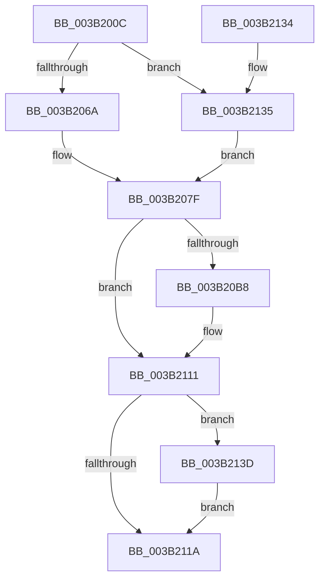

# SMKM_STORE&lt;SM_TRAITS&gt;::SmStWorkerThreadStartThread

- RVA: `0x003B200C`–`0x003B2146` (길이 `314` bytes)
- VA: `0x00000001403B200C`
- 실행 섹션: `.text`
- PDB 이름 있음: `예`; PDB Function 태그: `아니요`
- unwind 정보 RVA: `0x0008C384`
- 디코드: `87`개 명령, `314/314` bytes 표시
- 미해석 바이트: `0` (있으면 어셈블리에 `.byte`로 보존)

> 이 문서는 커널 이미지의 기계어와 PDB 기호를 분석해 생성했습니다. 4번과 5번은 함수 원형과 자료형을 바이너리 사용 방식에서 추정한 C 해석이며 원본 소스 복구 결과는 아닙니다.

## 1. Dependencies

- 직접 호출 지점: **6**; 고유 호출 대상: **5**
- 직접 호출자로 확인된 함수: **1**
- RIP 상대 이미지 참조: **0**

### Outgoing calls
- `0x003B2073` → [SmGetIdealProcessorFromNumaNode](SmGetIdealProcessorFromNumaNode_function_003B214C.md) (function, `0x003B214C`)
- `0x003B20AD` → [PsCreateSystemThreadEx](../../page/9E/PsCreateSystemThreadEx_function_009ED120.md) (function, `0x009ED120`)
- `0x003B20D6` → [ObReferenceObjectByHandle](../../page/86/ObReferenceObjectByHandle_function_00868DB0.md) (function, `0x00868DB0`)
- `0x003B20EA` → [ObCloseHandle](../../page/8A/ObCloseHandle_function_008A1870.md) (function, `0x008A1870`)
- `0x003B2104` → [KeWaitForSingleObject](../20/KeWaitForSingleObject_function_0020E6B0.md) (function, `0x0020E6B0`)
- `0x003B213F` → [ObCloseHandle](../../page/8A/ObCloseHandle_function_008A1870.md) (function, `0x008A1870`)

### Direct callers
- [SMKM_STORE&lt;SM_TRAITS&gt;::SmStStart](SMKM_STORE_SM_TRAITS_SmStStart_function_003B14DC.md) at `0x003B1921`
- [SMKM_STORE&lt;SM_TRAITS&gt;::SmStStart](SMKM_STORE_SM_TRAITS_SmStStart_function_003B14DC.md) at `0x003B195F`

### Static image references
- 디코드된 RIP-relative 메모리 참조가 없습니다.

## 2. Other-region calls and transfers

- 다른 실행 섹션으로 향하는 call: **4**
  - `0x003B20AD` → [PsCreateSystemThreadEx](../../page/9E/PsCreateSystemThreadEx_function_009ED120.md) (`.text` → `PAGE`)
  - `0x003B20D6` → [ObReferenceObjectByHandle](../../page/86/ObReferenceObjectByHandle_function_00868DB0.md) (`.text` → `PAGE`)
  - `0x003B20EA` → [ObCloseHandle](../../page/8A/ObCloseHandle_function_008A1870.md) (`.text` → `PAGE`)
  - `0x003B213F` → [ObCloseHandle](../../page/8A/ObCloseHandle_function_008A1870.md) (`.text` → `PAGE`)
- 별도 외부 분기/꼬리 이동을 확인하지 못했습니다.

## 3. Assembly (complete function range)

```asm
003B200C  48 89 5C 24 10                  mov qword ptr [rsp + 0x10], rbx
003B2011  48 89 74 24 18                  mov qword ptr [rsp + 0x18], rsi
003B2016  55                              push rbp
003B2017  57                              push rdi
003B2018  41 56                           push r14
003B201A  48 8B EC                        mov rbp, rsp
003B201D  48 81 EC 80 00 00 00            sub rsp, 0x80
003B2024  83 4D F8 FF                     or dword ptr [rbp - 8], 0xffffffff
003B2028  48 8D 45 E8                     lea rax, [rbp - 0x18]
003B202C  45 33 F6                        xor r14d, r14d
003B202F  48 89 45 F0                     mov qword ptr [rbp - 0x10], rax
003B2033  48 8B FA                        mov rdi, rdx
003B2036  44 89 75 20                     mov dword ptr [rbp + 0x20], r14d
003B203A  8B 91 9C 1D 00 00               mov edx, dword ptr [rcx + 0x1d9c]
003B2040  48 8D 45 E8                     lea rax, [rbp - 0x18]
003B2044  48 89 45 E8                     mov qword ptr [rbp - 0x18], rax
003B2048  49 8B F1                        mov rsi, r9
003B204B  4C 89 75 D0                     mov qword ptr [rbp - 0x30], r14
003B204F  49 8B D8                        mov rbx, r8
003B2052  48 C7 45 E0 00 00 06 00         mov qword ptr [rbp - 0x20], 0x60000
003B205A  44 89 75 FC                     mov dword ptr [rbp - 4], r14d
003B205E  48 89 4D D8                     mov qword ptr [rbp - 0x28], rcx
003B2062  85 D2                           test edx, edx
003B2064  0F 84 CB 00 00 00               je 0x1403b2135
003B206A  48 8B 89 90 1D 00 00            mov rcx, qword ptr [rcx + 0x1d90]
003B2071  FF CA                           dec edx
003B2073  E8 D4 00 00 00                  call 0x1403b214c
003B2078  89 45 20                        mov dword ptr [rbp + 0x20], eax
003B207B  48 8D 45 20                     lea rax, [rbp + 0x20]
003B207F  48 89 44 24 40                  mov qword ptr [rsp + 0x40], rax
003B2084  48 8D 4D D0                     lea rcx, [rbp - 0x30]
003B2088  4C 89 74 24 38                  mov qword ptr [rsp + 0x38], r14
003B208D  48 8D 45 D8                     lea rax, [rbp - 0x28]
003B2091  48 89 44 24 30                  mov qword ptr [rsp + 0x30], rax
003B2096  4C 8B CF                        mov r9, rdi
003B2099  BF FF FF 1F 00                  mov edi, 0x1fffff
003B209E  48 89 5C 24 28                  mov qword ptr [rsp + 0x28], rbx
003B20A3  45 33 C0                        xor r8d, r8d
003B20A6  4C 89 74 24 20                  mov qword ptr [rsp + 0x20], r14
003B20AB  8B D7                           mov edx, edi
003B20AD  E8 6E B0 63 00                  call 0x1409ed120
003B20B2  8B D8                           mov ebx, eax
003B20B4  85 C0                           test eax, eax
003B20B6  78 59                           js 0x1403b2111
003B20B8  48 8B 4D D0                     mov rcx, qword ptr [rbp - 0x30]
003B20BC  48 8D 45 20                     lea rax, [rbp + 0x20]
003B20C0  4C 89 74 24 28                  mov qword ptr [rsp + 0x28], r14
003B20C5  45 33 C9                        xor r9d, r9d
003B20C8  45 33 C0                        xor r8d, r8d
003B20CB  48 89 44 24 20                  mov qword ptr [rsp + 0x20], rax
003B20D0  8B D7                           mov edx, edi
003B20D2  4C 89 75 20                     mov qword ptr [rbp + 0x20], r14
003B20D6  E8 D5 6C 4B 00                  call 0x140868db0
003B20DB  48 8B 4D D0                     mov rcx, qword ptr [rbp - 0x30]
003B20DF  8B D8                           mov ebx, eax
003B20E1  48 8B 45 20                     mov rax, qword ptr [rbp + 0x20]
003B20E5  33 D2                           xor edx, edx
003B20E7  48 89 06                        mov qword ptr [rsi], rax
003B20EA  E8 81 F7 4E 00                  call 0x1408a1870
003B20EF  45 33 C9                        xor r9d, r9d
003B20F2  4C 89 75 D0                     mov qword ptr [rbp - 0x30], r14
003B20F6  45 33 C0                        xor r8d, r8d
003B20F9  4C 89 74 24 20                  mov qword ptr [rsp + 0x20], r14
003B20FE  33 D2                           xor edx, edx
003B2100  48 8D 4D E0                     lea rcx, [rbp - 0x20]
003B2104  E8 A7 C5 E5 FF                  call 0x14020e6b0
003B2109  8B 45 F8                        mov eax, dword ptr [rbp - 8]
003B210C  85 C0                           test eax, eax
003B210E  0F 48 D8                        cmovs ebx, eax
003B2111  48 8B 4D D0                     mov rcx, qword ptr [rbp - 0x30]
003B2115  48 85 C9                        test rcx, rcx
003B2118  75 23                           jne 0x1403b213d
003B211A  4C 8D 9C 24 80 00 00 00         lea r11, [rsp + 0x80]
003B2122  8B C3                           mov eax, ebx
003B2124  49 8B 5B 28                     mov rbx, qword ptr [r11 + 0x28]
003B2128  49 8B 73 30                     mov rsi, qword ptr [r11 + 0x30]
003B212C  49 8B E3                        mov rsp, r11
003B212F  41 5E                           pop r14
003B2131  5F                              pop rdi
003B2132  5D                              pop rbp
003B2133  C3                              ret
003B2134  CC                              int3
003B2135  49 8B C6                        mov rax, r14
003B2138  E9 42 FF FF FF                  jmp 0x1403b207f
003B213D  33 D2                           xor edx, edx
003B213F  E8 2C F7 4E 00                  call 0x1408a1870
003B2144  EB D4                           jmp 0x1403b211a
```

## 4. C-style interpretation (structured pseudocode)

```c
__int64 __fastcall SMKM_STORE_SM_TRAITS___SmStWorkerThreadStartThread(__int64 a1, __int64 a2, __int64 a3, __int64 a4)
{
    __int64 result;
    __int64 v_r14;
    __int64 v_rbx;
    __int64 v_rsp;
    unsigned __int64 v_stack_m18;
    unsigned int v_stack_m1C;
    unsigned int v_stack_m20;
    unsigned __int64 v_stack_m28;
    unsigned __int64 v_stack_m30;
    unsigned __int64 v_stack_m38;
    unsigned __int64 v_stack_m40;
    unsigned __int64 v_stack_m48;
    unsigned __int64 v_stack_m58;
    unsigned __int64 v_stack_m60;
    unsigned __int64 v_stack_m68;
    unsigned __int64 v_stack_m70;
    unsigned __int64 v_stack_m78;
    unsigned __int64 v_stack_p10;
    unsigned __int64 v_stack_p18;
    unsigned int v_stack_p8;

    v_stack_p10 = v_rbx;
    v_stack_p18 = v_rsi;
    v_rsp = (v_rsp) - (128);
    v_r14 = 0;
    v_stack_m28 = v_stack_m30;
    v_stack_p8 = 0;
    v_stack_m30 = v_stack_m30;
    v_stack_m48 = 0;
    v_stack_m38 = 0x60000ULL;
    v_stack_m1C = 0;
    v_stack_m40 = a1;
    if ((unsigned int)((unsigned int)(*(unsigned int *)(a1 + 7580))) == 0) goto loc_003B2135;
    a2 = (unsigned int)(((unsigned int)(*(unsigned int *)(a1 + 7580))) - 1);
    result = SmGetIdealProcessorFromNumaNode(*(unsigned __int64 *)(a1 + 7568), a2, a3, a4);
    v_stack_p8 = (unsigned int)(result);
loc_003B207F:
    v_stack_m58 = v_stack_p8;
    v_stack_m60 = 0;
    v_stack_m68 = v_stack_m40;
    v_stack_m70 = a3;
    a3 = 0;
    v_stack_m78 = 0;
    result = PsCreateSystemThreadEx(v_stack_m48, (unsigned int)((unsigned int)((unsigned int)(0x1FFFFFULL))), a3, a2);
    v_rbx = (unsigned int)((unsigned int)(result));
    if (!(sign_flag)) {
        a1 = v_stack_m48;
        result = v_stack_p8;
        v_stack_m70 = 0;
        a4 = 0;
        a3 = 0;
        v_stack_m78 = result;
        a2 = (unsigned int)((unsigned int)(0x1FFFFFULL));
        v_stack_p8 = 0;
        result = ObReferenceObjectByHandle(a1, a2, a3, a4);
        a1 = v_stack_m48;
        v_rbx = (unsigned int)(result);
        result = v_stack_p8;
        a2 = 0;
        *(unsigned __int64 *)(a4) = result;
        result = ObCloseHandle(a1, a2, a3, a4);
        a4 = 0;
        v_stack_m48 = 0;
        a3 = 0;
        v_stack_m78 = 0;
        a2 = 0;
        a1 = v_stack_m38;
        result = KeWaitForSingleObject(a1, a2, a3, a4);
        result = v_stack_m20;
        if (sign_flag) { v_rbx = (unsigned int)(result); }
    }
    if (v_stack_m48 != 0) goto loc_003B213D;
loc_003B211A:
    return (unsigned int)((unsigned int)(v_rbx));
loc_003B2135:
    goto loc_003B207F;
loc_003B213D:
    a2 = 0;
    result = ObCloseHandle(v_stack_m48, a2, a3, a4);
    goto loc_003B211A;
}
```

## 5. (Beta) C Style

```c
int64_t SMKM_STORE_SM_TRAITS___SmStWorkerThreadStartThread(void *Arg1, int64_t Arg2, int64_t Arg3, void *Arg4)
{
    uint8_t *arg1 = (uint8_t *)Arg1;
    uint8_t *arg4 = (uint8_t *)Arg4;

    int64_t result;
    int64_t local_r14;
    int64_t local_rbx;
    int64_t local_rsp;
    uint64_t v_stack_m18;
    uint32_t v_stack_m1C;
    uint32_t v_stack_m20;
    uint64_t v_stack_m28;
    uint64_t v_stack_m30;
    uint64_t v_stack_m38;
    uint64_t v_stack_m40;
    uint64_t v_stack_m48;
    uint64_t v_stack_m58;
    uint64_t v_stack_m60;
    uint64_t v_stack_m68;
    uint64_t v_stack_m70;
    uint64_t v_stack_m78;
    uint64_t v_stack_p10;
    uint64_t v_stack_p18;
    uint32_t v_stack_p8;

    v_stack_p10 = local_rbx;
    v_stack_p18 = local_rsi;
    local_rsp = (local_rsp) - (128);
    local_r14 = 0;
    v_stack_m28 = v_stack_m30;
    v_stack_p8 = 0;
    v_stack_m30 = v_stack_m30;
    v_stack_m48 = 0;
    v_stack_m38 = 0x60000ULL;
    v_stack_m1C = 0;
    v_stack_m40 = Arg1;
    if ((uint32_t)((uint32_t)(*(uint32_t *)(arg1 + 0x1D9C))) == 0) goto loc_003B2135;
    Arg2 = (uint32_t)(((uint32_t)(*(uint32_t *)(arg1 + 0x1D9C))) - 1);
    result = SmGetIdealProcessorFromNumaNode(*(uint64_t *)(arg1 + 0x1D90), Arg2, Arg3, Arg4);
    v_stack_p8 = (uint32_t)(result);
loc_003B207F:
    v_stack_m58 = v_stack_p8;
    v_stack_m60 = 0;
    v_stack_m68 = v_stack_m40;
    v_stack_m70 = Arg3;
    Arg3 = 0;
    v_stack_m78 = 0;
    result = PsCreateSystemThreadEx(v_stack_m48, (uint32_t)((uint32_t)((uint32_t)(0x1FFFFFULL))), Arg3, Arg2);
    local_rbx = (uint32_t)((uint32_t)(result));
    if (!(sign_flag)) {
        Arg1 = v_stack_m48;
        result = v_stack_p8;
        v_stack_m70 = 0;
        Arg4 = 0;
        Arg3 = 0;
        v_stack_m78 = result;
        Arg2 = (uint32_t)((uint32_t)(0x1FFFFFULL));
        v_stack_p8 = 0;
        result = ObReferenceObjectByHandle(Arg1, Arg2, Arg3, Arg4);
        Arg1 = v_stack_m48;
        local_rbx = (uint32_t)(result);
        result = v_stack_p8;
        Arg2 = 0;
        *(uint64_t *)(arg4) = result;
        result = ObCloseHandle(Arg1, Arg2, Arg3, Arg4);
        Arg4 = 0;
        v_stack_m48 = 0;
        Arg3 = 0;
        v_stack_m78 = 0;
        Arg2 = 0;
        Arg1 = v_stack_m38;
        result = KeWaitForSingleObject(Arg1, Arg2, Arg3, Arg4);
        result = v_stack_m20;
        if (sign_flag) { local_rbx = (uint32_t)(result); }
    }
    if (v_stack_m48 != 0) goto loc_003B213D;
loc_003B211A:
    return (uint32_t)((uint32_t)(local_rbx));
loc_003B2135:
    goto loc_003B207F;
loc_003B213D:
    Arg2 = 0;
    result = ObCloseHandle(v_stack_m48, Arg2, Arg3, Arg4);
    goto loc_003B211A;
}
```

### 관측된 메모리 오프셋

구조체 형식이 확인되지 않은 접근은 인자 기준의 오프셋으로만 기록했습니다.

| 기준 인자 | 오프셋 표현 | 폭 (bit) | 접근 |
|---|---:|---:|---|
| `Arg1` | `+ 0x1D90` | `64` | `R` |
| `Arg1` | `+ 0x1D9C` | `32` | `R` |
| `Arg4` | `+ 0x0` | `64` | `W` |

## 6. Execution-region graph

[열기: 2D/3D 그래프와 함수 탐색 컨트롤 패널](../../../control-panel.html?section=text&rva=0x003B200C&view=graph)

- 2D 그래프는 위에서 아래로 흐르고, 3D 그래프는 빈 공간을 드래그해 회전합니다. Shift+드래그는 이동, 휠은 확대·축소, 함수 노드 선택은 대상 보고서 이동입니다.

### Static fallback


