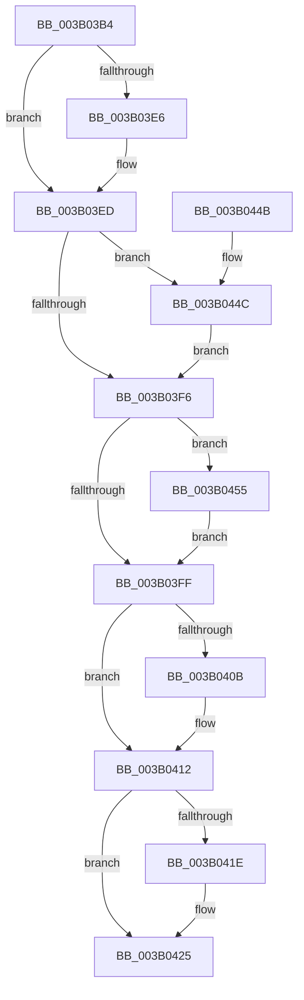

# ST_STORE&lt;SM_TRAITS&gt;::StCleanup

- RVA: `0x003B03B4`–`0x003B045E` (길이 `170` bytes)
- VA: `0x00000001403B03B4`
- 실행 섹션: `.text`
- PDB 이름 있음: `예`; PDB Function 태그: `아니요`
- unwind 정보 RVA: `0x0006F13C`
- 디코드: `47`개 명령, `170/170` bytes 표시
- 미해석 바이트: `0` (있으면 어셈블리에 `.byte`로 보존)

> 이 문서는 커널 이미지의 기계어와 PDB 기호를 분석해 생성했습니다. 4번과 5번은 함수 원형과 자료형을 바이너리 사용 방식에서 추정한 C 해석이며 원본 소스 복구 결과는 아닙니다.

## 1. Dependencies

- 직접 호출 지점: **10**; 고유 호출 대상: **5**
- 직접 호출자로 확인된 함수: **1**
- RIP 상대 이미지 참조: **0**

### Outgoing calls
- `0x003B03CA` → [ST_STORE<SM_TRAITS>::StDmCleanup](../3A/ST_STORE_SM_TRAITS_StDmCleanup_function_003AF8D4.md) (function, `0x003AF8D4`)
- `0x003B03D8` → [ST_STORE<SM_TRAITS>::StDmCleanup](../3A/ST_STORE_SM_TRAITS_StDmCleanup_function_003AF8D4.md) (function, `0x003AF8D4`)
- `0x003B03E8` → [ExFreePoolWithTag](../../poolcode/B8/ExFreePoolWithTag_function_00B82870.md) (function, `0x00B82870`)
- `0x003B040D` → [ExFreePoolWithTag](../../poolcode/B8/ExFreePoolWithTag_function_00B82870.md) (function, `0x00B82870`)
- `0x003B0420` → [ExFreePoolWithTag](../../poolcode/B8/ExFreePoolWithTag_function_00B82870.md) (function, `0x00B82870`)
- `0x003B042C` → [StEtaCleanup](StEtaCleanup_function_003B08EC.md) (function, `0x003B08EC`)
- `0x003B0438` → [SmCrEncCleanup](../../page/A9/SmCrEncCleanup_function_00A90A64.md) (function, `0x00A90A64`)
- `0x003B0440` → [ST_STORE<SM_TRAITS>::StDrainReadContextList](ST_STORE_SM_TRAITS_StDrainReadContextList_function_003B08B0.md) (function, `0x003B08B0`)
- `0x003B044E` → [ExFreePoolWithTag](../../poolcode/B8/ExFreePoolWithTag_function_00B82870.md) (function, `0x00B82870`)
- `0x003B0457` → [ExFreePoolWithTag](../../poolcode/B8/ExFreePoolWithTag_function_00B82870.md) (function, `0x00B82870`)

### Direct callers
- [SMKM_STORE&lt;SM_TRAITS&gt;::SmStCleanup](SMKM_STORE_SM_TRAITS_SmStCleanup_function_003B00E0.md) at `0x003B01FB`

### Static image references
- 디코드된 RIP-relative 메모리 참조가 없습니다.

## 2. Other-region calls and transfers

- 다른 실행 섹션으로 향하는 call: **6**
  - `0x003B03E8` → [ExFreePoolWithTag](../../poolcode/B8/ExFreePoolWithTag_function_00B82870.md) (`.text` → `POOLCODE`)
  - `0x003B040D` → [ExFreePoolWithTag](../../poolcode/B8/ExFreePoolWithTag_function_00B82870.md) (`.text` → `POOLCODE`)
  - `0x003B0420` → [ExFreePoolWithTag](../../poolcode/B8/ExFreePoolWithTag_function_00B82870.md) (`.text` → `POOLCODE`)
  - `0x003B0438` → [SmCrEncCleanup](../../page/A9/SmCrEncCleanup_function_00A90A64.md) (`.text` → `PAGE`)
  - `0x003B044E` → [ExFreePoolWithTag](../../poolcode/B8/ExFreePoolWithTag_function_00B82870.md) (`.text` → `POOLCODE`)
  - `0x003B0457` → [ExFreePoolWithTag](../../poolcode/B8/ExFreePoolWithTag_function_00B82870.md) (`.text` → `POOLCODE`)
- 별도 외부 분기/꼬리 이동을 확인하지 못했습니다.

## 3. Assembly (complete function range)

```asm
003B03B4  40 53                           push rbx
003B03B6  48 83 EC 20                     sub rsp, 0x20
003B03BA  83 89 80 1A 00 00 01            or dword ptr [rcx + 0x1a80], 1
003B03C1  48 8B D9                        mov rbx, rcx
003B03C4  48 83 C1 50                     add rcx, 0x50
003B03C8  33 D2                           xor edx, edx
003B03CA  E8 05 F5 FF FF                  call 0x1403af8d4
003B03CF  48 8D 8B 60 09 00 00            lea rcx, [rbx + 0x960]
003B03D6  33 D2                           xor edx, edx
003B03D8  E8 F7 F4 FF FF                  call 0x1403af8d4
003B03DD  48 8B 4B 38                     mov rcx, qword ptr [rbx + 0x38]
003B03E1  48 85 C9                        test rcx, rcx
003B03E4  74 07                           je 0x1403b03ed
003B03E6  33 D2                           xor edx, edx
003B03E8  E8 83 24 7D 00                  call 0x140b82870
003B03ED  48 8B 4B 40                     mov rcx, qword ptr [rbx + 0x40]
003B03F1  48 85 C9                        test rcx, rcx
003B03F4  75 56                           jne 0x1403b044c
003B03F6  48 8B 4B 48                     mov rcx, qword ptr [rbx + 0x48]
003B03FA  48 85 C9                        test rcx, rcx
003B03FD  75 56                           jne 0x1403b0455
003B03FF  48 8B 8B B0 12 00 00            mov rcx, qword ptr [rbx + 0x12b0]
003B0406  48 85 C9                        test rcx, rcx
003B0409  74 07                           je 0x1403b0412
003B040B  33 D2                           xor edx, edx
003B040D  E8 5E 24 7D 00                  call 0x140b82870
003B0412  48 8B 8B 70 13 00 00            mov rcx, qword ptr [rbx + 0x1370]
003B0419  48 85 C9                        test rcx, rcx
003B041C  74 07                           je 0x1403b0425
003B041E  33 D2                           xor edx, edx
003B0420  E8 4B 24 7D 00                  call 0x140b82870
003B0425  48 8D 8B 78 12 00 00            lea rcx, [rbx + 0x1278]
003B042C  E8 BB 04 00 00                  call 0x1403b08ec
003B0431  48 8D 8B E0 12 00 00            lea rcx, [rbx + 0x12e0]
003B0438  E8 27 06 6E 00                  call 0x140a90a64
003B043D  48 8B CB                        mov rcx, rbx
003B0440  E8 6B 04 00 00                  call 0x1403b08b0
003B0445  48 83 C4 20                     add rsp, 0x20
003B0449  5B                              pop rbx
003B044A  C3                              ret
003B044B  CC                              int3
003B044C  33 D2                           xor edx, edx
003B044E  E8 1D 24 7D 00                  call 0x140b82870
003B0453  EB A1                           jmp 0x1403b03f6
003B0455  33 D2                           xor edx, edx
003B0457  E8 14 24 7D 00                  call 0x140b82870
003B045C  EB A1                           jmp 0x1403b03ff
```

## 4. C-style interpretation (structured pseudocode)

```c
__int64 __fastcall ST_STORE_SM_TRAITS___StCleanup(__int64 a1, int a2)
{
    __int64 result;
    __int64 v_rsp;

    v_rsp = (v_rsp) - (32);
    a1 = (a1) + (80);
    a2 = 0;
    result = ST_STORE_SM_TRAITS___StDmCleanup(a1, a2, a3, a4);
    a2 = 0;
    result = ST_STORE_SM_TRAITS___StDmCleanup(a1 + 2400, a2, a3, a4);
    if (*(unsigned __int64 *)(a1 + 56) != 0) {
        a2 = 0;
        result = ExFreePoolWithTag(*(unsigned __int64 *)(a1 + 56), a2, a3, a4);
    }
    if (*(unsigned __int64 *)(a1 + 64) != 0) goto loc_003B044C;
loc_003B03F6:
    if (*(unsigned __int64 *)(a1 + 72) != 0) goto loc_003B0455;
loc_003B03FF:
    if (*(unsigned __int64 *)(a1 + 4784) != 0) {
        a2 = 0;
        result = ExFreePoolWithTag(*(unsigned __int64 *)(a1 + 4784), a2, a3, a4);
    }
    if (*(unsigned __int64 *)(a1 + 4976) != 0) {
        a2 = 0;
        result = ExFreePoolWithTag(*(unsigned __int64 *)(a1 + 4976), a2, a3, a4);
    }
    result = StEtaCleanup(a1 + 4728, a2, a3, a4);
    result = SmCrEncCleanup(a1 + 4832, a2, a3, a4);
    result = ST_STORE_SM_TRAITS___StDrainReadContextList(a1, a2, a3, a4);
    v_rsp = (v_rsp) + (32);
    return result;
loc_003B044C:
    a2 = 0;
    result = ExFreePoolWithTag(a1, a2, a3, a4);
    goto loc_003B03F6;
loc_003B0455:
    a2 = 0;
    result = ExFreePoolWithTag(a1, a2, a3, a4);
    goto loc_003B03FF;
}
```

## 5. (Beta) C Style

```c
int64_t ST_STORE_SM_TRAITS___StCleanup(void *Arg1, int32_t Arg2)
{
    uint8_t *arg1 = (uint8_t *)Arg1;

    int64_t result;
    int64_t local_rsp;

    local_rsp = (local_rsp) - (32);
    Arg1 = (Arg1) + (80);
    Arg2 = 0;
    result = ST_STORE_SM_TRAITS___StDmCleanup(Arg1, Arg2, a3, a4);
    Arg2 = 0;
    result = ST_STORE_SM_TRAITS___StDmCleanup(Arg1 + 2400, Arg2, a3, a4);
    if (*(uint64_t *)(arg1 + 0x38) != 0) {
        Arg2 = 0;
        result = ExFreePoolWithTag(*(uint64_t *)(arg1 + 0x38), Arg2, a3, a4);
    }
    if (*(uint64_t *)(arg1 + 0x40) != 0) goto loc_003B044C;
loc_003B03F6:
    if (*(uint64_t *)(arg1 + 0x48) != 0) goto loc_003B0455;
loc_003B03FF:
    if (*(uint64_t *)(arg1 + 0x12B0) != 0) {
        Arg2 = 0;
        result = ExFreePoolWithTag(*(uint64_t *)(arg1 + 0x12B0), Arg2, a3, a4);
    }
    if (*(uint64_t *)(arg1 + 0x1370) != 0) {
        Arg2 = 0;
        result = ExFreePoolWithTag(*(uint64_t *)(arg1 + 0x1370), Arg2, a3, a4);
    }
    result = StEtaCleanup(Arg1 + 4728, Arg2, a3, a4);
    result = SmCrEncCleanup(Arg1 + 4832, Arg2, a3, a4);
    result = ST_STORE_SM_TRAITS___StDrainReadContextList(Arg1, Arg2, a3, a4);
    local_rsp = (local_rsp) + (32);
    return result;
loc_003B044C:
    Arg2 = 0;
    result = ExFreePoolWithTag(Arg1, Arg2, a3, a4);
    goto loc_003B03F6;
loc_003B0455:
    Arg2 = 0;
    result = ExFreePoolWithTag(Arg1, Arg2, a3, a4);
    goto loc_003B03FF;
}
```

### 관측된 메모리 오프셋

구조체 형식이 확인되지 않은 접근은 인자 기준의 오프셋으로만 기록했습니다.

| 기준 인자 | 오프셋 표현 | 폭 (bit) | 접근 |
|---|---:|---:|---|
| `Arg1` | `+ 0x38` | `64` | `R` |
| `Arg1` | `+ 0x40` | `64` | `R` |
| `Arg1` | `+ 0x48` | `64` | `R` |
| `Arg1` | `+ 0x960` | `64` | `R` |
| `Arg1` | `+ 0x1278` | `64` | `R` |
| `Arg1` | `+ 0x12B0` | `64` | `R` |
| `Arg1` | `+ 0x12E0` | `64` | `R` |
| `Arg1` | `+ 0x1370` | `64` | `R` |
| `Arg1` | `+ 0x1A80` | `32` | `R/W` |

## 6. Execution-region graph

[열기: 2D/3D 그래프와 함수 탐색 컨트롤 패널](../../../control-panel.html?section=text&rva=0x003B03B4&view=graph)

- 2D 그래프는 위에서 아래로 흐르고, 3D 그래프는 빈 공간을 드래그해 회전합니다. Shift+드래그는 이동, 휠은 확대·축소, 함수 노드 선택은 대상 보고서 이동입니다.

### Static fallback


