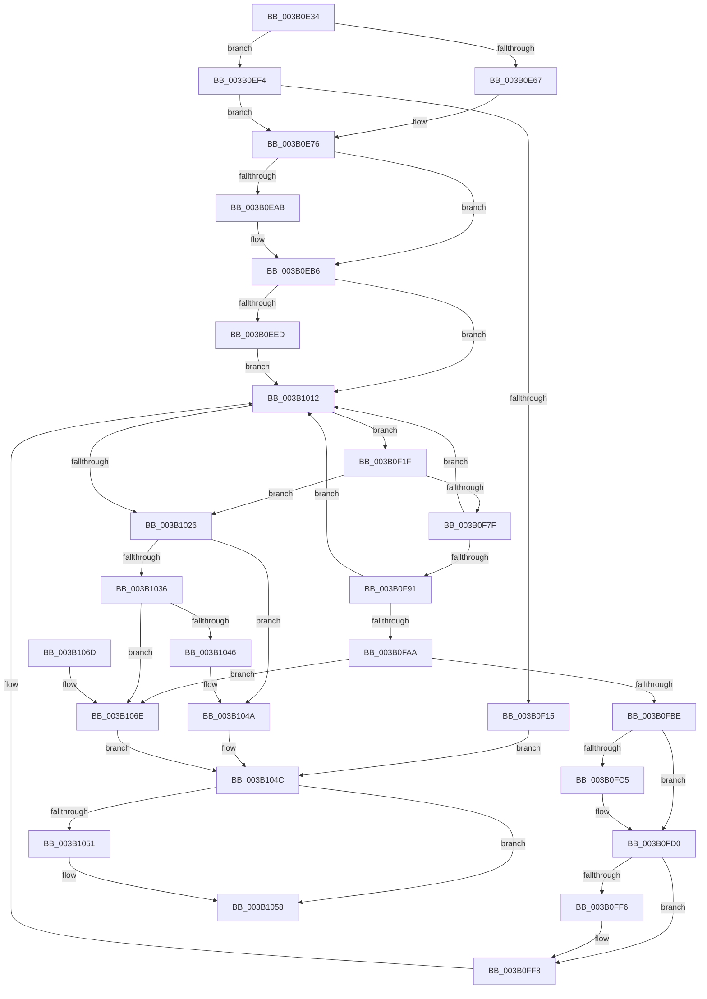

# ST_STORE&lt;SM_TRAITS&gt;::StDmCombineRegion

- RVA: `0x003B0E34`–`0x003B1074` (길이 `576` bytes)
- VA: `0x00000001403B0E34`
- 실행 섹션: `.text`
- PDB 이름 있음: `예`; PDB Function 태그: `아니요`
- unwind 정보 RVA: `0x0008C2A0`
- 디코드: `156`개 명령, `576/576` bytes 표시
- 미해석 바이트: `0` (있으면 어셈블리에 `.byte`로 보존)

> 이 문서는 커널 이미지의 기계어와 PDB 기호를 분석해 생성했습니다. 4번과 5번은 함수 원형과 자료형을 바이너리 사용 방식에서 추정한 C 해석이며 원본 소스 복구 결과는 아닙니다.

## 1. Dependencies

- 직접 호출 지점: **10**; 고유 호출 대상: **7**
- 직접 호출자로 확인된 함수: **1**
- RIP 상대 이미지 참조: **0**

### Outgoing calls
- `0x003B0EB1` → [B_TREE<unsigned long,ST_STORE<SM_TRAITS>::_ST_REGION_ENTRY,4096,NP_CONTEXT,ST_STORE<SM_TRAITS>::ST_REGION_ENTRY_COMPARATOR>::BTreeSearchResultDeref](../3A/B_TREE_unsigned_long_ST_STORE_SM_TRAITS__ST_REGION_ENTRY_4096_NP_CONTEXT_ST_STORE_SM_TRAITS_ST_REGIO_function_003AD260.md) (function, `0x003AD260`)
- `0x003B0EC4` → [ST_STORE<SM_TRAITS>::StDmPageRecordUnprotect](../26/ST_STORE_SM_TRAITS_StDmPageRecordUnprotect_function_00268B30.md) (function, `0x00268B30`)
- `0x003B0EE0` → [B_TREE<unsigned long,ST_STORE<SM_TRAITS>::_ST_REGION_ENTRY,4096,NP_CONTEXT,ST_STORE<SM_TRAITS>::ST_REGION_ENTRY_COMPARATOR>::BTreeSearchResultIterStart](../3A/B_TREE_unsigned_long_ST_STORE_SM_TRAITS__ST_REGION_ENTRY_4096_NP_CONTEXT_ST_STORE_SM_TRAITS_ST_REGIO_function_003AB794.md) (function, `0x003AB794`)
- `0x003B0F00` → [SmAllocEx](../34/SmAllocEx_function_0034C794.md) (function, `0x0034C794`)
- `0x003B0F9E` → [ST_STORE<SM_TRAITS>::StDmCombineBufferAddEntry](../4E/ST_STORE_SM_TRAITS_StDmCombineBufferAddEntry_function_004EB420.md) (function, `0x004EB420`)
- `0x003B0FB1` → [ST_STORE<SM_TRAITS>::StDmCombineBufferProcess](../4E/ST_STORE_SM_TRAITS_StDmCombineBufferProcess_function_004EB9AC.md) (function, `0x004EB9AC`)
- `0x003B0FCB` → [B_TREE<unsigned long,ST_STORE<SM_TRAITS>::_ST_REGION_ENTRY,4096,NP_CONTEXT,ST_STORE<SM_TRAITS>::ST_REGION_ENTRY_COMPARATOR>::BTreeSearchResultDeref](../3A/B_TREE_unsigned_long_ST_STORE_SM_TRAITS__ST_REGION_ENTRY_4096_NP_CONTEXT_ST_STORE_SM_TRAITS_ST_REGIO_function_003AD260.md) (function, `0x003AD260`)
- `0x003B0FED` → [B_TREE<unsigned long,ST_STORE<SM_TRAITS>::_ST_REGION_ENTRY,4096,NP_CONTEXT,ST_STORE<SM_TRAITS>::ST_REGION_ENTRY_COMPARATOR>::BTreeSearchResultIterStart](../3A/B_TREE_unsigned_long_ST_STORE_SM_TRAITS__ST_REGION_ENTRY_4096_NP_CONTEXT_ST_STORE_SM_TRAITS_ST_REGIO_function_003AB794.md) (function, `0x003AB794`)
- `0x003B1018` → [B_TREE<unsigned long,ST_STORE<SM_TRAITS>::_ST_REGION_ENTRY,4096,NP_CONTEXT,ST_STORE<SM_TRAITS>::ST_REGION_ENTRY_COMPARATOR>::BTreeFindPreviousEntry](../3A/B_TREE_unsigned_long_ST_STORE_SM_TRAITS__ST_REGION_ENTRY_4096_NP_CONTEXT_ST_STORE_SM_TRAITS_ST_REGIO_function_003A9B40.md) (function, `0x003A9B40`)
- `0x003B103D` → [ST_STORE<SM_TRAITS>::StDmCombineBufferProcess](../4E/ST_STORE_SM_TRAITS_StDmCombineBufferProcess_function_004EB9AC.md) (function, `0x004EB9AC`)

### Direct callers
- [ST_STORE&lt;SM_TRAITS&gt;::StDmpSinglePageFindSpace](ST_STORE_SM_TRAITS_StDmpSinglePageFindSpace_function_003B0980.md) at `0x003B0A12`

### Static image references
- 디코드된 RIP-relative 메모리 참조가 없습니다.

## 2. Other-region calls and transfers

- 다른 실행 섹션으로 향하는 call: **0**
- 별도 외부 분기/꼬리 이동을 확인하지 못했습니다.

## 3. Assembly (complete function range)

```asm
003B0E34  48 89 5C 24 10                  mov qword ptr [rsp + 0x10], rbx
003B0E39  55                              push rbp
003B0E3A  56                              push rsi
003B0E3B  57                              push rdi
003B0E3C  41 54                           push r12
003B0E3E  41 55                           push r13
003B0E40  41 56                           push r14
003B0E42  41 57                           push r15
003B0E44  48 8B EC                        mov rbp, rsp
003B0E47  48 83 EC 30                     sub rsp, 0x30
003B0E4B  48 8B 99 90 05 00 00            mov rbx, qword ptr [rcx + 0x590]
003B0E52  44 8B E2                        mov r12d, edx
003B0E55  48 8B F9                        mov rdi, rcx
003B0E58  41 BD 00 10 00 00               mov r13d, 0x1000
003B0E5E  48 85 DB                        test rbx, rbx
003B0E61  0F 84 8D 00 00 00               je 0x1403b0ef4
003B0E67  48 83 A1 90 05 00 00 00         and qword ptr [rcx + 0x590], 0
003B0E6F  48 8B C3                        mov rax, rbx
003B0E72  48 89 5D 50                     mov qword ptr [rbp + 0x50], rbx
003B0E76  44 89 20                        mov dword ptr [rax], r12d
003B0E79  48 8D 77 58                     lea rsi, [rdi + 0x58]
003B0E7D  C7 40 04 00 10 08 00            mov dword ptr [rax + 4], 0x81000
003B0E84  4C 8D 77 40                     lea r14, [rdi + 0x40]
003B0E88  8B 8F 2C 03 00 00               mov ecx, dword ptr [rdi + 0x32c]
003B0E8E  33 C0                           xor eax, eax
003B0E90  45 8B FC                        mov r15d, r12d
003B0E93  48 89 45 F0                     mov qword ptr [rbp - 0x10], rax
003B0E97  41 D3 E7                        shl r15d, cl
003B0E9A  44 0B BF 28 03 00 00            or r15d, dword ptr [rdi + 0x328]
003B0EA1  89 45 F8                        mov dword ptr [rbp - 8], eax
003B0EA4  8B 46 20                        mov eax, dword ptr [rsi + 0x20]
003B0EA7  A8 01                           test al, 1
003B0EA9  75 0B                           jne 0x1403b0eb6
003B0EAB  48 8B D6                        mov rdx, rsi
003B0EAE  49 8B CE                        mov rcx, r14
003B0EB1  E8 AA C3 FF FF                  call 0x1403ad260
003B0EB6  83 4E 20 01                     or dword ptr [rsi + 0x20], 1
003B0EBA  48 8B CF                        mov rcx, rdi
003B0EBD  48 8B 97 F8 02 00 00            mov rdx, qword ptr [rdi + 0x2f8]
003B0EC4  E8 67 7C EB FF                  call 0x140268b30
003B0EC9  48 8B 87 F8 02 00 00            mov rax, qword ptr [rdi + 0x2f8]
003B0ED0  49 8B D6                        mov rdx, r14
003B0ED3  48 8B CE                        mov rcx, rsi
003B0ED6  44 89 38                        mov dword ptr [rax], r15d
003B0ED9  44 8B 87 00 03 00 00            mov r8d, dword ptr [rdi + 0x300]
003B0EE0  E8 AF A8 FF FF                  call 0x1403ab794
003B0EE5  85 C0                           test eax, eax
003B0EE7  0F 89 25 01 00 00               jns 0x1403b1012
003B0EED  CD 2C                           int 0x2c
003B0EEF  E9 1E 01 00 00                  jmp 0x1403b1012
003B0EF4  41 83 C8 FF                     or r8d, 0xffffffff
003B0EF8  BA 73 6D 53 74                  mov edx, 0x74536d73
003B0EFD  49 8B CD                        mov rcx, r13
003B0F00  E8 8F B8 F9 FF                  call 0x14034c794
003B0F05  48 89 45 50                     mov qword ptr [rbp + 0x50], rax
003B0F09  48 8B D8                        mov rbx, rax
003B0F0C  48 85 C0                        test rax, rax
003B0F0F  0F 85 61 FF FF FF               jne 0x1403b0e76
003B0F15  B8 9A 00 00 C0                  mov eax, 0xc000009a
003B0F1A  E9 2D 01 00 00                  jmp 0x1403b104c
003B0F1F  44 8B 08                        mov r9d, dword ptr [rax]
003B0F22  41 B8 01 00 00 00               mov r8d, 1
003B0F28  8B 8F C8 01 00 00               mov ecx, dword ptr [rdi + 0x1c8]
003B0F2E  41 8B D1                        mov edx, r9d
003B0F31  8B 87 CC 01 00 00               mov eax, dword ptr [rdi + 0x1cc]
003B0F37  83 65 40 00                     and dword ptr [rbp + 0x40], 0
003B0F3B  41 23 C1                        and eax, r9d
003B0F3E  0F AF 87 D0 01 00 00            imul eax, dword ptr [rdi + 0x1d0]
003B0F45  D3 EA                           shr edx, cl
003B0F47  0F BD CA                        bsr ecx, edx
003B0F4A  41 D3 E0                        shl r8d, cl
003B0F4D  4C 33 C2                        xor r8, rdx
003B0F50  4D 03 C0                        add r8, r8
003B0F53  48 8B 8C CF C0 00 00 00         mov rcx, qword ptr [rdi + rcx*8 + 0xc0]
003B0F5B  4E 8B 3C C1                     mov r15, qword ptr [rcx + r8*8]
003B0F5F  8B 8F 2C 03 00 00               mov ecx, dword ptr [rdi + 0x32c]
003B0F65  4C 03 F8                        add r15, rax
003B0F68  8B 87 D8 01 00 00               mov eax, dword ptr [rdi + 0x1d8]
003B0F6E  4C 03 F8                        add r15, rax
003B0F71  41 8B 07                        mov eax, dword ptr [r15]
003B0F74  D3 E8                           shr eax, cl
003B0F76  41 3B C4                        cmp eax, r12d
003B0F79  0F 85 A7 00 00 00               jne 0x1403b1026
003B0F7F  41 8B 47 04                     mov eax, dword ptr [r15 + 4]
003B0F83  25 00 F0 FF FF                  and eax, 0xfffff000
003B0F88  41 3B C5                        cmp eax, r13d
003B0F8B  0F 87 81 00 00 00               ja 0x1403b1012
003B0F91  4D 8B CF                        mov r9, r15
003B0F94  4C 8D 45 F0                     lea r8, [rbp - 0x10]
003B0F98  48 8B D3                        mov rdx, rbx
003B0F9B  48 8B CF                        mov rcx, rdi
003B0F9E  E8 7D A4 13 00                  call 0x1404eb420
003B0FA3  3D 05 00 00 80                  cmp eax, 0x80000005
003B0FA8  75 68                           jne 0x1403b1012
003B0FAA  48 8D 55 50                     lea rdx, [rbp + 0x50]
003B0FAE  48 8B CF                        mov rcx, rdi
003B0FB1  E8 F6 A9 13 00                  call 0x1404eb9ac
003B0FB6  85 C0                           test eax, eax
003B0FB8  0F 88 B0 00 00 00               js 0x1403b106e
003B0FBE  8B 46 20                        mov eax, dword ptr [rsi + 0x20]
003B0FC1  A8 01                           test al, 1
003B0FC3  75 0B                           jne 0x1403b0fd0
003B0FC5  48 8B D6                        mov rdx, rsi
003B0FC8  49 8B CE                        mov rcx, r14
003B0FCB  E8 90 C2 FF FF                  call 0x1403ad260
003B0FD0  83 4E 20 01                     or dword ptr [rsi + 0x20], 1
003B0FD4  49 8B D6                        mov rdx, r14
003B0FD7  48 8B 8F F8 02 00 00            mov rcx, qword ptr [rdi + 0x2f8]
003B0FDE  41 8B 07                        mov eax, dword ptr [r15]
003B0FE1  89 01                           mov dword ptr [rcx], eax
003B0FE3  48 8B CE                        mov rcx, rsi
003B0FE6  44 8B 87 00 03 00 00            mov r8d, dword ptr [rdi + 0x300]
003B0FED  E8 A2 A7 FF FF                  call 0x1403ab794
003B0FF2  85 C0                           test eax, eax
003B0FF4  79 02                           jns 0x1403b0ff8
003B0FF6  CD 2C                           int 0x2c
003B0FF8  48 8B 5D 50                     mov rbx, qword ptr [rbp + 0x50]
003B0FFC  33 C0                           xor eax, eax
003B0FFE  48 89 45 F0                     mov qword ptr [rbp - 0x10], rax
003B1002  89 45 F8                        mov dword ptr [rbp - 8], eax
003B1005  48 89 03                        mov qword ptr [rbx], rax
003B1008  44 89 23                        mov dword ptr [rbx], r12d
003B100B  C7 43 04 00 10 08 00            mov dword ptr [rbx + 4], 0x81000
003B1012  48 8B D6                        mov rdx, rsi
003B1015  49 8B CE                        mov rcx, r14
003B1018  E8 23 8B FF FF                  call 0x1403a9b40
003B101D  48 85 C0                        test rax, rax
003B1020  0F 85 F9 FE FF FF               jne 0x1403b0f1f
003B1026  0F B7 4B 06                     movzx ecx, word ptr [rbx + 6]
003B102A  48 8D 43 08                     lea rax, [rbx + 8]
003B102E  48 03 CB                        add rcx, rbx
003B1031  48 3B C1                        cmp rax, rcx
003B1034  73 14                           jae 0x1403b104a
003B1036  48 8D 55 50                     lea rdx, [rbp + 0x50]
003B103A  48 8B CF                        mov rcx, rdi
003B103D  E8 6A A9 13 00                  call 0x1404eb9ac
003B1042  85 C0                           test eax, eax
003B1044  78 28                           js 0x1403b106e
003B1046  48 8B 5D 50                     mov rbx, qword ptr [rbp + 0x50]
003B104A  33 C0                           xor eax, eax
003B104C  48 85 DB                        test rbx, rbx
003B104F  74 07                           je 0x1403b1058
003B1051  48 89 9F 90 05 00 00            mov qword ptr [rdi + 0x590], rbx
003B1058  48 8B 5C 24 78                  mov rbx, qword ptr [rsp + 0x78]
003B105D  48 83 C4 30                     add rsp, 0x30
003B1061  41 5F                           pop r15
003B1063  41 5E                           pop r14
003B1065  41 5D                           pop r13
003B1067  41 5C                           pop r12
003B1069  5F                              pop rdi
003B106A  5E                              pop rsi
003B106B  5D                              pop rbp
003B106C  C3                              ret
003B106D  CC                              int3
003B106E  48 8B 5D 50                     mov rbx, qword ptr [rbp + 0x50]
003B1072  EB D8                           jmp 0x1403b104c
```

## 4. C-style interpretation (structured pseudocode)

```c
__int64 __fastcall ST_STORE_SM_TRAITS___StDmCombineRegion(__int64 a1, int a2)
{
    __int64 result;
    __int64 v_r15;
    __int64 v_rsp;
    unsigned int v_stack_m40;
    unsigned __int64 v_stack_m48;
    unsigned __int64 v_stack_p10;
    unsigned __int64 v_stack_p18;
    unsigned int v_stack_p8;

    v_stack_p10 = v_rbx;
    v_rsp = (v_rsp) - (48);
    if (*(unsigned __int64 *)(a1 + 1424) == 0) goto loc_003B0EF4;
    v_stack_p18 = *(unsigned __int64 *)(a1 + 1424);
loc_003B0E76:
    *(unsigned int *)(*(unsigned __int64 *)(a1 + 1424)) = (unsigned int)((unsigned int)(a2));
    *(unsigned int *)(*(unsigned __int64 *)(a1 + 1424) + 4) = 0x81000ULL;
    result = 0;
    v_stack_m48 = 0;
    v_r15 = (unsigned int)(((unsigned int)((unsigned int)((unsigned int)(a2)))) << ((unsigned __int8)((unsigned int)(*(unsigned int *)(a1 + 812)))));
    v_r15 = (unsigned int)((v_r15) | (*(unsigned int *)(a1 + 808)));
    v_stack_m40 = 0;
    result = (unsigned int)(*(unsigned int *)(a1 + 88 + 32));
    if ((((unsigned __int8)((unsigned int)(*(unsigned int *)(a1 + 88 + 32)))) & (1)) == 0) {
        a2 = a1 + 88;
        a1 = a1 + 64;
        result = B_TREE_unsigned_long_ST_STORE_SM_TRAITS____ST_REGION_ENTRY_4096_NP_CONTEXT_ST_STORE_SM_TRAITS___ST_R(a1, a2, a3, a4);
    }
    result = ST_STORE_SM_TRAITS___StDmPageRecordUnprotect(a1, *(unsigned __int64 *)(a1 + 760), a3, a4);
    *(unsigned int *)(*(unsigned __int64 *)(a1 + 760)) = (unsigned int)(v_r15);
    result = B_TREE_unsigned_long_ST_STORE_SM_TRAITS____ST_REGION_ENTRY_4096_NP_CONTEXT_ST_STORE_SM_TRAITS___ST_R(a1 + 88, a1 + 64, (unsigned int)(*(unsigned int *)(a1 + 768)), a4);
    if (!sign_flag) goto loc_003B1012;
    goto loc_003B1012;
loc_003B0EF4:
    a3 = (unsigned int)(((unsigned int)(*(unsigned int *)(a1 + 768))) | (0xFFFFFFFFULL));
    result = SmAllocEx((unsigned int)(0x1000ULL), (unsigned int)(0x74536D73ULL), a3, a4);
    v_stack_p18 = result;
    if (result != 0) goto loc_003B0E76;
    goto loc_003B104C;
loc_003B0F1F:
    result = (unsigned int)(((unsigned int)(*(unsigned int *)(a1 + 460))) & ((unsigned int)((unsigned int)(*(unsigned int *)((unsigned int)(0xC000009AULL))))));
    result = (unsigned int)((result) * (*(unsigned int *)(a1 + 464)));
    a2 = (unsigned int)(((unsigned int)((unsigned int)((unsigned int)(*(unsigned int *)((unsigned int)(0xC000009AULL)))))) >> ((unsigned __int8)((unsigned int)(*(unsigned int *)(a1 + 456)))));
    a3 = (unsigned int)((1) << ((unsigned __int8)((unsigned int)(*(unsigned int *)(a1 + 456)))));
    a3 = (a3) ^ (a2);
    a3 = (a3) + (a3);
    v_r15 = (*(unsigned __int64 *)(*(unsigned __int64 *)(a1 + (unsigned int)(*(unsigned int *)(a1 + 456)) * 8 + 192) + a3 * 8)) + (result);
    v_r15 = (v_r15) + ((unsigned int)(*(unsigned int *)(a1 + 472)));
    result = (unsigned int)(((unsigned int)(*(unsigned int *)(v_r15))) >> ((unsigned __int8)((unsigned int)(*(unsigned int *)(a1 + 812)))));
    if (((unsigned int)(result)) != ((unsigned int)((unsigned int)(a2)))) goto loc_003B1026;
    result = (unsigned int)(((unsigned int)(*(unsigned int *)(v_r15 + 4))) & (0xFFFFF000ULL));
    if (((unsigned int)(result)) > ((unsigned int)((unsigned int)(0x1000ULL)))) goto loc_003B1012;
    result = ST_STORE_SM_TRAITS___StDmCombineBufferAddEntry(a1, result, v_stack_m48, v_r15);
    if (((unsigned int)(result)) != 0x80000005ULL) goto loc_003B1012;
    result = ST_STORE_SM_TRAITS___StDmCombineBufferProcess(a1, v_stack_p18, v_stack_m48, v_r15);
    if (sign_flag) goto loc_003B106E;
    result = (unsigned int)(*(unsigned int *)(a1 + 88 + 32));
    if ((((unsigned __int8)((unsigned int)(*(unsigned int *)(a1 + 88 + 32)))) & (1)) == 0) {
        a2 = a1 + 88;
        a1 = a1 + 64;
        result = B_TREE_unsigned_long_ST_STORE_SM_TRAITS____ST_REGION_ENTRY_4096_NP_CONTEXT_ST_STORE_SM_TRAITS___ST_R(a1, a2, v_stack_m48, v_r15);
    }
    *(unsigned int *)(*(unsigned __int64 *)(a1 + 760)) = (unsigned int)((unsigned int)(*(unsigned int *)(v_r15)));
    result = B_TREE_unsigned_long_ST_STORE_SM_TRAITS____ST_REGION_ENTRY_4096_NP_CONTEXT_ST_STORE_SM_TRAITS___ST_R(a1 + 88, a1 + 64, (unsigned int)(*(unsigned int *)(a1 + 768)), v_r15);
    if (sign_flag) {
    }
    result = 0;
    v_stack_m48 = 0;
    v_stack_m40 = 0;
    *(unsigned __int64 *)(v_stack_p18) = 0;
    *(unsigned int *)(v_stack_p18) = (unsigned int)((unsigned int)(a2));
    *(unsigned int *)(v_stack_p18 + 4) = 0x81000ULL;
loc_003B1012:
    result = B_TREE_unsigned_long_ST_STORE_SM_TRAITS____ST_REGION_ENTRY_4096_NP_CONTEXT_ST_STORE_SM_TRAITS___ST_R(a1 + 64, a1 + 88, (unsigned int)(*(unsigned int *)(a1 + 768)), v_r15);
    if (result != 0) goto loc_003B0F1F;
loc_003B1026:
    a1 = (*(unsigned __int16 *)(v_stack_p18 + 6)) + (v_stack_p18);
    if ((v_stack_p18 + 8) >= a1) goto loc_003B104A;
    result = ST_STORE_SM_TRAITS___StDmCombineBufferProcess(a1, v_stack_p18, (unsigned int)(*(unsigned int *)(a1 + 768)), v_r15);
    if (sign_flag) goto loc_003B106E;
loc_003B104A:
    result = 0;
loc_003B104C:
    if (v_stack_p18 != 0) {
        *(unsigned __int64 *)(a1 + 1424) = v_stack_p18;
    }
    v_rsp = (v_rsp) + (48);
    return result;
loc_003B106E:
    goto loc_003B104C;
}
```

## 5. (Beta) C Style

```c
int64_t ST_STORE_SM_TRAITS___StDmCombineRegion(void *Arg1, int32_t Arg2)
{
    uint8_t *arg1 = (uint8_t *)Arg1;

    int64_t result;
    int64_t local_r15;
    int64_t local_rsp;
    uint32_t v_stack_m40;
    uint64_t v_stack_m48;
    uint64_t v_stack_p10;
    uint64_t v_stack_p18;
    uint32_t v_stack_p8;

    v_stack_p10 = local_rbx;
    local_rsp = (local_rsp) - (48);
    if (*(uint64_t *)(arg1 + 0x590) == 0) goto loc_003B0EF4;
    v_stack_p18 = *(uint64_t *)(arg1 + 0x590);
loc_003B0E76:
    *(uint32_t *)(*(uint64_t *)(arg1 + 0x590)) = (uint32_t)((uint32_t)(Arg2));
    *(uint32_t *)(*(uint64_t *)(arg1 + 0x590) + 0x4) = 0x81000ULL;
    result = 0;
    v_stack_m48 = 0;
    local_r15 = (uint32_t)(((uint32_t)((uint32_t)((uint32_t)(Arg2)))) << ((uint8_t)((uint32_t)(*(uint32_t *)(arg1 + 0x32C)))));
    local_r15 = (uint32_t)((local_r15) | (*(uint32_t *)(arg1 + 0x328)));
    v_stack_m40 = 0;
    result = (uint32_t)(*(uint32_t *)(arg1 + 0x58 + 0x20));
    if ((((uint8_t)((uint32_t)(*(uint32_t *)(arg1 + 0x58 + 0x20)))) & (1)) == 0) {
        Arg2 = Arg1 + 88;
        Arg1 = Arg1 + 64;
        result = B_TREE_unsigned_long_ST_STORE_SM_TRAITS____ST_REGION_ENTRY_4096_NP_CONTEXT_ST_STORE_SM_TRAITS___ST_R(Arg1, Arg2, a3, a4);
    }
    result = ST_STORE_SM_TRAITS___StDmPageRecordUnprotect(Arg1, *(uint64_t *)(arg1 + 0x2F8), a3, a4);
    *(uint32_t *)(*(uint64_t *)(arg1 + 0x2F8)) = (uint32_t)(local_r15);
    result = B_TREE_unsigned_long_ST_STORE_SM_TRAITS____ST_REGION_ENTRY_4096_NP_CONTEXT_ST_STORE_SM_TRAITS___ST_R(Arg1 + 88, Arg1 + 64, (uint32_t)(*(uint32_t *)(arg1 + 0x300)), a4);
    if (!sign_flag) goto loc_003B1012;
    goto loc_003B1012;
loc_003B0EF4:
    a3 = (uint32_t)(((uint32_t)(*(uint32_t *)(arg1 + 0x300))) | (0xFFFFFFFFULL));
    result = SmAllocEx((uint32_t)(0x1000ULL), (uint32_t)(0x74536D73ULL), a3, a4);
    v_stack_p18 = result;
    if (result != 0) goto loc_003B0E76;
    goto loc_003B104C;
loc_003B0F1F:
    result = (uint32_t)(((uint32_t)(*(uint32_t *)(arg1 + 0x1CC))) & ((uint32_t)((uint32_t)(*(uint32_t *)((uint32_t)(0xC000009AULL))))));
    result = (uint32_t)((result) * (*(uint32_t *)(arg1 + 0x1D0)));
    Arg2 = (uint32_t)(((uint32_t)((uint32_t)((uint32_t)(*(uint32_t *)((uint32_t)(0xC000009AULL)))))) >> ((uint8_t)((uint32_t)(*(uint32_t *)(arg1 + 0x1C8)))));
    a3 = (uint32_t)((1) << ((uint8_t)((uint32_t)(*(uint32_t *)(arg1 + 0x1C8)))));
    a3 = (a3) ^ (Arg2);
    a3 = (a3) + (a3);
    local_r15 = (*(uint64_t *)(*(uint64_t *)(arg1 + (uint32_t)(*(uint32_t *)(arg1 + 0x1C8)) * 8 + 0xC0) + a3 * 8)) + (result);
    local_r15 = (local_r15) + ((uint32_t)(*(uint32_t *)(arg1 + 0x1D8)));
    result = (uint32_t)(((uint32_t)(*(uint32_t *)(local_r15))) >> ((uint8_t)((uint32_t)(*(uint32_t *)(arg1 + 0x32C)))));
    if (((uint32_t)(result)) != ((uint32_t)((uint32_t)(Arg2)))) goto loc_003B1026;
    result = (uint32_t)(((uint32_t)(*(uint32_t *)(local_r15 + 0x4))) & (0xFFFFF000ULL));
    if (((uint32_t)(result)) > ((uint32_t)((uint32_t)(0x1000ULL)))) goto loc_003B1012;
    result = ST_STORE_SM_TRAITS___StDmCombineBufferAddEntry(Arg1, result, v_stack_m48, local_r15);
    if (((uint32_t)(result)) != 0x80000005ULL) goto loc_003B1012;
    result = ST_STORE_SM_TRAITS___StDmCombineBufferProcess(Arg1, v_stack_p18, v_stack_m48, local_r15);
    if (sign_flag) goto loc_003B106E;
    result = (uint32_t)(*(uint32_t *)(arg1 + 0x58 + 0x20));
    if ((((uint8_t)((uint32_t)(*(uint32_t *)(arg1 + 0x58 + 0x20)))) & (1)) == 0) {
        Arg2 = Arg1 + 88;
        Arg1 = Arg1 + 64;
        result = B_TREE_unsigned_long_ST_STORE_SM_TRAITS____ST_REGION_ENTRY_4096_NP_CONTEXT_ST_STORE_SM_TRAITS___ST_R(Arg1, Arg2, v_stack_m48, local_r15);
    }
    *(uint32_t *)(*(uint64_t *)(arg1 + 0x2F8)) = (uint32_t)((uint32_t)(*(uint32_t *)(local_r15)));
    result = B_TREE_unsigned_long_ST_STORE_SM_TRAITS____ST_REGION_ENTRY_4096_NP_CONTEXT_ST_STORE_SM_TRAITS___ST_R(Arg1 + 88, Arg1 + 64, (uint32_t)(*(uint32_t *)(arg1 + 0x300)), local_r15);
    if (sign_flag) {
    }
    result = 0;
    v_stack_m48 = 0;
    v_stack_m40 = 0;
    *(uint64_t *)(v_stack_p18) = 0;
    *(uint32_t *)(v_stack_p18) = (uint32_t)((uint32_t)(Arg2));
    *(uint32_t *)(v_stack_p18 + 0x4) = 0x81000ULL;
loc_003B1012:
    result = B_TREE_unsigned_long_ST_STORE_SM_TRAITS____ST_REGION_ENTRY_4096_NP_CONTEXT_ST_STORE_SM_TRAITS___ST_R(Arg1 + 64, Arg1 + 88, (uint32_t)(*(uint32_t *)(arg1 + 0x300)), local_r15);
    if (result != 0) goto loc_003B0F1F;
loc_003B1026:
    Arg1 = (*(uint16_t *)(v_stack_p18 + 0x6)) + (v_stack_p18);
    if ((v_stack_p18 + 8) >= Arg1) goto loc_003B104A;
    result = ST_STORE_SM_TRAITS___StDmCombineBufferProcess(Arg1, v_stack_p18, (uint32_t)(*(uint32_t *)(arg1 + 0x300)), local_r15);
    if (sign_flag) goto loc_003B106E;
loc_003B104A:
    result = 0;
loc_003B104C:
    if (v_stack_p18 != 0) {
        *(uint64_t *)(arg1 + 0x590) = v_stack_p18;
    }
    local_rsp = (local_rsp) + (48);
    return result;
loc_003B106E:
    goto loc_003B104C;
}
```

### 관측된 메모리 오프셋

구조체 형식이 확인되지 않은 접근은 인자 기준의 오프셋으로만 기록했습니다.

| 기준 인자 | 오프셋 표현 | 폭 (bit) | 접근 |
|---|---:|---:|---|
| `Arg1` | `+ 0x20` | `32` | `R` |
| `Arg1` | `+ 0x20` | `32` | `R/W` |
| `Arg1` | `+ 0x40` | `64` | `R` |
| `Arg1` | `+ 0x58` | `64` | `R` |
| `Arg1` | `+ 0xC0 + rcx*8` | `64` | `R` |
| `Arg1` | `+ 0x1C8` | `32` | `R` |
| `Arg1` | `+ 0x1CC` | `32` | `R` |
| `Arg1` | `+ 0x1D0` | `32` | `R` |
| `Arg1` | `+ 0x1D8` | `32` | `R` |
| `Arg1` | `+ 0x2F8` | `64` | `R` |
| `Arg1` | `+ 0x300` | `32` | `R` |
| `Arg1` | `+ 0x328` | `32` | `R` |
| `Arg1` | `+ 0x32C` | `32` | `R` |
| `Arg1` | `+ 0x590` | `64` | `R` |
| `Arg1` | `+ 0x590` | `64` | `R/W` |
| `Arg1` | `+ 0x590` | `64` | `W` |

## 6. Execution-region graph

[열기: 2D/3D 그래프와 함수 탐색 컨트롤 패널](../../../control-panel.html?section=text&rva=0x003B0E34&view=graph)

- 2D 그래프는 위에서 아래로 흐르고, 3D 그래프는 빈 공간을 드래그해 회전합니다. Shift+드래그는 이동, 휠은 확대·축소, 함수 노드 선택은 대상 보고서 이동입니다.

### Static fallback


