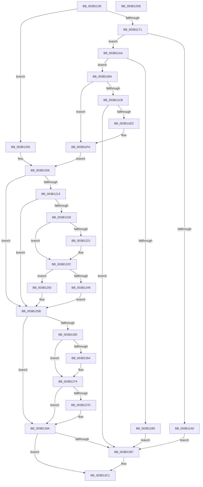

# ST_STORE&lt;SM_TRAITS&gt;::StDmCurrentRegionSet

- RVA: `0x003B1130`–`0x003B12DF` (길이 `431` bytes)
- VA: `0x00000001403B1130`
- 실행 섹션: `.text`
- PDB 이름 있음: `예`; PDB Function 태그: `아니요`
- unwind 정보 RVA: `0x0008C2BC`
- 디코드: `112`개 명령, `431/431` bytes 표시
- 미해석 바이트: `0` (있으면 어셈블리에 `.byte`로 보존)

> 이 문서는 커널 이미지의 기계어와 PDB 기호를 분석해 생성했습니다. 4번과 5번은 함수 원형과 자료형을 바이너리 사용 방식에서 추정한 C 해석이며 원본 소스 복구 결과는 아닙니다.

## 1. Dependencies

- 직접 호출 지점: **8**; 고유 호출 대상: **7**
- 직접 호출자로 확인된 함수: **4**
- RIP 상대 이미지 참조: **0**

### Outgoing calls
- `0x003B117D` → [ST_STORE<SM_TRAITS>::StSetDataMovementInProgress](../60/ST_STORE_SM_TRAITS_StSetDataMovementInProgress_function_0060E9BC.md) (function, `0x0060E9BC`)
- `0x003B1193` → [ST_STORE<SM_TRAITS>::StMapAndLockRegion](../4E/ST_STORE_SM_TRAITS_StMapAndLockRegion_function_004EC090.md) (function, `0x004EC090`)
- `0x003B11E0` → [ST_STORE<SM_TRAITS>::StCompactRegions](../4A/ST_STORE_SM_TRAITS_StCompactRegions_function_004A48E0.md) (function, `0x004A48E0`)
- `0x003B1227` → [ST_STORE<SM_TRAITS>::StUnlockAndUnmapRegion](../34/ST_STORE_SM_TRAITS_StUnlockAndUnmapRegion_function_0034C7F0.md) (function, `0x0034C7F0`)
- `0x003B1249` → [ST_STORE<SM_TRAITS>::StReleaseRegion](../3A/ST_STORE_SM_TRAITS_StReleaseRegion_function_003AF138.md) (function, `0x003AF138`)
- `0x003B1256` → [ST_STORE<SM_TRAITS>::StDmUpdateRegionsToCompactBitmap](../44/ST_STORE_SM_TRAITS_StDmUpdateRegionsToCompactBitmap_function_00440A70.md) (function, `0x00440A70`)
- `0x003B126F` → [ST_STORE<SM_TRAITS>::StDmUpdateRegionsToCompactBitmap](../44/ST_STORE_SM_TRAITS_StDmUpdateRegionsToCompactBitmap_function_00440A70.md) (function, `0x00440A70`)
- `0x003B1295` → [ST_STORE<SM_TRAITS>::StLazyWorkMgrQueueWork](../41/ST_STORE_SM_TRAITS_StLazyWorkMgrQueueWork_function_00411800.md) (function, `0x00411800`)

### Direct callers
- [ST_STORE&lt;SM_TRAITS&gt;::StDmInvalidateCurrentRegions](ST_STORE_SM_TRAITS_StDmInvalidateCurrentRegions_function_003B092C.md) at `0x003B0959`
- [ST_STORE&lt;SM_TRAITS&gt;::StDmpSinglePageFindSpace](ST_STORE_SM_TRAITS_StDmpSinglePageFindSpace_function_003B0980.md) at `0x003B0A35`
- [ST_STORE&lt;SM_TRAITS&gt;::StDmpSinglePageFindSpace](ST_STORE_SM_TRAITS_StDmpSinglePageFindSpace_function_003B0980.md) at `0x003B0A6B`
- [ST_STORE&lt;SM_TRAITS&gt;::StDmDeviceIoCompletion](../4B/ST_STORE_SM_TRAITS_StDmDeviceIoCompletion_function_004BBB70.md) at `0x004BBD2A`
- [ST_STORE&lt;SM_TRAITS&gt;::StDmRegionRemove](../60/ST_STORE_SM_TRAITS_StDmRegionRemove_function_0060E314.md) at `0x0060E3A0`

### Static image references
- 디코드된 RIP-relative 메모리 참조가 없습니다.

## 2. Other-region calls and transfers

- 다른 실행 섹션으로 향하는 call: **0**
- 별도 외부 분기/꼬리 이동을 확인하지 못했습니다.

## 3. Assembly (complete function range)

```asm
003B1130  48 89 5C 24 10                  mov qword ptr [rsp + 0x10], rbx
003B1135  48 89 6C 24 18                  mov qword ptr [rsp + 0x18], rbp
003B113A  48 89 74 24 20                  mov qword ptr [rsp + 0x20], rsi
003B113F  57                              push rdi
003B1140  41 54                           push r12
003B1142  41 55                           push r13
003B1144  41 56                           push r14
003B1146  41 57                           push r15
003B1148  48 83 EC 30                     sub rsp, 0x30
003B114C  8B F2                           mov esi, edx
003B114E  45 33 E4                        xor r12d, r12d
003B1151  48 03 F6                        add rsi, rsi
003B1154  41 8B F8                        mov edi, r8d
003B1157  41 83 CD FF                     or r13d, 0xffffffff
003B115B  8B EA                           mov ebp, edx
003B115D  48 8B D9                        mov rbx, rcx
003B1160  44 8B B4 F1 58 06 00 00         mov r14d, dword ptr [rcx + rsi*8 + 0x658]
003B1168  45 3B C5                        cmp r8d, r13d
003B116B  0F 84 8F 00 00 00               je 0x1403b1200
003B1171  48 8B 81 78 05 00 00            mov rax, qword ptr [rcx + 0x578]
003B1178  48 89 44 24 60                  mov qword ptr [rsp + 0x60], rax
003B117D  E8 3A D8 25 00                  call 0x14060e9bc
003B1182  45 33 C9                        xor r9d, r9d
003B1185  44 8B C5                        mov r8d, ebp
003B1188  8B D7                           mov edx, edi
003B118A  48 8B CB                        mov rcx, rbx
003B118D  41 BC 01 00 00 00               mov r12d, 1
003B1193  E8 F8 AE 13 00                  call 0x1404ec090
003B1198  4C 8B F8                        mov r15, rax
003B119B  48 85 C0                        test rax, rax
003B119E  75 0A                           jne 0x1403b11aa
003B11A0  B8 2A 00 00 C0                  mov eax, 0xc000002a
003B11A5  E9 0D 01 00 00                  jmp 0x1403b12b7
003B11AA  49 83 FF FF                     cmp r15, -1
003B11AE  75 0A                           jne 0x1403b11ba
003B11B0  B8 2D 02 00 C0                  mov eax, 0xc000022d
003B11B5  E9 FD 00 00 00                  jmp 0x1403b12b7
003B11BA  48 8B 44 24 60                  mov rax, qword ptr [rsp + 0x60]
003B11BF  0F B7 2C 78                     movzx ebp, word ptr [rax + rdi*2]
003B11C3  81 E5 FF 1F 00 00               and ebp, 0x1fff
003B11C9  76 2F                           jbe 0x1403b11fa
003B11CB  83 64 24 28 00                  and dword ptr [rsp + 0x28], 0
003B11D0  4D 8B CF                        mov r9, r15
003B11D3  44 8B C7                        mov r8d, edi
003B11D6  89 7C 24 20                     mov dword ptr [rsp + 0x20], edi
003B11DA  49 8B D7                        mov rdx, r15
003B11DD  48 8B CB                        mov rcx, rbx
003B11E0  E8 FB 36 0F 00                  call 0x1404a48e0
003B11E5  85 C0                           test eax, eax
003B11E7  0F 88 CA 00 00 00               js 0x1403b12b7
003B11ED  C7 83 C0 05 00 00 00 00 00 00   mov dword ptr [rbx + 0x5c0], 0
003B11F7  45 33 E4                        xor r12d, r12d
003B11FA  41 83 CD FF                     or r13d, 0xffffffff
003B11FE  EB 06                           jmp 0x1403b1206
003B1200  45 33 FF                        xor r15d, r15d
003B1203  41 8B ED                        mov ebp, r13d
003B1206  44 89 AC F3 58 06 00 00         mov dword ptr [rbx + rsi*8 + 0x658], r13d
003B120E  41 3B FE                        cmp edi, r14d
003B1211  74 48                           je 0x1403b125b
003B1213  45 3B F5                        cmp r14d, r13d
003B1216  74 43                           je 0x1403b125b
003B1218  80 BB 08 03 00 00 00            cmp byte ptr [rbx + 0x308], 0
003B121F  75 0B                           jne 0x1403b122c
003B1221  41 8B D6                        mov edx, r14d
003B1224  48 8B CB                        mov rcx, rbx
003B1227  E8 C4 B5 F9 FF                  call 0x14034c7f0
003B122C  48 8B 83 78 05 00 00            mov rax, qword ptr [rbx + 0x578]
003B1233  41 8B D6                        mov edx, r14d
003B1236  48 8B CB                        mov rcx, rbx
003B1239  46 0F B7 0C 70                  movzx r9d, word ptr [rax + r14*2]
003B123E  B8 FF 1F 00 00                  mov eax, 0x1fff
003B1243  66 44 85 C8                     test ax, r9w
003B1247  75 07                           jne 0x1403b1250
003B1249  E8 EA DE FF FF                  call 0x1403af138
003B124E  EB 0B                           jmp 0x1403b125b
003B1250  44 23 C8                        and r9d, eax
003B1253  45 33 C0                        xor r8d, r8d
003B1256  E8 15 F8 08 00                  call 0x140440a70
003B125B  41 3B FD                        cmp edi, r13d
003B125E  74 3A                           je 0x1403b129a
003B1260  85 ED                           test ebp, ebp
003B1262  74 10                           je 0x1403b1274
003B1264  45 33 C9                        xor r9d, r9d
003B1267  44 8B C5                        mov r8d, ebp
003B126A  8B D7                           mov edx, edi
003B126C  48 8B CB                        mov rcx, rbx
003B126F  E8 FC F7 08 00                  call 0x140440a70
003B1274  80 BB 08 03 00 00 00            cmp byte ptr [rbx + 0x308], 0
003B127B  75 1D                           jne 0x1403b129a
003B127D  48 8B 8B F0 08 00 00            mov rcx, qword ptr [rbx + 0x8f0]
003B1284  BA 03 00 00 00                  mov edx, 3
003B1289  41 B9 FE FF FF FF               mov r9d, 0xfffffffe
003B128F  41 B8 88 13 00 00               mov r8d, 0x1388
003B1295  E8 66 05 06 00                  call 0x140411800
003B129A  89 BC F3 58 06 00 00            mov dword ptr [rbx + rsi*8 + 0x658], edi
003B12A1  33 C0                           xor eax, eax
003B12A3  89 AC F3 5C 06 00 00            mov dword ptr [rbx + rsi*8 + 0x65c], ebp
003B12AA  4C 89 BC F3 60 06 00 00         mov qword ptr [rbx + rsi*8 + 0x660], r15
003B12B2  45 85 E4                        test r12d, r12d
003B12B5  74 0A                           je 0x1403b12c1
003B12B7  C7 83 C0 05 00 00 00 00 00 00   mov dword ptr [rbx + 0x5c0], 0
003B12C1  48 8B 5C 24 68                  mov rbx, qword ptr [rsp + 0x68]
003B12C6  48 8B 6C 24 70                  mov rbp, qword ptr [rsp + 0x70]
003B12CB  48 8B 74 24 78                  mov rsi, qword ptr [rsp + 0x78]
003B12D0  48 83 C4 30                     add rsp, 0x30
003B12D4  41 5F                           pop r15
003B12D6  41 5E                           pop r14
003B12D8  41 5D                           pop r13
003B12DA  41 5C                           pop r12
003B12DC  5F                              pop rdi
003B12DD  C3                              ret
003B12DE  CC                              int3
```

## 4. C-style interpretation (structured pseudocode)

```c
__int64 __fastcall ST_STORE_SM_TRAITS___StDmCurrentRegionSet(__int64 a1, int a2, int a3, int a4)
{
    __int64 result;
    __int64 v_r12;
    __int64 v_r13;
    __int64 v_r15;
    __int64 v_rbp;
    __int64 v_rsi;
    __int64 v_rsp;
    unsigned int v_stack_m30;
    unsigned int v_stack_m38;
    unsigned __int64 v_stack_p10;
    unsigned __int64 v_stack_p18;
    unsigned __int64 v_stack_p20;
    unsigned __int64 v_stack_p8;

    v_stack_p10 = v_rbx;
    v_stack_p18 = v_rbp;
    v_stack_p20 = v_rsi;
    v_rsp = (v_rsp) - (48);
    v_r12 = 0;
    v_rsi = ((unsigned int)(a2)) + ((unsigned int)(a2));
    v_r13 = (unsigned int)((v_r13) | (0xFFFFFFFFULL));
    if (a3 == ((unsigned int)(v_r13))) goto loc_003B1200;
    v_stack_p8 = *(unsigned __int64 *)(a1 + 1400);
    result = ST_STORE_SM_TRAITS___StSetDataMovementInProgress(a1, a2, a3, a4);
    a4 = 0;
    result = ST_STORE_SM_TRAITS___StMapAndLockRegion(a1, (unsigned int)((unsigned int)((unsigned int)(a3))), (unsigned int)((unsigned int)((unsigned int)(a2))), a4);
    if (result != 0) goto loc_003B11AA;
    goto loc_003B12B7;
loc_003B11AA:
    if (result != -1) goto loc_003B11BA;
    goto loc_003B12B7;
loc_003B11BA:
    v_rbp = (unsigned int)((*(unsigned __int16 *)(v_stack_p8 + (unsigned int)(a3) * 2)) & (0x1FFFULL));
    if (condition_is_below_or_equal) goto loc_003B11FA;
    v_stack_m38 = (unsigned int)((unsigned int)(a3));
    result = ST_STORE_SM_TRAITS___StCompactRegions(a1, result, (unsigned int)((unsigned int)((unsigned int)(a3))), result);
    if (sign_flag) goto loc_003B12B7;
    *(unsigned int *)(a1 + 1472) = 0;
    v_r12 = 0;
loc_003B11FA:
    v_r13 = (unsigned int)((v_r13) | (0xFFFFFFFFULL));
    goto loc_003B1206;
loc_003B1200:
    v_r15 = 0;
loc_003B1206:
    *(unsigned int *)(a1 + v_rsi * 8 + 1624) = (unsigned int)(v_r13);
    if (((unsigned int)((unsigned int)(a3))) == ((unsigned int)((unsigned int)(*(unsigned int *)(a1 + v_rsi * 8 + 1624))))) goto loc_003B125B;
    if (((unsigned int)((unsigned int)(*(unsigned int *)(a1 + v_rsi * 8 + 1624)))) == ((unsigned int)(v_r13))) goto loc_003B125B;
    if ((*(unsigned __int8 *)(a1 + 776)) == 0) {
        a2 = (unsigned int)((unsigned int)(*(unsigned int *)(a1 + v_rsi * 8 + 1624)));
        a1 = a1;
        result = ST_STORE_SM_TRAITS___StUnlockAndUnmapRegion(a1, a2, (unsigned int)((unsigned int)((unsigned int)(a3))), result);
    }
    if ((((unsigned __int16)((unsigned int)(0x1FFFULL))) & ((unsigned __int16)(*(unsigned __int16 *)(*(unsigned __int64 *)(a1 + 1400) + (unsigned int)(*(unsigned int *)(a1 + v_rsi * 8 + 1624)) * 2)))) != 0) goto loc_003B1250;
    result = ST_STORE_SM_TRAITS___StReleaseRegion(a1, (unsigned int)((unsigned int)((unsigned int)(*(unsigned int *)(a1 + v_rsi * 8 + 1624)))), (unsigned int)((unsigned int)((unsigned int)(a3))), *(unsigned __int16 *)(*(unsigned __int64 *)(a1 + 1400) + (unsigned int)(*(unsigned int *)(a1 + v_rsi * 8 + 1624)) * 2));
    goto loc_003B125B;
loc_003B1250:
    a4 = (unsigned int)((*(unsigned __int16 *)(*(unsigned __int64 *)(a1 + 1400) + (unsigned int)(*(unsigned int *)(a1 + v_rsi * 8 + 1624)) * 2)) & ((unsigned int)(result)));
    a3 = 0;
    result = ST_STORE_SM_TRAITS___StDmUpdateRegionsToCompactBitmap(a1, (unsigned int)((unsigned int)((unsigned int)(*(unsigned int *)(a1 + v_rsi * 8 + 1624)))), a3, a4);
loc_003B125B:
    if (((unsigned int)((unsigned int)(a3))) == ((unsigned int)(v_r13))) goto loc_003B129A;
    if ((unsigned int)((unsigned int)((unsigned int)(v_r13))) != 0) {
        a4 = 0;
        a3 = (unsigned int)((unsigned int)((unsigned int)(v_r13)));
        a2 = (unsigned int)((unsigned int)(a3));
        a1 = a1;
        result = ST_STORE_SM_TRAITS___StDmUpdateRegionsToCompactBitmap(a1, a2, a3, a4);
    }
    if ((*(unsigned __int8 *)(a1 + 776)) == 0) {
        a1 = *(unsigned __int64 *)(a1 + 2288);
        a2 = 3;
        a4 = 0xFFFFFFFEULL;
        a3 = 0x1388ULL;
        result = ST_STORE_SM_TRAITS___StLazyWorkMgrQueueWork(a1, a2, a3, a4);
    }
    *(unsigned int *)(a1 + v_rsi * 8 + 1624) = (unsigned int)((unsigned int)(a3));
    result = 0;
    *(unsigned int *)(a1 + v_rsi * 8 + 1628) = (unsigned int)((unsigned int)((unsigned int)(v_r13)));
    *(unsigned __int64 *)(a1 + v_rsi * 8 + 1632) = 0;
    if (0 != 0) {
        *(unsigned int *)(a1 + 1472) = 0;
    }
    v_rsp = (v_rsp) + (48);
    return result;
}
```

## 5. (Beta) C Style

```c
int64_t ST_STORE_SM_TRAITS___StDmCurrentRegionSet(void *Arg1, int32_t Arg2, int32_t Arg3, int32_t Arg4)
{
    uint8_t *arg1 = (uint8_t *)Arg1;

    int64_t result;
    int64_t local_r12;
    int64_t local_r13;
    int64_t local_r15;
    int64_t local_rbp;
    int64_t local_rsi;
    int64_t local_rsp;
    uint32_t v_stack_m30;
    uint32_t v_stack_m38;
    uint64_t v_stack_p10;
    uint64_t v_stack_p18;
    uint64_t v_stack_p20;
    uint64_t v_stack_p8;

    v_stack_p10 = local_rbx;
    v_stack_p18 = local_rbp;
    v_stack_p20 = local_rsi;
    local_rsp = (local_rsp) - (48);
    local_r12 = 0;
    local_rsi = ((uint32_t)(Arg2)) + ((uint32_t)(Arg2));
    local_r13 = (uint32_t)((local_r13) | (0xFFFFFFFFULL));
    if (Arg3 == ((uint32_t)(local_r13))) goto loc_003B1200;
    v_stack_p8 = *(uint64_t *)(arg1 + 0x578);
    result = ST_STORE_SM_TRAITS___StSetDataMovementInProgress(Arg1, Arg2, Arg3, Arg4);
    Arg4 = 0;
    result = ST_STORE_SM_TRAITS___StMapAndLockRegion(Arg1, (uint32_t)((uint32_t)((uint32_t)(Arg3))), (uint32_t)((uint32_t)((uint32_t)(Arg2))), Arg4);
    if (result != 0) goto loc_003B11AA;
    goto loc_003B12B7;
loc_003B11AA:
    if (result != -1) goto loc_003B11BA;
    goto loc_003B12B7;
loc_003B11BA:
    local_rbp = (uint32_t)((*(uint16_t *)(v_stack_p8 + (uint32_t)(Arg3) * 2)) & (0x1FFFULL));
    if (condition_is_below_or_equal) goto loc_003B11FA;
    v_stack_m38 = (uint32_t)((uint32_t)(Arg3));
    result = ST_STORE_SM_TRAITS___StCompactRegions(Arg1, result, (uint32_t)((uint32_t)((uint32_t)(Arg3))), result);
    if (sign_flag) goto loc_003B12B7;
    *(uint32_t *)(arg1 + 0x5C0) = 0;
    local_r12 = 0;
loc_003B11FA:
    local_r13 = (uint32_t)((local_r13) | (0xFFFFFFFFULL));
    goto loc_003B1206;
loc_003B1200:
    local_r15 = 0;
loc_003B1206:
    *(uint32_t *)(arg1 + local_rsi * 8 + 0x658) = (uint32_t)(local_r13);
    if (((uint32_t)((uint32_t)(Arg3))) == ((uint32_t)((uint32_t)(*(uint32_t *)(arg1 + local_rsi * 8 + 0x658))))) goto loc_003B125B;
    if (((uint32_t)((uint32_t)(*(uint32_t *)(arg1 + local_rsi * 8 + 0x658)))) == ((uint32_t)(local_r13))) goto loc_003B125B;
    if ((*(uint8_t *)(arg1 + 0x308)) == 0) {
        Arg2 = (uint32_t)((uint32_t)(*(uint32_t *)(arg1 + local_rsi * 8 + 0x658)));
        Arg1 = Arg1;
        result = ST_STORE_SM_TRAITS___StUnlockAndUnmapRegion(Arg1, Arg2, (uint32_t)((uint32_t)((uint32_t)(Arg3))), result);
    }
    if ((((uint16_t)((uint32_t)(0x1FFFULL))) & ((uint16_t)(*(uint16_t *)(*(uint64_t *)(arg1 + 0x578) + (uint32_t)(*(uint32_t *)(arg1 + local_rsi * 8 + 0x658)) * 2)))) != 0) goto loc_003B1250;
    result = ST_STORE_SM_TRAITS___StReleaseRegion(Arg1, (uint32_t)((uint32_t)((uint32_t)(*(uint32_t *)(arg1 + local_rsi * 8 + 0x658)))), (uint32_t)((uint32_t)((uint32_t)(Arg3))), *(uint16_t *)(*(uint64_t *)(arg1 + 0x578) + (uint32_t)(*(uint32_t *)(arg1 + local_rsi * 8 + 0x658)) * 2));
    goto loc_003B125B;
loc_003B1250:
    Arg4 = (uint32_t)((*(uint16_t *)(*(uint64_t *)(arg1 + 0x578) + (uint32_t)(*(uint32_t *)(arg1 + local_rsi * 8 + 0x658)) * 2)) & ((uint32_t)(result)));
    Arg3 = 0;
    result = ST_STORE_SM_TRAITS___StDmUpdateRegionsToCompactBitmap(Arg1, (uint32_t)((uint32_t)((uint32_t)(*(uint32_t *)(arg1 + local_rsi * 8 + 0x658)))), Arg3, Arg4);
loc_003B125B:
    if (((uint32_t)((uint32_t)(Arg3))) == ((uint32_t)(local_r13))) goto loc_003B129A;
    if ((uint32_t)((uint32_t)((uint32_t)(local_r13))) != 0) {
        Arg4 = 0;
        Arg3 = (uint32_t)((uint32_t)((uint32_t)(local_r13)));
        Arg2 = (uint32_t)((uint32_t)(Arg3));
        Arg1 = Arg1;
        result = ST_STORE_SM_TRAITS___StDmUpdateRegionsToCompactBitmap(Arg1, Arg2, Arg3, Arg4);
    }
    if ((*(uint8_t *)(arg1 + 0x308)) == 0) {
        Arg1 = *(uint64_t *)(arg1 + 0x8F0);
        Arg2 = 3;
        Arg4 = 0xFFFFFFFEULL;
        Arg3 = 0x1388ULL;
        result = ST_STORE_SM_TRAITS___StLazyWorkMgrQueueWork(Arg1, Arg2, Arg3, Arg4);
    }
    *(uint32_t *)(arg1 + local_rsi * 8 + 0x658) = (uint32_t)((uint32_t)(Arg3));
    result = 0;
    *(uint32_t *)(arg1 + local_rsi * 8 + 0x65C) = (uint32_t)((uint32_t)((uint32_t)(local_r13)));
    *(uint64_t *)(arg1 + local_rsi * 8 + 0x660) = 0;
    if (0 != 0) {
        *(uint32_t *)(arg1 + 0x5C0) = 0;
    }
    local_rsp = (local_rsp) + (48);
    return result;
}
```

### 관측된 메모리 오프셋

구조체 형식이 확인되지 않은 접근은 인자 기준의 오프셋으로만 기록했습니다.

| 기준 인자 | 오프셋 표현 | 폭 (bit) | 접근 |
|---|---:|---:|---|
| `Arg1` | `+ 0x308` | `8` | `R` |
| `Arg1` | `+ 0x578` | `64` | `R` |
| `Arg1` | `+ 0x5C0` | `32` | `W` |
| `Arg1` | `+ 0x658 + rsi*8` | `32` | `R` |
| `Arg1` | `+ 0x658 + rsi*8` | `32` | `W` |
| `Arg1` | `+ 0x65C + rsi*8` | `32` | `W` |
| `Arg1` | `+ 0x660 + rsi*8` | `64` | `W` |
| `Arg1` | `+ 0x8F0` | `64` | `R` |

## 6. Execution-region graph

[열기: 2D/3D 그래프와 함수 탐색 컨트롤 패널](../../../control-panel.html?section=text&rva=0x003B1130&view=graph)

- 2D 그래프는 위에서 아래로 흐르고, 3D 그래프는 빈 공간을 드래그해 회전합니다. Shift+드래그는 이동, 휠은 확대·축소, 함수 노드 선택은 대상 보고서 이동입니다.

### Static fallback


