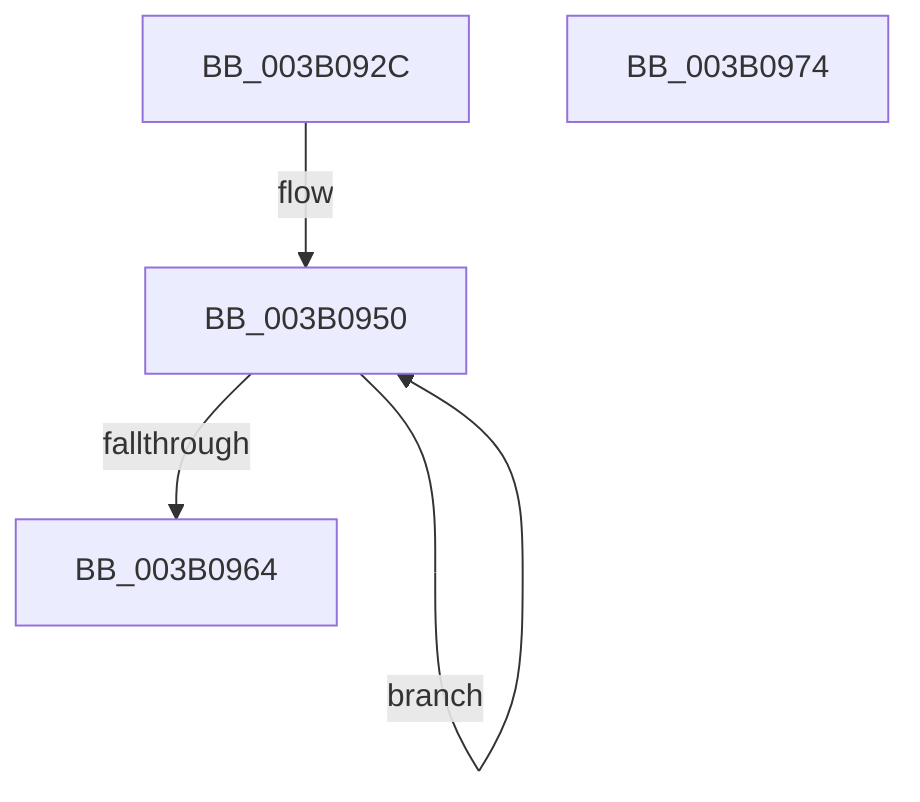

# ST_STORE&lt;SM_TRAITS&gt;::StDmInvalidateCurrentRegions

- RVA: `0x003B092C`–`0x003B0975` (길이 `73` bytes)
- VA: `0x00000001403B092C`
- 실행 섹션: `.text`
- PDB 이름 있음: `예`; PDB Function 태그: `아니요`
- unwind 정보 RVA: `0x00060BC4`
- 디코드: `24`개 명령, `73/73` bytes 표시
- 미해석 바이트: `0` (있으면 어셈블리에 `.byte`로 보존)

> 이 문서는 커널 이미지의 기계어와 PDB 기호를 분석해 생성했습니다. 4번과 5번은 함수 원형과 자료형을 바이너리 사용 방식에서 추정한 C 해석이며 원본 소스 복구 결과는 아닙니다.

## 1. Dependencies

- 직접 호출 지점: **1**; 고유 호출 대상: **1**
- 직접 호출자로 확인된 함수: **3**
- RIP 상대 이미지 참조: **0**

### Outgoing calls
- `0x003B0959` → [ST_STORE<SM_TRAITS>::StDmCurrentRegionSet](ST_STORE_SM_TRAITS_StDmCurrentRegionSet_function_003B1130.md) (function, `0x003B1130`)

### Direct callers
- [sub_002061A0](../20/Unknown_function_002061A0.md) at `0x00206241`
- [sub_0020634E](../20/Unknown_function_0020634E.md) at `0x002064A3`
- [ST_STORE&lt;SM_TRAITS&gt;::StDmCleanup](../3A/ST_STORE_SM_TRAITS_StDmCleanup_function_003AF8D4.md) at `0x003AFA85`

### Static image references
- 디코드된 RIP-relative 메모리 참조가 없습니다.

## 2. Other-region calls and transfers

- 다른 실행 섹션으로 향하는 call: **0**
- 별도 외부 분기/꼬리 이동을 확인하지 못했습니다.

## 3. Assembly (complete function range)

```asm
003B092C  48 89 5C 24 08                  mov qword ptr [rsp + 8], rbx
003B0931  48 89 74 24 10                  mov qword ptr [rsp + 0x10], rsi
003B0936  57                              push rdi
003B0937  48 83 EC 20                     sub rsp, 0x20
003B093B  8B 81 08 03 00 00               mov eax, dword ptr [rcx + 0x308]
003B0941  48 8B F1                        mov rsi, rcx
003B0944  F6 D8                           neg al
003B0946  1B DB                           sbb ebx, ebx
003B0948  83 E3 F9                        and ebx, 0xfffffff9
003B094B  83 C3 08                        add ebx, 8
003B094E  33 FF                           xor edi, edi
003B0950  41 83 C8 FF                     or r8d, 0xffffffff
003B0954  8B D7                           mov edx, edi
003B0956  48 8B CE                        mov rcx, rsi
003B0959  E8 D2 07 00 00                  call 0x1403b1130
003B095E  FF C7                           inc edi
003B0960  3B FB                           cmp edi, ebx
003B0962  72 EC                           jb 0x1403b0950
003B0964  48 8B 5C 24 30                  mov rbx, qword ptr [rsp + 0x30]
003B0969  48 8B 74 24 38                  mov rsi, qword ptr [rsp + 0x38]
003B096E  48 83 C4 20                     add rsp, 0x20
003B0972  5F                              pop rdi
003B0973  C3                              ret
003B0974  CC                              int3
```

## 4. C-style interpretation (structured pseudocode)

```c
__int64 __fastcall ST_STORE_SM_TRAITS___StDmInvalidateCurrentRegions(__int64 a1, __int64 a2, int a3)
{
    __int64 result;
    __int64 v_rbx;
    __int64 v_rdi;
    __int64 v_rsp;
    unsigned __int64 v_stack_p10;
    unsigned __int64 v_stack_p8;

    v_stack_p8 = v_rbx;
    v_stack_p10 = v_rsi;
    v_rsp = (v_rsp) - (32);
    result = (unsigned __int8)(-((unsigned int)(*(unsigned int *)(a1 + 776))));
    v_rbx = (unsigned int)((v_rbx) & (0xFFFFFFF9ULL));
    v_rbx = (unsigned int)((v_rbx) + (8));
    v_rdi = 0;
loc_003B0950:
    a3 = (unsigned int)((a3) | (0xFFFFFFFFULL));
    result = ST_STORE_SM_TRAITS___StDmCurrentRegionSet(a1, 0, a3, a4);
    v_rdi = (unsigned int)((v_rdi) + 1);
    if (((unsigned int)(v_rdi)) < ((unsigned int)(v_rbx))) goto loc_003B0950;
    v_rsp = (v_rsp) + (32);
    return result;
}
```

## 5. (Beta) C Style

```c
int64_t ST_STORE_SM_TRAITS___StDmInvalidateCurrentRegions(void *Arg1, int64_t Arg2, int32_t Arg3)
{
    uint8_t *arg1 = (uint8_t *)Arg1;

    int64_t result;
    int64_t local_rbx;
    int64_t local_rdi;
    int64_t local_rsp;
    uint64_t v_stack_p10;
    uint64_t v_stack_p8;

    v_stack_p8 = local_rbx;
    v_stack_p10 = local_rsi;
    local_rsp = (local_rsp) - (32);
    result = (uint8_t)(-((uint32_t)(*(uint32_t *)(arg1 + 0x308))));
    local_rbx = (uint32_t)((local_rbx) & (0xFFFFFFF9ULL));
    local_rbx = (uint32_t)((local_rbx) + (8));
    local_rdi = 0;
loc_003B0950:
    Arg3 = (uint32_t)((Arg3) | (0xFFFFFFFFULL));
    result = ST_STORE_SM_TRAITS___StDmCurrentRegionSet(Arg1, 0, Arg3, a4);
    local_rdi = (uint32_t)((local_rdi) + 1);
    if (((uint32_t)(local_rdi)) < ((uint32_t)(local_rbx))) goto loc_003B0950;
    local_rsp = (local_rsp) + (32);
    return result;
}
```

### 관측된 메모리 오프셋

구조체 형식이 확인되지 않은 접근은 인자 기준의 오프셋으로만 기록했습니다.

| 기준 인자 | 오프셋 표현 | 폭 (bit) | 접근 |
|---|---:|---:|---|
| `Arg1` | `+ 0x308` | `32` | `R` |

## 6. Execution-region graph

[열기: 2D/3D 그래프와 함수 탐색 컨트롤 패널](../../../control-panel.html?section=text&rva=0x003B092C&view=graph)

- 2D 그래프는 위에서 아래로 흐르고, 3D 그래프는 빈 공간을 드래그해 회전합니다. Shift+드래그는 이동, 휠은 확대·축소, 함수 노드 선택은 대상 보고서 이동입니다.

### Static fallback


