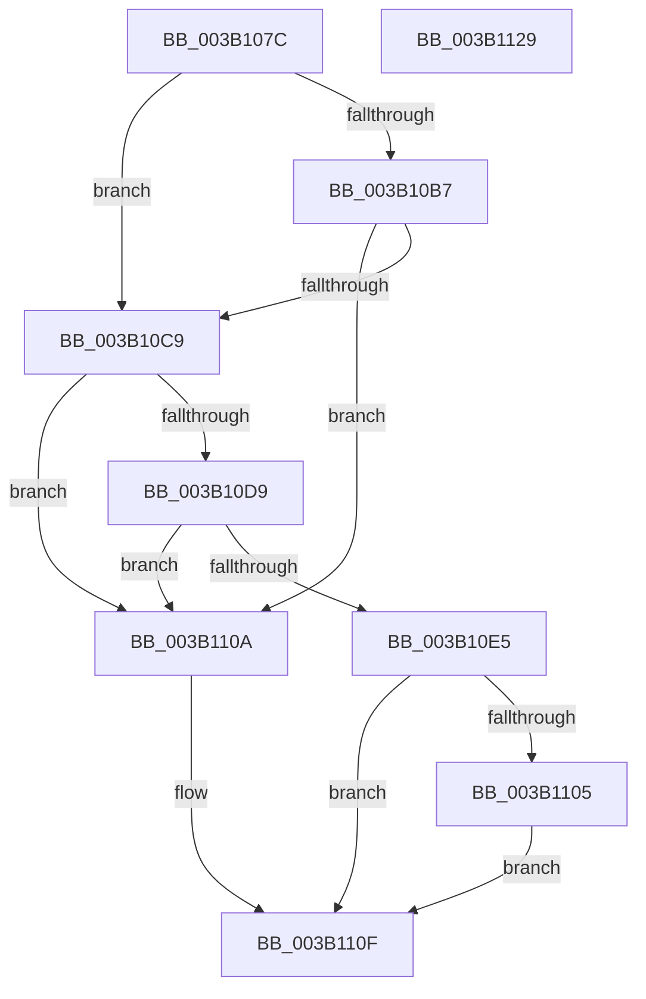

# ST_STORE&lt;SM_TRAITS&gt;::StDmReuseCurrentRegion

- RVA: `0x003B107C`–`0x003B112A` (길이 `174` bytes)
- VA: `0x00000001403B107C`
- 실행 섹션: `.text`
- PDB 이름 있음: `예`; PDB Function 태그: `아니요`
- unwind 정보 RVA: `0x000794E0`
- 디코드: `46`개 명령, `174/174` bytes 표시
- 미해석 바이트: `0` (있으면 어셈블리에 `.byte`로 보존)

> 이 문서는 커널 이미지의 기계어와 PDB 기호를 분석해 생성했습니다. 4번과 5번은 함수 원형과 자료형을 바이너리 사용 방식에서 추정한 C 해석이며 원본 소스 복구 결과는 아닙니다.

## 1. Dependencies

- 직접 호출 지점: **3**; 고유 호출 대상: **3**
- 직접 호출자로 확인된 함수: **1**
- RIP 상대 이미지 참조: **0**

### Outgoing calls
- `0x003B10A6` → [ST_STORE<SM_TRAITS>::StSetDataMovementInProgress](../60/ST_STORE_SM_TRAITS_StSetDataMovementInProgress_function_0060E9BC.md) (function, `0x0060E9BC`)
- `0x003B10C0` → [SMKM_STORE<SM_TRAITS>::SmStIsRegionBusy](../43/SMKM_STORE_SM_TRAITS_SmStIsRegionBusy_function_0043DB80.md) (function, `0x0043DB80`)
- `0x003B10FC` → [ST_STORE<SM_TRAITS>::StCompactRegions](../4A/ST_STORE_SM_TRAITS_StCompactRegions_function_004A48E0.md) (function, `0x004A48E0`)

### Direct callers
- [ST_STORE&lt;SM_TRAITS&gt;::StDmpSinglePageFindSpace](ST_STORE_SM_TRAITS_StDmpSinglePageFindSpace_function_003B0980.md) at `0x003B0A21`

### Static image references
- 디코드된 RIP-relative 메모리 참조가 없습니다.

## 2. Other-region calls and transfers

- 다른 실행 섹션으로 향하는 call: **0**
- 별도 외부 분기/꼬리 이동을 확인하지 못했습니다.

## 3. Assembly (complete function range)

```asm
003B107C  48 89 5C 24 08                  mov qword ptr [rsp + 8], rbx
003B1081  48 89 74 24 10                  mov qword ptr [rsp + 0x10], rsi
003B1086  57                              push rdi
003B1087  48 83 EC 30                     sub rsp, 0x30
003B108B  44 8B 02                        mov r8d, dword ptr [rdx]
003B108E  48 8B F2                        mov rsi, rdx
003B1091  48 8B 81 78 05 00 00            mov rax, qword ptr [rcx + 0x578]
003B1098  48 8B D9                        mov rbx, rcx
003B109B  42 0F B7 3C 40                  movzx edi, word ptr [rax + r8*2]
003B10A0  81 E7 FF 1F 00 00               and edi, 0x1fff
003B10A6  E8 11 D9 25 00                  call 0x14060e9bc
003B10AB  F7 83 08 03 00 00 00 00 02 00   test dword ptr [rbx + 0x308], 0x20000
003B10B5  74 12                           je 0x1403b10c9
003B10B7  8B 16                           mov edx, dword ptr [rsi]
003B10B9  48 8B 8B 20 03 00 00            mov rcx, qword ptr [rbx + 0x320]
003B10C0  E8 BB CA 08 00                  call 0x14043db80
003B10C5  85 C0                           test eax, eax
003B10C7  75 41                           jne 0x1403b110a
003B10C9  8B 8B 30 03 00 00               mov ecx, dword ptr [rbx + 0x330]
003B10CF  8D 04 49                        lea eax, [rcx + rcx*2]
003B10D2  C1 E8 02                        shr eax, 2
003B10D5  3B F8                           cmp edi, eax
003B10D7  73 31                           jae 0x1403b110a
003B10D9  2B 8B 34 03 00 00               sub ecx, dword ptr [rbx + 0x334]
003B10DF  FF C1                           inc ecx
003B10E1  3B F9                           cmp edi, ecx
003B10E3  73 25                           jae 0x1403b110a
003B10E5  48 8B 56 08                     mov rdx, qword ptr [rsi + 8]
003B10E9  48 8B CB                        mov rcx, rbx
003B10EC  44 8B 06                        mov r8d, dword ptr [rsi]
003B10EF  4C 8B CA                        mov r9, rdx
003B10F2  83 64 24 28 00                  and dword ptr [rsp + 0x28], 0
003B10F7  44 89 44 24 20                  mov dword ptr [rsp + 0x20], r8d
003B10FC  E8 DF 37 0F 00                  call 0x1404a48e0
003B1101  85 C0                           test eax, eax
003B1103  78 0A                           js 0x1403b110f
003B1105  89 7E 04                        mov dword ptr [rsi + 4], edi
003B1108  EB 05                           jmp 0x1403b110f
003B110A  B8 7F 00 00 C0                  mov eax, 0xc000007f
003B110F  48 8B 74 24 48                  mov rsi, qword ptr [rsp + 0x48]
003B1114  C7 83 C0 05 00 00 00 00 00 00   mov dword ptr [rbx + 0x5c0], 0
003B111E  48 8B 5C 24 40                  mov rbx, qword ptr [rsp + 0x40]
003B1123  48 83 C4 30                     add rsp, 0x30
003B1127  5F                              pop rdi
003B1128  C3                              ret
003B1129  CC                              int3
```

## 4. C-style interpretation (structured pseudocode)

```c
__int64 __fastcall ST_STORE_SM_TRAITS___StDmReuseCurrentRegion(__int64 a1, __int64 a2)
{
    __int64 result;
    __int64 v_rdi;
    __int64 v_rsp;
    unsigned int v_stack_m10;
    unsigned int v_stack_m18;
    unsigned __int64 v_stack_p10;
    unsigned __int64 v_stack_p8;

    v_stack_p8 = v_rbx;
    v_stack_p10 = v_rsi;
    v_rsp = (v_rsp) - (48);
    v_rdi = (unsigned int)((*(unsigned __int16 *)(*(unsigned __int64 *)(a1 + 1400) + (unsigned int)(*(unsigned int *)(a2)) * 2)) & (0x1FFFULL));
    result = ST_STORE_SM_TRAITS___StSetDataMovementInProgress(a1, a2, (unsigned int)(*(unsigned int *)(a2)), a4);
    if (((*(unsigned int *)(a1 + 776)) & (0x20000ULL)) == 0) goto loc_003B10C9;
    result = SMKM_STORE_SM_TRAITS___SmStIsRegionBusy(*(unsigned __int64 *)(a1 + 800), (unsigned int)(*(unsigned int *)(a2)), (unsigned int)(*(unsigned int *)(a2)), a4);
    if ((unsigned int)(result) != 0) goto loc_003B110A;
loc_003B10C9:
    result = (unsigned int)(((unsigned int)(*(unsigned int *)(a1 + 816)) + (unsigned int)(*(unsigned int *)(a1 + 816)) * 2) >> (2));
    if (((unsigned int)(v_rdi)) >= ((unsigned int)(result))) goto loc_003B110A;
    a1 = (unsigned int)(((unsigned int)(*(unsigned int *)(a1 + 816))) - (*(unsigned int *)(a1 + 820)));
    a1 = (unsigned int)((a1) + 1);
    if (((unsigned int)(v_rdi)) >= ((unsigned int)(a1))) goto loc_003B110A;
    v_stack_m18 = (unsigned int)((unsigned int)(*(unsigned int *)(a2)));
    result = ST_STORE_SM_TRAITS___StCompactRegions(a1, *(unsigned __int64 *)(a2 + 8), (unsigned int)(*(unsigned int *)(a2)), *(unsigned __int64 *)(a2 + 8));
    if (sign_flag) goto loc_003B110F;
    *(unsigned int *)(a2 + 4) = (unsigned int)(v_rdi);
    goto loc_003B110F;
loc_003B110A:
loc_003B110F:
    *(unsigned int *)(a1 + 1472) = 0;
    v_rsp = (v_rsp) + (48);
    return (unsigned int)(0xC000007FULL);
}
```

## 5. (Beta) C Style

```c
int64_t ST_STORE_SM_TRAITS___StDmReuseCurrentRegion(void *Arg1, void *Arg2)
{
    uint8_t *arg1 = (uint8_t *)Arg1;
    uint8_t *arg2 = (uint8_t *)Arg2;

    int64_t result;
    int64_t local_rdi;
    int64_t local_rsp;
    uint32_t v_stack_m10;
    uint32_t v_stack_m18;
    uint64_t v_stack_p10;
    uint64_t v_stack_p8;

    v_stack_p8 = local_rbx;
    v_stack_p10 = local_rsi;
    local_rsp = (local_rsp) - (48);
    local_rdi = (uint32_t)((*(uint16_t *)(*(uint64_t *)(arg1 + 0x578) + (uint32_t)(*(uint32_t *)(arg2)) * 2)) & (0x1FFFULL));
    result = ST_STORE_SM_TRAITS___StSetDataMovementInProgress(Arg1, Arg2, (uint32_t)(*(uint32_t *)(arg2)), a4);
    if (((*(uint32_t *)(arg1 + 0x308)) & (0x20000ULL)) == 0) goto loc_003B10C9;
    result = SMKM_STORE_SM_TRAITS___SmStIsRegionBusy(*(uint64_t *)(arg1 + 0x320), (uint32_t)(*(uint32_t *)(arg2)), (uint32_t)(*(uint32_t *)(arg2)), a4);
    if ((uint32_t)(result) != 0) goto loc_003B110A;
loc_003B10C9:
    result = (uint32_t)(((uint32_t)(*(uint32_t *)(arg1 + 0x330)) + (uint32_t)(*(uint32_t *)(arg1 + 0x330)) * 2) >> (2));
    if (((uint32_t)(local_rdi)) >= ((uint32_t)(result))) goto loc_003B110A;
    Arg1 = (uint32_t)(((uint32_t)(*(uint32_t *)(arg1 + 0x330))) - (*(uint32_t *)(arg1 + 0x334)));
    Arg1 = (uint32_t)((Arg1) + 1);
    if (((uint32_t)(local_rdi)) >= ((uint32_t)(Arg1))) goto loc_003B110A;
    v_stack_m18 = (uint32_t)((uint32_t)(*(uint32_t *)(arg2)));
    result = ST_STORE_SM_TRAITS___StCompactRegions(Arg1, *(uint64_t *)(arg2 + 0x8), (uint32_t)(*(uint32_t *)(arg2)), *(uint64_t *)(arg2 + 0x8));
    if (sign_flag) goto loc_003B110F;
    *(uint32_t *)(arg2 + 0x4) = (uint32_t)(local_rdi);
    goto loc_003B110F;
loc_003B110A:
loc_003B110F:
    *(uint32_t *)(arg1 + 0x5C0) = 0;
    local_rsp = (local_rsp) + (48);
    return (uint32_t)(0xC000007FULL);
}
```

### 관측된 메모리 오프셋

구조체 형식이 확인되지 않은 접근은 인자 기준의 오프셋으로만 기록했습니다.

| 기준 인자 | 오프셋 표현 | 폭 (bit) | 접근 |
|---|---:|---:|---|
| `Arg1` | `+ 0x308` | `32` | `R` |
| `Arg1` | `+ 0x320` | `64` | `R` |
| `Arg1` | `+ 0x330` | `32` | `R` |
| `Arg1` | `+ 0x334` | `32` | `R` |
| `Arg1` | `+ 0x578` | `64` | `R` |
| `Arg1` | `+ 0x5C0` | `32` | `W` |
| `Arg2` | `+ 0x0` | `32` | `R` |
| `Arg2` | `+ 0x4` | `32` | `W` |
| `Arg2` | `+ 0x8` | `64` | `R` |

## 6. Execution-region graph

[열기: 2D/3D 그래프와 함수 탐색 컨트롤 패널](../../../control-panel.html?section=text&rva=0x003B107C&view=graph)

- 2D 그래프는 위에서 아래로 흐르고, 3D 그래프는 빈 공간을 드래그해 회전합니다. Shift+드래그는 이동, 휠은 확대·축소, 함수 노드 선택은 대상 보고서 이동입니다.

### Static fallback


