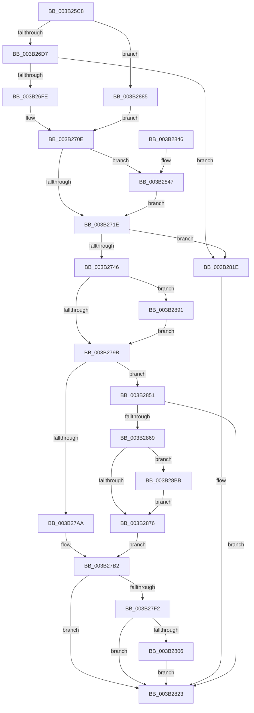

# ST_STORE&lt;SM_TRAITS&gt;::StDmStart

- RVA: `0x003B25C8`–`0x003B28CC` (길이 `772` bytes)
- VA: `0x00000001403B25C8`
- 실행 섹션: `.text`
- PDB 이름 있음: `예`; PDB Function 태그: `아니요`
- unwind 정보 RVA: `0x0008C3EC`
- 디코드: `170`개 명령, `772/772` bytes 표시
- 미해석 바이트: `0` (있으면 어셈블리에 `.byte`로 보존)

> 이 문서는 커널 이미지의 기계어와 PDB 기호를 분석해 생성했습니다. 4번과 5번은 함수 원형과 자료형을 바이너리 사용 방식에서 추정한 C 해석이며 원본 소스 복구 결과는 아닙니다.

## 1. Dependencies

- 직접 호출 지점: **11**; 고유 호출 대상: **7**
- 직접 호출자로 확인된 함수: **1**
- RIP 상대 이미지 참조: **5**

### Outgoing calls
- `0x003B26ED` → [ExAllocatePool2](../../poolcode/B8/ExAllocatePool2_function_00B820F0.md) (function, `0x00B820F0`)
- `0x003B2735` → [ExAllocatePool2](../../poolcode/B8/ExAllocatePool2_function_00B820F0.md) (function, `0x00B820F0`)
- `0x003B2756` → [RtlSetAllBits](../36/RtlSetAllBits_function_00362490.md) (function, `0x00362490`)
- `0x003B27E9` → [NP_CONTEXT::NpStart](NP_CONTEXT_NpStart_function_003B28D4.md) (function, `0x003B28D4`)
- `0x003B27FD` → [NP_CONTEXT::NpStart](NP_CONTEXT_NpStart_function_003B28D4.md) (function, `0x003B28D4`)
- `0x003B2811` → [NP_CONTEXT::NpStart](NP_CONTEXT_NpStart_function_003B28D4.md) (function, `0x003B28D4`)
- `0x003B282A` → [_security_check_cookie](../6A/_security_check_cookie_function_006AC640.md) (function, `0x006AC640`)
- `0x003B2847` → [RtlSetAllBits](../36/RtlSetAllBits_function_00362490.md) (function, `0x00362490`)
- `0x003B2860` → [SmQuerySystemInformation](SmQuerySystemInformation_function_003B29F8.md) (function, `0x003B29F8`)
- `0x003B28A5` → [SmHpChunkHeapCleanup](../3A/SmHpChunkHeapCleanup_function_003AFD08.md) (function, `0x003AFD08`)
- `0x003B28B1` → [SmHpChunkHeapInitialize](../46/SmHpChunkHeapInitialize_function_0046857C.md) (function, `0x0046857C`)

### Direct callers
- [ST_STORE&lt;SM_TRAITS&gt;::StStart](ST_STORE_SM_TRAITS_StStart_function_003B1BBC.md) at `0x003B1E63`
- [ST_STORE&lt;SM_TRAITS&gt;::StStart](ST_STORE_SM_TRAITS_StStart_function_003B1BBC.md) at `0x003B1FF3`

### Static image references
- `0x003B25E0` → RVA `0x00E0A740` (`.data`; read)
- `0x003B27B2` → RVA `0x0060E540` (`ST_STORE<SM_TRAITS>::StNpEnumBTreeNodes`; read)
- `0x003B27C4` → RVA `0x0060E6C0` (`ST_STORE<SM_TRAITS>::StNpLeafPageOut`; read)
- `0x003B27D3` → RVA `0x0060E610` (`ST_STORE<SM_TRAITS>::StNpLeafPageIn`; read)
- `0x003B27DE` → RVA `0x0060E5C0` (`ST_STORE<SM_TRAITS>::StNpLeafDelete`; read)

## 2. Other-region calls and transfers

- 다른 실행 섹션으로 향하는 call: **2**
  - `0x003B26ED` → [ExAllocatePool2](../../poolcode/B8/ExAllocatePool2_function_00B820F0.md) (`.text` → `POOLCODE`)
  - `0x003B2735` → [ExAllocatePool2](../../poolcode/B8/ExAllocatePool2_function_00B820F0.md) (`.text` → `POOLCODE`)
- 별도 외부 분기/꼬리 이동을 확인하지 못했습니다.

## 3. Assembly (complete function range)

```asm
003B25C8  48 89 5C 24 18                  mov qword ptr [rsp + 0x18], rbx
003B25CD  55                              push rbp
003B25CE  56                              push rsi
003B25CF  57                              push rdi
003B25D0  41 56                           push r14
003B25D2  41 57                           push r15
003B25D4  48 8D 6C 24 D9                  lea rbp, [rsp - 0x27]
003B25D9  48 81 EC 90 00 00 00            sub rsp, 0x90
003B25E0  48 8B 05 59 81 A5 00            mov rax, qword ptr [rip + 0xa58159]
003B25E7  48 33 C4                        xor rax, rsp
003B25EA  48 89 45 1F                     mov qword ptr [rbp + 0x1f], rax
003B25EE  33 C0                           xor eax, eax
003B25F0  48 8B D9                        mov rbx, rcx
003B25F3  48 89 45 17                     mov qword ptr [rbp + 0x17], rax
003B25F7  0F 57 C0                        xorps xmm0, xmm0
003B25FA  41 8B 00                        mov eax, dword ptr [r8]
003B25FD  45 33 FF                        xor r15d, r15d
003B2600  0F 11 45 E7                     movups xmmword ptr [rbp - 0x19], xmm0
003B2604  4D 8B F0                        mov r14, r8
003B2607  48 8B FA                        mov rdi, rdx
003B260A  0F 11 45 F7                     movups xmmword ptr [rbp - 9], xmm0
003B260E  BE 73 6D 53 74                  mov esi, 0x74536d73
003B2613  0F 11 45 07                     movups xmmword ptr [rbp + 7], xmm0
003B2617  0F 10 01                        movups xmm0, xmmword ptr [rcx]
003B261A  0F 11 82 08 03 00 00            movups xmmword ptr [rdx + 0x308], xmm0
003B2621  0F 10 49 10                     movups xmm1, xmmword ptr [rcx + 0x10]
003B2625  0F 11 8A 18 03 00 00            movups xmmword ptr [rdx + 0x318], xmm1
003B262C  0F 10 41 20                     movups xmm0, xmmword ptr [rcx + 0x20]
003B2630  0F 11 82 28 03 00 00            movups xmmword ptr [rdx + 0x328], xmm0
003B2637  F2 0F 10 49 30                  movsd xmm1, qword ptr [rcx + 0x30]
003B263C  89 82 40 03 00 00               mov dword ptr [rdx + 0x340], eax
003B2642  48 8D 83 60 19 00 00            lea rax, [rbx + 0x1960]
003B2649  F2 0F 11 8A 38 03 00 00         movsd qword ptr [rdx + 0x338], xmm1
003B2651  F7 82 08 03 00 00 00 00 02 00   test dword ptr [rdx + 0x308], 0x20000
003B265B  48 8B 89 B0 12 00 00            mov rcx, qword ptr [rcx + 0x12b0]
003B2662  48 89 82 F8 08 00 00            mov qword ptr [rdx + 0x8f8], rax
003B2669  48 89 8A 80 03 00 00            mov qword ptr [rdx + 0x380], rcx
003B2670  48 8B 83 70 12 00 00            mov rax, qword ptr [rbx + 0x1270]
003B2677  48 89 82 58 05 00 00            mov qword ptr [rdx + 0x558], rax
003B267E  48 8D 83 E0 12 00 00            lea rax, [rbx + 0x12e0]
003B2685  48 89 82 68 05 00 00            mov qword ptr [rdx + 0x568], rax
003B268C  48 8B 83 70 13 00 00            mov rax, qword ptr [rbx + 0x1370]
003B2693  48 89 82 70 08 00 00            mov qword ptr [rdx + 0x870], rax
003B269A  48 8D 83 68 19 00 00            lea rax, [rbx + 0x1968]
003B26A1  48 89 82 F0 08 00 00            mov qword ptr [rdx + 0x8f0], rax
003B26A8  8B 83 C0 12 00 00               mov eax, dword ptr [rbx + 0x12c0]
003B26AE  89 82 50 05 00 00               mov dword ptr [rdx + 0x550], eax
003B26B4  48 8D 42 18                     lea rax, [rdx + 0x18]
003B26B8  48 89 82 38 05 00 00            mov qword ptr [rdx + 0x538], rax
003B26BF  48 8D 42 58                     lea rax, [rdx + 0x58]
003B26C3  48 89 82 40 05 00 00            mov qword ptr [rdx + 0x540], rax
003B26CA  48 89 8A A0 03 00 00            mov qword ptr [rdx + 0x3a0], rcx
003B26D1  0F 84 AE 01 00 00               je 0x1403b2885
003B26D7  8B 53 0C                        mov edx, dword ptr [rbx + 0xc]
003B26DA  41 8D 4F 40                     lea ecx, [r15 + 0x40]
003B26DE  48 83 C2 1F                     add rdx, 0x1f
003B26E2  44 8B C6                        mov r8d, esi
003B26E5  48 C1 EA 05                     shr rdx, 5
003B26E9  48 C1 E2 02                     shl rdx, 2
003B26ED  E8 FE F9 7C 00                  call 0x140b820f0
003B26F2  48 8B D0                        mov rdx, rax
003B26F5  48 85 C0                        test rax, rax
003B26F8  0F 84 20 01 00 00               je 0x1403b281e
003B26FE  8B 43 0C                        mov eax, dword ptr [rbx + 0xc]
003B2701  48 8D 8F 48 03 00 00            lea rcx, [rdi + 0x348]
003B2708  89 01                           mov dword ptr [rcx], eax
003B270A  48 89 51 08                     mov qword ptr [rcx + 8], rdx
003B270E  F7 87 08 03 00 00 00 00 02 00   test dword ptr [rdi + 0x308], 0x20000
003B2718  0F 85 29 01 00 00               jne 0x1403b2847
003B271E  8B 53 0C                        mov edx, dword ptr [rbx + 0xc]
003B2721  44 8B C6                        mov r8d, esi
003B2724  48 83 C2 1F                     add rdx, 0x1f
003B2728  B9 40 00 00 00                  mov ecx, 0x40
003B272D  48 C1 EA 05                     shr rdx, 5
003B2731  48 C1 E2 02                     shl rdx, 2
003B2735  E8 B6 F9 7C 00                  call 0x140b820f0
003B273A  48 8B D0                        mov rdx, rax
003B273D  48 85 C0                        test rax, rax
003B2740  0F 84 D8 00 00 00               je 0x1403b281e
003B2746  8B 43 0C                        mov eax, dword ptr [rbx + 0xc]
003B2749  48 8D 8F A0 05 00 00            lea rcx, [rdi + 0x5a0]
003B2750  89 01                           mov dword ptr [rcx], eax
003B2752  48 89 51 08                     mov qword ptr [rcx + 8], rdx
003B2756  E8 35 FD FA FF                  call 0x140362490
003B275B  48 8B 43 38                     mov rax, qword ptr [rbx + 0x38]
003B275F  BE 10 00 00 00                  mov esi, 0x10
003B2764  48 89 87 78 05 00 00            mov qword ptr [rdi + 0x578], rax
003B276B  48 8B 43 40                     mov rax, qword ptr [rbx + 0x40]
003B276F  48 89 87 80 05 00 00            mov qword ptr [rdi + 0x580], rax
003B2776  48 8B 43 48                     mov rax, qword ptr [rbx + 0x48]
003B277A  48 89 87 88 05 00 00            mov qword ptr [rdi + 0x588], rax
003B2781  8B 45 7F                        mov eax, dword ptr [rbp + 0x7f]
003B2784  89 87 58 03 00 00               mov dword ptr [rdi + 0x358], eax
003B278A  48 8B 87 68 05 00 00            mov rax, qword ptr [rdi + 0x568]
003B2791  44 39 78 18                     cmp dword ptr [rax + 0x18], r15d
003B2795  0F 85 F6 00 00 00               jne 0x1403b2891
003B279B  41 8B 06                        mov eax, dword ptr [r14]
003B279E  44 89 7D C3                     mov dword ptr [rbp - 0x3d], r15d
003B27A2  A8 08                           test al, 8
003B27A4  0F 85 A7 00 00 00               jne 0x1403b2851
003B27AA  B9 FF FF FF FF                  mov ecx, 0xffffffff
003B27AF  89 4D BF                        mov dword ptr [rbp - 0x41], ecx
003B27B2  48 8D 05 87 BD 25 00            lea rax, [rip + 0x25bd87]
003B27B9  48 89 45 C7                     mov qword ptr [rbp - 0x39], rax
003B27BD  48 8D 8F D8 06 00 00            lea rcx, [rdi + 0x6d8]
003B27C4  48 8D 05 F5 BE 25 00            lea rax, [rip + 0x25bef5]
003B27CB  48 89 45 CF                     mov qword ptr [rbp - 0x31], rax
003B27CF  48 8D 55 BF                     lea rdx, [rbp - 0x41]
003B27D3  48 8D 05 36 BE 25 00            lea rax, [rip + 0x25be36]
003B27DA  48 89 45 D7                     mov qword ptr [rbp - 0x29], rax
003B27DE  48 8D 05 DB BD 25 00            lea rax, [rip + 0x25bddb]
003B27E5  48 89 45 DF                     mov qword ptr [rbp - 0x21], rax
003B27E9  E8 E6 00 00 00                  call 0x1403b28d4
003B27EE  85 C0                           test eax, eax
003B27F0  78 31                           js 0x1403b2823
003B27F2  48 8D 8F 60 07 00 00            lea rcx, [rdi + 0x760]
003B27F9  48 8D 55 BF                     lea rdx, [rbp - 0x41]
003B27FD  E8 D2 00 00 00                  call 0x1403b28d4
003B2802  85 C0                           test eax, eax
003B2804  78 1D                           js 0x1403b2823
003B2806  48 8D 8F E8 07 00 00            lea rcx, [rdi + 0x7e8]
003B280D  48 8D 55 BF                     lea rdx, [rbp - 0x41]
003B2811  E8 BE 00 00 00                  call 0x1403b28d4
003B2816  85 C0                           test eax, eax
003B2818  41 0F 49 C7                     cmovns eax, r15d
003B281C  EB 05                           jmp 0x1403b2823
003B281E  B8 9A 00 00 C0                  mov eax, 0xc000009a
003B2823  48 8B 4D 1F                     mov rcx, qword ptr [rbp + 0x1f]
003B2827  48 33 CC                        xor rcx, rsp
003B282A  E8 11 9E 2F 00                  call 0x1406ac640
003B282F  48 8B 9C 24 D0 00 00 00         mov rbx, qword ptr [rsp + 0xd0]
003B2837  48 81 C4 90 00 00 00            add rsp, 0x90
003B283E  41 5F                           pop r15
003B2840  41 5E                           pop r14
003B2842  5F                              pop rdi
003B2843  5E                              pop rsi
003B2844  5D                              pop rbp
003B2845  C3                              ret
003B2846  CC                              int3
003B2847  E8 44 FC FA FF                  call 0x140362490
003B284C  E9 CD FE FF FF                  jmp 0x1403b271e
003B2851  48 8B 8F 20 03 00 00            mov rcx, qword ptr [rdi + 0x320]
003B2858  4C 8D 45 E7                     lea r8, [rbp - 0x19]
003B285C  48 83 C9 01                     or rcx, 1
003B2860  E8 93 01 00 00                  call 0x1403b29f8
003B2865  85 C0                           test eax, eax
003B2867  78 BA                           js 0x1403b2823
003B2869  48 8B 45 E7                     mov rax, qword ptr [rbp - 0x19]
003B286D  48 C1 E8 15                     shr rax, 0x15
003B2871  48 3B C6                        cmp rax, rsi
003B2874  73 45                           jae 0x1403b28bb
003B2876  89 75 BF                        mov dword ptr [rbp - 0x41], esi
003B2879  C7 45 C3 04 00 00 00            mov dword ptr [rbp - 0x3d], 4
003B2880  E9 2D FF FF FF                  jmp 0x1403b27b2
003B2885  48 8D 8A 48 03 00 00            lea rcx, [rdx + 0x348]
003B288C  E9 7D FE FF FF                  jmp 0x1403b270e
003B2891  48 8D 9F C0 00 00 00            lea rbx, [rdi + 0xc0]
003B2898  89 75 B7                        mov dword ptr [rbp - 0x49], esi
003B289B  48 8B CB                        mov rcx, rbx
003B289E  C7 45 BB 04 00 00 00            mov dword ptr [rbp - 0x45], 4
003B28A5  E8 5E D4 FF FF                  call 0x1403afd08
003B28AA  48 8D 55 B7                     lea rdx, [rbp - 0x49]
003B28AE  48 8B CB                        mov rcx, rbx
003B28B1  E8 C6 5C 0B 00                  call 0x14046857c
003B28B6  E9 E0 FE FF FF                  jmp 0x1403b279b
003B28BB  B9 FF FF FF FF                  mov ecx, 0xffffffff
003B28C0  48 8B F0                        mov rsi, rax
003B28C3  48 3B C1                        cmp rax, rcx
003B28C6  48 0F 47 F1                     cmova rsi, rcx
003B28CA  EB AA                           jmp 0x1403b2876
```

## 4. C-style interpretation (structured pseudocode)

```c
__int64 __fastcall ST_STORE_SM_TRAITS___StDmStart(__int64 a1, __int64 a2, __int64 a3, __int64 a4, __int64 a5, unsigned int a6)
{
    __int64 result;
    __int64 v_r15;
    __int64 v_rsi;
    __int64 v_rsp;
    unsigned __int64 v_stack_m30;
    unsigned __int64 v_stack_m38;
    unsigned __int64 v_stack_m48;
    unsigned __int64 v_stack_m4F;
    unsigned __int64 v_stack_m58;
    unsigned __int64 v_stack_m68;
    unsigned __int64 v_stack_m70;
    unsigned __int64 v_stack_m78;
    unsigned __int64 v_stack_m80;
    unsigned __int64 v_stack_m88;
    unsigned int v_stack_m8C;
    unsigned int v_stack_m90;
    unsigned int v_stack_m94;
    unsigned int v_stack_m98;
    unsigned __int64 v_stack_p18;

    v_stack_p18 = v_rbx;
    v_rsp = (v_rsp) - (144);
    result = (*(unsigned __int64 *)(v_rip + 10846553)) ^ (v_rsp);
    v_stack_m30 = result;
    result = 0;
    v_stack_m38 = 0;
    v_r15 = 0;
    v_stack_m68 = v_xmm0;
    v_stack_m58 = v_xmm0;
    v_stack_m48 = v_xmm0;
    *(unsigned __int64 *)(a2 + 776) = v_xmm0;
    *(unsigned __int64 *)(a2 + 792) = v_xmm1;
    *(unsigned __int64 *)(a2 + 808) = v_xmm0;
    *(unsigned int *)(a2 + 832) = (unsigned int)((unsigned int)(*(unsigned int *)(a3)));
    *(unsigned __int64 *)(a2 + 824) = v_xmm1;
    *(unsigned __int64 *)(a2 + 2296) = a1 + 6496;
    *(unsigned __int64 *)(a2 + 896) = *(unsigned __int64 *)(a1 + 4784);
    *(unsigned __int64 *)(a2 + 1368) = *(unsigned __int64 *)(a1 + 4720);
    *(unsigned __int64 *)(a2 + 1384) = a1 + 4832;
    *(unsigned __int64 *)(a2 + 2160) = *(unsigned __int64 *)(a1 + 4976);
    *(unsigned __int64 *)(a2 + 2288) = a1 + 6504;
    *(unsigned int *)(a2 + 1360) = (unsigned int)((unsigned int)(*(unsigned int *)(a1 + 4800)));
    *(unsigned __int64 *)(a2 + 1336) = a2 + 24;
    *(unsigned __int64 *)(a2 + 1344) = a2 + 88;
    *(unsigned __int64 *)(a2 + 928) = *(unsigned __int64 *)(a1 + 4784);
    if (((*(unsigned int *)(a2 + 776)) & (0x20000ULL)) == 0) goto loc_003B2885;
    a2 = ((unsigned int)(*(unsigned int *)(a1 + 12))) + (31);
    a2 = (a2) >> (5);
    a2 = (a2) << (2);
    result = ExAllocatePool2(v_r15 + 64, a2, (unsigned int)((unsigned int)((unsigned int)(0x74536D73ULL))), a4);
    if (result == 0) goto loc_003B281E;
    *(unsigned int *)(a2 + 840) = (unsigned int)((unsigned int)(*(unsigned int *)(a1 + 12)));
    *(unsigned __int64 *)(a2 + 840 + 8) = result;
loc_003B270E:
    if (((*(unsigned int *)(a2 + 776)) & (0x20000ULL)) != 0) goto loc_003B2847;
loc_003B271E:
    a2 = ((unsigned int)(*(unsigned int *)(a1 + 12))) + (31);
    a2 = (a2) >> (5);
    a2 = (a2) << (2);
    result = ExAllocatePool2(64, a2, (unsigned int)((unsigned int)((unsigned int)(0x74536D73ULL))), a4);
    if (result == 0) goto loc_003B281E;
    *(unsigned int *)(a2 + 1440) = (unsigned int)((unsigned int)(*(unsigned int *)(a1 + 12)));
    *(unsigned __int64 *)(a2 + 1440 + 8) = result;
    result = RtlSetAllBits(a2 + 1440, result, (unsigned int)((unsigned int)((unsigned int)(0x74536D73ULL))), a4);
    *(unsigned __int64 *)(a2 + 1400) = *(unsigned __int64 *)(a1 + 56);
    *(unsigned __int64 *)(a2 + 1408) = *(unsigned __int64 *)(a1 + 64);
    *(unsigned __int64 *)(a2 + 1416) = *(unsigned __int64 *)(a1 + 72);
    *(unsigned int *)(a2 + 856) = (unsigned int)((unsigned int)(a6));
    if ((*(unsigned int *)(*(unsigned __int64 *)(a2 + 1384) + 24)) != 0) goto loc_003B2891;
loc_003B279B:
    v_stack_m8C = 0;
    if ((((unsigned __int8)((unsigned int)(*(unsigned int *)(a3)))) & (8)) != 0) goto loc_003B2851;
    v_stack_m90 = (unsigned int)((unsigned int)(0xFFFFFFFFULL));
loc_003B27B2:
    v_stack_m88 = v_rip + 2473351;
    v_stack_m80 = v_rip + 2473717;
    v_stack_m78 = v_rip + 2473526;
    v_stack_m70 = v_rip + 2473435;
    result = NP_CONTEXT__NpStart(a2 + 1752, v_stack_m90, (unsigned int)((unsigned int)((unsigned int)(0x74536D73ULL))), a4);
    if (sign_flag) goto loc_003B2823;
    result = NP_CONTEXT__NpStart(a2 + 1888, v_stack_m90, (unsigned int)((unsigned int)((unsigned int)(0x74536D73ULL))), a4);
    if (sign_flag) goto loc_003B2823;
    result = NP_CONTEXT__NpStart(a2 + 2024, v_stack_m90, (unsigned int)((unsigned int)((unsigned int)(0x74536D73ULL))), a4);
    if (!sign_flag) { result = 0; }
    goto loc_003B2823;
loc_003B281E:
loc_003B2823:
    a1 = (v_stack_m30) ^ (v_rsp);
    result = _security_check_cookie(a1, v_stack_m90, (unsigned int)((unsigned int)((unsigned int)(0x74536D73ULL))), a4);
    v_rsp = (v_rsp) + (144);
    return result;
loc_003B2847:
    result = RtlSetAllBits(a1, v_stack_m90, (unsigned int)((unsigned int)((unsigned int)(0x74536D73ULL))), a4);
    goto loc_003B271E;
loc_003B2851:
    a1 = (*(unsigned __int64 *)(a2 + 800)) | (1);
    result = SmQuerySystemInformation(a1, v_stack_m90, v_stack_m68, a4);
    if (sign_flag) goto loc_003B2823;
    result = (v_stack_m68) >> (21);
    if (result >= 16) goto loc_003B28BB;
loc_003B2876:
    v_stack_m90 = 16;
    v_stack_m8C = 4;
    goto loc_003B27B2;
loc_003B2885:
    goto loc_003B270E;
loc_003B2891:
    v_stack_m98 = 16;
    v_stack_m94 = 4;
    result = SmHpChunkHeapCleanup(a2 + 192, v_stack_m90, v_stack_m68, a4);
    result = SmHpChunkHeapInitialize(a2 + 192, v_stack_m98, v_stack_m68, a4);
    goto loc_003B279B;
loc_003B28BB:
    v_rsi = result;
    if (result > ((unsigned int)(0xFFFFFFFFULL))) { v_rsi = (unsigned int)(0xFFFFFFFFULL); }
    goto loc_003B2876;
}
```

## 5. (Beta) C Style

```c
int64_t ST_STORE_SM_TRAITS___StDmStart(void *Arg1, void *Arg2, void *Arg3, int64_t Arg4, uint64_t Arg5, uint32_t Arg6)
{
    uint8_t *arg1 = (uint8_t *)Arg1;
    uint8_t *arg2 = (uint8_t *)Arg2;
    uint8_t *arg3 = (uint8_t *)Arg3;

    int64_t result;
    int64_t local_r15;
    int64_t local_rsi;
    int64_t local_rsp;
    uint64_t v_stack_m30;
    uint64_t v_stack_m38;
    uint64_t v_stack_m48;
    uint64_t v_stack_m4F;
    uint64_t v_stack_m58;
    uint64_t v_stack_m68;
    uint64_t v_stack_m70;
    uint64_t v_stack_m78;
    uint64_t v_stack_m80;
    uint64_t v_stack_m88;
    uint32_t v_stack_m8C;
    uint32_t v_stack_m90;
    uint32_t v_stack_m94;
    uint32_t v_stack_m98;
    uint64_t v_stack_p18;

    v_stack_p18 = local_rbx;
    local_rsp = (local_rsp) - (144);
    result = (*(uint64_t *)(v_rip + 0xA58159)) ^ (local_rsp);
    v_stack_m30 = result;
    result = 0;
    v_stack_m38 = 0;
    local_r15 = 0;
    v_stack_m68 = v_xmm0;
    v_stack_m58 = v_xmm0;
    v_stack_m48 = v_xmm0;
    *(uint64_t *)(arg2 + 0x308) = v_xmm0;
    *(uint64_t *)(arg2 + 0x318) = v_xmm1;
    *(uint64_t *)(arg2 + 0x328) = v_xmm0;
    *(uint32_t *)(arg2 + 0x340) = (uint32_t)((uint32_t)(*(uint32_t *)(arg3)));
    *(uint64_t *)(arg2 + 0x338) = v_xmm1;
    *(void **)(arg2 + 0x8F8) = Arg1 + 6496;
    *(uint64_t *)(arg2 + 0x380) = *(uint64_t *)(arg1 + 0x12B0);
    *(uint64_t *)(arg2 + 0x558) = *(uint64_t *)(arg1 + 0x1270);
    *(void **)(arg2 + 0x568) = Arg1 + 4832;
    *(uint64_t *)(arg2 + 0x870) = *(uint64_t *)(arg1 + 0x1370);
    *(void **)(arg2 + 0x8F0) = Arg1 + 6504;
    *(uint32_t *)(arg2 + 0x550) = (uint32_t)((uint32_t)(*(uint32_t *)(arg1 + 0x12C0)));
    *(void **)(arg2 + 0x538) = Arg2 + 24;
    *(void **)(arg2 + 0x540) = Arg2 + 88;
    *(uint64_t *)(arg2 + 0x3A0) = *(uint64_t *)(arg1 + 0x12B0);
    if (((*(uint32_t *)(arg2 + 0x308)) & (0x20000ULL)) == 0) goto loc_003B2885;
    Arg2 = ((uint32_t)(*(uint32_t *)(arg1 + 0xC))) + (31);
    Arg2 = (Arg2) >> (5);
    Arg2 = (Arg2) << (2);
    result = ExAllocatePool2(local_r15 + 64, Arg2, (uint32_t)((uint32_t)((uint32_t)(0x74536D73ULL))), Arg4);
    if (result == 0) goto loc_003B281E;
    *(uint32_t *)(arg2 + 0x348) = (uint32_t)((uint32_t)(*(uint32_t *)(arg1 + 0xC)));
    *(uint64_t *)(arg2 + 0x348 + 0x8) = result;
loc_003B270E:
    if (((*(uint32_t *)(arg2 + 0x308)) & (0x20000ULL)) != 0) goto loc_003B2847;
loc_003B271E:
    Arg2 = ((uint32_t)(*(uint32_t *)(arg1 + 0xC))) + (31);
    Arg2 = (Arg2) >> (5);
    Arg2 = (Arg2) << (2);
    result = ExAllocatePool2(64, Arg2, (uint32_t)((uint32_t)((uint32_t)(0x74536D73ULL))), Arg4);
    if (result == 0) goto loc_003B281E;
    *(uint32_t *)(arg2 + 0x5A0) = (uint32_t)((uint32_t)(*(uint32_t *)(arg1 + 0xC)));
    *(uint64_t *)(arg2 + 0x5A0 + 0x8) = result;
    result = RtlSetAllBits(Arg2 + 1440, result, (uint32_t)((uint32_t)((uint32_t)(0x74536D73ULL))), Arg4);
    *(uint64_t *)(arg2 + 0x578) = *(uint64_t *)(arg1 + 0x38);
    *(uint64_t *)(arg2 + 0x580) = *(uint64_t *)(arg1 + 0x40);
    *(uint64_t *)(arg2 + 0x588) = *(uint64_t *)(arg1 + 0x48);
    *(uint32_t *)(arg2 + 0x358) = (uint32_t)((uint32_t)(Arg6));
    if ((*(uint32_t *)(*(uint64_t *)(arg2 + 0x568) + 0x18)) != 0) goto loc_003B2891;
loc_003B279B:
    v_stack_m8C = 0;
    if ((((uint8_t)((uint32_t)(*(uint32_t *)(arg3)))) & (8)) != 0) goto loc_003B2851;
    v_stack_m90 = (uint32_t)((uint32_t)(0xFFFFFFFFULL));
loc_003B27B2:
    v_stack_m88 = v_rip + 2473351;
    v_stack_m80 = v_rip + 2473717;
    v_stack_m78 = v_rip + 2473526;
    v_stack_m70 = v_rip + 2473435;
    result = NP_CONTEXT__NpStart(Arg2 + 1752, v_stack_m90, (uint32_t)((uint32_t)((uint32_t)(0x74536D73ULL))), Arg4);
    if (sign_flag) goto loc_003B2823;
    result = NP_CONTEXT__NpStart(Arg2 + 1888, v_stack_m90, (uint32_t)((uint32_t)((uint32_t)(0x74536D73ULL))), Arg4);
    if (sign_flag) goto loc_003B2823;
    result = NP_CONTEXT__NpStart(Arg2 + 2024, v_stack_m90, (uint32_t)((uint32_t)((uint32_t)(0x74536D73ULL))), Arg4);
    if (!sign_flag) { result = 0; }
    goto loc_003B2823;
loc_003B281E:
loc_003B2823:
    Arg1 = (v_stack_m30) ^ (local_rsp);
    result = _security_check_cookie(Arg1, v_stack_m90, (uint32_t)((uint32_t)((uint32_t)(0x74536D73ULL))), Arg4);
    local_rsp = (local_rsp) + (144);
    return result;
loc_003B2847:
    result = RtlSetAllBits(Arg1, v_stack_m90, (uint32_t)((uint32_t)((uint32_t)(0x74536D73ULL))), Arg4);
    goto loc_003B271E;
loc_003B2851:
    Arg1 = (*(uint64_t *)(arg2 + 0x320)) | (1);
    result = SmQuerySystemInformation(Arg1, v_stack_m90, v_stack_m68, Arg4);
    if (sign_flag) goto loc_003B2823;
    result = (v_stack_m68) >> (21);
    if (result >= 16) goto loc_003B28BB;
loc_003B2876:
    v_stack_m90 = 16;
    v_stack_m8C = 4;
    goto loc_003B27B2;
loc_003B2885:
    goto loc_003B270E;
loc_003B2891:
    v_stack_m98 = 16;
    v_stack_m94 = 4;
    result = SmHpChunkHeapCleanup(Arg2 + 192, v_stack_m90, v_stack_m68, Arg4);
    result = SmHpChunkHeapInitialize(Arg2 + 192, v_stack_m98, v_stack_m68, Arg4);
    goto loc_003B279B;
loc_003B28BB:
    local_rsi = result;
    if (result > ((uint32_t)(0xFFFFFFFFULL))) { local_rsi = (uint32_t)(0xFFFFFFFFULL); }
    goto loc_003B2876;
}
```

### 관측된 메모리 오프셋

구조체 형식이 확인되지 않은 접근은 인자 기준의 오프셋으로만 기록했습니다.

| 기준 인자 | 오프셋 표현 | 폭 (bit) | 접근 |
|---|---:|---:|---|
| `Arg1` | `+ 0x0` | `128` | `R` |
| `Arg1` | `+ 0xC` | `32` | `R` |
| `Arg1` | `+ 0x10` | `128` | `R` |
| `Arg1` | `+ 0x20` | `128` | `R` |
| `Arg1` | `+ 0x30` | `64` | `R` |
| `Arg1` | `+ 0x38` | `64` | `R` |
| `Arg1` | `+ 0x40` | `64` | `R` |
| `Arg1` | `+ 0x48` | `64` | `R` |
| `Arg1` | `+ 0x1270` | `64` | `R` |
| `Arg1` | `+ 0x12B0` | `64` | `R` |
| `Arg1` | `+ 0x12C0` | `32` | `R` |
| `Arg1` | `+ 0x12E0` | `64` | `R` |
| `Arg1` | `+ 0x1370` | `64` | `R` |
| `Arg1` | `+ 0x1960` | `64` | `R` |
| `Arg1` | `+ 0x1968` | `64` | `R` |
| `Arg2` | `+ 0x0` | `32` | `W` |
| `Arg2` | `+ 0x8` | `64` | `W` |
| `Arg2` | `+ 0x18` | `64` | `R` |
| `Arg2` | `+ 0x58` | `64` | `R` |
| `Arg2` | `+ 0xC0` | `64` | `R` |
| `Arg2` | `+ 0x308` | `32` | `R` |
| `Arg2` | `+ 0x308` | `128` | `R` |
| `Arg2` | `+ 0x318` | `128` | `R` |
| `Arg2` | `+ 0x320` | `64` | `R` |
| `Arg2` | `+ 0x328` | `128` | `R` |
| `Arg2` | `+ 0x338` | `64` | `W` |
| `Arg2` | `+ 0x340` | `32` | `W` |
| `Arg2` | `+ 0x348` | `64` | `R` |
| `Arg2` | `+ 0x358` | `32` | `W` |
| `Arg2` | `+ 0x380` | `64` | `W` |
| `Arg2` | `+ 0x3A0` | `64` | `W` |
| `Arg2` | `+ 0x538` | `64` | `W` |

추가 오프셋 16개는 표에서 생략했습니다.

## 6. Execution-region graph

[열기: 2D/3D 그래프와 함수 탐색 컨트롤 패널](../../../control-panel.html?section=text&rva=0x003B25C8&view=graph)

- 2D 그래프는 위에서 아래로 흐르고, 3D 그래프는 빈 공간을 드래그해 회전합니다. Shift+드래그는 이동, 휠은 확대·축소, 함수 노드 선택은 대상 보고서 이동입니다.

### Static fallback


