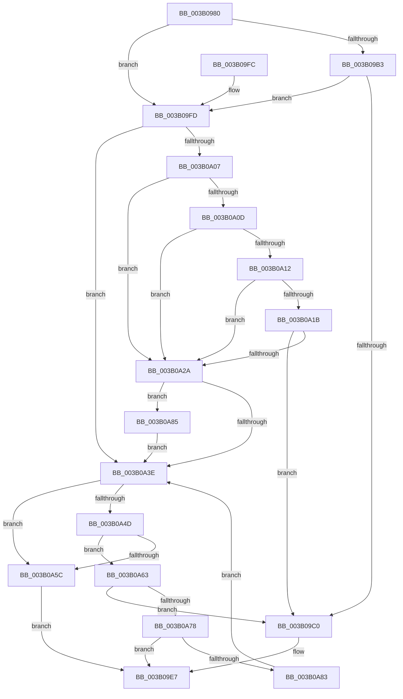

# ST_STORE&lt;SM_TRAITS&gt;::StDmpSinglePageFindSpace

- RVA: `0x003B0980`–`0x003B0A89` (길이 `265` bytes)
- VA: `0x00000001403B0980`
- 실행 섹션: `.text`
- PDB 이름 있음: `예`; PDB Function 태그: `아니요`
- unwind 정보 RVA: `0x0008C26C`
- 디코드: `80`개 명령, `265/265` bytes 표시
- 미해석 바이트: `0` (있으면 어셈블리에 `.byte`로 보존)

> 이 문서는 커널 이미지의 기계어와 PDB 기호를 분석해 생성했습니다. 4번과 5번은 함수 원형과 자료형을 바이너리 사용 방식에서 추정한 C 해석이며 원본 소스 복구 결과는 아닙니다.

## 1. Dependencies

- 직접 호출 지점: **5**; 고유 호출 대상: **4**
- 직접 호출자로 확인된 함수: **1**
- RIP 상대 이미지 참조: **0**

### Outgoing calls
- `0x003B0A12` → [ST_STORE<SM_TRAITS>::StDmCombineRegion](ST_STORE_SM_TRAITS_StDmCombineRegion_function_003B0E34.md) (function, `0x003B0E34`)
- `0x003B0A21` → [ST_STORE<SM_TRAITS>::StDmReuseCurrentRegion](ST_STORE_SM_TRAITS_StDmReuseCurrentRegion_function_003B107C.md) (function, `0x003B107C`)
- `0x003B0A35` → [ST_STORE<SM_TRAITS>::StDmCurrentRegionSet](ST_STORE_SM_TRAITS_StDmCurrentRegionSet_function_003B1130.md) (function, `0x003B1130`)
- `0x003B0A43` → [ST_STORE<SM_TRAITS>::StRegionFindCompact](ST_STORE_SM_TRAITS_StRegionFindCompact_function_003B0A90.md) (function, `0x003B0A90`)
- `0x003B0A6B` → [ST_STORE<SM_TRAITS>::StDmCurrentRegionSet](ST_STORE_SM_TRAITS_StDmCurrentRegionSet_function_003B1130.md) (function, `0x003B1130`)

### Direct callers
- [ST_STORE&lt;SM_TRAITS&gt;::StDmpSinglePageAdd](../20/ST_STORE_SM_TRAITS_StDmpSinglePageAdd_function_0020502C.md) at `0x002050B5`

### Static image references
- 디코드된 RIP-relative 메모리 참조가 없습니다.

## 2. Other-region calls and transfers

- 다른 실행 섹션으로 향하는 call: **0**
- 별도 외부 분기/꼬리 이동을 확인하지 못했습니다.

## 3. Assembly (complete function range)

```asm
003B0980  48 89 5C 24 08                  mov qword ptr [rsp + 8], rbx
003B0985  48 89 6C 24 10                  mov qword ptr [rsp + 0x10], rbp
003B098A  48 89 74 24 18                  mov qword ptr [rsp + 0x18], rsi
003B098F  57                              push rdi
003B0990  48 83 EC 20                     sub rsp, 0x20
003B0994  8B C2                           mov eax, edx
003B0996  48 8D 99 58 06 00 00            lea rbx, [rcx + 0x658]
003B099D  48 C1 E0 04                     shl rax, 4
003B09A1  49 8B F1                        mov rsi, r9
003B09A4  48 03 D8                        add rbx, rax
003B09A7  8B EA                           mov ebp, edx
003B09A9  48 8B F9                        mov rdi, rcx
003B09AC  8B 13                           mov edx, dword ptr [rbx]
003B09AE  83 FA FF                        cmp edx, -1
003B09B1  74 4A                           je 0x1403b09fd
003B09B3  44 03 43 04                     add r8d, dword ptr [rbx + 4]
003B09B7  44 3B 81 30 03 00 00            cmp r8d, dword ptr [rcx + 0x330]
003B09BE  77 3D                           ja 0x1403b09fd
003B09C0  44 8B 43 04                     mov r8d, dword ptr [rbx + 4]
003B09C4  41 8B C8                        mov ecx, r8d
003B09C7  48 8B 44 24 50                  mov rax, qword ptr [rsp + 0x50]
003B09CC  8B 13                           mov edx, dword ptr [rbx]
003B09CE  C1 E1 04                        shl ecx, 4
003B09D1  48 03 4B 08                     add rcx, qword ptr [rbx + 8]
003B09D5  48 89 0E                        mov qword ptr [rsi], rcx
003B09D8  8B 8F 2C 03 00 00               mov ecx, dword ptr [rdi + 0x32c]
003B09DE  D3 E2                           shl edx, cl
003B09E0  41 0B D0                        or edx, r8d
003B09E3  89 10                           mov dword ptr [rax], edx
003B09E5  33 C0                           xor eax, eax
003B09E7  48 8B 5C 24 30                  mov rbx, qword ptr [rsp + 0x30]
003B09EC  48 8B 6C 24 38                  mov rbp, qword ptr [rsp + 0x38]
003B09F1  48 8B 74 24 40                  mov rsi, qword ptr [rsp + 0x40]
003B09F6  48 83 C4 20                     add rsp, 0x20
003B09FA  5F                              pop rdi
003B09FB  C3                              ret
003B09FC  CC                              int3
003B09FD  8B 81 08 03 00 00               mov eax, dword ptr [rcx + 0x308]
003B0A03  84 C0                           test al, al
003B0A05  75 37                           jne 0x1403b0a3e
003B0A07  0F BA E0 14                     bt eax, 0x14
003B0A0B  73 1D                           jae 0x1403b0a2a
003B0A0D  83 FA FF                        cmp edx, -1
003B0A10  74 18                           je 0x1403b0a2a
003B0A12  E8 1D 04 00 00                  call 0x1403b0e34
003B0A17  85 C0                           test eax, eax
003B0A19  78 0F                           js 0x1403b0a2a
003B0A1B  48 8B D3                        mov rdx, rbx
003B0A1E  48 8B CF                        mov rcx, rdi
003B0A21  E8 56 06 00 00                  call 0x1403b107c
003B0A26  85 C0                           test eax, eax
003B0A28  79 96                           jns 0x1403b09c0
003B0A2A  41 B8 FF FF FF FF               mov r8d, 0xffffffff
003B0A30  8B D5                           mov edx, ebp
003B0A32  48 8B CF                        mov rcx, rdi
003B0A35  E8 F6 06 00 00                  call 0x1403b1130
003B0A3A  85 C0                           test eax, eax
003B0A3C  78 47                           js 0x1403b0a85
003B0A3E  8B D5                           mov edx, ebp
003B0A40  48 8B CF                        mov rcx, rdi
003B0A43  E8 48 00 00 00                  call 0x1403b0a90
003B0A48  48 85 C0                        test rax, rax
003B0A4B  74 0F                           je 0x1403b0a5c
003B0A4D  48 2B 87 78 05 00 00            sub rax, qword ptr [rdi + 0x578]
003B0A54  48 D1 F8                        sar rax, 1
003B0A57  83 F8 FF                        cmp eax, -1
003B0A5A  75 07                           jne 0x1403b0a63
003B0A5C  B8 7F 00 00 C0                  mov eax, 0xc000007f
003B0A61  EB 84                           jmp 0x1403b09e7
003B0A63  44 8B C0                        mov r8d, eax
003B0A66  8B D5                           mov edx, ebp
003B0A68  48 8B CF                        mov rcx, rdi
003B0A6B  E8 C0 06 00 00                  call 0x1403b1130
003B0A70  85 C0                           test eax, eax
003B0A72  0F 89 48 FF FF FF               jns 0x1403b09c0
003B0A78  3D 2D 02 00 C0                  cmp eax, 0xc000022d
003B0A7D  0F 85 64 FF FF FF               jne 0x1403b09e7
003B0A83  EB B9                           jmp 0x1403b0a3e
003B0A85  CD 2C                           int 0x2c
003B0A87  EB B5                           jmp 0x1403b0a3e
```

## 4. C-style interpretation (structured pseudocode)

```c
__int64 __fastcall ST_STORE_SM_TRAITS___StDmpSinglePageFindSpace(__int64 a1, int a2, int a3, __int64 a4, __int64 a5)
{
    __int64 result;
    __int64 v_rbx;
    __int64 v_rsp;
    unsigned __int64 v_stack_p10;
    unsigned __int64 v_stack_p18;
    unsigned __int64 v_stack_p8;

    v_stack_p8 = v_rbx;
    v_stack_p10 = v_rbp;
    v_stack_p18 = v_rsi;
    v_rsp = (v_rsp) - (32);
    result = ((unsigned int)(a2)) << (4);
    v_rbx = (a1 + 1624) + (result);
    if (((unsigned int)((unsigned int)(*(unsigned int *)(v_rbx)))) == -1) goto loc_003B09FD;
    a3 = (unsigned int)((a3) + (*(unsigned int *)(v_rbx + 4)));
    if (a3 > (*(unsigned int *)(a1 + 816))) goto loc_003B09FD;
loc_003B09C0:
    a1 = (unsigned int)(((unsigned int)((unsigned int)((unsigned int)(*(unsigned int *)(v_rbx + 4))))) << (4));
    a1 = (a1) + (*(unsigned __int64 *)(v_rbx + 8));
    *(unsigned __int64 *)(a4) = a1;
    a2 = (unsigned int)(((unsigned int)(*(unsigned int *)(v_rbx))) << ((unsigned __int8)((unsigned int)(*(unsigned int *)(a1 + 812)))));
    a2 = (unsigned int)((a2) | ((unsigned int)((unsigned int)(*(unsigned int *)(v_rbx + 4)))));
    *(unsigned int *)(a5) = a2;
    result = 0;
loc_003B09E7:
    v_rsp = (v_rsp) + (32);
    return result;
loc_003B09FD:
    if ((unsigned __int8)((unsigned int)(*(unsigned int *)((unsigned int)(*(unsigned int *)(a1 + 812)) + 776))) != 0) goto loc_003B0A3E;
    if (condition_is_above_or_equal) goto loc_003B0A2A;
    if (a2 == -1) goto loc_003B0A2A;
    result = ST_STORE_SM_TRAITS___StDmCombineRegion((unsigned int)(*(unsigned int *)(a1 + 812)), a2, (unsigned int)(*(unsigned int *)(v_rbx + 4)), a4);
    if (sign_flag) goto loc_003B0A2A;
    result = ST_STORE_SM_TRAITS___StDmReuseCurrentRegion(a1, v_stack_p8, (unsigned int)(*(unsigned int *)(v_rbx + 4)), a4);
    if (!sign_flag) goto loc_003B09C0;
loc_003B0A2A:
    result = ST_STORE_SM_TRAITS___StDmCurrentRegionSet(a1, (unsigned int)((unsigned int)(v_stack_p10)), (unsigned int)(0xFFFFFFFFULL), a4);
    if (sign_flag) goto loc_003B0A85;
loc_003B0A3E:
    result = ST_STORE_SM_TRAITS___StRegionFindCompact(a1, (unsigned int)((unsigned int)(v_stack_p10)), (unsigned int)(0xFFFFFFFFULL), a4);
    if (result == 0) goto loc_003B0A5C;
    result = (result) - (*(unsigned __int64 *)(a1 + 1400));
    result = (result) >> (1);
    if (((unsigned int)(result)) != -1) goto loc_003B0A63;
loc_003B0A5C:
    goto loc_003B09E7;
loc_003B0A63:
    result = ST_STORE_SM_TRAITS___StDmCurrentRegionSet(a1, (unsigned int)((unsigned int)(v_stack_p10)), (unsigned int)((unsigned int)((unsigned int)(0xC000007FULL))), a4);
    if (!sign_flag) goto loc_003B09C0;
    if (((unsigned int)(result)) != 0xC000022DULL) goto loc_003B09E7;
    goto loc_003B0A3E;
loc_003B0A85:
    goto loc_003B0A3E;
}
```

## 5. (Beta) C Style

```c
int64_t ST_STORE_SM_TRAITS___StDmpSinglePageFindSpace(void *Arg1, int32_t Arg2, int32_t Arg3, void *Arg4, void *Arg5)
{
    uint8_t *arg1 = (uint8_t *)Arg1;
    uint8_t *arg4 = (uint8_t *)Arg4;
    uint8_t *arg5 = (uint8_t *)Arg5;

    int64_t result;
    int64_t local_rbx;
    int64_t local_rsp;
    uint64_t v_stack_p10;
    uint64_t v_stack_p18;
    uint64_t v_stack_p8;

    v_stack_p8 = local_rbx;
    v_stack_p10 = local_rbp;
    v_stack_p18 = local_rsi;
    local_rsp = (local_rsp) - (32);
    result = ((uint32_t)(Arg2)) << (4);
    local_rbx = (Arg1 + 1624) + (result);
    if (((uint32_t)((uint32_t)(*(uint32_t *)(local_rbx)))) == -1) goto loc_003B09FD;
    Arg3 = (uint32_t)((Arg3) + (*(uint32_t *)(local_rbx + 0x4)));
    if (Arg3 > (*(uint32_t *)(arg1 + 0x330))) goto loc_003B09FD;
loc_003B09C0:
    Arg1 = (uint32_t)(((uint32_t)((uint32_t)((uint32_t)(*(uint32_t *)(local_rbx + 0x4))))) << (4));
    Arg1 = (Arg1) + (*(uint64_t *)(local_rbx + 0x8));
    *(void **)(arg4) = Arg1;
    Arg2 = (uint32_t)(((uint32_t)(*(uint32_t *)(local_rbx))) << ((uint8_t)((uint32_t)(*(uint32_t *)(arg1 + 0x32C)))));
    Arg2 = (uint32_t)((Arg2) | ((uint32_t)((uint32_t)(*(uint32_t *)(local_rbx + 0x4)))));
    *(uint32_t *)(arg5) = Arg2;
    result = 0;
loc_003B09E7:
    local_rsp = (local_rsp) + (32);
    return result;
loc_003B09FD:
    if ((uint8_t)((uint32_t)(*(uint32_t *)((uint32_t)(*(uint32_t *)(arg1 + 0x32C)) + 0x308))) != 0) goto loc_003B0A3E;
    if (condition_is_above_or_equal) goto loc_003B0A2A;
    if (Arg2 == -1) goto loc_003B0A2A;
    result = ST_STORE_SM_TRAITS___StDmCombineRegion((uint32_t)(*(uint32_t *)(arg1 + 0x32C)), Arg2, (uint32_t)(*(uint32_t *)(local_rbx + 0x4)), Arg4);
    if (sign_flag) goto loc_003B0A2A;
    result = ST_STORE_SM_TRAITS___StDmReuseCurrentRegion(Arg1, v_stack_p8, (uint32_t)(*(uint32_t *)(local_rbx + 0x4)), Arg4);
    if (!sign_flag) goto loc_003B09C0;
loc_003B0A2A:
    result = ST_STORE_SM_TRAITS___StDmCurrentRegionSet(Arg1, (uint32_t)((uint32_t)(v_stack_p10)), (uint32_t)(0xFFFFFFFFULL), Arg4);
    if (sign_flag) goto loc_003B0A85;
loc_003B0A3E:
    result = ST_STORE_SM_TRAITS___StRegionFindCompact(Arg1, (uint32_t)((uint32_t)(v_stack_p10)), (uint32_t)(0xFFFFFFFFULL), Arg4);
    if (result == 0) goto loc_003B0A5C;
    result = (result) - (*(uint64_t *)(arg1 + 0x578));
    result = (result) >> (1);
    if (((uint32_t)(result)) != -1) goto loc_003B0A63;
loc_003B0A5C:
    goto loc_003B09E7;
loc_003B0A63:
    result = ST_STORE_SM_TRAITS___StDmCurrentRegionSet(Arg1, (uint32_t)((uint32_t)(v_stack_p10)), (uint32_t)((uint32_t)((uint32_t)(0xC000007FULL))), Arg4);
    if (!sign_flag) goto loc_003B09C0;
    if (((uint32_t)(result)) != 0xC000022DULL) goto loc_003B09E7;
    goto loc_003B0A3E;
loc_003B0A85:
    goto loc_003B0A3E;
}
```

### 관측된 메모리 오프셋

구조체 형식이 확인되지 않은 접근은 인자 기준의 오프셋으로만 기록했습니다.

| 기준 인자 | 오프셋 표현 | 폭 (bit) | 접근 |
|---|---:|---:|---|
| `Arg1` | `+ 0x0` | `32` | `R` |
| `Arg1` | `+ 0x4` | `32` | `R` |
| `Arg1` | `+ 0x8` | `64` | `R` |
| `Arg1` | `+ 0x308` | `32` | `R` |
| `Arg1` | `+ 0x32C` | `32` | `R` |
| `Arg1` | `+ 0x330` | `32` | `R` |
| `Arg1` | `+ 0x578` | `64` | `R` |
| `Arg1` | `+ 0x658` | `64` | `R` |
| `Arg4` | `+ 0x0` | `64` | `W` |
| `Arg5` | `+ 0x0` | `32` | `W` |

## 6. Execution-region graph

[열기: 2D/3D 그래프와 함수 탐색 컨트롤 패널](../../../control-panel.html?section=text&rva=0x003B0980&view=graph)

- 2D 그래프는 위에서 아래로 흐르고, 3D 그래프는 빈 공간을 드래그해 회전합니다. Shift+드래그는 이동, 휠은 확대·축소, 함수 노드 선택은 대상 보고서 이동입니다.

### Static fallback


