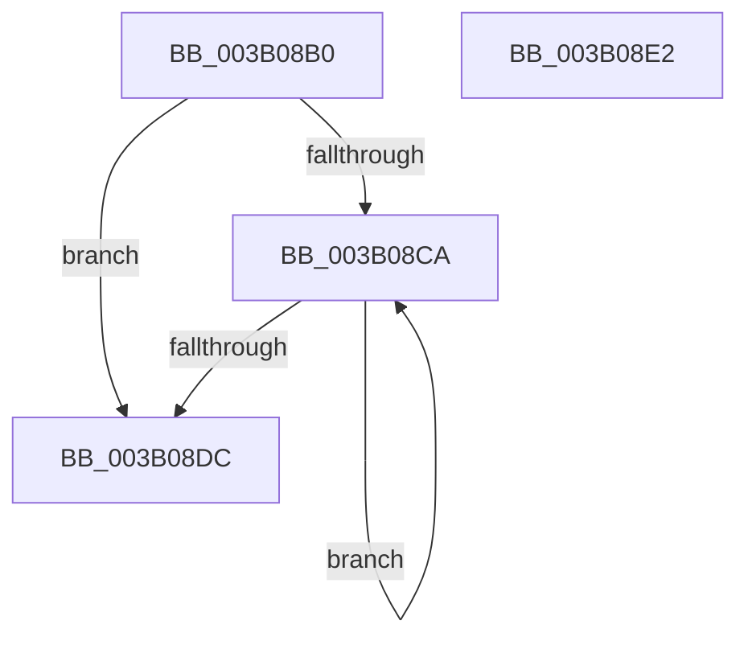

# ST_STORE&lt;SM_TRAITS&gt;::StDrainReadContextList

- RVA: `0x003B08B0`–`0x003B08E3` (길이 `51` bytes)
- VA: `0x00000001403B08B0`
- 실행 섹션: `.text`
- PDB 이름 있음: `예`; PDB Function 태그: `아니요`
- unwind 정보 RVA: `0x0005CF00`
- 디코드: `17`개 명령, `51/51` bytes 표시
- 미해석 바이트: `0` (있으면 어셈블리에 `.byte`로 보존)

> 이 문서는 커널 이미지의 기계어와 PDB 기호를 분석해 생성했습니다. 4번과 5번은 함수 원형과 자료형을 바이너리 사용 방식에서 추정한 C 해석이며 원본 소스 복구 결과는 아닙니다.

## 1. Dependencies

- 직접 호출 지점: **2**; 고유 호출 대상: **2**
- 직접 호출자로 확인된 함수: **3**
- RIP 상대 이미지 참조: **0**

### Outgoing calls
- `0x003B08BD` → [ExpInterlockedFlushSList](../6B/ExpInterlockedFlushSList_function_006BA5F0.md) (function, `0x006BA5F0`)
- `0x003B08D2` → [ExFreePoolWithTag](../../poolcode/B8/ExFreePoolWithTag_function_00B82870.md) (function, `0x00B82870`)

### Direct callers
- [sub_00206865](../20/Unknown_function_00206865.md) at `0x00206C96`
- [ST_STORE&lt;SM_TRAITS&gt;::StCleanup](ST_STORE_SM_TRAITS_StCleanup_function_003B03B4.md) at `0x003B0440`
- [SMKM_STORE&lt;SM_TRAITS&gt;::SmStOutSwapStore](../49/SMKM_STORE_SM_TRAITS_SmStOutSwapStore_function_00496C84.md) at `0x00496CB6`

### Static image references
- 디코드된 RIP-relative 메모리 참조가 없습니다.

## 2. Other-region calls and transfers

- 다른 실행 섹션으로 향하는 call: **1**
  - `0x003B08D2` → [ExFreePoolWithTag](../../poolcode/B8/ExFreePoolWithTag_function_00B82870.md) (`.text` → `POOLCODE`)
- 별도 외부 분기/꼬리 이동을 확인하지 못했습니다.

## 3. Assembly (complete function range)

```asm
003B08B0  40 53                           push rbx
003B08B2  48 83 EC 20                     sub rsp, 0x20
003B08B6  48 81 C1 D0 12 00 00            add rcx, 0x12d0
003B08BD  E8 2E 9D 30 00                  call 0x1406ba5f0
003B08C2  48 8B D8                        mov rbx, rax
003B08C5  48 85 C0                        test rax, rax
003B08C8  74 12                           je 0x1403b08dc
003B08CA  48 8B CB                        mov rcx, rbx
003B08CD  33 D2                           xor edx, edx
003B08CF  48 8B 1B                        mov rbx, qword ptr [rbx]
003B08D2  E8 99 1F 7D 00                  call 0x140b82870
003B08D7  48 85 DB                        test rbx, rbx
003B08DA  75 EE                           jne 0x1403b08ca
003B08DC  48 83 C4 20                     add rsp, 0x20
003B08E0  5B                              pop rbx
003B08E1  C3                              ret
003B08E2  CC                              int3
```

## 4. C-style interpretation (structured pseudocode)

```c
__int64 __fastcall ST_STORE_SM_TRAITS___StDrainReadContextList(__int64 a1, int a2)
{
    __int64 result;
    __int64 v_rsp;

    v_rsp = (v_rsp) - (32);
    a1 = (a1) + (0x12D0ULL);
    result = ExpInterlockedFlushSList(a1, a2, a3, a4);
    if (result == 0) goto loc_003B08DC;
loc_003B08CA:
    a2 = 0;
    result = ExFreePoolWithTag(result, a2, a3, a4);
    if (*(unsigned __int64 *)(result) != 0) goto loc_003B08CA;
loc_003B08DC:
    v_rsp = (v_rsp) + (32);
    return result;
}
```

## 5. (Beta) C Style

```c
int64_t ST_STORE_SM_TRAITS___StDrainReadContextList(int64_t Arg1, int32_t Arg2)
{
    int64_t result;
    int64_t local_rsp;

    local_rsp = (local_rsp) - (32);
    Arg1 = (Arg1) + (0x12D0ULL);
    result = ExpInterlockedFlushSList(Arg1, Arg2, a3, a4);
    if (result == 0) goto loc_003B08DC;
loc_003B08CA:
    Arg2 = 0;
    result = ExFreePoolWithTag(result, Arg2, a3, a4);
    if (*(uint64_t *)(result) != 0) goto loc_003B08CA;
loc_003B08DC:
    local_rsp = (local_rsp) + (32);
    return result;
}
```

## 6. Execution-region graph

[열기: 2D/3D 그래프와 함수 탐색 컨트롤 패널](../../../control-panel.html?section=text&rva=0x003B08B0&view=graph)

- 2D 그래프는 위에서 아래로 흐르고, 3D 그래프는 빈 공간을 드래그해 회전합니다. Shift+드래그는 이동, 휠은 확대·축소, 함수 노드 선택은 대상 보고서 이동입니다.

### Static fallback


