# ST_STORE&lt;SM_TRAITS&gt;::StRegionFindCompact

- RVA: `0x003B0A90`–`0x003B0E2C` (길이 `924` bytes)
- VA: `0x00000001403B0A90`
- 실행 섹션: `.text`
- PDB 이름 있음: `예`; PDB Function 태그: `아니요`
- unwind 정보 RVA: `0x0008C284`
- 디코드: `244`개 명령, `924/924` bytes 표시
- 미해석 바이트: `0` (있으면 어셈블리에 `.byte`로 보존)

> 이 문서는 커널 이미지의 기계어와 PDB 기호를 분석해 생성했습니다. 4번과 5번은 함수 원형과 자료형을 바이너리 사용 방식에서 추정한 C 해석이며 원본 소스 복구 결과는 아닙니다.

## 1. Dependencies

- 직접 호출 지점: **0**; 고유 호출 대상: **0**
- 직접 호출자로 확인된 함수: **1**
- RIP 상대 이미지 참조: **0**

### Outgoing calls
- 직접 디코드된 call 명령이 없습니다.

### Direct callers
- [ST_STORE&lt;SM_TRAITS&gt;::StDmpSinglePageFindSpace](ST_STORE_SM_TRAITS_StDmpSinglePageFindSpace_function_003B0980.md) at `0x003B0A43`

### Static image references
- 디코드된 RIP-relative 메모리 참조가 없습니다.

## 2. Other-region calls and transfers

- 다른 실행 섹션으로 향하는 call: **0**
- 별도 외부 분기/꼬리 이동을 확인하지 못했습니다.

## 3. Assembly (complete function range)

```asm
003B0A90  40 55                           push rbp
003B0A92  56                              push rsi
003B0A93  57                              push rdi
003B0A94  41 54                           push r12
003B0A96  41 55                           push r13
003B0A98  41 56                           push r14
003B0A9A  41 57                           push r15
003B0A9C  48 83 EC 10                     sub rsp, 0x10
003B0AA0  48 8B 81 20 03 00 00            mov rax, qword ptr [rcx + 0x320]
003B0AA7  8B EA                           mov ebp, edx
003B0AA9  4C 8B D1                        mov r10, rcx
003B0AAC  4C 8B 80 F0 1C 00 00            mov r8, qword ptr [rax + 0x1cf0]
003B0AB3  4D 85 C0                        test r8, r8
003B0AB6  75 16                           jne 0x1403b0ace
003B0AB8  44 8B A9 28 03 00 00            mov r13d, dword ptr [rcx + 0x328]
003B0ABF  44 8B B1 B4 05 00 00            mov r14d, dword ptr [rcx + 0x5b4]
003B0AC6  41 FF C5                        inc r13d
003B0AC9  41 D1 ED                        shr r13d, 1
003B0ACC  EB 06                           jmp 0x1403b0ad4
003B0ACE  45 33 ED                        xor r13d, r13d
003B0AD1  45 33 F6                        xor r14d, r14d
003B0AD4  8B 91 58 03 00 00               mov edx, dword ptr [rcx + 0x358]
003B0ADA  4C 8D 3C 24                     lea r15, [rsp]
003B0ADE  4C 8B A1 78 05 00 00            mov r12, qword ptr [rcx + 0x578]
003B0AE5  49 8D BA 20 03 00 00            lea rdi, [r10 + 0x320]
003B0AEC  0F B7 89 30 03 00 00            movzx ecx, word ptr [rcx + 0x330]
003B0AF3  B8 FF 1F 00 00                  mov eax, 0x1fff
003B0AF8  66 41 2B 8A 34 03 00 00         sub cx, word ptr [r10 + 0x334]
003B0B00  66 FF C1                        inc cx
003B0B03  48 89 5C 24 58                  mov qword ptr [rsp + 0x58], rbx
003B0B08  66 23 C8                        and cx, ax
003B0B0B  89 54 24 50                     mov dword ptr [rsp + 0x50], edx
003B0B0F  41 83 BA B0 05 00 00 00         cmp dword ptr [r10 + 0x5b0], 0
003B0B17  66 89 0C 24                     mov word ptr [rsp], cx
003B0B1B  0F 84 D1 01 00 00               je 0x1403b0cf2
003B0B21  49 8D BA 20 03 00 00            lea rdi, [r10 + 0x320]
003B0B28  45 85 ED                        test r13d, r13d
003B0B2B  0F 84 C1 01 00 00               je 0x1403b0cf2
003B0B31  45 33 C0                        xor r8d, r8d
003B0B34  0F 1F 40 00                     nop dword ptr [rax]
003B0B38  0F 1F 84 00 00 00 00 00         nop dword ptr [rax + rax]
003B0B40  41 8B 82 A0 05 00 00            mov eax, dword ptr [r10 + 0x5a0]
003B0B47  C7 44 24 60 00 00 00 00         mov dword ptr [rsp + 0x60], 0
003B0B4F  41 3B C0                        cmp eax, r8d
003B0B52  0F 86 8F 01 00 00               jbe 0x1403b0ce7
003B0B58  49 8B BA A8 05 00 00            mov rdi, qword ptr [r10 + 0x5a8]
003B0B5F  8D 50 FF                        lea edx, [rax - 1]
003B0B62  48 C1 EA 05                     shr rdx, 5
003B0B66  45 33 C9                        xor r9d, r9d
003B0B69  41 8B C0                        mov eax, r8d
003B0B6C  41 83 E0 1F                     and r8d, 0x1f
003B0B70  48 C1 E8 05                     shr rax, 5
003B0B74  41 0F B6 C8                     movzx ecx, r8b
003B0B78  48 8D 04 87                     lea rax, [rdi + rax*4]
003B0B7C  4C 8D 1C 97                     lea r11, [rdi + rdx*4]
003B0B80  BA 01 00 00 00                  mov edx, 1
003B0B85  D3 E2                           shl edx, cl
003B0B87  FF CA                           dec edx
003B0B89  0B 10                           or edx, dword ptr [rax]
003B0B8B  F7 D2                           not edx
003B0B8D  85 D2                           test edx, edx
003B0B8F  75 1A                           jne 0x1403b0bab
003B0B91  48 8D 48 04                     lea rcx, [rax + 4]
003B0B95  49 3B CB                        cmp rcx, r11
003B0B98  77 39                           ja 0x1403b0bd3
003B0B9A  8B 50 04                        mov edx, dword ptr [rax + 4]
003B0B9D  48 83 C0 04                     add rax, 4
003B0BA1  F7 D2                           not edx
003B0BA3  48 83 C1 04                     add rcx, 4
003B0BA7  85 D2                           test edx, edx
003B0BA9  74 EA                           je 0x1403b0b95
003B0BAB  8B CA                           mov ecx, edx
003B0BAD  4C 8B C0                        mov r8, rax
003B0BB0  4C 2B C7                        sub r8, rdi
003B0BB3  48 0F BC D9                     bsf rbx, rcx
003B0BB7  41 8B 8A A0 05 00 00            mov ecx, dword ptr [r10 + 0x5a0]
003B0BBE  49 C1 F8 02                     sar r8, 2
003B0BC2  41 C1 E0 05                     shl r8d, 5
003B0BC6  44 03 C3                        add r8d, ebx
003B0BC9  44 3B C1                        cmp r8d, ecx
003B0BCC  76 0E                           jbe 0x1403b0bdc
003B0BCE  44 8B C1                        mov r8d, ecx
003B0BD1  EB 6C                           jmp 0x1403b0c3f
003B0BD3  45 8B 82 A0 05 00 00            mov r8d, dword ptr [r10 + 0x5a0]
003B0BDA  EB 63                           jmp 0x1403b0c3f
003B0BDC  8B CB                           mov ecx, ebx
003B0BDE  41 B9 01 00 00 00               mov r9d, 1
003B0BE4  41 D3 E1                        shl r9d, cl
003B0BE7  41 FF C9                        dec r9d
003B0BEA  44 0B CA                        or r9d, edx
003B0BED  41 F7 D1                        not r9d
003B0BF0  45 85 C9                        test r9d, r9d
003B0BF3  75 26                           jne 0x1403b0c1b
003B0BF5  66 66 66 0F 1F 84 00 00 00 00 00  nop word ptr [rax + rax]
003B0C00  48 8D 48 04                     lea rcx, [rax + 4]
003B0C04  48 8B D0                        mov rdx, rax
003B0C07  48 8B C1                        mov rax, rcx
003B0C0A  49 3B CB                        cmp rcx, r11
003B0C0D  0F 87 A4 00 00 00               ja 0x1403b0cb7
003B0C13  44 8B 09                        mov r9d, dword ptr [rcx]
003B0C16  45 85 C9                        test r9d, r9d
003B0C19  74 E5                           je 0x1403b0c00
003B0C1B  41 8B C9                        mov ecx, r9d
003B0C1E  48 0F BC C9                     bsf rcx, rcx
003B0C22  45 8B 8A A0 05 00 00            mov r9d, dword ptr [r10 + 0x5a0]
003B0C29  48 2B C7                        sub rax, rdi
003B0C2C  48 C1 F8 02                     sar rax, 2
003B0C30  C1 E0 05                        shl eax, 5
003B0C33  03 C8                           add ecx, eax
003B0C35  41 3B C9                        cmp ecx, r9d
003B0C38  44 0F 46 C9                     cmovbe r9d, ecx
003B0C3C  45 2B C8                        sub r9d, r8d
003B0C3F  45 85 C9                        test r9d, r9d
003B0C42  0F 84 9F 00 00 00               je 0x1403b0ce7
003B0C48  43 8D 1C 01                     lea ebx, [r9 + r8]
003B0C4C  45 8B D8                        mov r11d, r8d
003B0C4F  4F 8D 0C 5C                     lea r9, [r12 + r11*2]
003B0C53  44 3B C3                        cmp r8d, ebx
003B0C56  0F 83 E4 FE FF FF               jae 0x1403b0b40
003B0C5C  4E 8D 1C DD 00 00 00 00         lea r11, [r11*8]
003B0C64  0F 1F 40 00                     nop dword ptr [rax]
003B0C68  0F 1F 84 00 00 00 00 00         nop dword ptr [rax + rax]
003B0C70  41 F7 82 08 03 00 00 00 00 02 00  test dword ptr [r10 + 0x308], 0x20000
003B0C7B  74 27                           je 0x1403b0ca4
003B0C7D  49 8B 8A 20 03 00 00            mov rcx, qword ptr [r10 + 0x320]
003B0C84  BF FF 7F 00 00                  mov edi, 0x7fff
003B0C89  48 8B 91 68 1B 00 00            mov rdx, qword ptr [rcx + 0x1b68]
003B0C90  49 03 D3                        add rdx, r11
003B0C93  0F B7 02                        movzx eax, word ptr [rdx]
003B0C96  66 85 C7                        test di, ax
003B0C99  75 2F                           jne 0x1403b0cca
003B0C9B  48 39 91 F8 1C 00 00            cmp qword ptr [rcx + 0x1cf8], rdx
003B0CA2  74 26                           je 0x1403b0cca
003B0CA4  41 80 BA 08 03 00 00 00         cmp byte ptr [r10 + 0x308], 0
003B0CAC  75 16                           jne 0x1403b0cc4
003B0CAE  41 0F B7 01                     movzx eax, word ptr [r9]
003B0CB2  C1 E8 0D                        shr eax, 0xd
003B0CB5  EB 0F                           jmp 0x1403b0cc6
003B0CB7  B9 20 00 00 00                  mov ecx, 0x20
003B0CBC  48 8B C2                        mov rax, rdx
003B0CBF  E9 5E FF FF FF                  jmp 0x1403b0c22
003B0CC4  33 C0                           xor eax, eax
003B0CC6  3B C5                           cmp eax, ebp
003B0CC8  74 15                           je 0x1403b0cdf
003B0CCA  41 FF C0                        inc r8d
003B0CCD  49 83 C3 08                     add r11, 8
003B0CD1  49 83 C1 02                     add r9, 2
003B0CD5  44 3B C3                        cmp r8d, ebx
003B0CD8  72 96                           jb 0x1403b0c70
003B0CDA  E9 61 FE FF FF                  jmp 0x1403b0b40
003B0CDF  4D 8B F9                        mov r15, r9
003B0CE2  E9 FD 00 00 00                  jmp 0x1403b0de4
003B0CE7  8B 54 24 50                     mov edx, dword ptr [rsp + 0x50]
003B0CEB  49 8D BA 20 03 00 00            lea rdi, [r10 + 0x320]
003B0CF2  8B C2                           mov eax, edx
003B0CF4  33 DB                           xor ebx, ebx
003B0CF6  49 8D 34 44                     lea rsi, [r12 + rax*2]
003B0CFA  41 8B C6                        mov eax, r14d
003B0CFD  49 8D 14 44                     lea rdx, [r12 + rax*2]
003B0D01  39 5C 24 50                     cmp dword ptr [rsp + 0x50], ebx
003B0D05  0F 86 09 01 00 00               jbe 0x1403b0e14
003B0D0B  0F 1F 44 00 00                  nop dword ptr [rax + rax]
003B0D10  48 3B D6                        cmp rdx, rsi
003B0D13  48 8B C2                        mov rax, rdx
003B0D16  49 0F 43 D4                     cmovae rdx, r12
003B0D1A  45 33 DB                        xor r11d, r11d
003B0D1D  48 3B C6                        cmp rax, rsi
003B0D20  45 0F 42 DE                     cmovb r11d, r14d
003B0D24  41 F7 82 08 03 00 00 00 00 02 00  test dword ptr [r10 + 0x308], 0x20000
003B0D2F  74 26                           je 0x1403b0d57
003B0D31  4C 8B 07                        mov r8, qword ptr [rdi]
003B0D34  B9 FF 7F 00 00                  mov ecx, 0x7fff
003B0D39  49 8B 80 68 1B 00 00            mov rax, qword ptr [r8 + 0x1b68]
003B0D40  4E 8D 0C D8                     lea r9, [rax + r11*8]
003B0D44  42 0F B7 04 D8                  movzx eax, word ptr [rax + r11*8]
003B0D49  66 85 C1                        test cx, ax
003B0D4C  75 79                           jne 0x1403b0dc7
003B0D4E  4D 39 88 F8 1C 00 00            cmp qword ptr [r8 + 0x1cf8], r9
003B0D55  74 70                           je 0x1403b0dc7
003B0D57  41 80 BA 08 03 00 00 00         cmp byte ptr [r10 + 0x308], 0
003B0D5F  75 0A                           jne 0x1403b0d6b
003B0D61  44 0F B7 02                     movzx r8d, word ptr [rdx]
003B0D65  41 C1 E8 0D                     shr r8d, 0xd
003B0D69  EB 03                           jmp 0x1403b0d6e
003B0D6B  45 33 C0                        xor r8d, r8d
003B0D6E  0F B7 0A                        movzx ecx, word ptr [rdx]
003B0D71  41 BE FF 1F 00 00               mov r14d, 0x1fff
003B0D77  41 0F B7 07                     movzx eax, word ptr [r15]
003B0D7B  44 0F B7 C9                     movzx r9d, cx
003B0D7F  66 41 23 CE                     and cx, r14w
003B0D83  66 41 23 C6                     and ax, r14w
003B0D87  66 3B C8                        cmp cx, ax
003B0D8A  73 3B                           jae 0x1403b0dc7
003B0D8C  41 0F B7 C1                     movzx eax, r9w
003B0D90  66 41 23 C6                     and ax, r14w
003B0D94  44 3B C5                        cmp r8d, ebp
003B0D97  75 12                           jne 0x1403b0dab
003B0D99  4C 8B FA                        mov r15, rdx
003B0D9C  66 85 C0                        test ax, ax
003B0D9F  74 43                           je 0x1403b0de4
003B0DA1  45 23 CE                        and r9d, r14d
003B0DA4  45 3B CD                        cmp r9d, r13d
003B0DA7  72 3B                           jb 0x1403b0de4
003B0DA9  EB 1C                           jmp 0x1403b0dc7
003B0DAB  66 85 C0                        test ax, ax
003B0DAE  75 17                           jne 0x1403b0dc7
003B0DB0  41 8B C0                        mov eax, r8d
003B0DB3  48 03 C0                        add rax, rax
003B0DB6  41 8B 84 C2 58 06 00 00         mov eax, dword ptr [r10 + rax*8 + 0x658]
003B0DBE  49 8D 0C 44                     lea rcx, [r12 + rax*2]
003B0DC2  48 3B D1                        cmp rdx, rcx
003B0DC5  75 48                           jne 0x1403b0e0f
003B0DC7  48 83 C2 02                     add rdx, 2
003B0DCB  45 8D 73 01                     lea r14d, [r11 + 1]
003B0DCF  FF C3                           inc ebx
003B0DD1  3B 5C 24 50                     cmp ebx, dword ptr [rsp + 0x50]
003B0DD5  0F 82 35 FF FF FF               jb 0x1403b0d10
003B0DDB  48 8D 04 24                     lea rax, [rsp]
003B0DDF  4C 3B F8                        cmp r15, rax
003B0DE2  74 30                           je 0x1403b0e14
003B0DE4  49 8B CF                        mov rcx, r15
003B0DE7  49 2B CC                        sub rcx, r12
003B0DEA  48 D1 F9                        sar rcx, 1
003B0DED  FF C1                           inc ecx
003B0DEF  41 89 8A B4 05 00 00            mov dword ptr [r10 + 0x5b4], ecx
003B0DF6  41 3B 8A 58 03 00 00            cmp ecx, dword ptr [r10 + 0x358]
003B0DFD  75 0B                           jne 0x1403b0e0a
003B0DFF  41 C7 82 B4 05 00 00 00 00 00 00  mov dword ptr [r10 + 0x5b4], 0
003B0E0A  49 8B C7                        mov rax, r15
003B0E0D  EB 07                           jmp 0x1403b0e16
003B0E0F  4C 8B FA                        mov r15, rdx
003B0E12  EB D0                           jmp 0x1403b0de4
003B0E14  33 C0                           xor eax, eax
003B0E16  48 8B 5C 24 58                  mov rbx, qword ptr [rsp + 0x58]
003B0E1B  48 83 C4 10                     add rsp, 0x10
003B0E1F  41 5F                           pop r15
003B0E21  41 5E                           pop r14
003B0E23  41 5D                           pop r13
003B0E25  41 5C                           pop r12
003B0E27  5F                              pop rdi
003B0E28  5E                              pop rsi
003B0E29  5D                              pop rbp
003B0E2A  C3                              ret
003B0E2B  CC                              int3
```

## 4. C-style interpretation (structured pseudocode)

```c
__int64 __fastcall ST_STORE_SM_TRAITS___StRegionFindCompact(__int64 a1, int a2, __int64 a3, int a4)
{
    __int64 result;
    __int64 v_r11;
    __int64 v_r13;
    __int64 v_r14;
    __int64 v_rbx;
    __int64 v_rsp;
    unsigned __int64 v_stack_m48;
    unsigned __int64 v_stack_p10;
    unsigned int v_stack_p18;
    unsigned int v_stack_p8;

    v_rsp = (v_rsp) - (16);
    if (*(unsigned __int64 *)(*(unsigned __int64 *)(a1 + 800) + 7408) != 0) goto loc_003B0ACE;
    v_r13 = (unsigned int)(((unsigned int)(*(unsigned int *)(a1 + 808))) + 1);
    v_r13 = (unsigned int)((v_r13) >> (1));
    goto loc_003B0AD4;
loc_003B0ACE:
    v_r13 = 0;
    v_r14 = 0;
loc_003B0AD4:
    a1 = (unsigned __int16)((*(unsigned __int16 *)(a1 + 816)) - (*(unsigned __int16 *)(a1 + 820)));
    a1 = (unsigned __int16)((a1) + 1);
    v_stack_p10 = v_rbx;
    a1 = (unsigned __int16)((a1) & ((unsigned __int16)((unsigned int)(0x1FFFULL))));
    v_stack_p8 = (unsigned int)((unsigned int)(*(unsigned int *)(a1 + 856)));
    v_stack_m48 = (unsigned __int16)(a1);
    if ((*(unsigned int *)(a1 + 1456)) == 0) goto loc_003B0CF2;
    if (0 == 0) goto loc_003B0CF2;
    a3 = 0;
loc_003B0B40:
    v_stack_p18 = 0;
    if (((unsigned int)((unsigned int)(*(unsigned int *)(a1 + 1440)))) <= 0) goto loc_003B0CE7;
    a2 = ((unsigned int)(*(unsigned int *)(a1 + 1440)) - 1) >> (5);
    a4 = 0;
    a3 = (unsigned int)((a3) & (31));
    result = (0) >> (5);
    a2 = (unsigned int)((1) << ((unsigned __int8)((unsigned __int8)(a3))));
    a2 = (unsigned int)((a2) - 1);
    a2 = (unsigned int)((a2) | (*(unsigned int *)(*(unsigned __int64 *)(a1 + 1448) + result * 4)));
    a2 = (unsigned int)(~(a2));
    if (a2 != 0) goto loc_003B0BAB;
loc_003B0B95:
    if ((*(unsigned __int64 *)(a1 + 1448) + result * 4 + 4) > (*(unsigned __int64 *)(a1 + 1448) + a2 * 4)) goto loc_003B0BD3;
    result = (*(unsigned __int64 *)(a1 + 1448) + result * 4) + (4);
    a2 = (unsigned int)(~((unsigned int)(*(unsigned int *)(*(unsigned __int64 *)(a1 + 1448) + result * 4 + 4))));
    a1 = (*(unsigned __int64 *)(a1 + 1448) + result * 4 + 4) + (4);
    if (a2 == 0) goto loc_003B0B95;
loc_003B0BAB:
    a3 = (result) - (*(unsigned __int64 *)(a1 + 1448));
    a3 = (a3) >> (2);
    a3 = (unsigned int)((a3) << (5));
    a3 = (unsigned int)((a3) + ((unsigned int)(v_rbx)));
    if (((unsigned int)(a3)) <= ((unsigned int)((unsigned int)(*(unsigned int *)(a1 + 1440))))) goto loc_003B0BDC;
    goto loc_003B0C3F;
loc_003B0BD3:
    goto loc_003B0C3F;
loc_003B0BDC:
    a4 = (unsigned int)((1) << ((unsigned __int8)((unsigned int)((unsigned int)(v_rbx)))));
    a4 = (unsigned int)((a4) - 1);
    a4 = (unsigned int)((a4) | (a2));
    a4 = (unsigned int)(~(a4));
    if (a4 != 0) goto loc_003B0C1B;
loc_003B0C00:
    if ((result + 4) > (*(unsigned __int64 *)(a1 + 1448) + a2 * 4)) goto loc_003B0CB7;
    if ((unsigned int)((unsigned int)(*(unsigned int *)(result + 4))) == 0) goto loc_003B0C00;
loc_003B0C1B:
loc_003B0C22:
    result = (result + 4) - (*(unsigned __int64 *)(a1 + 1448));
    result = (result) >> (2);
    result = (unsigned int)((result) << (5));
    a1 = (unsigned int)(((unsigned int)((unsigned int)((unsigned int)(*(unsigned int *)(result + 4))))) + ((unsigned int)(result)));
    a4 = (unsigned int)(*(unsigned int *)(a1 + 1440));
    if (((unsigned int)(a1)) <= ((unsigned int)((unsigned int)(*(unsigned int *)(a1 + 1440))))) { a4 = (unsigned int)(a1); }
    a4 = (unsigned int)((a4) - ((unsigned int)((unsigned int)(*(unsigned int *)(a1 + 1440)))));
loc_003B0C3F:
    if (a4 == 0) goto loc_003B0CE7;
    if (((unsigned int)((unsigned int)(*(unsigned int *)(a1 + 1440)))) >= ((unsigned int)(a4 + (unsigned int)(*(unsigned int *)(a1 + 1440)) * 1))) goto loc_003B0B40;
loc_003B0C70:
    if (((*(unsigned int *)(a1 + 776)) & (0x20000ULL)) == 0) goto loc_003B0CA4;
    a2 = (*(unsigned __int64 *)(*(unsigned __int64 *)(a1 + 800) + 7016)) + ((unsigned int)((unsigned int)((unsigned int)(*(unsigned int *)(a1 + 1440)))) * 8);
    if ((((unsigned __int16)((unsigned int)(0x7FFFULL))) & ((unsigned __int16)(*(unsigned __int16 *)(a2)))) != 0) goto loc_003B0CCA;
    if ((*(unsigned __int64 *)(*(unsigned __int64 *)(a1 + 800) + 7416)) == a2) goto loc_003B0CCA;
loc_003B0CA4:
    if ((*(unsigned __int8 *)(a1 + 776)) != 0) goto loc_003B0CC4;
    result = (unsigned int)((*(unsigned __int16 *)(*(unsigned __int64 *)(a1 + 1400) + (unsigned int)((unsigned int)((unsigned int)(*(unsigned int *)(a1 + 1440)))) * 2)) >> (13));
    goto loc_003B0CC6;
loc_003B0CB7:
    goto loc_003B0C22;
loc_003B0CC4:
    result = 0;
loc_003B0CC6:
    if (0 == ((unsigned int)((unsigned int)(a2)))) goto loc_003B0CDF;
loc_003B0CCA:
    a3 = (unsigned int)(((unsigned int)(*(unsigned int *)(a1 + 1440))) + 1);
    v_r11 = ((unsigned int)((unsigned int)((unsigned int)(*(unsigned int *)(a1 + 1440)))) * 8) + (8);
    a4 = (*(unsigned __int64 *)(a1 + 1400) + (unsigned int)((unsigned int)((unsigned int)(*(unsigned int *)(a1 + 1440)))) * 2) + (2);
    if (((unsigned int)(a3)) < ((unsigned int)(a4 + (unsigned int)(*(unsigned int *)(a1 + 1440)) * 1))) goto loc_003B0C70;
    goto loc_003B0B40;
loc_003B0CDF:
    goto loc_003B0DE4;
loc_003B0CE7:
loc_003B0CF2:
    v_rbx = 0;
    if (v_stack_p8 <= 0) goto loc_003B0E14;
loc_003B0D10:
    a2 = *(unsigned __int64 *)(a1 + 1400) + 0 * 2;
    if ((*(unsigned __int64 *)(a1 + 1400) + 0 * 2) >= (*(unsigned __int64 *)(a1 + 1400) + (unsigned int)((unsigned int)((unsigned int)(v_stack_p8))) * 2)) { a2 = *(unsigned __int64 *)(a1 + 1400); }
    v_r11 = 0;
    if ((*(unsigned __int64 *)(a1 + 1400) + 0 * 2) < (*(unsigned __int64 *)(a1 + 1400) + (unsigned int)((unsigned int)((unsigned int)(v_stack_p8))) * 2)) { v_r11 = 0; }
    if (((*(unsigned int *)(a1 + 776)) & (0x20000ULL)) == 0) goto loc_003B0D57;
    if ((((unsigned __int16)((unsigned int)(0x7FFFULL))) & ((unsigned __int16)(*(unsigned __int16 *)(*(unsigned __int64 *)(*(unsigned __int64 *)(a1 + 800) + 7016) + v_r11 * 8)))) != 0) goto loc_003B0DC7;
    if ((*(unsigned __int64 *)(*(unsigned __int64 *)(a1 + 800) + 7416)) == (*(unsigned __int64 *)(*(unsigned __int64 *)(a1 + 800) + 7016) + v_r11 * 8)) goto loc_003B0DC7;
loc_003B0D57:
    if ((*(unsigned __int8 *)(a1 + 776)) != 0) goto loc_003B0D6B;
    a3 = (unsigned int)((*(unsigned __int16 *)(a2)) >> (13));
    goto loc_003B0D6E;
loc_003B0D6B:
    a3 = 0;
loc_003B0D6E:
    a1 = (unsigned __int16)((*(unsigned __int16 *)(a2)) & ((unsigned __int16)((unsigned int)(0x1FFFULL))));
    result = (unsigned __int16)((*(unsigned __int16 *)(a4)) & ((unsigned __int16)((unsigned int)(0x1FFFULL))));
    if (((unsigned __int16)(a1)) >= ((unsigned __int16)(result))) goto loc_003B0DC7;
    result = (unsigned __int16)(((unsigned __int16)((unsigned __int16)(*(unsigned __int16 *)(a2)))) & ((unsigned __int16)((unsigned int)(0x1FFFULL))));
    if (0 != ((unsigned int)((unsigned int)(a2)))) goto loc_003B0DAB;
    if ((unsigned __int16)(result) == 0) goto loc_003B0DE4;
    a4 = (unsigned int)(((unsigned __int16)(*(unsigned __int16 *)(a2))) & ((unsigned int)((unsigned int)(0x1FFFULL))));
    if (a4 < 0) goto loc_003B0DE4;
    goto loc_003B0DC7;
loc_003B0DAB:
    if ((unsigned __int16)(result) != 0) goto loc_003B0DC7;
    result = (0) + (0);
    if (a2 != (*(unsigned __int64 *)(a1 + 1400) + (unsigned int)(*(unsigned int *)(a1 + result * 8 + 1624)) * 2)) goto loc_003B0E0F;
loc_003B0DC7:
    a2 = (a2) + (2);
    v_rbx = (unsigned int)((v_rbx) + 1);
    if (((unsigned int)(v_rbx)) < v_stack_p8) goto loc_003B0D10;
    if (a2 == v_stack_m48) goto loc_003B0E14;
loc_003B0DE4:
    a1 = (a2) - (*(unsigned __int64 *)(a1 + 1400));
    a1 = (a1) >> (1);
    a1 = (unsigned int)((a1) + 1);
    *(unsigned int *)(a1 + 1460) = (unsigned int)(a1);
    if (((unsigned int)(a1)) == (*(unsigned int *)(a1 + 856))) {
        *(unsigned int *)(a1 + 1460) = 0;
    }
    goto loc_003B0E16;
loc_003B0E0F:
    goto loc_003B0DE4;
loc_003B0E14:
    result = 0;
loc_003B0E16:
    v_rsp = (v_rsp) + (16);
    return result;
}
```

## 5. (Beta) C Style

```c
int64_t ST_STORE_SM_TRAITS___StRegionFindCompact(void *Arg1, int32_t Arg2, int64_t Arg3, int32_t Arg4)
{
    uint8_t *arg1 = (uint8_t *)Arg1;

    int64_t result;
    int64_t local_r11;
    int64_t local_r13;
    int64_t local_r14;
    int64_t local_rbx;
    int64_t local_rsp;
    uint64_t v_stack_m48;
    uint64_t v_stack_p10;
    uint32_t v_stack_p18;
    uint32_t v_stack_p8;

    local_rsp = (local_rsp) - (16);
    if (*(uint64_t *)(*(uint64_t *)(arg1 + 0x320) + 0x1CF0) != 0) goto loc_003B0ACE;
    local_r13 = (uint32_t)(((uint32_t)(*(uint32_t *)(arg1 + 0x328))) + 1);
    local_r13 = (uint32_t)((local_r13) >> (1));
    goto loc_003B0AD4;
loc_003B0ACE:
    local_r13 = 0;
    local_r14 = 0;
loc_003B0AD4:
    Arg1 = (uint16_t)((*(uint16_t *)(arg1 + 0x330)) - (*(uint16_t *)(arg1 + 0x334)));
    Arg1 = (uint16_t)((Arg1) + 1);
    v_stack_p10 = local_rbx;
    Arg1 = (uint16_t)((Arg1) & ((uint16_t)((uint32_t)(0x1FFFULL))));
    v_stack_p8 = (uint32_t)((uint32_t)(*(uint32_t *)(arg1 + 0x358)));
    v_stack_m48 = (uint16_t)(Arg1);
    if ((*(uint32_t *)(arg1 + 0x5B0)) == 0) goto loc_003B0CF2;
    if (0 == 0) goto loc_003B0CF2;
    Arg3 = 0;
loc_003B0B40:
    v_stack_p18 = 0;
    if (((uint32_t)((uint32_t)(*(uint32_t *)(arg1 + 0x5A0)))) <= 0) goto loc_003B0CE7;
    Arg2 = ((uint32_t)(*(uint32_t *)(arg1 + 0x5A0)) - 1) >> (5);
    Arg4 = 0;
    Arg3 = (uint32_t)((Arg3) & (31));
    result = (0) >> (5);
    Arg2 = (uint32_t)((1) << ((uint8_t)((uint8_t)(Arg3))));
    Arg2 = (uint32_t)((Arg2) - 1);
    Arg2 = (uint32_t)((Arg2) | (*(uint32_t *)(*(uint64_t *)(arg1 + 0x5A8) + result * 4)));
    Arg2 = (uint32_t)(~(Arg2));
    if (Arg2 != 0) goto loc_003B0BAB;
loc_003B0B95:
    if ((*(uint64_t *)(arg1 + 0x5A8) + result * 4 + 4) > (*(uint64_t *)(arg1 + 0x5A8) + Arg2 * 4)) goto loc_003B0BD3;
    result = (*(uint64_t *)(arg1 + 0x5A8) + result * 4) + (4);
    Arg2 = (uint32_t)(~((uint32_t)(*(uint32_t *)(*(uint64_t *)(arg1 + 0x5A8) + result * 4 + 0x4))));
    Arg1 = (*(uint64_t *)(arg1 + 0x5A8) + result * 4 + 4) + (4);
    if (Arg2 == 0) goto loc_003B0B95;
loc_003B0BAB:
    Arg3 = (result) - (*(uint64_t *)(arg1 + 0x5A8));
    Arg3 = (Arg3) >> (2);
    Arg3 = (uint32_t)((Arg3) << (5));
    Arg3 = (uint32_t)((Arg3) + ((uint32_t)(local_rbx)));
    if (((uint32_t)(Arg3)) <= ((uint32_t)((uint32_t)(*(uint32_t *)(arg1 + 0x5A0))))) goto loc_003B0BDC;
    goto loc_003B0C3F;
loc_003B0BD3:
    goto loc_003B0C3F;
loc_003B0BDC:
    Arg4 = (uint32_t)((1) << ((uint8_t)((uint32_t)((uint32_t)(local_rbx)))));
    Arg4 = (uint32_t)((Arg4) - 1);
    Arg4 = (uint32_t)((Arg4) | (Arg2));
    Arg4 = (uint32_t)(~(Arg4));
    if (Arg4 != 0) goto loc_003B0C1B;
loc_003B0C00:
    if ((result + 4) > (*(uint64_t *)(arg1 + 0x5A8) + Arg2 * 4)) goto loc_003B0CB7;
    if ((uint32_t)((uint32_t)(*(uint32_t *)(result + 0x4))) == 0) goto loc_003B0C00;
loc_003B0C1B:
loc_003B0C22:
    result = (result + 4) - (*(uint64_t *)(arg1 + 0x5A8));
    result = (result) >> (2);
    result = (uint32_t)((result) << (5));
    Arg1 = (uint32_t)(((uint32_t)((uint32_t)((uint32_t)(*(uint32_t *)(result + 0x4))))) + ((uint32_t)(result)));
    Arg4 = (uint32_t)(*(uint32_t *)(arg1 + 0x5A0));
    if (((uint32_t)(Arg1)) <= ((uint32_t)((uint32_t)(*(uint32_t *)(arg1 + 0x5A0))))) { Arg4 = (uint32_t)(Arg1); }
    Arg4 = (uint32_t)((Arg4) - ((uint32_t)((uint32_t)(*(uint32_t *)(arg1 + 0x5A0)))));
loc_003B0C3F:
    if (Arg4 == 0) goto loc_003B0CE7;
    if (((uint32_t)((uint32_t)(*(uint32_t *)(arg1 + 0x5A0)))) >= ((uint32_t)(Arg4 + (uint32_t)(*(uint32_t *)(arg1 + 0x5A0)) * 1))) goto loc_003B0B40;
loc_003B0C70:
    if (((*(uint32_t *)(arg1 + 0x308)) & (0x20000ULL)) == 0) goto loc_003B0CA4;
    Arg2 = (*(uint64_t *)(*(uint64_t *)(arg1 + 0x320) + 0x1B68)) + ((uint32_t)((uint32_t)((uint32_t)(*(uint32_t *)(arg1 + 0x5A0)))) * 8);
    if ((((uint16_t)((uint32_t)(0x7FFFULL))) & ((uint16_t)(*(uint16_t *)(Arg2)))) != 0) goto loc_003B0CCA;
    if ((*(uint64_t *)(*(uint64_t *)(arg1 + 0x320) + 0x1CF8)) == Arg2) goto loc_003B0CCA;
loc_003B0CA4:
    if ((*(uint8_t *)(arg1 + 0x308)) != 0) goto loc_003B0CC4;
    result = (uint32_t)((*(uint16_t *)(*(uint64_t *)(arg1 + 0x578) + (uint32_t)((uint32_t)((uint32_t)(*(uint32_t *)(arg1 + 0x5A0)))) * 2)) >> (13));
    goto loc_003B0CC6;
loc_003B0CB7:
    goto loc_003B0C22;
loc_003B0CC4:
    result = 0;
loc_003B0CC6:
    if (0 == ((uint32_t)((uint32_t)(Arg2)))) goto loc_003B0CDF;
loc_003B0CCA:
    Arg3 = (uint32_t)(((uint32_t)(*(uint32_t *)(arg1 + 0x5A0))) + 1);
    local_r11 = ((uint32_t)((uint32_t)((uint32_t)(*(uint32_t *)(arg1 + 0x5A0)))) * 8) + (8);
    Arg4 = (*(uint64_t *)(arg1 + 0x578) + (uint32_t)((uint32_t)((uint32_t)(*(uint32_t *)(arg1 + 0x5A0)))) * 2) + (2);
    if (((uint32_t)(Arg3)) < ((uint32_t)(Arg4 + (uint32_t)(*(uint32_t *)(arg1 + 0x5A0)) * 1))) goto loc_003B0C70;
    goto loc_003B0B40;
loc_003B0CDF:
    goto loc_003B0DE4;
loc_003B0CE7:
loc_003B0CF2:
    local_rbx = 0;
    if (v_stack_p8 <= 0) goto loc_003B0E14;
loc_003B0D10:
    Arg2 = *(uint64_t *)(arg1 + 0x578) + 0 * 2;
    if ((*(uint64_t *)(arg1 + 0x578) + 0 * 2) >= (*(uint64_t *)(arg1 + 0x578) + (uint32_t)((uint32_t)((uint32_t)(v_stack_p8))) * 2)) { Arg2 = *(uint64_t *)(arg1 + 0x578); }
    local_r11 = 0;
    if ((*(uint64_t *)(arg1 + 0x578) + 0 * 2) < (*(uint64_t *)(arg1 + 0x578) + (uint32_t)((uint32_t)((uint32_t)(v_stack_p8))) * 2)) { local_r11 = 0; }
    if (((*(uint32_t *)(arg1 + 0x308)) & (0x20000ULL)) == 0) goto loc_003B0D57;
    if ((((uint16_t)((uint32_t)(0x7FFFULL))) & ((uint16_t)(*(uint16_t *)(*(uint64_t *)(*(uint64_t *)(arg1 + 0x320) + 0x1B68) + local_r11 * 8)))) != 0) goto loc_003B0DC7;
    if ((*(uint64_t *)(*(uint64_t *)(arg1 + 0x320) + 0x1CF8)) == (*(uint64_t *)(*(uint64_t *)(arg1 + 0x320) + 0x1B68) + local_r11 * 8)) goto loc_003B0DC7;
loc_003B0D57:
    if ((*(uint8_t *)(arg1 + 0x308)) != 0) goto loc_003B0D6B;
    Arg3 = (uint32_t)((*(uint16_t *)(Arg2)) >> (13));
    goto loc_003B0D6E;
loc_003B0D6B:
    Arg3 = 0;
loc_003B0D6E:
    Arg1 = (uint16_t)((*(uint16_t *)(Arg2)) & ((uint16_t)((uint32_t)(0x1FFFULL))));
    result = (uint16_t)((*(uint16_t *)(Arg4)) & ((uint16_t)((uint32_t)(0x1FFFULL))));
    if (((uint16_t)(Arg1)) >= ((uint16_t)(result))) goto loc_003B0DC7;
    result = (uint16_t)(((uint16_t)((uint16_t)(*(uint16_t *)(Arg2)))) & ((uint16_t)((uint32_t)(0x1FFFULL))));
    if (0 != ((uint32_t)((uint32_t)(Arg2)))) goto loc_003B0DAB;
    if ((uint16_t)(result) == 0) goto loc_003B0DE4;
    Arg4 = (uint32_t)(((uint16_t)(*(uint16_t *)(Arg2))) & ((uint32_t)((uint32_t)(0x1FFFULL))));
    if (Arg4 < 0) goto loc_003B0DE4;
    goto loc_003B0DC7;
loc_003B0DAB:
    if ((uint16_t)(result) != 0) goto loc_003B0DC7;
    result = (0) + (0);
    if (Arg2 != (*(uint64_t *)(arg1 + 0x578) + (uint32_t)(*(uint32_t *)(arg1 + result * 8 + 0x658)) * 2)) goto loc_003B0E0F;
loc_003B0DC7:
    Arg2 = (Arg2) + (2);
    local_rbx = (uint32_t)((local_rbx) + 1);
    if (((uint32_t)(local_rbx)) < v_stack_p8) goto loc_003B0D10;
    if (Arg2 == v_stack_m48) goto loc_003B0E14;
loc_003B0DE4:
    Arg1 = (Arg2) - (*(uint64_t *)(arg1 + 0x578));
    Arg1 = (Arg1) >> (1);
    Arg1 = (uint32_t)((Arg1) + 1);
    *(uint32_t *)(arg1 + 0x5B4) = (uint32_t)(Arg1);
    if (((uint32_t)(Arg1)) == (*(uint32_t *)(arg1 + 0x358))) {
        *(uint32_t *)(arg1 + 0x5B4) = 0;
    }
    goto loc_003B0E16;
loc_003B0E0F:
    goto loc_003B0DE4;
loc_003B0E14:
    result = 0;
loc_003B0E16:
    local_rsp = (local_rsp) + (16);
    return result;
}
```

### 관측된 메모리 오프셋

구조체 형식이 확인되지 않은 접근은 인자 기준의 오프셋으로만 기록했습니다.

| 기준 인자 | 오프셋 표현 | 폭 (bit) | 접근 |
|---|---:|---:|---|
| `Arg1` | `+ 0x0` | `64` | `R` |
| `Arg1` | `+ 0x308` | `8` | `R` |
| `Arg1` | `+ 0x308` | `32` | `R` |
| `Arg1` | `+ 0x320` | `64` | `R` |
| `Arg1` | `+ 0x328` | `32` | `R` |
| `Arg1` | `+ 0x330` | `16` | `R` |
| `Arg1` | `+ 0x334` | `16` | `R` |
| `Arg1` | `+ 0x358` | `32` | `R` |
| `Arg1` | `+ 0x578` | `64` | `R` |
| `Arg1` | `+ 0x5A0` | `32` | `R` |
| `Arg1` | `+ 0x5A8` | `64` | `R` |
| `Arg1` | `+ 0x5B0` | `32` | `R` |
| `Arg1` | `+ 0x5B4` | `32` | `R` |
| `Arg1` | `+ 0x5B4` | `32` | `W` |
| `Arg1` | `+ 0x658 + rax*8` | `32` | `R` |

## 6. Execution-region graph

[열기: 2D/3D 그래프와 함수 탐색 컨트롤 패널](../../../control-panel.html?section=text&rva=0x003B0A90&view=graph)

- 2D 그래프는 위에서 아래로 흐르고, 3D 그래프는 빈 공간을 드래그해 회전합니다. Shift+드래그는 이동, 휠은 확대·축소, 함수 노드 선택은 대상 보고서 이동입니다.

### Static fallback

```mermaid
flowchart TD
  bb_003B0A90[BB_003B0A90]
  bb_003B0AB8[BB_003B0AB8]
  bb_003B0ACE[BB_003B0ACE]
  bb_003B0AD4[BB_003B0AD4]
  bb_003B0B21[BB_003B0B21]
  bb_003B0B31[BB_003B0B31]
  bb_003B0B40[BB_003B0B40]
  bb_003B0B58[BB_003B0B58]
  bb_003B0B91[BB_003B0B91]
  bb_003B0B95[BB_003B0B95]
  bb_003B0B9A[BB_003B0B9A]
  bb_003B0BAB[BB_003B0BAB]
  bb_003B0BCE[BB_003B0BCE]
  bb_003B0BD3[BB_003B0BD3]
  bb_003B0BDC[BB_003B0BDC]
  bb_003B0BF5[BB_003B0BF5]
  bb_003B0C00[BB_003B0C00]
  bb_003B0C13[BB_003B0C13]
  bb_003B0C1B[BB_003B0C1B]
  bb_003B0C22[BB_003B0C22]
  bb_003B0C3F[BB_003B0C3F]
  bb_003B0C48[BB_003B0C48]
  bb_003B0C5C[BB_003B0C5C]
  bb_003B0C70[BB_003B0C70]
  bb_003B0C7D[BB_003B0C7D]
  bb_003B0C9B[BB_003B0C9B]
  bb_003B0CA4[BB_003B0CA4]
  bb_003B0CAE[BB_003B0CAE]
  bb_003B0CB7[BB_003B0CB7]
  bb_003B0CC4[BB_003B0CC4]
  bb_003B0CC6[BB_003B0CC6]
  bb_003B0CCA[BB_003B0CCA]
  bb_003B0CDA[BB_003B0CDA]
  bb_003B0CDF[BB_003B0CDF]
  bb_003B0CE7[BB_003B0CE7]
  bb_003B0CF2[BB_003B0CF2]
  bb_003B0D0B[BB_003B0D0B]
  bb_003B0D10[BB_003B0D10]
  bb_003B0D31[BB_003B0D31]
  bb_003B0D4E[BB_003B0D4E]
  bb_003B0D57[BB_003B0D57]
  bb_003B0D61[BB_003B0D61]
  bb_003B0D6B[BB_003B0D6B]
  bb_003B0D6E[BB_003B0D6E]
  bb_003B0D8C[BB_003B0D8C]
  bb_003B0D99[BB_003B0D99]
  bb_003B0DA1[BB_003B0DA1]
  bb_003B0DA9[BB_003B0DA9]
  bb_003B0DAB[BB_003B0DAB]
  bb_003B0DB0[BB_003B0DB0]
  bb_003B0DC7[BB_003B0DC7]
  bb_003B0DDB[BB_003B0DDB]
  bb_003B0DE4[BB_003B0DE4]
  bb_003B0DFF[BB_003B0DFF]
  bb_003B0E0A[BB_003B0E0A]
  bb_003B0E0F[BB_003B0E0F]
  bb_003B0E14[BB_003B0E14]
  bb_003B0E16[BB_003B0E16]
  bb_003B0E2B[BB_003B0E2B]
  bb_003B0A90 -->|branch| bb_003B0ACE
  bb_003B0A90 -->|fallthrough| bb_003B0AB8
  bb_003B0AB8 -->|branch| bb_003B0AD4
  bb_003B0ACE -->|flow| bb_003B0AD4
  bb_003B0AD4 -->|branch| bb_003B0CF2
  bb_003B0AD4 -->|fallthrough| bb_003B0B21
  bb_003B0B21 -->|branch| bb_003B0CF2
  bb_003B0B21 -->|fallthrough| bb_003B0B31
  bb_003B0B31 -->|flow| bb_003B0B40
  bb_003B0B40 -->|branch| bb_003B0CE7
  bb_003B0B40 -->|fallthrough| bb_003B0B58
  bb_003B0B58 -->|branch| bb_003B0BAB
  bb_003B0B58 -->|fallthrough| bb_003B0B91
  bb_003B0B91 -->|flow| bb_003B0B95
  bb_003B0B95 -->|branch| bb_003B0BD3
  bb_003B0B95 -->|fallthrough| bb_003B0B9A
  bb_003B0B9A -->|branch| bb_003B0B95
  bb_003B0B9A -->|fallthrough| bb_003B0BAB
  bb_003B0BAB -->|branch| bb_003B0BDC
  bb_003B0BAB -->|fallthrough| bb_003B0BCE
  bb_003B0BCE -->|branch| bb_003B0C3F
  bb_003B0BD3 -->|branch| bb_003B0C3F
  bb_003B0BDC -->|branch| bb_003B0C1B
  bb_003B0BDC -->|fallthrough| bb_003B0BF5
  bb_003B0BF5 -->|flow| bb_003B0C00
  bb_003B0C00 -->|branch| bb_003B0CB7
  bb_003B0C00 -->|fallthrough| bb_003B0C13
  bb_003B0C13 -->|branch| bb_003B0C00
  bb_003B0C13 -->|fallthrough| bb_003B0C1B
  bb_003B0C1B -->|flow| bb_003B0C22
  bb_003B0C22 -->|flow| bb_003B0C3F
  bb_003B0C3F -->|branch| bb_003B0CE7
  bb_003B0C3F -->|fallthrough| bb_003B0C48
  bb_003B0C48 -->|branch| bb_003B0B40
  bb_003B0C48 -->|fallthrough| bb_003B0C5C
  bb_003B0C5C -->|flow| bb_003B0C70
  bb_003B0C70 -->|branch| bb_003B0CA4
  bb_003B0C70 -->|fallthrough| bb_003B0C7D
  bb_003B0C7D -->|branch| bb_003B0CCA
  bb_003B0C7D -->|fallthrough| bb_003B0C9B
  bb_003B0C9B -->|branch| bb_003B0CCA
  bb_003B0C9B -->|fallthrough| bb_003B0CA4
  bb_003B0CA4 -->|branch| bb_003B0CC4
  bb_003B0CA4 -->|fallthrough| bb_003B0CAE
  bb_003B0CAE -->|branch| bb_003B0CC6
  bb_003B0CB7 -->|branch| bb_003B0C22
  bb_003B0CC4 -->|flow| bb_003B0CC6
  bb_003B0CC6 -->|branch| bb_003B0CDF
  bb_003B0CC6 -->|fallthrough| bb_003B0CCA
  bb_003B0CCA -->|branch| bb_003B0C70
  bb_003B0CCA -->|fallthrough| bb_003B0CDA
  bb_003B0CDA -->|branch| bb_003B0B40
  bb_003B0CDF -->|branch| bb_003B0DE4
  bb_003B0CE7 -->|flow| bb_003B0CF2
  bb_003B0CF2 -->|branch| bb_003B0E14
  bb_003B0CF2 -->|fallthrough| bb_003B0D0B
  bb_003B0D0B -->|flow| bb_003B0D10
  bb_003B0D10 -->|branch| bb_003B0D57
  bb_003B0D10 -->|fallthrough| bb_003B0D31
  bb_003B0D31 -->|branch| bb_003B0DC7
  bb_003B0D31 -->|fallthrough| bb_003B0D4E
  bb_003B0D4E -->|branch| bb_003B0DC7
  bb_003B0D4E -->|fallthrough| bb_003B0D57
  bb_003B0D57 -->|branch| bb_003B0D6B
  bb_003B0D57 -->|fallthrough| bb_003B0D61
  bb_003B0D61 -->|branch| bb_003B0D6E
  bb_003B0D6B -->|flow| bb_003B0D6E
  bb_003B0D6E -->|branch| bb_003B0DC7
  bb_003B0D6E -->|fallthrough| bb_003B0D8C
  bb_003B0D8C -->|branch| bb_003B0DAB
  bb_003B0D8C -->|fallthrough| bb_003B0D99
  bb_003B0D99 -->|branch| bb_003B0DE4
  bb_003B0D99 -->|fallthrough| bb_003B0DA1
  bb_003B0DA1 -->|branch| bb_003B0DE4
  bb_003B0DA1 -->|fallthrough| bb_003B0DA9
  bb_003B0DA9 -->|branch| bb_003B0DC7
  bb_003B0DAB -->|branch| bb_003B0DC7
  bb_003B0DAB -->|fallthrough| bb_003B0DB0
  bb_003B0DB0 -->|branch| bb_003B0E0F
  bb_003B0DB0 -->|fallthrough| bb_003B0DC7
  bb_003B0DC7 -->|branch| bb_003B0D10
  bb_003B0DC7 -->|fallthrough| bb_003B0DDB
  bb_003B0DDB -->|branch| bb_003B0E14
  bb_003B0DDB -->|fallthrough| bb_003B0DE4
  bb_003B0DE4 -->|branch| bb_003B0E0A
  bb_003B0DE4 -->|fallthrough| bb_003B0DFF
  bb_003B0DFF -->|flow| bb_003B0E0A
  bb_003B0E0A -->|branch| bb_003B0E16
  bb_003B0E0F -->|branch| bb_003B0DE4
  bb_003B0E14 -->|flow| bb_003B0E16
```


