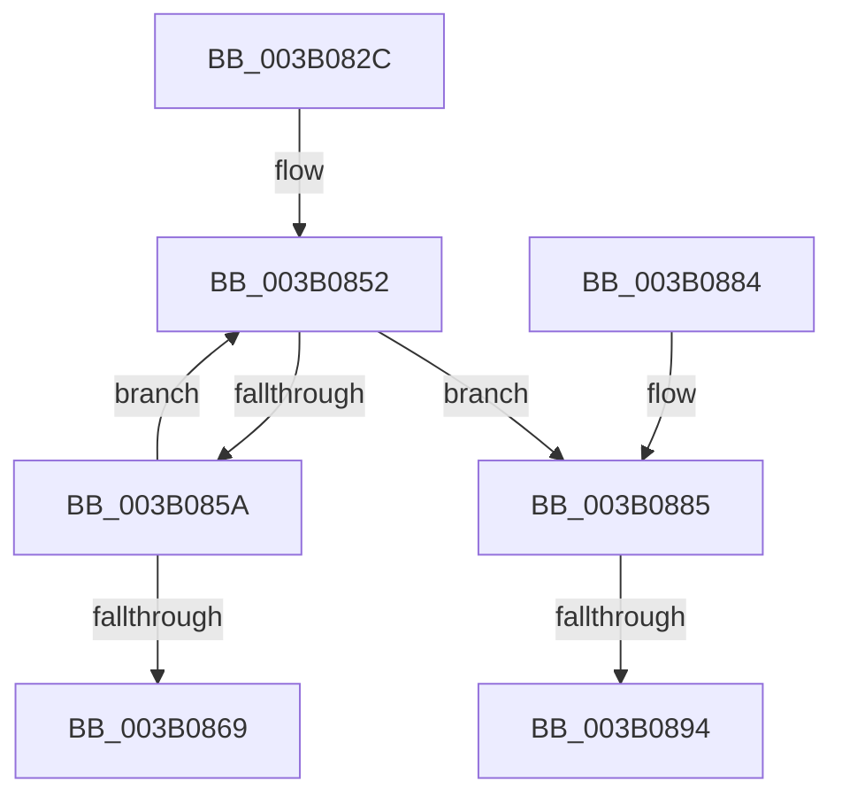

# SmFpCleanup

- RVA: `0x003B082C`–`0x003B08A8` (길이 `124` bytes)
- VA: `0x00000001403B082C`
- 실행 섹션: `.text`
- PDB 이름 있음: `예`; PDB Function 태그: `예`
- unwind 정보 RVA: `0x00071D88`
- 디코드: `36`개 명령, `124/124` bytes 표시
- 미해석 바이트: `0` (있으면 어셈블리에 `.byte`로 보존)

> 이 문서는 커널 이미지의 기계어와 PDB 기호를 분석해 생성했습니다. 4번과 5번은 함수 원형과 자료형을 바이너리 사용 방식에서 추정한 C 해석이며 원본 소스 복구 결과는 아닙니다.

## 1. Dependencies

- 직접 호출 지점: **1**; 고유 호출 대상: **1**
- 직접 호출자로 확인된 함수: **6**
- RIP 상대 이미지 참조: **0**

### Outgoing calls
- `0x003B089D` → [MmFreeMappingAddress](../../page/A7/MmFreeMappingAddress_function_00A75F20.md) (function, `0x00A75F20`)

### Direct callers
- [SMKM_STORE&lt;SM_TRAITS&gt;::SmStCleanup](SMKM_STORE_SM_TRAITS_SmStCleanup_function_003B00E0.md) at `0x003B0237`
- [SMKM_STORE&lt;SM_TRAITS&gt;::SmStStart](SMKM_STORE_SM_TRAITS_SmStStart_function_003B14DC.md) at `0x003B1678`
- [SmFpPreAllocate](../4C/SmFpPreAllocate_function_004CF32C.md) at `0x004CF49F`
- [SmFirstTimeInit](../4E/SmFirstTimeInit_function_004EA944.md) at `0x004EACEA`
- [SMKM_STORE_MGR&lt;SM_TRAITS&gt;::SmCleanup](../60/SMKM_STORE_MGR_SM_TRAITS_SmCleanup_function_0060C214.md) at `0x0060C23D`
- [SMKM_STORE_MGR&lt;SM_TRAITS&gt;::SmCleanup](../60/SMKM_STORE_MGR_SM_TRAITS_SmCleanup_function_0060C214.md) at `0x0060C249`
- [SmPartitionCleanup](../../page/7A/SmPartitionCleanup_function_007A5C14.md) at `0x007A5CA1`
- [SmPartitionCleanup](../../page/7A/SmPartitionCleanup_function_007A5C14.md) at `0x007A5CAD`

### Static image references
- 디코드된 RIP-relative 메모리 참조가 없습니다.

## 2. Other-region calls and transfers

- 다른 실행 섹션으로 향하는 call: **1**
  - `0x003B089D` → [MmFreeMappingAddress](../../page/A7/MmFreeMappingAddress_function_00A75F20.md) (`.text` → `PAGE`)
- call이 아닌 외부 분기/꼬리 이동: **2**
  - `0x003B088E` → [sub_006E7030](../6E/Unknown_function_006E7030.md) (`tail-transfer`)
  - `0x003B08A3` → [sub_006E7030 + 0x3E](../6E/Unknown_function_006E7030.md) (`tail-transfer`)

## 3. Assembly (complete function range)

```asm
003B082C  48 8B C4                        mov rax, rsp
003B082F  48 89 58 08                     mov qword ptr [rax + 8], rbx
003B0833  48 89 68 10                     mov qword ptr [rax + 0x10], rbp
003B0837  48 89 70 18                     mov qword ptr [rax + 0x18], rsi
003B083B  48 89 78 20                     mov qword ptr [rax + 0x20], rdi
003B083F  41 56                           push r14
003B0841  48 83 EC 20                     sub rsp, 0x20
003B0845  48 8B E9                        mov rbp, rcx
003B0848  4C 8D 71 60                     lea r14, [rcx + 0x60]
003B084C  33 DB                           xor ebx, ebx
003B084E  48 8D 71 28                     lea rsi, [rcx + 0x28]
003B0852  48 8B 3E                        mov rdi, qword ptr [rsi]
003B0855  48 85 FF                        test rdi, rdi
003B0858  75 2B                           jne 0x1403b0885
003B085A  FF C3                           inc ebx
003B085C  48 83 C6 08                     add rsi, 8
003B0860  49 83 C6 02                     add r14, 2
003B0864  83 FB 06                        cmp ebx, 6
003B0867  72 E9                           jb 0x1403b0852
003B0869  48 8B 5C 24 30                  mov rbx, qword ptr [rsp + 0x30]
003B086E  48 8B 6C 24 38                  mov rbp, qword ptr [rsp + 0x38]
003B0873  48 8B 74 24 40                  mov rsi, qword ptr [rsp + 0x40]
003B0878  48 8B 7C 24 48                  mov rdi, qword ptr [rsp + 0x48]
003B087D  48 83 C4 20                     add rsp, 0x20
003B0881  41 5E                           pop r14
003B0883  C3                              ret
003B0884  CC                              int3
003B0885  48 8B 07                        mov rax, qword ptr [rdi]
003B0888  48 89 06                        mov qword ptr [rsi], rax
003B088B  83 FB 05                        cmp ebx, 5
003B088E  0F 82 9C 67 33 00               jb 0x1406e7030
003B0894  48 8B 4F 08                     mov rcx, qword ptr [rdi + 8]
003B0898  BA 73 6D 52 6D                  mov edx, 0x6d526d73
003B089D  E8 7E 56 6C 00                  call 0x140a75f20
003B08A2  90                              nop
003B08A3  E9 C6 67 33 00                  jmp 0x1406e706e
```

## 4. C-style interpretation (structured pseudocode)

```c
__int64 __fastcall SmFpCleanup(__int64 a1)
{
    __int64 result;
    __int64 v_r14;
    __int64 v_rbx;
    __int64 v_rsi;
    __int64 v_rsp;
    unsigned __int64 v_stack_p10;
    unsigned __int64 v_stack_p18;
    unsigned __int64 v_stack_p20;
    unsigned __int64 v_stack_p8;

    *(unsigned __int64 *)(v_rsp + 8) = v_rbx;
    *(unsigned __int64 *)(v_rsp + 16) = v_rbp;
    *(unsigned __int64 *)(v_rsp + 24) = v_rsi;
    *(unsigned __int64 *)(v_rsp + 32) = v_rdi;
    v_rsp = (v_rsp) - (32);
    v_rbx = 0;
loc_003B0852:
    if (*(unsigned __int64 *)(a1 + 40) != 0) goto loc_003B0885;
    v_rbx = (unsigned int)((v_rbx) + 1);
    v_rsi = (a1 + 40) + (8);
    v_r14 = (a1 + 96) + (2);
    if (((unsigned int)(v_rbx)) < 6) goto loc_003B0852;
    v_rsp = (v_rsp) + (32);
    return v_rsp;
loc_003B0885:
    *(unsigned __int64 *)(v_stack_p18) = *(unsigned __int64 *)(v_stack_p20);
    result = MmFreeMappingAddress(*(unsigned __int64 *)(v_stack_p20 + 8), (unsigned int)(0x6D526D73ULL), a3, a4);
}
```

## 5. (Beta) C Style

```c
int64_t SmFpCleanup(void *Arg1)
{
    uint8_t *arg1 = (uint8_t *)Arg1;

    int64_t result;
    int64_t local_r14;
    int64_t local_rbx;
    int64_t local_rsi;
    int64_t local_rsp;
    uint64_t v_stack_p10;
    uint64_t v_stack_p18;
    uint64_t v_stack_p20;
    uint64_t v_stack_p8;

    *(uint64_t *)(local_rsp + 0x8) = local_rbx;
    *(uint64_t *)(local_rsp + 0x10) = local_rbp;
    *(uint64_t *)(local_rsp + 0x18) = local_rsi;
    *(uint64_t *)(local_rsp + 0x20) = local_rdi;
    local_rsp = (local_rsp) - (32);
    local_rbx = 0;
loc_003B0852:
    if (*(uint64_t *)(arg1 + 0x28) != 0) goto loc_003B0885;
    local_rbx = (uint32_t)((local_rbx) + 1);
    local_rsi = (Arg1 + 40) + (8);
    local_r14 = (Arg1 + 96) + (2);
    if (((uint32_t)(local_rbx)) < 6) goto loc_003B0852;
    local_rsp = (local_rsp) + (32);
    return local_rsp;
loc_003B0885:
    *(uint64_t *)(v_stack_p18) = *(uint64_t *)(v_stack_p20);
    result = MmFreeMappingAddress(*(uint64_t *)(v_stack_p20 + 0x8), (uint32_t)(0x6D526D73ULL), a3, a4);
}
```

### 관측된 메모리 오프셋

구조체 형식이 확인되지 않은 접근은 인자 기준의 오프셋으로만 기록했습니다.

| 기준 인자 | 오프셋 표현 | 폭 (bit) | 접근 |
|---|---:|---:|---|
| `Arg1` | `+ 0x0` | `64` | `R` |
| `Arg1` | `+ 0x0` | `64` | `W` |
| `Arg1` | `+ 0x28` | `64` | `R` |
| `Arg1` | `+ 0x60` | `64` | `R` |

## 6. Execution-region graph

[열기: 2D/3D 그래프와 함수 탐색 컨트롤 패널](../../../control-panel.html?section=text&rva=0x003B082C&view=graph)

- 2D 그래프는 위에서 아래로 흐르고, 3D 그래프는 빈 공간을 드래그해 회전합니다. Shift+드래그는 이동, 휠은 확대·축소, 함수 노드 선택은 대상 보고서 이동입니다.

### Static fallback


