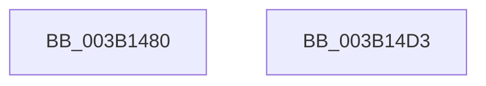

# SmHpBufferCleanup

- RVA: `0x003B1480`–`0x003B14D4` (길이 `84` bytes)
- VA: `0x00000001403B1480`
- 실행 섹션: `.text`
- PDB 이름 있음: `예`; PDB Function 태그: `아니요`
- unwind 정보 RVA: `0x00060BC4`
- 디코드: `23`개 명령, `84/84` bytes 표시
- 미해석 바이트: `0` (있으면 어셈블리에 `.byte`로 보존)

> 이 문서는 커널 이미지의 기계어와 PDB 기호를 분석해 생성했습니다. 4번과 5번은 함수 원형과 자료형을 바이너리 사용 방식에서 추정한 C 해석이며 원본 소스 복구 결과는 아닙니다.

## 1. Dependencies

- 직접 호출 지점: **2**; 고유 호출 대상: **2**
- 직접 호출자로 확인된 함수: **2**
- RIP 상대 이미지 참조: **0**

### Outgoing calls
- `0x003B149E` → [SmHpBufferUpdateFullness](../26/SmHpBufferUpdateFullness_function_002690B0.md) (function, `0x002690B0`)
- `0x003B14AB` → [ExFreePoolWithTag](../../poolcode/B8/ExFreePoolWithTag_function_00B82870.md) (function, `0x00B82870`)

### Direct callers
- [sub_00268EBD](../26/Unknown_function_00268EBD.md) at `0x00268F16`
- [SmHpChunkHeapCleanup](../3A/SmHpChunkHeapCleanup_function_003AFD08.md) at `0x003AFD75`

### Static image references
- 디코드된 RIP-relative 메모리 참조가 없습니다.

## 2. Other-region calls and transfers

- 다른 실행 섹션으로 향하는 call: **1**
  - `0x003B14AB` → [ExFreePoolWithTag](../../poolcode/B8/ExFreePoolWithTag_function_00B82870.md) (`.text` → `POOLCODE`)
- 별도 외부 분기/꼬리 이동을 확인하지 못했습니다.

## 3. Assembly (complete function range)

```asm
003B1480  48 89 5C 24 08                  mov qword ptr [rsp + 8], rbx
003B1485  48 89 74 24 10                  mov qword ptr [rsp + 0x10], rsi
003B148A  57                              push rdi
003B148B  48 83 EC 20                     sub rsp, 0x20
003B148F  44 0F B7 42 0A                  movzx r8d, word ptr [rdx + 0xa]
003B1494  48 8B FA                        mov rdi, rdx
003B1497  66 41 F7 D8                     neg r8w
003B149B  48 8B F1                        mov rsi, rcx
003B149E  E8 0D 7C EB FF                  call 0x1402690b0
003B14A3  48 8B 0F                        mov rcx, qword ptr [rdi]
003B14A6  33 D2                           xor edx, edx
003B14A8  8B 59 10                        mov ebx, dword ptr [rcx + 0x10]
003B14AB  E8 C0 13 7D 00                  call 0x140b82870
003B14B0  48 83 27 00                     and qword ptr [rdi], 0
003B14B4  8B 86 20 02 00 00               mov eax, dword ptr [rsi + 0x220]
003B14BA  89 47 08                        mov dword ptr [rdi + 8], eax
003B14BD  89 9E 20 02 00 00               mov dword ptr [rsi + 0x220], ebx
003B14C3  48 8B 5C 24 30                  mov rbx, qword ptr [rsp + 0x30]
003B14C8  48 8B 74 24 38                  mov rsi, qword ptr [rsp + 0x38]
003B14CD  48 83 C4 20                     add rsp, 0x20
003B14D1  5F                              pop rdi
003B14D2  C3                              ret
003B14D3  CC                              int3
```

## 4. C-style interpretation (structured pseudocode)

```c
__int64 __fastcall SmHpBufferCleanup(__int64 a1, __int64 a2)
{
    __int64 result;
    __int64 v_rsp;
    unsigned __int64 v_stack_p10;
    unsigned __int64 v_stack_p8;

    v_stack_p8 = v_rbx;
    v_stack_p10 = v_rsi;
    v_rsp = (v_rsp) - (32);
    a3 = (unsigned __int16)(-(*(unsigned __int16 *)(a2 + 10)));
    result = SmHpBufferUpdateFullness(a1, a2, a3, a4);
    a2 = 0;
    result = ExFreePoolWithTag(*(unsigned __int64 *)(a2), a2, a3, a4);
    *(unsigned int *)(a2 + 8) = (unsigned int)((unsigned int)(*(unsigned int *)(a1 + 544)));
    *(unsigned int *)(a1 + 544) = (unsigned int)((unsigned int)(*(unsigned int *)(*(unsigned __int64 *)(a2) + 16)));
    v_rsp = (v_rsp) + (32);
    return (unsigned int)(*(unsigned int *)(a1 + 544));
}
```

## 5. (Beta) C Style

```c
int64_t SmHpBufferCleanup(void *Arg1, void *Arg2)
{
    uint8_t *arg1 = (uint8_t *)Arg1;
    uint8_t *arg2 = (uint8_t *)Arg2;

    int64_t result;
    int64_t local_rsp;
    uint64_t v_stack_p10;
    uint64_t v_stack_p8;

    v_stack_p8 = local_rbx;
    v_stack_p10 = local_rsi;
    local_rsp = (local_rsp) - (32);
    a3 = (uint16_t)(-(*(uint16_t *)(arg2 + 0xA)));
    result = SmHpBufferUpdateFullness(Arg1, Arg2, a3, a4);
    Arg2 = 0;
    result = ExFreePoolWithTag(*(uint64_t *)(arg2), Arg2, a3, a4);
    *(uint32_t *)(arg2 + 0x8) = (uint32_t)((uint32_t)(*(uint32_t *)(arg1 + 0x220)));
    *(uint32_t *)(arg1 + 0x220) = (uint32_t)((uint32_t)(*(uint32_t *)(*(uint64_t *)(arg2) + 0x10)));
    local_rsp = (local_rsp) + (32);
    return (uint32_t)(*(uint32_t *)(arg1 + 0x220));
}
```

### 관측된 메모리 오프셋

구조체 형식이 확인되지 않은 접근은 인자 기준의 오프셋으로만 기록했습니다.

| 기준 인자 | 오프셋 표현 | 폭 (bit) | 접근 |
|---|---:|---:|---|
| `Arg1` | `+ 0x220` | `32` | `R` |
| `Arg1` | `+ 0x220` | `32` | `W` |
| `Arg2` | `+ 0x0` | `64` | `R` |
| `Arg2` | `+ 0x0` | `64` | `R/W` |
| `Arg2` | `+ 0x8` | `32` | `W` |
| `Arg2` | `+ 0xA` | `16` | `R` |

## 6. Execution-region graph

[열기: 2D/3D 그래프와 함수 탐색 컨트롤 패널](../../../control-panel.html?section=text&rva=0x003B1480&view=graph)

- 2D 그래프는 위에서 아래로 흐르고, 3D 그래프는 빈 공간을 드래그해 회전합니다. Shift+드래그는 이동, 휠은 확대·축소, 함수 노드 선택은 대상 보고서 이동입니다.

### Static fallback


