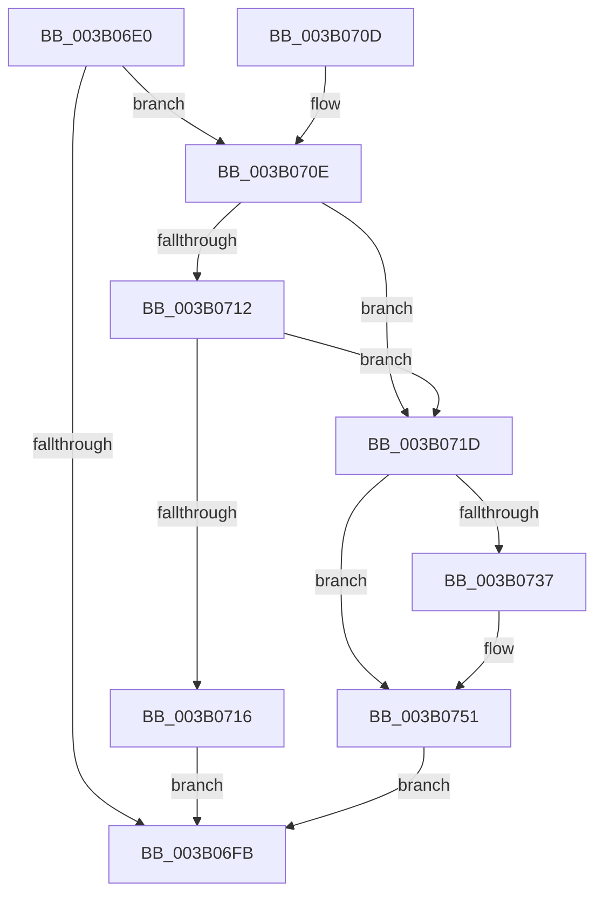

# SmKmStoreHelperCheckWaitCommand

- RVA: `0x003B06E0`–`0x003B0755` (길이 `117` bytes)
- VA: `0x00000001403B06E0`
- 실행 섹션: `.text`
- PDB 이름 있음: `예`; PDB Function 태그: `아니요`
- unwind 정보 RVA: `0x0008C22C`
- 디코드: `40`개 명령, `117/117` bytes 표시
- 미해석 바이트: `0` (있으면 어셈블리에 `.byte`로 보존)

> 이 문서는 커널 이미지의 기계어와 PDB 기호를 분석해 생성했습니다. 4번과 5번은 함수 원형과 자료형을 바이너리 사용 방식에서 추정한 C 해석이며 원본 소스 복구 결과는 아닙니다.

## 1. Dependencies

- 직접 호출 지점: **2**; 고유 호출 대상: **2**
- 직접 호출자로 확인된 함수: **4**
- RIP 상대 이미지 참조: **0**

### Outgoing calls
- `0x003B072E` → [KeWaitForSingleObject](../20/KeWaitForSingleObject_function_0020E6B0.md) (function, `0x0020E6B0`)
- `0x003B073B` → [KeResetEvent](../24/KeResetEvent_function_00248350.md) (function, `0x00248350`)

### Direct callers
- [SMKM_STORE&lt;SM_TRAITS&gt;::SmStCleanup](SMKM_STORE_SM_TRAITS_SmStCleanup_function_003B00E0.md) at `0x003B017C`
- [SMKM_STORE&lt;SM_TRAITS&gt;::SmStHelperSendCommand](SMKM_STORE_SM_TRAITS_SmStHelperSendCommand_function_003B0530.md) at `0x003B057E`
- [SmKmStoreHelperSendCommand](SmKmStoreHelperSendCommand_function_003B0658.md) at `0x003B0677`
- [SMKM_STORE&lt;SM_TRAITS&gt;::SmStCheckLockInProgressRegionComplete](SMKM_STORE_SM_TRAITS_SmStCheckLockInProgressRegionComplete_function_003B1B74.md) at `0x003B1B9C`

### Static image references
- 디코드된 RIP-relative 메모리 참조가 없습니다.

## 2. Other-region calls and transfers

- 다른 실행 섹션으로 향하는 call: **0**
- 별도 외부 분기/꼬리 이동을 확인하지 못했습니다.

## 3. Assembly (complete function range)

```asm
003B06E0  48 89 5C 24 08                  mov qword ptr [rsp + 8], rbx
003B06E5  48 89 74 24 10                  mov qword ptr [rsp + 0x10], rsi
003B06EA  57                              push rdi
003B06EB  48 83 EC 30                     sub rsp, 0x30
003B06EF  8B 41 38                        mov eax, dword ptr [rcx + 0x38]
003B06F2  33 DB                           xor ebx, ebx
003B06F4  48 8B F9                        mov rdi, rcx
003B06F7  85 C0                           test eax, eax
003B06F9  75 13                           jne 0x1403b070e
003B06FB  48 8B 74 24 48                  mov rsi, qword ptr [rsp + 0x48]
003B0700  8B C3                           mov eax, ebx
003B0702  48 8B 5C 24 40                  mov rbx, qword ptr [rsp + 0x40]
003B0707  48 83 C4 30                     add rsp, 0x30
003B070B  5F                              pop rdi
003B070C  C3                              ret
003B070D  CC                              int3
003B070E  85 D2                           test edx, edx
003B0710  75 0B                           jne 0x1403b071d
003B0712  A8 01                           test al, 1
003B0714  75 07                           jne 0x1403b071d
003B0716  BB AE 00 00 C0                  mov ebx, 0xc00000ae
003B071B  EB DE                           jmp 0x1403b06fb
003B071D  45 33 C9                        xor r9d, r9d
003B0720  48 89 5C 24 20                  mov qword ptr [rsp + 0x20], rbx
003B0725  45 33 C0                        xor r8d, r8d
003B0728  33 D2                           xor edx, edx
003B072A  48 83 C1 20                     add rcx, 0x20
003B072E  E8 7D DF E5 FF                  call 0x14020e6b0
003B0733  85 C0                           test eax, eax
003B0735  75 1A                           jne 0x1403b0751
003B0737  48 8D 4F 20                     lea rcx, [rdi + 0x20]
003B073B  E8 10 7C E9 FF                  call 0x140248350
003B0740  8B 47 38                        mov eax, dword ptr [rdi + 0x38]
003B0743  24 02                           and al, 2
003B0745  89 5F 38                        mov dword ptr [rdi + 0x38], ebx
003B0748  F6 D8                           neg al
003B074A  1B C0                           sbb eax, eax
003B074C  25 20 01 00 C0                  and eax, 0xc0000120
003B0751  8B D8                           mov ebx, eax
003B0753  EB A6                           jmp 0x1403b06fb
```

## 4. C-style interpretation (structured pseudocode)

```c
__int64 __fastcall SmKmStoreHelperCheckWaitCommand(__int64 a1, int a2, int a3, int a4)
{
    __int64 result;
    __int64 v_rbx;
    __int64 v_rsp;
    unsigned __int64 v_stack_p10;
    unsigned __int64 v_stack_p20;
    unsigned __int64 v_stack_p8;

    v_stack_p8 = v_rbx;
    v_stack_p10 = v_rsi;
    v_rsp = (v_rsp) - (48);
    v_rbx = 0;
    if ((unsigned int)((unsigned int)(*(unsigned int *)(a1 + 56))) != 0) goto loc_003B070E;
loc_003B06FB:
    v_rsp = (v_rsp) + (48);
    return 0;
loc_003B070E:
    if (a2 != 0) goto loc_003B071D;
    if (((0) & (1)) != 0) goto loc_003B071D;
    goto loc_003B06FB;
loc_003B071D:
    a4 = 0;
    v_stack_p20 = (unsigned int)(0xC00000AEULL);
    a3 = 0;
    a2 = 0;
    a1 = (a1) + (32);
    result = KeWaitForSingleObject(a1, a2, a3, a4);
    if ((unsigned int)(result) == 0) {
        a1 = a1 + 32;
        result = KeResetEvent(a1, a2, a3, a4);
        result = *(unsigned int *)(a1 + 56);
        result = (unsigned __int8)((result) & (2));
        *(unsigned int *)(a1 + 56) = (unsigned int)((unsigned int)(0xC00000AEULL));
        result = (unsigned __int8)(-(result));
        result = (unsigned int)((result) & (0xC0000120ULL));
    }
    goto loc_003B06FB;
}
```

## 5. (Beta) C Style

```c
int64_t SmKmStoreHelperCheckWaitCommand(void *Arg1, int32_t Arg2, int32_t Arg3, int32_t Arg4)
{
    uint8_t *arg1 = (uint8_t *)Arg1;

    int64_t result;
    int64_t local_rbx;
    int64_t local_rsp;
    uint64_t v_stack_p10;
    uint64_t v_stack_p20;
    uint64_t v_stack_p8;

    v_stack_p8 = local_rbx;
    v_stack_p10 = local_rsi;
    local_rsp = (local_rsp) - (48);
    local_rbx = 0;
    if ((uint32_t)((uint32_t)(*(uint32_t *)(arg1 + 0x38))) != 0) goto loc_003B070E;
loc_003B06FB:
    local_rsp = (local_rsp) + (48);
    return 0;
loc_003B070E:
    if (Arg2 != 0) goto loc_003B071D;
    if (((0) & (1)) != 0) goto loc_003B071D;
    goto loc_003B06FB;
loc_003B071D:
    Arg4 = 0;
    v_stack_p20 = (uint32_t)(0xC00000AEULL);
    Arg3 = 0;
    Arg2 = 0;
    Arg1 = (Arg1) + (32);
    result = KeWaitForSingleObject(Arg1, Arg2, Arg3, Arg4);
    if ((uint32_t)(result) == 0) {
        Arg1 = Arg1 + 32;
        result = KeResetEvent(Arg1, Arg2, Arg3, Arg4);
        result = *(uint32_t *)(arg1 + 0x38);
        result = (uint8_t)((result) & (2));
        *(uint32_t *)(arg1 + 0x38) = (uint32_t)((uint32_t)(0xC00000AEULL));
        result = (uint8_t)(-(result));
        result = (uint32_t)((result) & (0xC0000120ULL));
    }
    goto loc_003B06FB;
}
```

### 관측된 메모리 오프셋

구조체 형식이 확인되지 않은 접근은 인자 기준의 오프셋으로만 기록했습니다.

| 기준 인자 | 오프셋 표현 | 폭 (bit) | 접근 |
|---|---:|---:|---|
| `Arg1` | `+ 0x20` | `64` | `R` |
| `Arg1` | `+ 0x38` | `32` | `R` |
| `Arg1` | `+ 0x38` | `32` | `W` |

## 6. Execution-region graph

[열기: 2D/3D 그래프와 함수 탐색 컨트롤 패널](../../../control-panel.html?section=text&rva=0x003B06E0&view=graph)

- 2D 그래프는 위에서 아래로 흐르고, 3D 그래프는 빈 공간을 드래그해 회전합니다. Shift+드래그는 이동, 휠은 확대·축소, 함수 노드 선택은 대상 보고서 이동입니다.

### Static fallback


