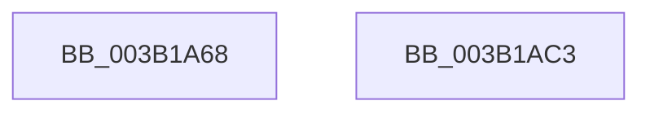

# SmKmStoreHelperInitialize

- RVA: `0x003B1A68`–`0x003B1AC4` (길이 `92` bytes)
- VA: `0x00000001403B1A68`
- 실행 섹션: `.text`
- PDB 이름 있음: `예`; PDB Function 태그: `아니요`
- unwind 정보 RVA: `0x0005CAAC`
- 디코드: `26`개 명령, `92/92` bytes 표시
- 미해석 바이트: `0` (있으면 어셈블리에 `.byte`로 보존)

> 이 문서는 커널 이미지의 기계어와 PDB 기호를 분석해 생성했습니다. 4번과 5번은 함수 원형과 자료형을 바이너리 사용 방식에서 추정한 C 해석이며 원본 소스 복구 결과는 아닙니다.

## 1. Dependencies

- 직접 호출 지점: **1**; 고유 호출 대상: **1**
- 직접 호출자로 확인된 함수: **1**
- RIP 상대 이미지 참조: **0**

### Outgoing calls
- `0x003B1A80` → [memset](../6C/memset_function_006C6C40.md) (function, `0x006C6C40`)

### Direct callers
- [SMKM_STORE&lt;SM_TRAITS&gt;::SmStStart](SMKM_STORE_SM_TRAITS_SmStStart_function_003B14DC.md) at `0x003B16D3`
- [SMKM_STORE&lt;SM_TRAITS&gt;::SmStStart](SMKM_STORE_SM_TRAITS_SmStStart_function_003B14DC.md) at `0x003B16E6`

### Static image references
- 디코드된 RIP-relative 메모리 참조가 없습니다.

## 2. Other-region calls and transfers

- 다른 실행 섹션으로 향하는 call: **0**
- 별도 외부 분기/꼬리 이동을 확인하지 못했습니다.

## 3. Assembly (complete function range)

```asm
003B1A68  48 89 5C 24 08                  mov qword ptr [rsp + 8], rbx
003B1A6D  57                              push rdi
003B1A6E  48 83 EC 20                     sub rsp, 0x20
003B1A72  40 8A FA                        mov dil, dl
003B1A75  41 B8 90 00 00 00               mov r8d, 0x90
003B1A7B  33 D2                           xor edx, edx
003B1A7D  48 8B D9                        mov rbx, rcx
003B1A80  E8 BB 51 31 00                  call 0x1406c6c40
003B1A85  66 C7 43 09 00 06               mov word ptr [rbx + 9], 0x600
003B1A8B  48 8D 43 10                     lea rax, [rbx + 0x10]
003B1A8F  33 C9                           xor ecx, ecx
003B1A91  89 4B 0C                        mov dword ptr [rbx + 0xc], ecx
003B1A94  48 89 40 08                     mov qword ptr [rax + 8], rax
003B1A98  48 89 00                        mov qword ptr [rax], rax
003B1A9B  48 8D 43 28                     lea rax, [rbx + 0x28]
003B1A9F  66 89 4B 20                     mov word ptr [rbx + 0x20], cx
003B1AA3  C6 43 22 06                     mov byte ptr [rbx + 0x22], 6
003B1AA7  89 4B 24                        mov dword ptr [rbx + 0x24], ecx
003B1AAA  48 89 40 08                     mov qword ptr [rax + 8], rax
003B1AAE  48 89 00                        mov qword ptr [rax], rax
003B1AB1  40 88 BB 88 00 00 00            mov byte ptr [rbx + 0x88], dil
003B1AB8  48 8B 5C 24 30                  mov rbx, qword ptr [rsp + 0x30]
003B1ABD  48 83 C4 20                     add rsp, 0x20
003B1AC1  5F                              pop rdi
003B1AC2  C3                              ret
003B1AC3  CC                              int3
```

## 4. C-style interpretation (structured pseudocode)

```c
__int64 __fastcall SmKmStoreHelperInitialize(__int64 a1, int a2)
{
    __int64 result;
    __int64 v_rsp;
    unsigned __int64 v_stack_p8;

    v_stack_p8 = v_rbx;
    v_rsp = (v_rsp) - (32);
    a2 = 0;
    result = memset(a1, a2, 144, a4);
    *(unsigned __int16 *)(a1 + 9) = 0x600ULL;
    a1 = 0;
    *(unsigned int *)(a1 + 12) = 0;
    *(unsigned __int64 *)(a1 + 16 + 8) = a1 + 16;
    *(unsigned __int64 *)(a1 + 16) = a1 + 16;
    *(unsigned __int16 *)(a1 + 32) = 0;
    *(unsigned __int8 *)(a1 + 34) = 6;
    *(unsigned int *)(a1 + 36) = 0;
    *(unsigned __int64 *)(a1 + 40 + 8) = a1 + 40;
    *(unsigned __int64 *)(a1 + 40) = a1 + 40;
    *(unsigned __int8 *)(a1 + 136) = (unsigned __int8)((unsigned __int8)(a2));
    v_rsp = (v_rsp) + (32);
    return a1 + 40;
}
```

## 5. (Beta) C Style

```c
void *SmKmStoreHelperInitialize(void *Arg1, int32_t Arg2)
{
    uint8_t *arg1 = (uint8_t *)Arg1;

    int64_t result;
    int64_t local_rsp;
    uint64_t v_stack_p8;

    v_stack_p8 = local_rbx;
    local_rsp = (local_rsp) - (32);
    Arg2 = 0;
    result = memset(Arg1, Arg2, 144, a4);
    *(uint16_t *)(arg1 + 0x9) = 0x600ULL;
    Arg1 = 0;
    *(uint32_t *)(arg1 + 0xC) = 0;
    *(void **)(arg1 + 0x10 + 0x8) = Arg1 + 16;
    *(void **)(arg1 + 0x10) = Arg1 + 16;
    *(uint16_t *)(arg1 + 0x20) = 0;
    *(uint8_t *)(arg1 + 0x22) = 6;
    *(uint32_t *)(arg1 + 0x24) = 0;
    *(void **)(arg1 + 0x28 + 0x8) = Arg1 + 40;
    *(void **)(arg1 + 0x28) = Arg1 + 40;
    *(uint8_t *)(arg1 + 0x88) = (uint8_t)((uint8_t)(Arg2));
    local_rsp = (local_rsp) + (32);
    return Arg1 + 40;
}
```

### 관측된 메모리 오프셋

구조체 형식이 확인되지 않은 접근은 인자 기준의 오프셋으로만 기록했습니다.

| 기준 인자 | 오프셋 표현 | 폭 (bit) | 접근 |
|---|---:|---:|---|
| `Arg1` | `+ 0x0` | `64` | `W` |
| `Arg1` | `+ 0x8` | `64` | `W` |
| `Arg1` | `+ 0x9` | `16` | `W` |
| `Arg1` | `+ 0xC` | `32` | `W` |
| `Arg1` | `+ 0x10` | `64` | `R` |
| `Arg1` | `+ 0x20` | `16` | `W` |
| `Arg1` | `+ 0x22` | `8` | `W` |
| `Arg1` | `+ 0x24` | `32` | `W` |
| `Arg1` | `+ 0x28` | `64` | `R` |
| `Arg1` | `+ 0x88` | `8` | `W` |

## 6. Execution-region graph

[열기: 2D/3D 그래프와 함수 탐색 컨트롤 패널](../../../control-panel.html?section=text&rva=0x003B1A68&view=graph)

- 2D 그래프는 위에서 아래로 흐르고, 3D 그래프는 빈 공간을 드래그해 회전합니다. Shift+드래그는 이동, 휠은 확대·축소, 함수 노드 선택은 대상 보고서 이동입니다.

### Static fallback


