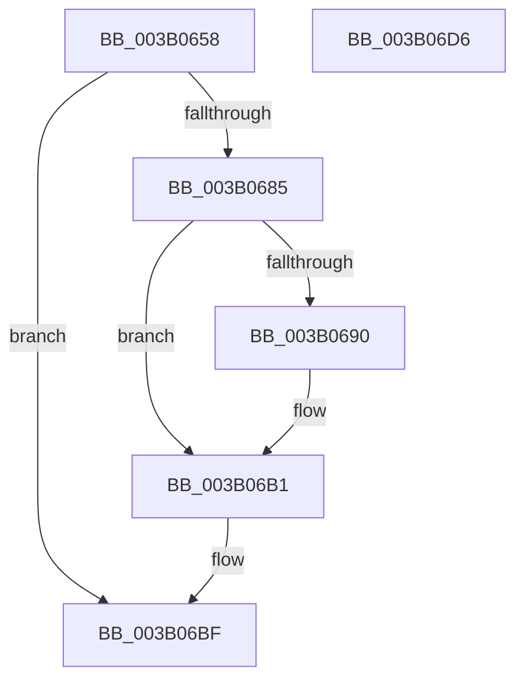

# SmKmStoreHelperSendCommand

- RVA: `0x003B0658`–`0x003B06D7` (길이 `127` bytes)
- VA: `0x00000001403B0658`
- 실행 섹션: `.text`
- PDB 이름 있음: `예`; PDB Function 태그: `아니요`
- unwind 정보 RVA: `0x0005C954`
- 디코드: `37`개 명령, `127/127` bytes 표시
- 미해석 바이트: `0` (있으면 어셈블리에 `.byte`로 보존)

> 이 문서는 커널 이미지의 기계어와 PDB 기호를 분석해 생성했습니다. 4번과 5번은 함수 원형과 자료형을 바이너리 사용 방식에서 추정한 C 해석이며 원본 소스 복구 결과는 아닙니다.

## 1. Dependencies

- 직접 호출 지점: **2**; 고유 호출 대상: **2**
- 직접 호출자로 확인된 함수: **1**
- RIP 상대 이미지 참조: **0**

### Outgoing calls
- `0x003B0677` → [SmKmStoreHelperCheckWaitCommand](SmKmStoreHelperCheckWaitCommand_function_003B06E0.md) (function, `0x003B06E0`)
- `0x003B06BA` → [KeSetEvent](../33/KeSetEvent_function_0033F310.md) (function, `0x0033F310`)

### Direct callers
- [SmKmStoreHelperCleanup](../3A/SmKmStoreHelperCleanup_function_003AFFE8.md) at `0x003B0002`

### Static image references
- 디코드된 RIP-relative 메모리 참조가 없습니다.

## 2. Other-region calls and transfers

- 다른 실행 섹션으로 향하는 call: **0**
- 별도 외부 분기/꼬리 이동을 확인하지 못했습니다.

## 3. Assembly (complete function range)

```asm
003B0658  48 89 5C 24 08                  mov qword ptr [rsp + 8], rbx
003B065D  48 89 6C 24 10                  mov qword ptr [rsp + 0x10], rbp
003B0662  48 89 74 24 18                  mov qword ptr [rsp + 0x18], rsi
003B0667  57                              push rdi
003B0668  48 83 EC 20                     sub rsp, 0x20
003B066C  8B EA                           mov ebp, edx
003B066E  49 8B F0                        mov rsi, r8
003B0671  41 8B D1                        mov edx, r9d
003B0674  48 8B D9                        mov rbx, rcx
003B0677  E8 64 00 00 00                  call 0x1403b06e0
003B067C  8B F8                           mov edi, eax
003B067E  3D AE 00 00 C0                  cmp eax, 0xc00000ae
003B0683  74 3A                           je 0x1403b06bf
003B0685  33 FF                           xor edi, edi
003B0687  66 89 6B 3A                     mov word ptr [rbx + 0x3a], bp
003B068B  48 85 F6                        test rsi, rsi
003B068E  74 21                           je 0x1403b06b1
003B0690  0F 10 06                        movups xmm0, xmmword ptr [rsi]
003B0693  0F 11 43 40                     movups xmmword ptr [rbx + 0x40], xmm0
003B0697  0F 10 4E 10                     movups xmm1, xmmword ptr [rsi + 0x10]
003B069B  0F 11 4B 50                     movups xmmword ptr [rbx + 0x50], xmm1
003B069F  0F 10 46 20                     movups xmm0, xmmword ptr [rsi + 0x20]
003B06A3  0F 11 43 60                     movups xmmword ptr [rbx + 0x60], xmm0
003B06A7  F2 0F 10 4E 30                  movsd xmm1, qword ptr [rsi + 0x30]
003B06AC  F2 0F 11 4B 70                  movsd qword ptr [rbx + 0x70], xmm1
003B06B1  48 8D 4B 08                     lea rcx, [rbx + 8]
003B06B5  45 33 C0                        xor r8d, r8d
003B06B8  33 D2                           xor edx, edx
003B06BA  E8 51 EC F8 FF                  call 0x14033f310
003B06BF  48 8B 5C 24 30                  mov rbx, qword ptr [rsp + 0x30]
003B06C4  8B C7                           mov eax, edi
003B06C6  48 8B 6C 24 38                  mov rbp, qword ptr [rsp + 0x38]
003B06CB  48 8B 74 24 40                  mov rsi, qword ptr [rsp + 0x40]
003B06D0  48 83 C4 20                     add rsp, 0x20
003B06D4  5F                              pop rdi
003B06D5  C3                              ret
003B06D6  CC                              int3
```

## 4. C-style interpretation (structured pseudocode)

```c
__int64 __fastcall SmKmStoreHelperSendCommand(__int64 a1, int a2, __int64 a3, int a4)
{
    __int64 result;
    __int64 v_rdi;
    __int64 v_rsp;
    unsigned __int64 v_stack_p10;
    unsigned __int64 v_stack_p18;
    unsigned __int64 v_stack_p8;

    v_stack_p8 = v_rbx;
    v_stack_p10 = v_rbp;
    v_stack_p18 = v_rsi;
    v_rsp = (v_rsp) - (32);
    result = SmKmStoreHelperCheckWaitCommand(a1, (unsigned int)(a4), a3, a4);
    if (((unsigned int)(result)) == 0xC00000AEULL) goto loc_003B06BF;
    v_rdi = 0;
    *(unsigned __int16 *)(a1 + 58) = (unsigned __int16)((unsigned int)(a2));
    if (a3 != 0) {
        *(unsigned __int64 *)(a1 + 64) = v_xmm0;
        *(unsigned __int64 *)(a1 + 80) = v_xmm1;
        *(unsigned __int64 *)(a1 + 96) = v_xmm0;
        *(unsigned __int64 *)(a1 + 112) = v_xmm1;
    }
    a3 = 0;
    a2 = 0;
    result = KeSetEvent(a1 + 8, a2, a3, a4);
loc_003B06BF:
    v_rsp = (v_rsp) + (32);
    return 0;
}
```

## 5. (Beta) C Style

```c
int64_t SmKmStoreHelperSendCommand(void *Arg1, int32_t Arg2, int64_t Arg3, int32_t Arg4)
{
    uint8_t *arg1 = (uint8_t *)Arg1;

    int64_t result;
    int64_t local_rdi;
    int64_t local_rsp;
    uint64_t v_stack_p10;
    uint64_t v_stack_p18;
    uint64_t v_stack_p8;

    v_stack_p8 = local_rbx;
    v_stack_p10 = local_rbp;
    v_stack_p18 = local_rsi;
    local_rsp = (local_rsp) - (32);
    result = SmKmStoreHelperCheckWaitCommand(Arg1, (uint32_t)(Arg4), Arg3, Arg4);
    if (((uint32_t)(result)) == 0xC00000AEULL) goto loc_003B06BF;
    local_rdi = 0;
    *(uint16_t *)(arg1 + 0x3A) = (uint16_t)((uint32_t)(Arg2));
    if (Arg3 != 0) {
        *(uint64_t *)(arg1 + 0x40) = v_xmm0;
        *(uint64_t *)(arg1 + 0x50) = v_xmm1;
        *(uint64_t *)(arg1 + 0x60) = v_xmm0;
        *(uint64_t *)(arg1 + 0x70) = v_xmm1;
    }
    Arg3 = 0;
    Arg2 = 0;
    result = KeSetEvent(Arg1 + 8, Arg2, Arg3, Arg4);
loc_003B06BF:
    local_rsp = (local_rsp) + (32);
    return 0;
}
```

### 관측된 메모리 오프셋

구조체 형식이 확인되지 않은 접근은 인자 기준의 오프셋으로만 기록했습니다.

| 기준 인자 | 오프셋 표현 | 폭 (bit) | 접근 |
|---|---:|---:|---|
| `Arg1` | `+ 0x8` | `64` | `R` |
| `Arg1` | `+ 0x3A` | `16` | `W` |
| `Arg1` | `+ 0x40` | `128` | `R` |
| `Arg1` | `+ 0x50` | `128` | `R` |
| `Arg1` | `+ 0x60` | `128` | `R` |
| `Arg1` | `+ 0x70` | `64` | `W` |

## 6. Execution-region graph

[열기: 2D/3D 그래프와 함수 탐색 컨트롤 패널](../../../control-panel.html?section=text&rva=0x003B0658&view=graph)

- 2D 그래프는 위에서 아래로 흐르고, 3D 그래프는 빈 공간을 드래그해 회전합니다. Shift+드래그는 이동, 휠은 확대·축소, 함수 노드 선택은 대상 보고서 이동입니다.

### Static fallback


